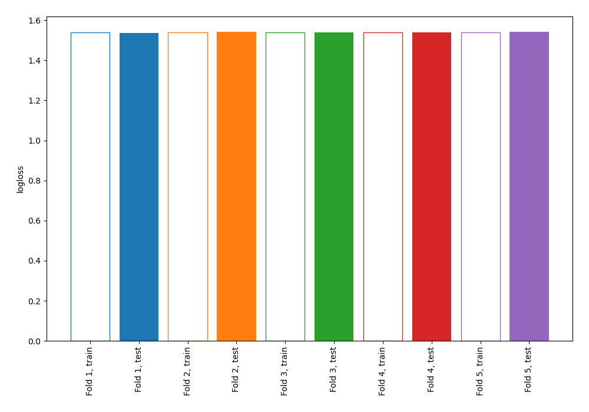
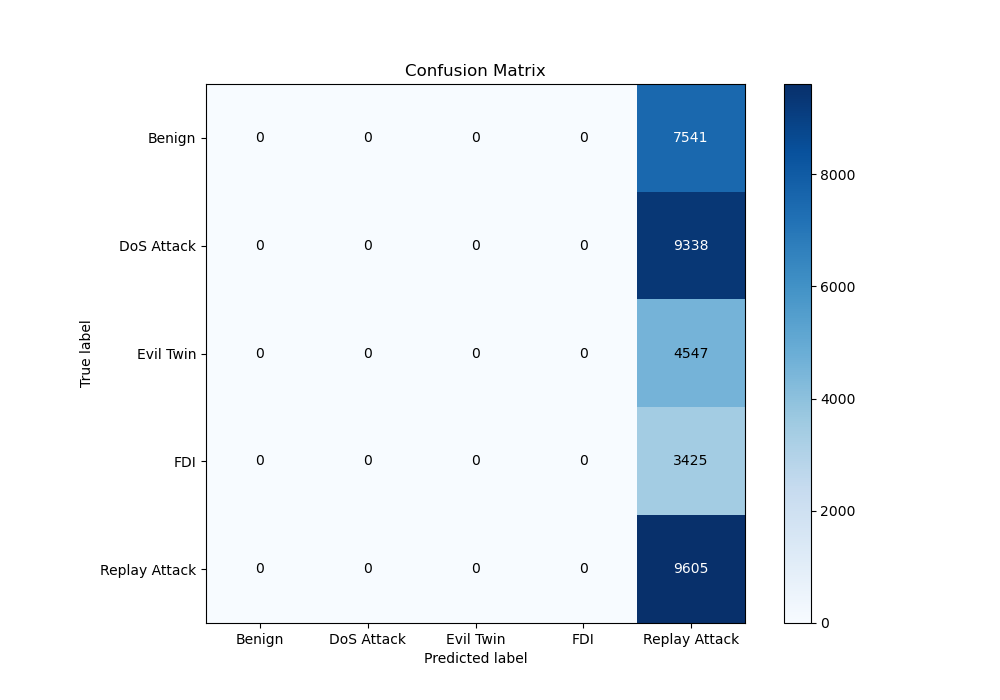
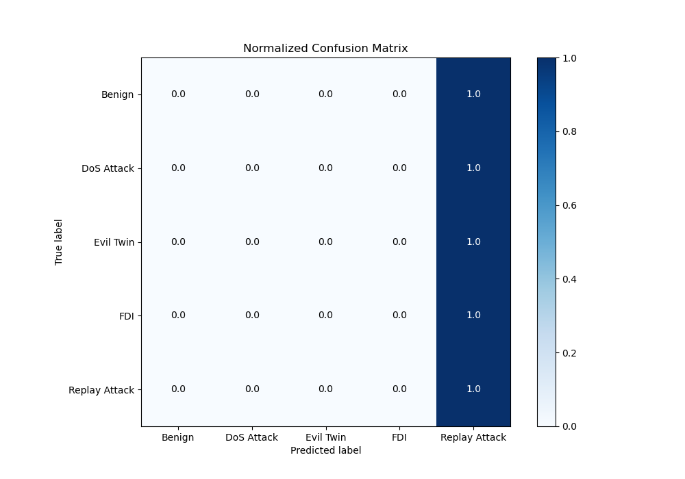
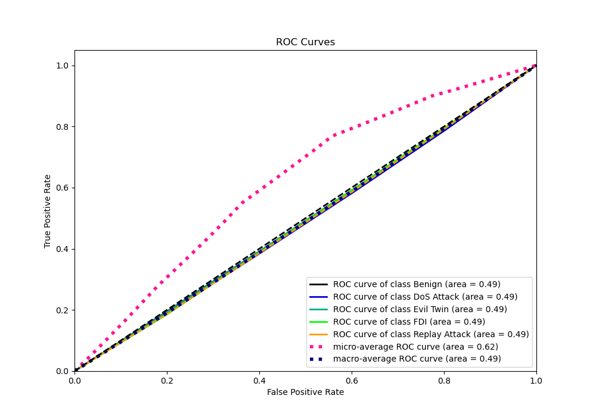
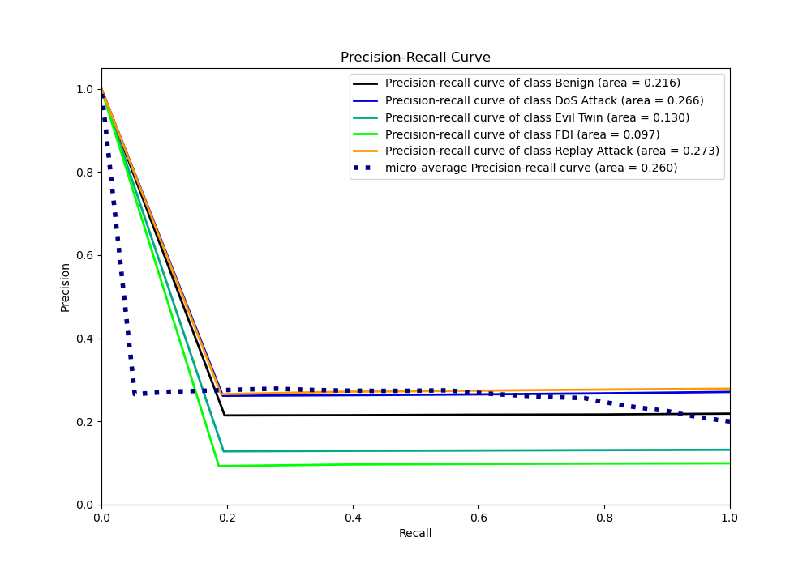

# Summary of 1_Baseline

[<< Go back](../README.md)

## Baseline Classifier (Baseline)
- **n_jobs**: -1
- **num_class**: 5
- **explain_level**: 2

## Validation
 - **validation_type**: kfold
 - **k_folds**: 5
 - **shuffle**: True
 - **random_seed**: 1082

## Optimized metric
logloss

## Training time

1.9 seconds

### Metric details
|           |   Benign |   DoS Attack |   Evil Twin |   FDI |   Replay Attack |   accuracy |     macro avg |   weighted avg |   logloss |
|:----------|---------:|-------------:|------------:|------:|----------------:|-----------:|--------------:|---------------:|----------:|
| precision |        0 |            0 |           0 |     0 |        0.278761 |   0.278761 |     0.0557523 |      0.0777079 |   1.53937 |
| recall    |        0 |            0 |           0 |     0 |        1        |   0.278761 |     0.2       |      0.278761  |   1.53937 |
| f1-score  |        0 |            0 |           0 |     0 |        0.435986 |   0.278761 |     0.0871973 |      0.121536  |   1.53937 |
| support   |     7541 |         9338 |        4547 |  3425 |     9605        |   0.278761 | 34456         |  34456         |   1.53937 |

## Confusion matrix
|                          |   Predicted as Benign |   Predicted as DoS Attack |   Predicted as Evil Twin |   Predicted as FDI |   Predicted as Replay Attack |
|:-------------------------|----------------------:|--------------------------:|-------------------------:|-------------------:|-----------------------------:|
| Labeled as Benign        |                     0 |                         0 |                        0 |                  0 |                         7541 |
| Labeled as DoS Attack    |                     0 |                         0 |                        0 |                  0 |                         9338 |
| Labeled as Evil Twin     |                     0 |                         0 |                        0 |                  0 |                         4547 |
| Labeled as FDI           |                     0 |                         0 |                        0 |                  0 |                         3425 |
| Labeled as Replay Attack |                     0 |                         0 |                        0 |                  0 |                         9605 |

## Learning curves

## Confusion Matrix

## Normalized Confusion Matrix

## ROC Curve

## Precision Recall Curve

[<< Go back](../README.md)
