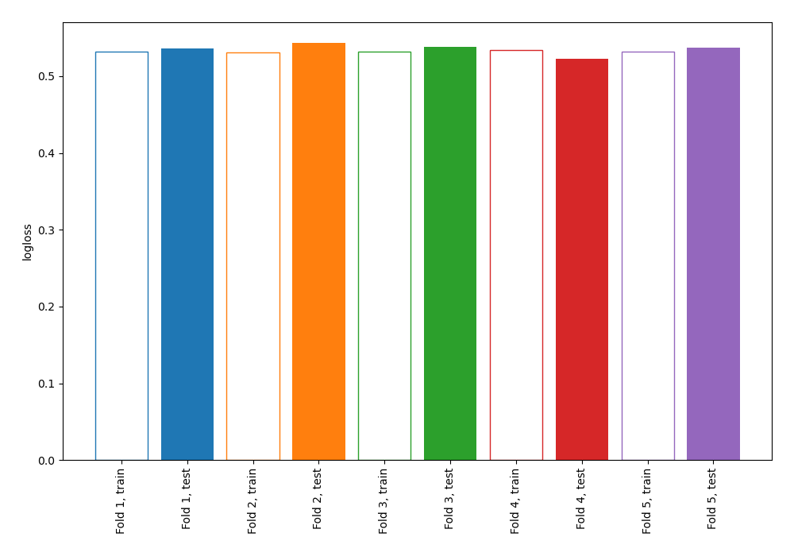
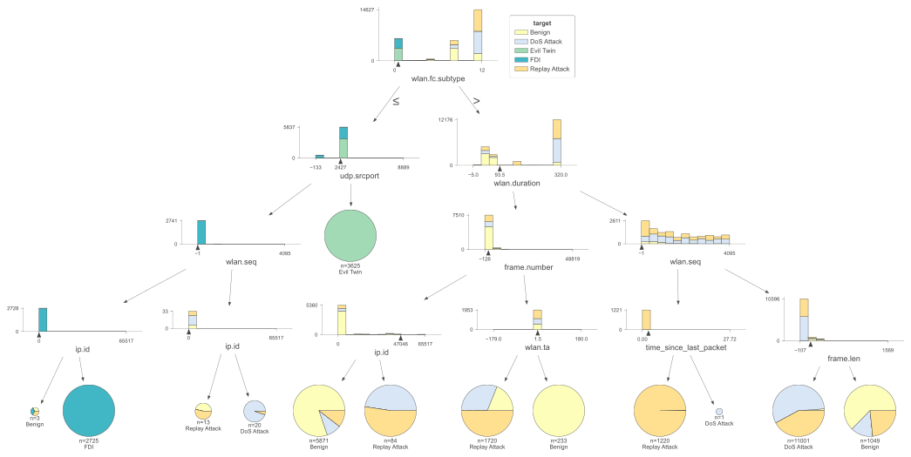
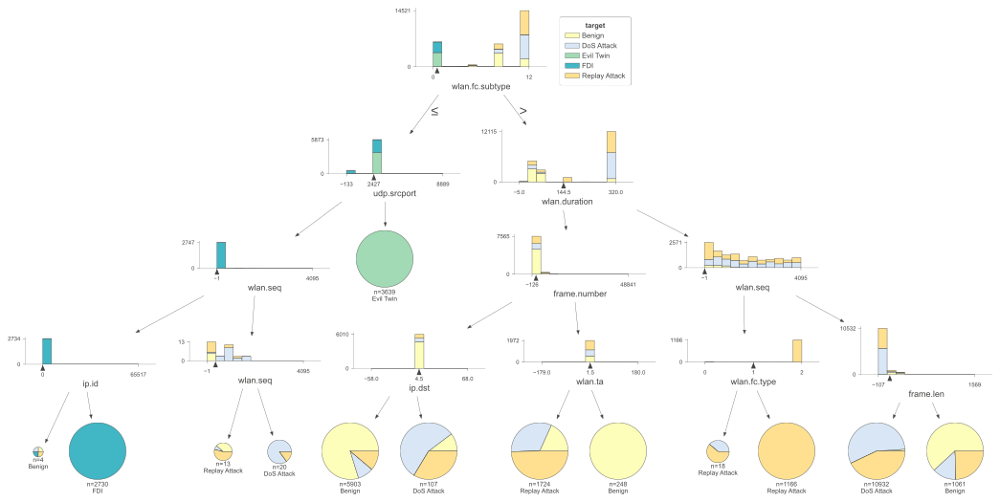
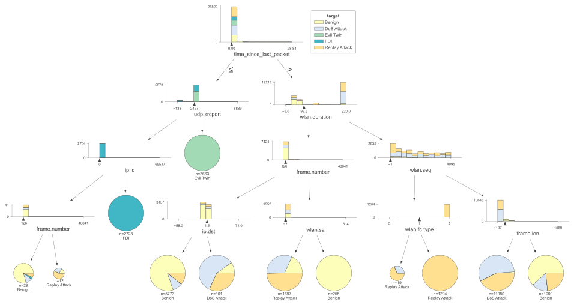
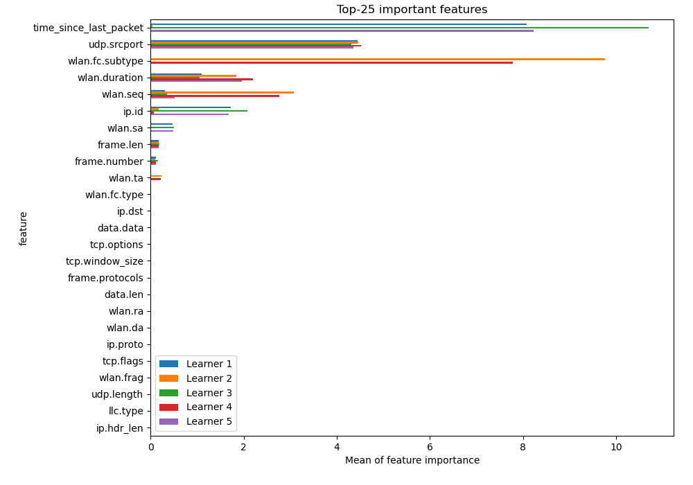
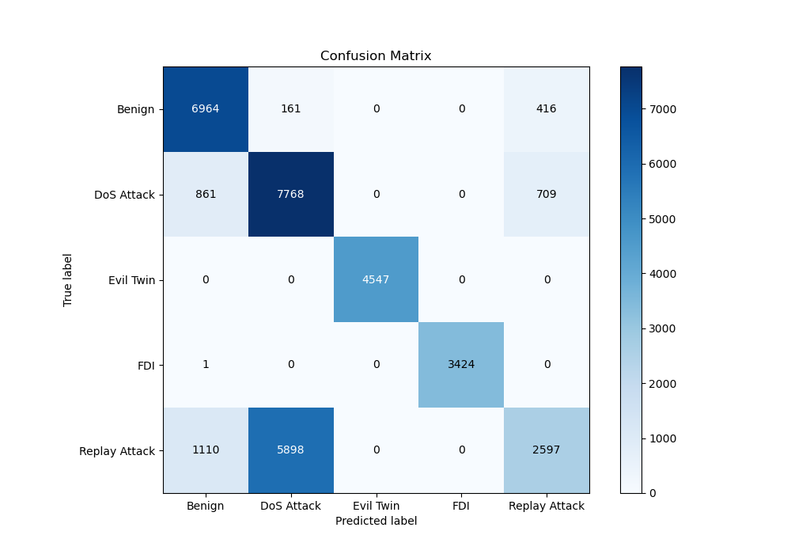
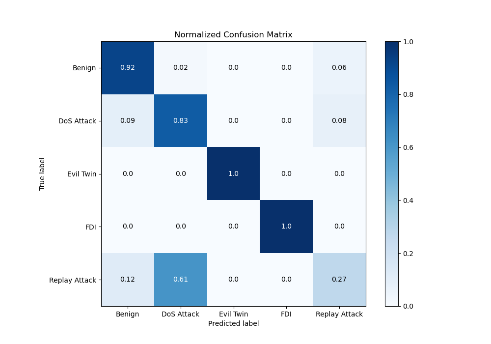
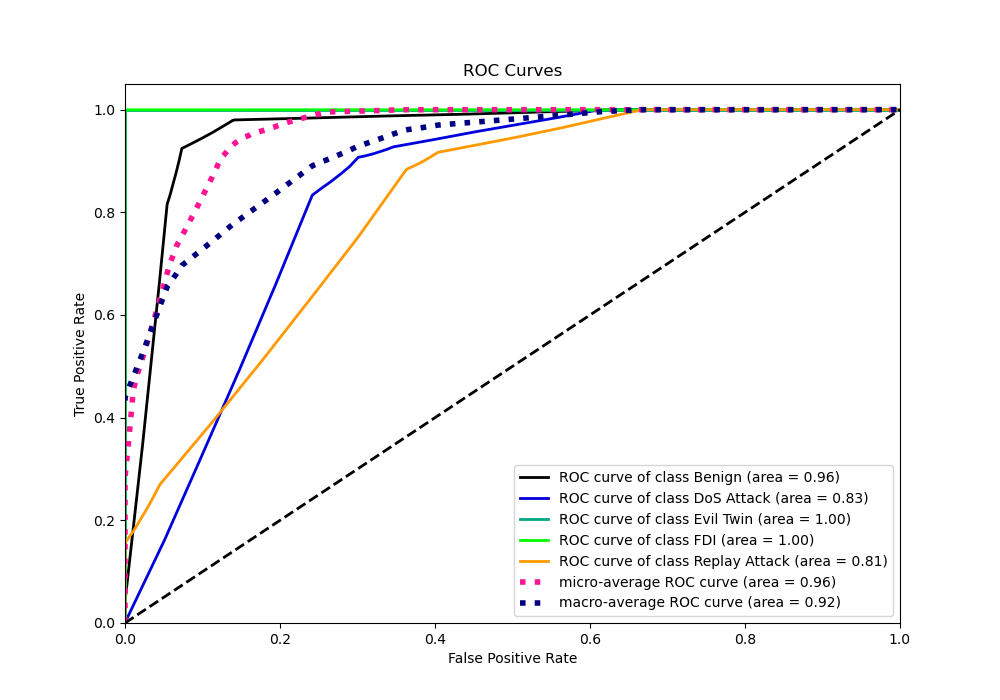
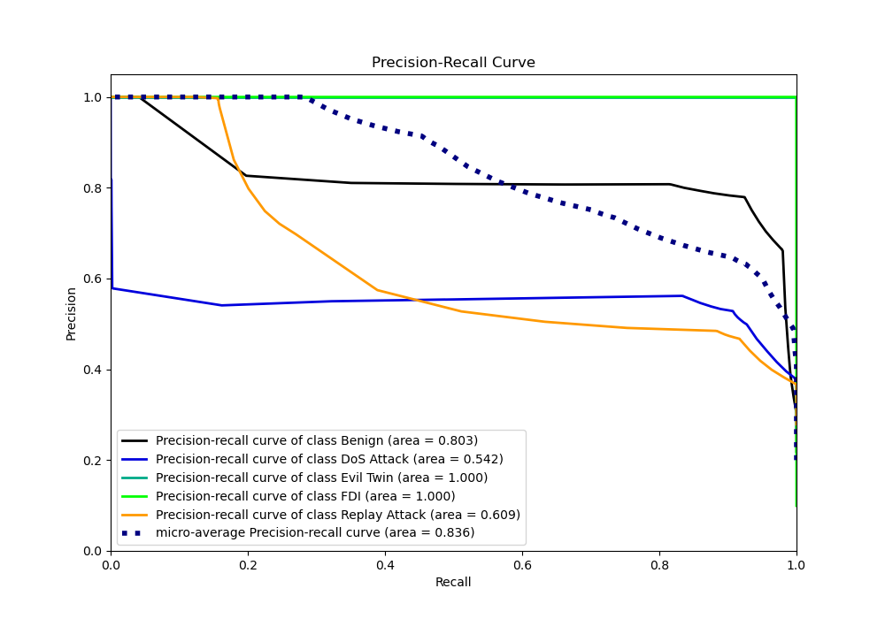

# Summary of 2_DecisionTree

[<< Go back](../README.md)

## Decision Tree
- **n_jobs**: -1
- **criterion**: gini
- **max_depth**: 4
- **num_class**: 5
- **explain_level**: 2

## Validation
 - **validation_type**: kfold
 - **k_folds**: 5
 - **shuffle**: True
 - **random_seed**: 1082

## Optimized metric
logloss

## Training time

33.5 seconds

### Metric details
|           |      Benign |   DoS Attack |   Evil Twin |         FDI |   Replay Attack |   accuracy |    macro avg |   weighted avg |   logloss |
|:----------|------------:|-------------:|------------:|------------:|----------------:|-----------:|-------------:|---------------:|----------:|
| precision |    0.77932  |     0.561799 |           1 |    1        |        0.697743 |    0.73427 |     0.807772 |       0.748687 |  0.535386 |
| recall    |    0.923485 |     0.83187  |           1 |    0.999708 |        0.27038  |    0.73427 |     0.805089 |       0.73427  |  0.535386 |
| f1-score  |    0.8453   |     0.670667 |           1 |    0.999854 |        0.389735 |    0.73427 |     0.781111 |       0.706756 |  0.535386 |
| support   | 7541        |  9338        |        4547 | 3425        |     9605        |    0.73427 | 34456        |   34456        |  0.535386 |

## Confusion matrix
|                          |   Predicted as Benign |   Predicted as DoS Attack |   Predicted as Evil Twin |   Predicted as FDI |   Predicted as Replay Attack |
|:-------------------------|----------------------:|--------------------------:|-------------------------:|-------------------:|-----------------------------:|
| Labeled as Benign        |                  6964 |                       161 |                        0 |                  0 |                          416 |
| Labeled as DoS Attack    |                   861 |                      7768 |                        0 |                  0 |                          709 |
| Labeled as Evil Twin     |                     0 |                         0 |                     4547 |                  0 |                            0 |
| Labeled as FDI           |                     1 |                         0 |                        0 |               3424 |                            0 |
| Labeled as Replay Attack |                  1110 |                      5898 |                        0 |                  0 |                         2597 |

## Learning curves

## Decision Tree 

### Tree #1

### Rules

if (time_since_last_packet > 0.0) and (wlan.duration > 93.5) and (wlan.seq > 16.5) and (frame.len <= 97.0) then class: DoS Attack (proba: 56.19%) | based on 11,000 samples

if (time_since_last_packet > 0.0) and (wlan.duration <= 93.5) and (frame.number <= 1860.0) and (ip.id <= 47039.0) then class: Benign (proba: 80.31%) | based on 5,791 samples

if (time_since_last_packet <= 0.0) and (udp.srcport > 2427.0) then class: Evil Twin (proba: 100.0%) | based on 3,613 samples

if (time_since_last_packet <= 0.0) and (udp.srcport <= 2427.0) and (ip.id > 1.0) then class: FDI (proba: 100.0%) | based on 2,784 samples

if (time_since_last_packet > 0.0) and (wlan.duration <= 93.5) and (frame.number > 1860.0) and (wlan.sa <= 1.5) then class: Replay Attack (proba: 48.79%) | based on 1,730 samples

if (time_since_last_packet > 0.0) and (wlan.duration > 93.5) and (wlan.seq <= 16.5) and (wlan.fc.type > 1.0) then class: Replay Attack (proba: 99.92%) | based on 1,182 samples

if (time_since_last_packet > 0.0) and (wlan.duration > 93.5) and (wlan.seq > 16.5) and (frame.len > 97.0) then class: Benign (proba: 60.74%) | based on 1,052 samples

if (time_since_last_packet > 0.0) and (wlan.duration <= 93.5) and (frame.number > 1860.0) and (wlan.sa > 1.5) then class: Benign (proba: 100.0%) | based on 266 samples

if (time_since_last_packet > 0.0) and (wlan.duration <= 93.5) and (frame.number <= 1860.0) and (ip.id > 47039.0) then class: Replay Attack (proba: 51.85%) | based on 81 samples

if (time_since_last_packet > 0.0) and (wlan.duration > 93.5) and (wlan.seq <= 16.5) and (wlan.fc.type <= 1.0) then class: Replay Attack (proba: 74.07%) | based on 27 samples

if (time_since_last_packet <= 0.0) and (udp.srcport <= 2427.0) and (ip.id <= 1.0) and (frame.number <= 168.5) then class: Benign (proba: 76.92%) | based on 26 samples

if (time_since_last_packet <= 0.0) and (udp.srcport <= 2427.0) and (ip.id <= 1.0) and (frame.number > 168.5) then class: Replay Attack (proba: 41.67%) | based on 12 samples

### Tree #2

### Rules

if (wlan.fc.subtype > 0.5) and (wlan.duration > 93.5) and (wlan.seq > 12.5) and (frame.len <= 92.0) then class: DoS Attack (proba: 56.76%) | based on 11,001 samples

if (wlan.fc.subtype > 0.5) and (wlan.duration <= 93.5) and (frame.number <= 1872.5) and (ip.id <= 47045.5) then class: Benign (proba: 80.21%) | based on 5,871 samples

if (wlan.fc.subtype <= 0.5) and (udp.srcport > 2427.0) then class: Evil Twin (proba: 100.0%) | based on 3,625 samples

if (wlan.fc.subtype <= 0.5) and (udp.srcport <= 2427.0) and (wlan.seq <= 3.5) and (ip.id > 1.0) then class: FDI (proba: 100.0%) | based on 2,725 samples

if (wlan.fc.subtype > 0.5) and (wlan.duration <= 93.5) and (frame.number > 1872.5) and (wlan.ta <= 1.5) then class: Replay Attack (proba: 50.12%) | based on 1,720 samples

if (wlan.fc.subtype > 0.5) and (wlan.duration > 93.5) and (wlan.seq <= 12.5) and (time_since_last_packet <= 1.916) then class: Replay Attack (proba: 99.75%) | based on 1,220 samples

if (wlan.fc.subtype > 0.5) and (wlan.duration > 93.5) and (wlan.seq > 12.5) and (frame.len > 92.0) then class: Benign (proba: 62.63%) | based on 1,049 samples

if (wlan.fc.subtype > 0.5) and (wlan.duration <= 93.5) and (frame.number > 1872.5) and (wlan.ta > 1.5) then class: Benign (proba: 100.0%) | based on 233 samples

if (wlan.fc.subtype > 0.5) and (wlan.duration <= 93.5) and (frame.number <= 1872.5) and (ip.id > 47045.5) then class: Replay Attack (proba: 52.38%) | based on 84 samples

if (wlan.fc.subtype <= 0.5) and (udp.srcport <= 2427.0) and (wlan.seq > 3.5) and (ip.id > 150.0) then class: DoS Attack (proba: 95.0%) | based on 20 samples

if (wlan.fc.subtype <= 0.5) and (udp.srcport <= 2427.0) and (wlan.seq > 3.5) and (ip.id <= 150.0) then class: Replay Attack (proba: 53.85%) | based on 13 samples

if (wlan.fc.subtype <= 0.5) and (udp.srcport <= 2427.0) and (wlan.seq <= 3.5) and (ip.id <= 1.0) then class: Benign (proba: 33.33%) | based on 3 samples

if (wlan.fc.subtype > 0.5) and (wlan.duration > 93.5) and (wlan.seq <= 12.5) and (time_since_last_packet > 1.916) then class: DoS Attack (proba: 100.0%) | based on 1 samples

### Tree #3

### Rules

if (time_since_last_packet > 0.0) and (wlan.duration > 144.5) and (wlan.seq > 16.5) and (frame.len <= 97.0) then class: DoS Attack (proba: 55.78%) | based on 10,955 samples

if (time_since_last_packet > 0.0) and (wlan.duration <= 144.5) and (frame.number <= 1853.5) and (ip.dst <= 4.5) then class: Benign (proba: 80.13%) | based on 5,823 samples

if (time_since_last_packet <= 0.0) and (udp.srcport > 2427.0) then class: Evil Twin (proba: 100.0%) | based on 3,648 samples

if (time_since_last_packet <= 0.0) and (udp.srcport <= 2427.0) and (ip.id > 1.0) then class: FDI (proba: 100.0%) | based on 2,734 samples

if (time_since_last_packet > 0.0) and (wlan.duration <= 144.5) and (frame.number > 1853.5) and (wlan.sa <= 1.5) then class: Replay Attack (proba: 50.63%) | based on 1,742 samples

if (time_since_last_packet > 0.0) and (wlan.duration > 144.5) and (wlan.seq <= 16.5) and (wlan.fc.type > 1.0) then class: Replay Attack (proba: 99.92%) | based on 1,223 samples

if (time_since_last_packet > 0.0) and (wlan.duration > 144.5) and (wlan.seq > 16.5) and (frame.len > 97.0) then class: Benign (proba: 61.26%) | based on 1,035 samples

if (time_since_last_packet > 0.0) and (wlan.duration <= 144.5) and (frame.number > 1853.5) and (wlan.sa > 1.5) then class: Benign (proba: 100.0%) | based on 245 samples

if (time_since_last_packet > 0.0) and (wlan.duration <= 144.5) and (frame.number <= 1853.5) and (ip.dst > 4.5) then class: DoS Attack (proba: 57.0%) | based on 100 samples

if (time_since_last_packet <= 0.0) and (udp.srcport <= 2427.0) and (ip.id <= 1.0) and (frame.number <= 379.0) then class: Benign (proba: 68.75%) | based on 32 samples

if (time_since_last_packet > 0.0) and (wlan.duration > 144.5) and (wlan.seq <= 16.5) and (wlan.fc.type <= 1.0) then class: Replay Attack (proba: 72.0%) | based on 25 samples

if (time_since_last_packet <= 0.0) and (udp.srcport <= 2427.0) and (ip.id <= 1.0) and (frame.number > 379.0) then class: Replay Attack (proba: 100.0%) | based on 3 samples

### Tree #4

### Rules

if (wlan.fc.subtype > 0.5) and (wlan.duration > 144.5) and (wlan.seq > 10.5) and (frame.len <= 92.0) then class: DoS Attack (proba: 56.01%) | based on 10,932 samples

if (wlan.fc.subtype > 0.5) and (wlan.duration <= 144.5) and (frame.number <= 1886.5) and (ip.dst <= 4.5) then class: Benign (proba: 79.77%) | based on 5,903 samples

if (wlan.fc.subtype <= 0.5) and (udp.srcport > 2427.0) then class: Evil Twin (proba: 100.0%) | based on 3,639 samples

if (wlan.fc.subtype <= 0.5) and (udp.srcport <= 2427.0) and (wlan.seq <= 2.5) and (ip.id > 1.0) then class: FDI (proba: 100.0%) | based on 2,730 samples

if (wlan.fc.subtype > 0.5) and (wlan.duration <= 144.5) and (frame.number > 1886.5) and (wlan.ta <= 1.5) then class: Replay Attack (proba: 49.65%) | based on 1,724 samples

if (wlan.fc.subtype > 0.5) and (wlan.duration > 144.5) and (wlan.seq <= 10.5) and (wlan.fc.type > 1.0) then class: Replay Attack (proba: 100.0%) | based on 1,166 samples

if (wlan.fc.subtype > 0.5) and (wlan.duration > 144.5) and (wlan.seq > 10.5) and (frame.len > 92.0) then class: Benign (proba: 61.83%) | based on 1,061 samples

if (wlan.fc.subtype > 0.5) and (wlan.duration <= 144.5) and (frame.number > 1886.5) and (wlan.ta > 1.5) then class: Benign (proba: 100.0%) | based on 248 samples

if (wlan.fc.subtype > 0.5) and (wlan.duration <= 144.5) and (frame.number <= 1886.5) and (ip.dst > 4.5) then class: DoS Attack (proba: 56.07%) | based on 107 samples

if (wlan.fc.subtype <= 0.5) and (udp.srcport <= 2427.0) and (wlan.seq > 2.5) and (wlan.seq > 360.0) then class: DoS Attack (proba: 85.0%) | based on 20 samples

if (wlan.fc.subtype > 0.5) and (wlan.duration > 144.5) and (wlan.seq <= 10.5) and (wlan.fc.type <= 1.0) then class: Replay Attack (proba: 61.11%) | based on 18 samples

if (wlan.fc.subtype <= 0.5) and (udp.srcport <= 2427.0) and (wlan.seq > 2.5) and (wlan.seq <= 360.0) then class: Replay Attack (proba: 53.85%) | based on 13 samples

if (wlan.fc.subtype <= 0.5) and (udp.srcport <= 2427.0) and (wlan.seq <= 2.5) and (ip.id <= 1.0) then class: Benign (proba: 25.0%) | based on 4 samples

### Tree #5

### Rules

if (time_since_last_packet > 0.0) and (wlan.duration > 93.5) and (wlan.seq > 10.5) and (frame.len <= 97.0) then class: DoS Attack (proba: 56.21%) | based on 11,080 samples

if (time_since_last_packet > 0.0) and (wlan.duration <= 93.5) and (frame.number <= 1867.5) and (ip.dst <= 4.5) then class: Benign (proba: 80.11%) | based on 5,773 samples

if (time_since_last_packet <= 0.0) and (udp.srcport > 2427.0) then class: Evil Twin (proba: 100.0%) | based on 3,663 samples

if (time_since_last_packet <= 0.0) and (udp.srcport <= 2427.0) and (ip.id > 1.0) then class: FDI (proba: 100.0%) | based on 2,723 samples

if (time_since_last_packet > 0.0) and (wlan.duration <= 93.5) and (frame.number > 1867.5) and (wlan.sa <= 1.5) then class: Replay Attack (proba: 49.68%) | based on 1,697 samples

if (time_since_last_packet > 0.0) and (wlan.duration > 93.5) and (wlan.seq <= 10.5) and (wlan.fc.type > 1.0) then class: Replay Attack (proba: 100.0%) | based on 1,204 samples

if (time_since_last_packet > 0.0) and (wlan.duration > 93.5) and (wlan.seq > 10.5) and (frame.len > 97.0) then class: Benign (proba: 61.84%) | based on 1,009 samples

if (time_since_last_packet > 0.0) and (wlan.duration <= 93.5) and (frame.number > 1867.5) and (wlan.sa > 1.5) then class: Benign (proba: 100.0%) | based on 255 samples

if (time_since_last_packet > 0.0) and (wlan.duration <= 93.5) and (frame.number <= 1867.5) and (ip.dst > 4.5) then class: DoS Attack (proba: 58.42%) | based on 101 samples

if (time_since_last_packet <= 0.0) and (udp.srcport <= 2427.0) and (ip.id <= 1.0) and (frame.number <= 181.0) then class: Benign (proba: 79.31%) | based on 29 samples

if (time_since_last_packet > 0.0) and (wlan.duration > 93.5) and (wlan.seq <= 10.5) and (wlan.fc.type <= 1.0) then class: Replay Attack (proba: 68.42%) | based on 19 samples

if (time_since_last_packet <= 0.0) and (udp.srcport <= 2427.0) and (ip.id <= 1.0) and (frame.number > 181.0) then class: Replay Attack (proba: 58.33%) | based on 12 samples

## Permutation-based Importance

## Confusion Matrix

## Normalized Confusion Matrix

## ROC Curve

## Precision Recall Curve

[<< Go back](../README.md)
