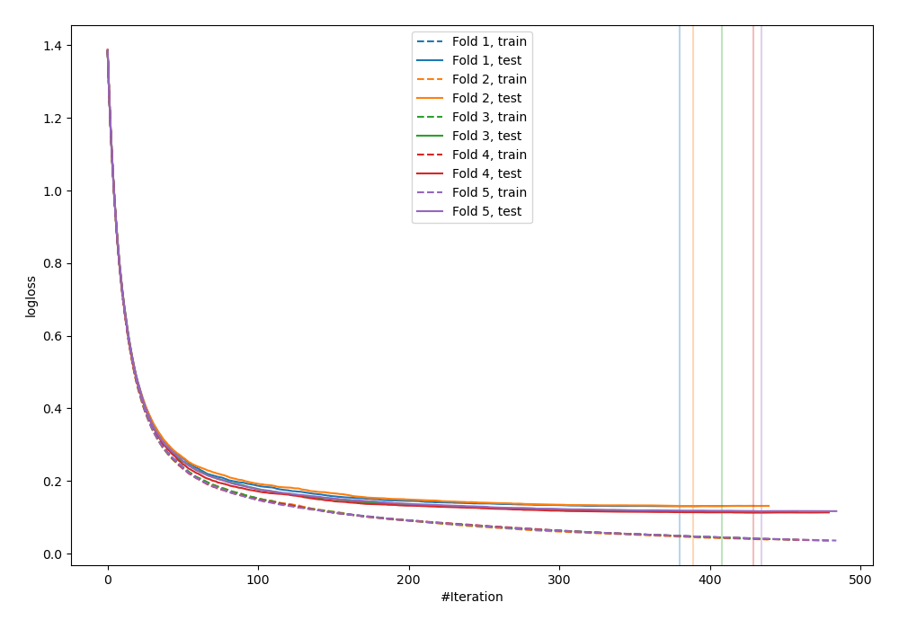
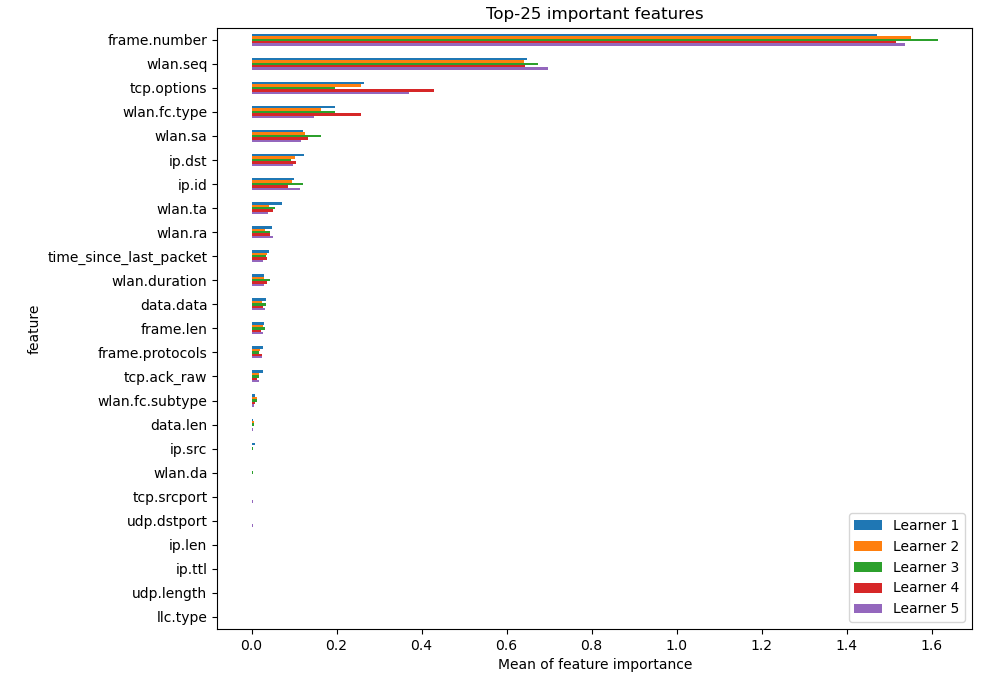
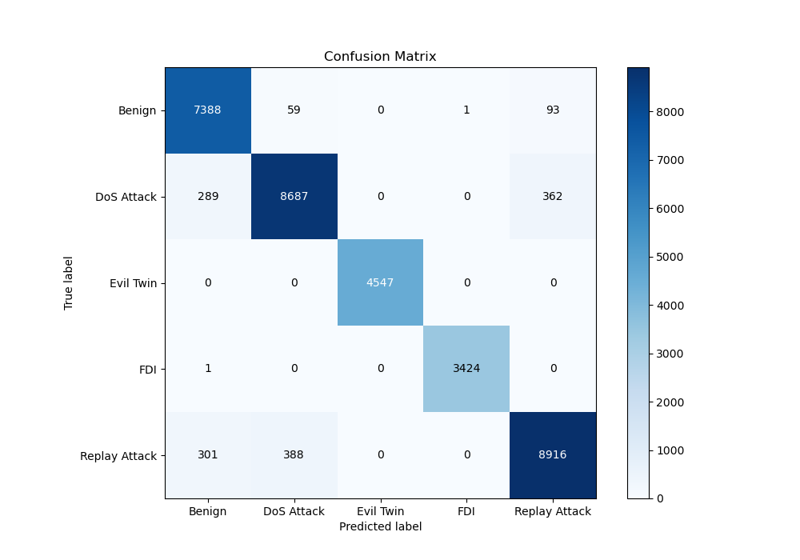
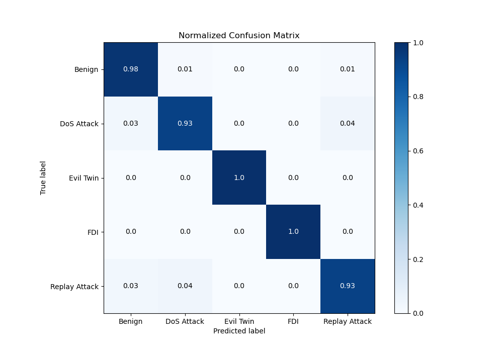
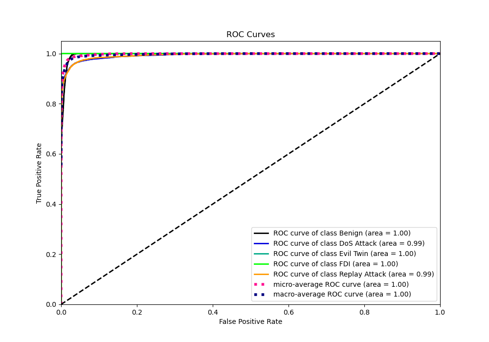
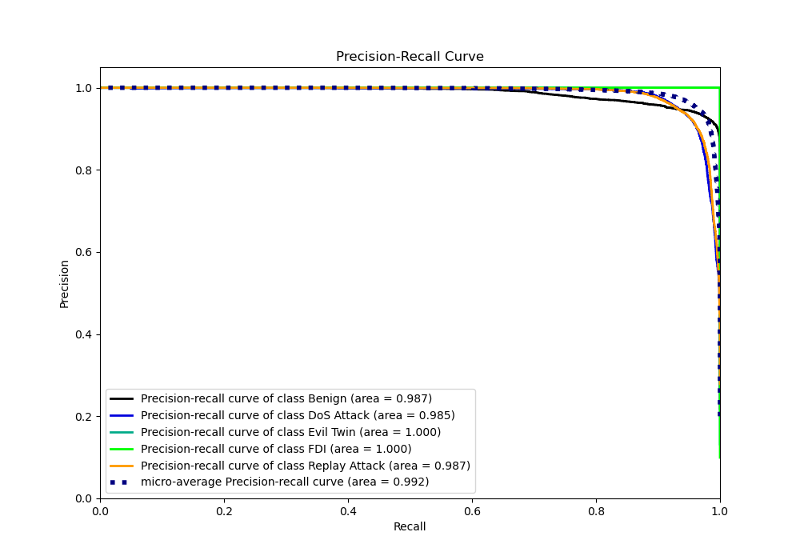

# Summary of 3_Default_LightGBM

[<< Go back](../README.md)

## LightGBM
- **n_jobs**: -1
- **objective**: multiclass
- **num_leaves**: 63
- **learning_rate**: 0.05
- **feature_fraction**: 0.9
- **bagging_fraction**: 0.9
- **min_data_in_leaf**: 10
- **metric**: multi_logloss
- **custom_eval_metric_name**: None
- **num_class**: 5
- **explain_level**: 2

## Validation
 - **validation_type**: kfold
 - **k_folds**: 5
 - **shuffle**: True
 - **random_seed**: 1082

## Optimized metric
logloss

## Training time

537.4 seconds

### Metric details
|           |      Benign |   DoS Attack |   Evil Twin |         FDI |   Replay Attack |   accuracy |    macro avg |   weighted avg |   logloss |
|:----------|------------:|-------------:|------------:|------------:|----------------:|-----------:|-------------:|---------------:|----------:|
| precision |    0.925931 |     0.951062 |           1 |    0.999708 |        0.951446 |    0.95664 |     0.965629 |       0.956962 |  0.120963 |
| recall    |    0.979711 |     0.930285 |           1 |    0.999708 |        0.928267 |    0.95664 |     0.967594 |       0.95664  |  0.120963 |
| f1-score  |    0.952062 |     0.940559 |           1 |    0.999708 |        0.939713 |    0.95664 |     0.966408 |       0.956564 |  0.120963 |
| support   | 7541        |  9338        |        4547 | 3425        |     9605        |    0.95664 | 34456        |   34456        |  0.120963 |

## Confusion matrix
|                          |   Predicted as Benign |   Predicted as DoS Attack |   Predicted as Evil Twin |   Predicted as FDI |   Predicted as Replay Attack |
|:-------------------------|----------------------:|--------------------------:|-------------------------:|-------------------:|-----------------------------:|
| Labeled as Benign        |                  7388 |                        59 |                        0 |                  1 |                           93 |
| Labeled as DoS Attack    |                   289 |                      8687 |                        0 |                  0 |                          362 |
| Labeled as Evil Twin     |                     0 |                         0 |                     4547 |                  0 |                            0 |
| Labeled as FDI           |                     1 |                         0 |                        0 |               3424 |                            0 |
| Labeled as Replay Attack |                   301 |                       388 |                        0 |                  0 |                         8916 |

## Learning curves

## Permutation-based Importance

## Confusion Matrix

## Normalized Confusion Matrix

## ROC Curve

## Precision Recall Curve

[<< Go back](../README.md)
