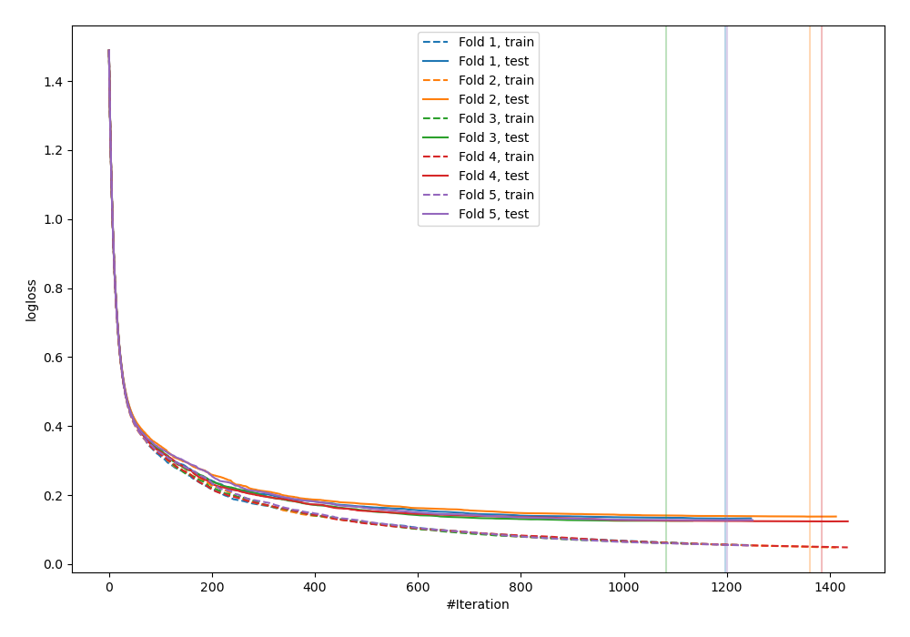
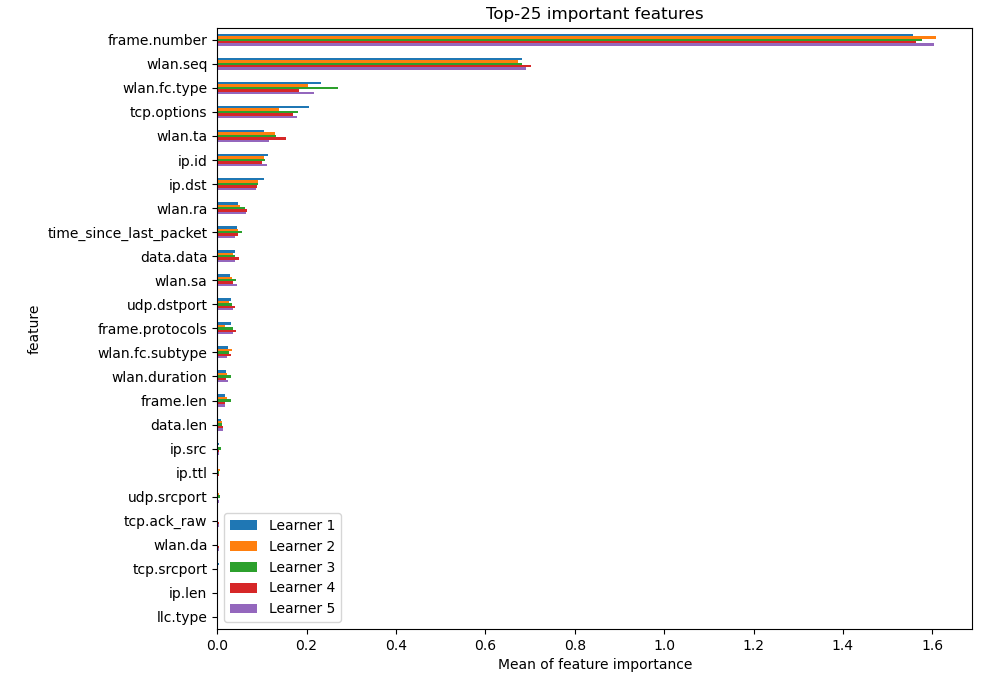
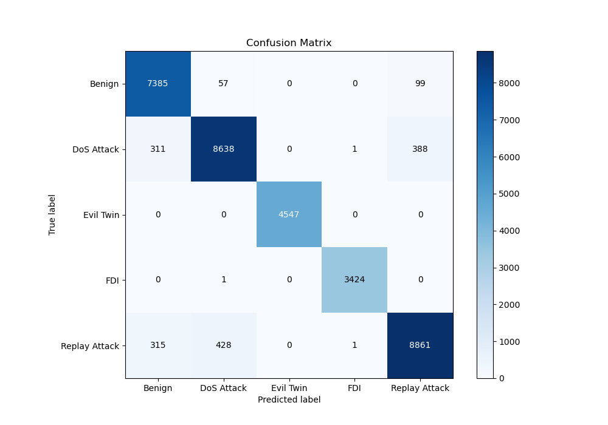
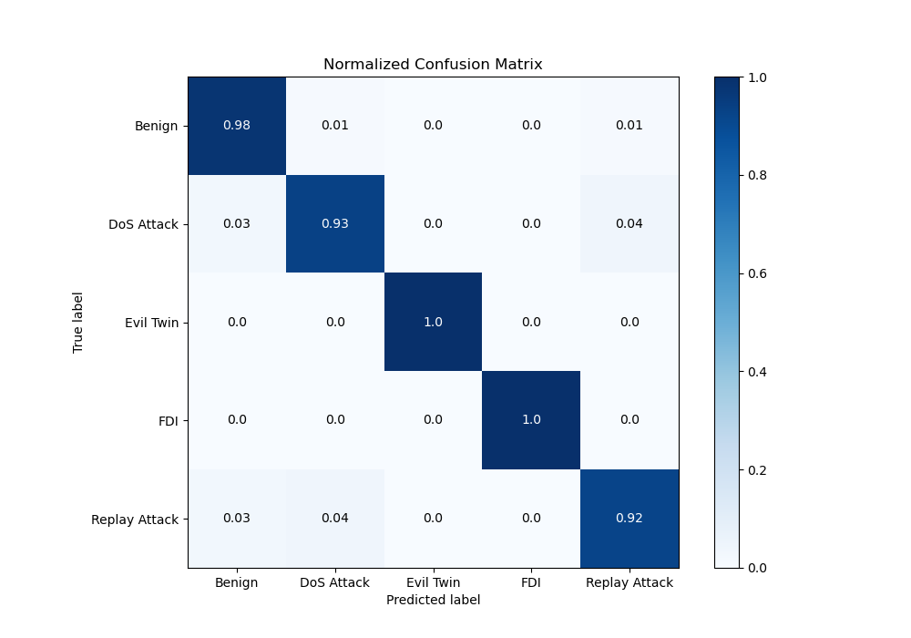
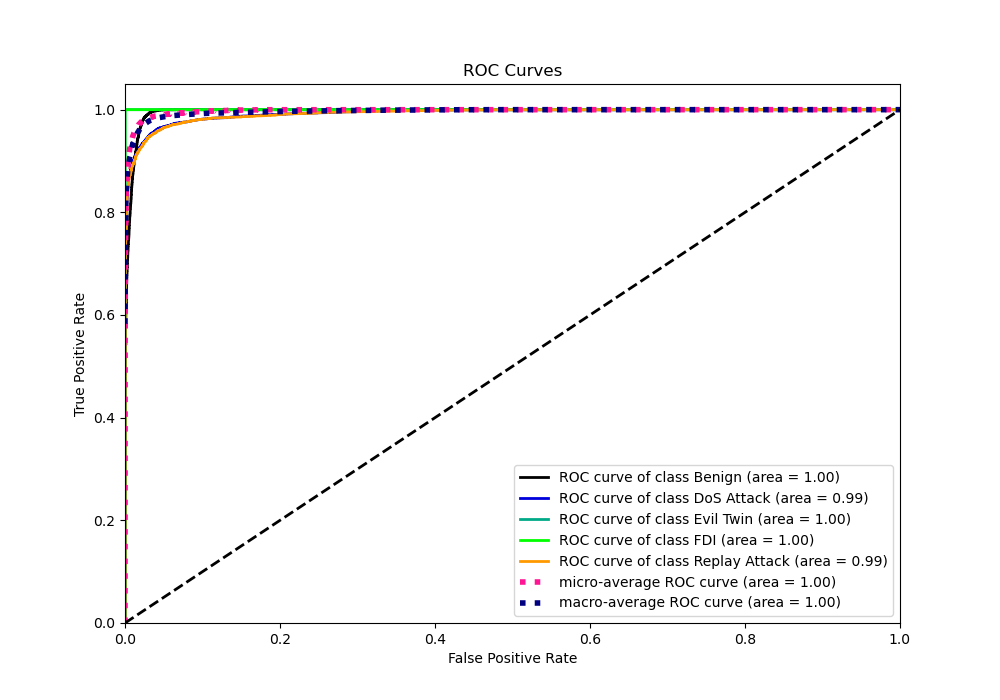
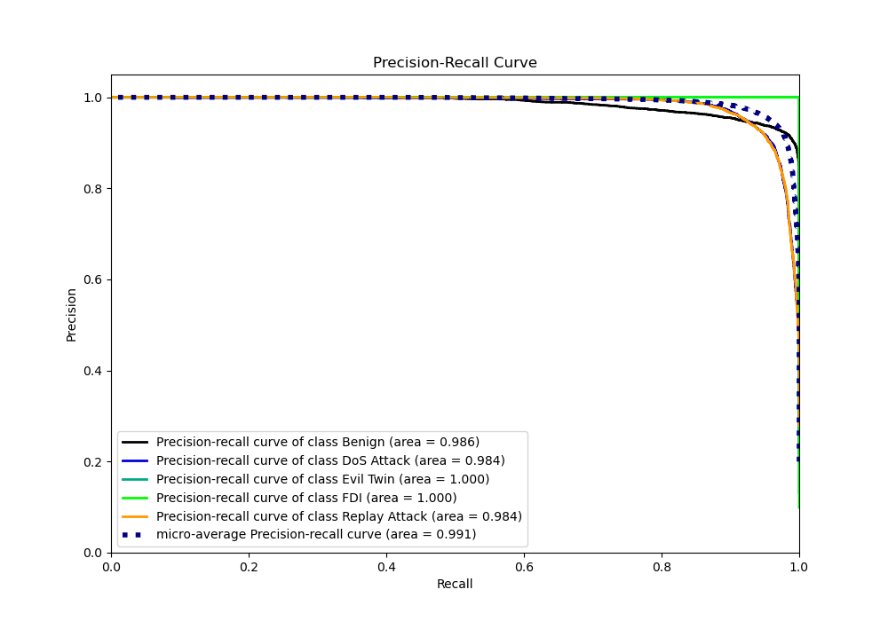

# Summary of 4_Default_Xgboost

[<< Go back](../README.md)

## Extreme Gradient Boosting (Xgboost)
- **n_jobs**: -1
- **objective**: multi:softprob
- **eta**: 0.075
- **max_depth**: 6
- **min_child_weight**: 1
- **subsample**: 1.0
- **colsample_bytree**: 1.0
- **eval_metric**: mlogloss
- **num_class**: 5
- **explain_level**: 2

## Validation
 - **validation_type**: kfold
 - **k_folds**: 5
 - **shuffle**: True
 - **random_seed**: 1082

## Optimized metric
logloss

## Training time

145.3 seconds

### Metric details
|           |      Benign |   DoS Attack |   Evil Twin |         FDI |   Replay Attack |   accuracy |    macro avg |   weighted avg |   logloss |
|:----------|------------:|-------------:|------------:|------------:|----------------:|-----------:|-------------:|---------------:|----------:|
| precision |    0.921857 |     0.946734 |           1 |    0.999416 |        0.947903 |   0.953535 |     0.963182 |       0.953881 |  0.129057 |
| recall    |    0.979313 |     0.925037 |           1 |    0.999708 |        0.92254  |   0.953535 |     0.96532  |       0.953535 |  0.129057 |
| f1-score  |    0.949717 |     0.93576  |           1 |    0.999562 |        0.93505  |   0.953535 |     0.964018 |       0.953436 |  0.129057 |
| support   | 7541        |  9338        |        4547 | 3425        |     9605        |   0.953535 | 34456        |   34456        |  0.129057 |

## Confusion matrix
|                          |   Predicted as Benign |   Predicted as DoS Attack |   Predicted as Evil Twin |   Predicted as FDI |   Predicted as Replay Attack |
|:-------------------------|----------------------:|--------------------------:|-------------------------:|-------------------:|-----------------------------:|
| Labeled as Benign        |                  7385 |                        57 |                        0 |                  0 |                           99 |
| Labeled as DoS Attack    |                   311 |                      8638 |                        0 |                  1 |                          388 |
| Labeled as Evil Twin     |                     0 |                         0 |                     4547 |                  0 |                            0 |
| Labeled as FDI           |                     0 |                         1 |                        0 |               3424 |                            0 |
| Labeled as Replay Attack |                   315 |                       428 |                        0 |                  1 |                         8861 |

## Learning curves

## Permutation-based Importance

## Confusion Matrix

## Normalized Confusion Matrix

## ROC Curve

## Precision Recall Curve

[<< Go back](../README.md)
