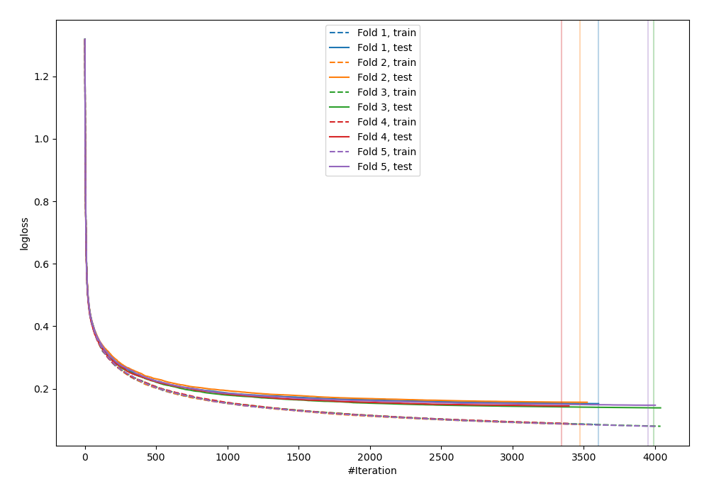
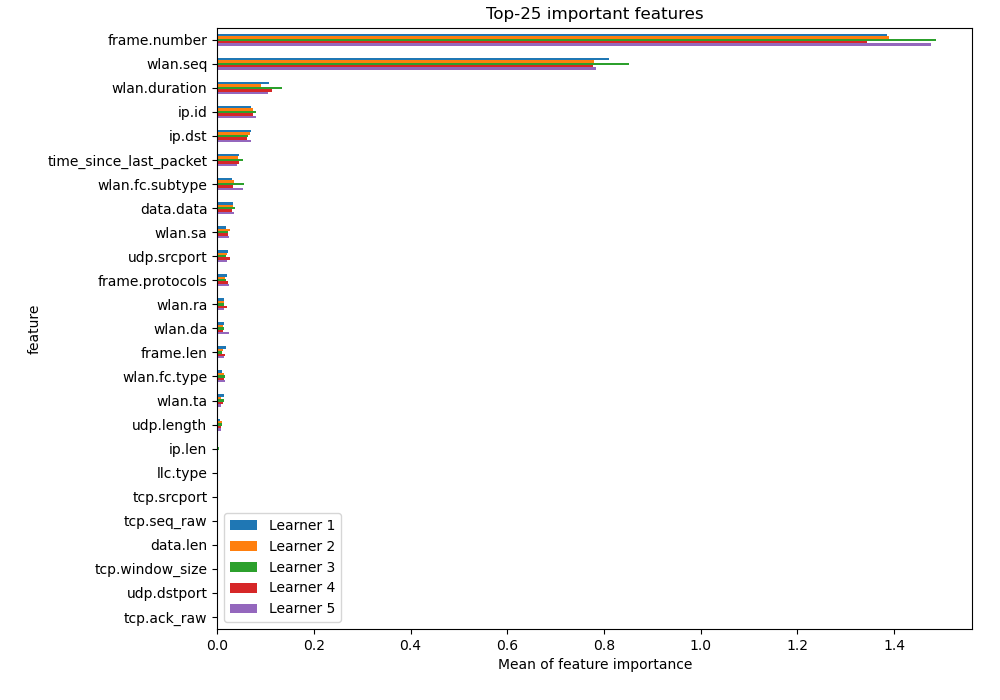
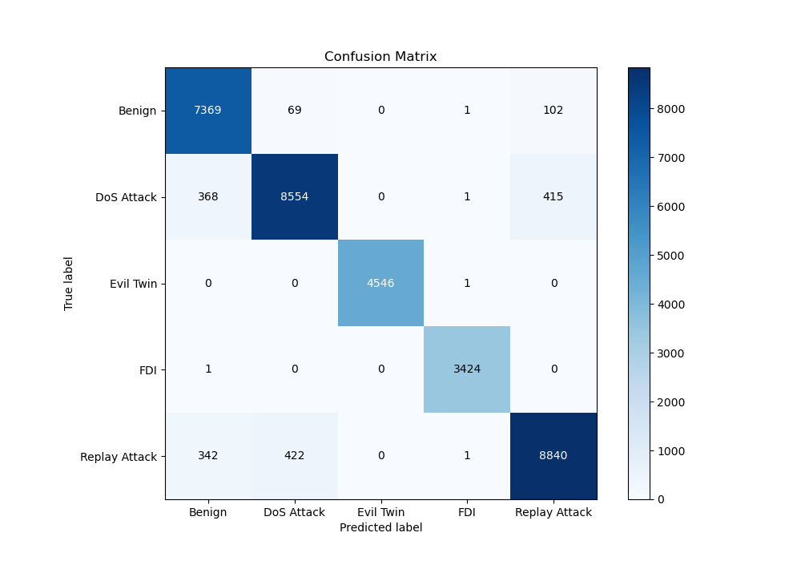
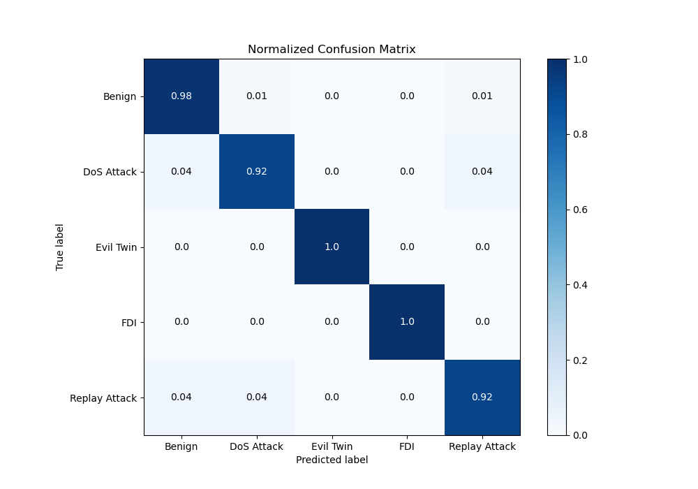
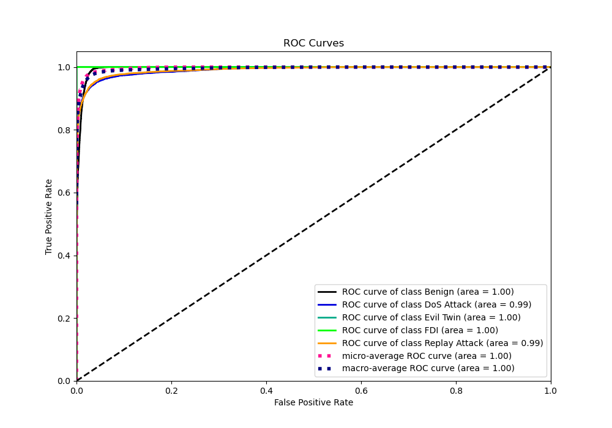
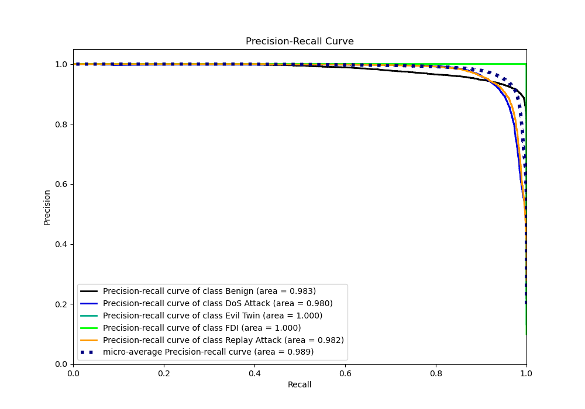

# Summary of 5_Default_CatBoost

[<< Go back](../README.md)

## CatBoost
- **n_jobs**: -1
- **learning_rate**: 0.15
- **depth**: 5
- **rsm**: 1
- **loss_function**: MultiClass
- **eval_metric**: MultiClass
- **num_class**: 5
- **explain_level**: 2

## Validation
 - **validation_type**: kfold
 - **k_folds**: 5
 - **shuffle**: True
 - **random_seed**: 1082

## Optimized metric
logloss

## Training time

185.3 seconds

### Metric details
|           |      Benign |   DoS Attack |   Evil Twin |         FDI |   Replay Attack |   accuracy |    macro avg |   weighted avg |   logloss |
|:----------|------------:|-------------:|------------:|------------:|----------------:|-----------:|-------------:|---------------:|----------:|
| precision |    0.912005 |     0.945716 |     1       |    0.998833 |        0.944747 |   0.949994 |     0.96026  |       0.950512 |  0.148095 |
| recall    |    0.977191 |     0.916042 |     0.99978 |    0.999708 |        0.920354 |   0.949994 |     0.962615 |       0.949994 |  0.148095 |
| f1-score  |    0.943474 |     0.930642 |     0.99989 |    0.99927  |        0.932391 |   0.949994 |     0.961133 |       0.949898 |  0.148095 |
| support   | 7541        |  9338        |  4547       | 3425        |     9605        |   0.949994 | 34456        |   34456        |  0.148095 |

## Confusion matrix
|                          |   Predicted as Benign |   Predicted as DoS Attack |   Predicted as Evil Twin |   Predicted as FDI |   Predicted as Replay Attack |
|:-------------------------|----------------------:|--------------------------:|-------------------------:|-------------------:|-----------------------------:|
| Labeled as Benign        |                  7369 |                        69 |                        0 |                  1 |                          102 |
| Labeled as DoS Attack    |                   368 |                      8554 |                        0 |                  1 |                          415 |
| Labeled as Evil Twin     |                     0 |                         0 |                     4546 |                  1 |                            0 |
| Labeled as FDI           |                     1 |                         0 |                        0 |               3424 |                            0 |
| Labeled as Replay Attack |                   342 |                       422 |                        0 |                  1 |                         8840 |

## Learning curves

## Permutation-based Importance

## Confusion Matrix

## Normalized Confusion Matrix

## ROC Curve

## Precision Recall Curve

[<< Go back](../README.md)
