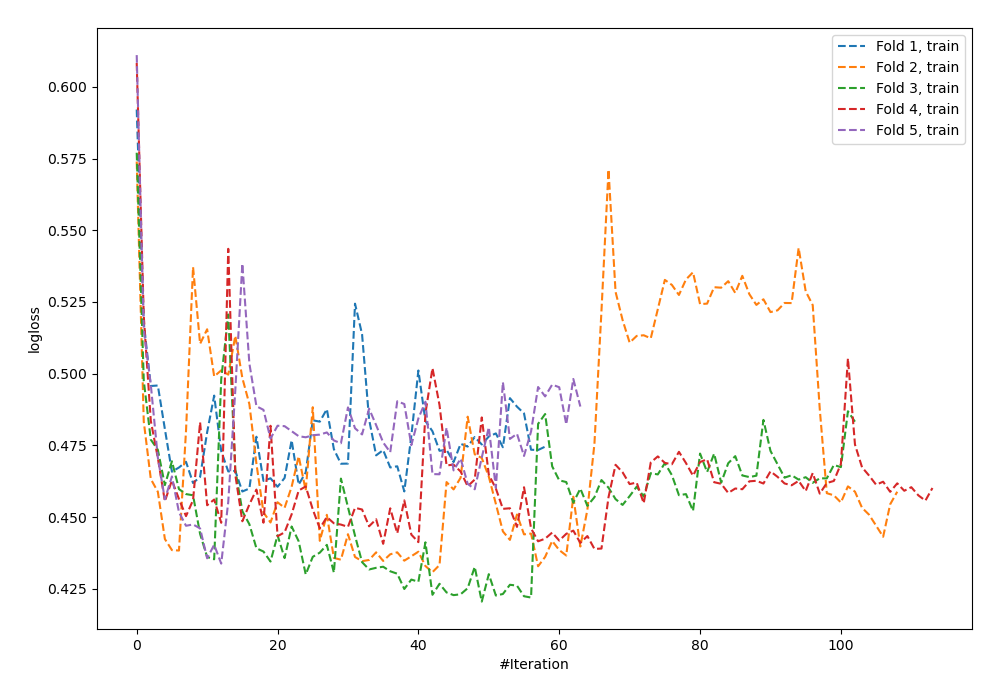
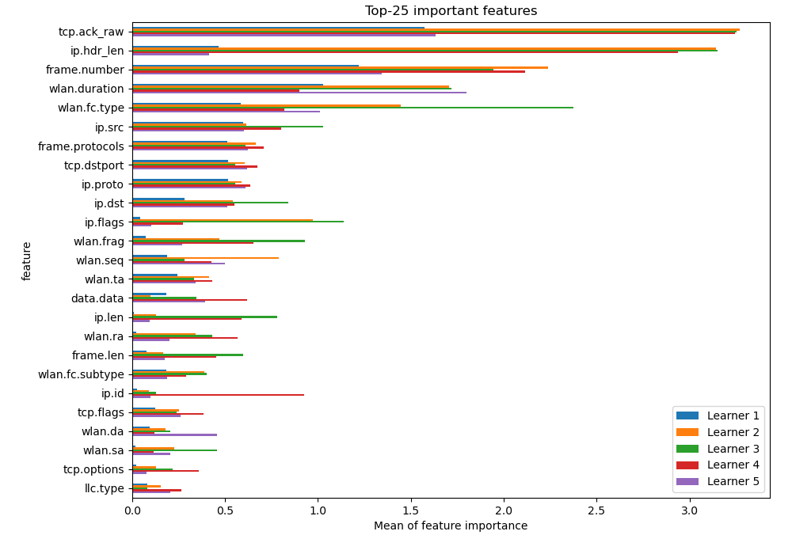
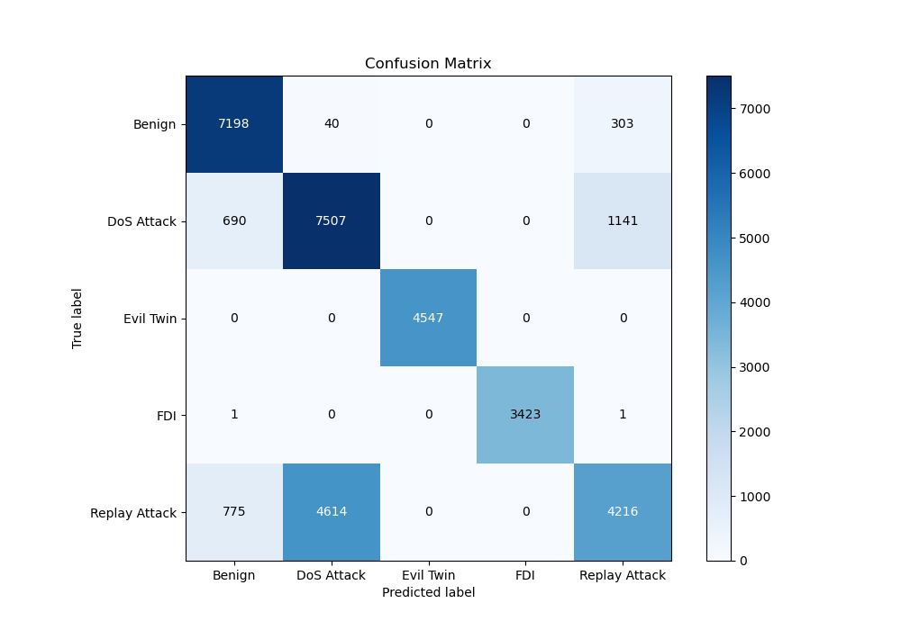
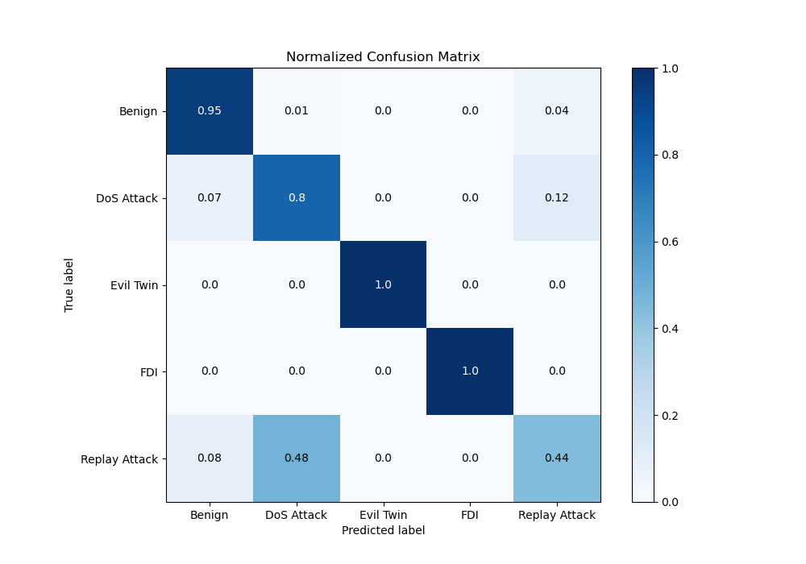
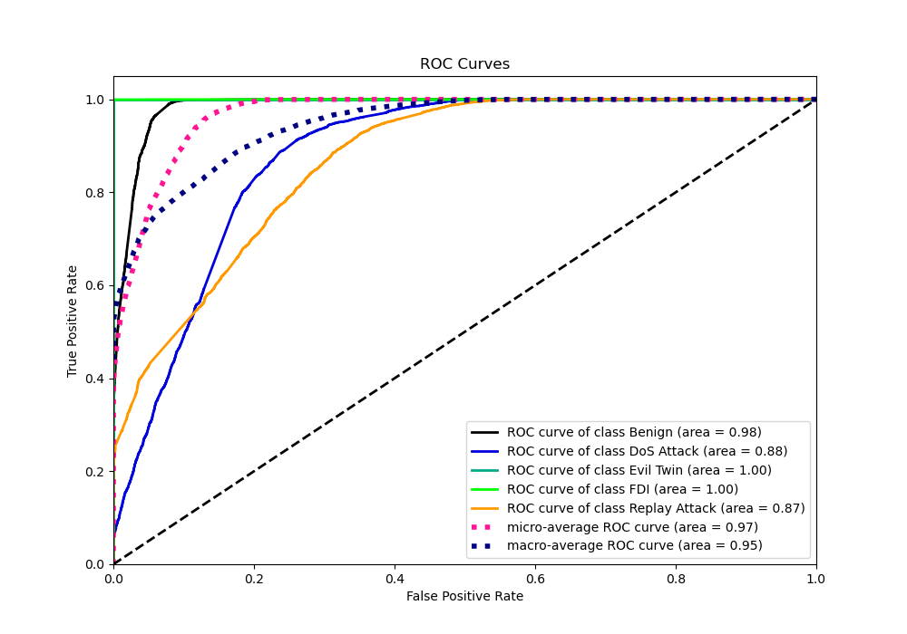
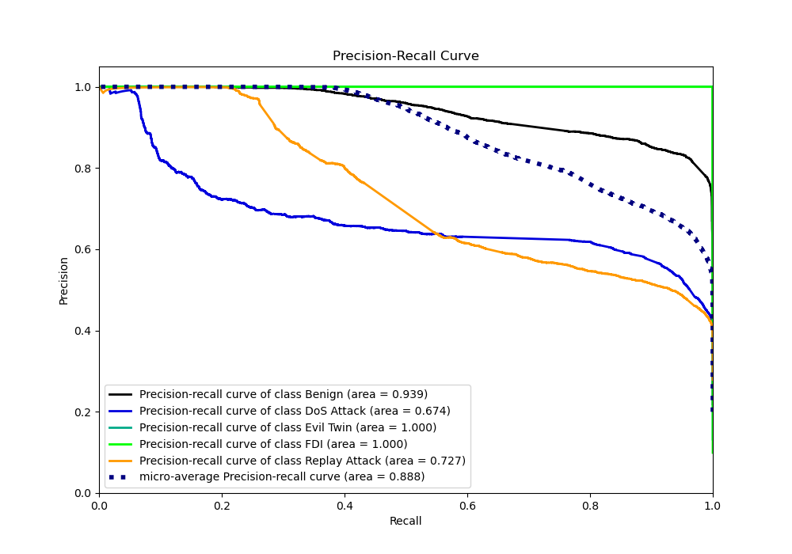

# Summary of 6_Default_NeuralNetwork

[<< Go back](../README.md)

## Neural Network
- **n_jobs**: -1
- **dense_1_size**: 32
- **dense_2_size**: 16
- **learning_rate**: 0.05
- **num_class**: 5
- **explain_level**: 2

## Validation
 - **validation_type**: kfold
 - **k_folds**: 5
 - **shuffle**: True
 - **random_seed**: 1082

## Optimized metric
logloss

## Training time

40.1 seconds

### Metric details
|           |      Benign |   DoS Attack |   Evil Twin |         FDI |   Replay Attack |   accuracy |    macro avg |   weighted avg |   logloss |
|:----------|------------:|-------------:|------------:|------------:|----------------:|-----------:|-------------:|---------------:|----------:|
| precision |    0.830794 |     0.617301 |           1 |    1        |        0.744745 |   0.780445 |     0.838568 |       0.788096 |   0.44349 |
| recall    |    0.954515 |     0.803919 |           1 |    0.999416 |        0.438938 |   0.780445 |     0.839358 |       0.780445 |   0.44349 |
| f1-score  |    0.888368 |     0.698358 |           1 |    0.999708 |        0.552339 |   0.780445 |     0.827754 |       0.769    |   0.44349 |
| support   | 7541        |  9338        |        4547 | 3425        |     9605        |   0.780445 | 34456        |   34456        |   0.44349 |

## Confusion matrix
|                          |   Predicted as Benign |   Predicted as DoS Attack |   Predicted as Evil Twin |   Predicted as FDI |   Predicted as Replay Attack |
|:-------------------------|----------------------:|--------------------------:|-------------------------:|-------------------:|-----------------------------:|
| Labeled as Benign        |                  7198 |                        40 |                        0 |                  0 |                          303 |
| Labeled as DoS Attack    |                   690 |                      7507 |                        0 |                  0 |                         1141 |
| Labeled as Evil Twin     |                     0 |                         0 |                     4547 |                  0 |                            0 |
| Labeled as FDI           |                     1 |                         0 |                        0 |               3423 |                            1 |
| Labeled as Replay Attack |                   775 |                      4614 |                        0 |                  0 |                         4216 |

## Learning curves

## Permutation-based Importance

## Confusion Matrix

## Normalized Confusion Matrix

## ROC Curve

## Precision Recall Curve

[<< Go back](../README.md)
