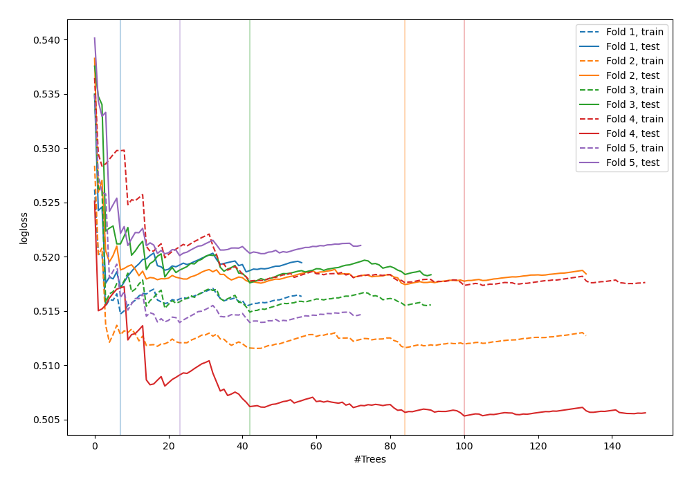
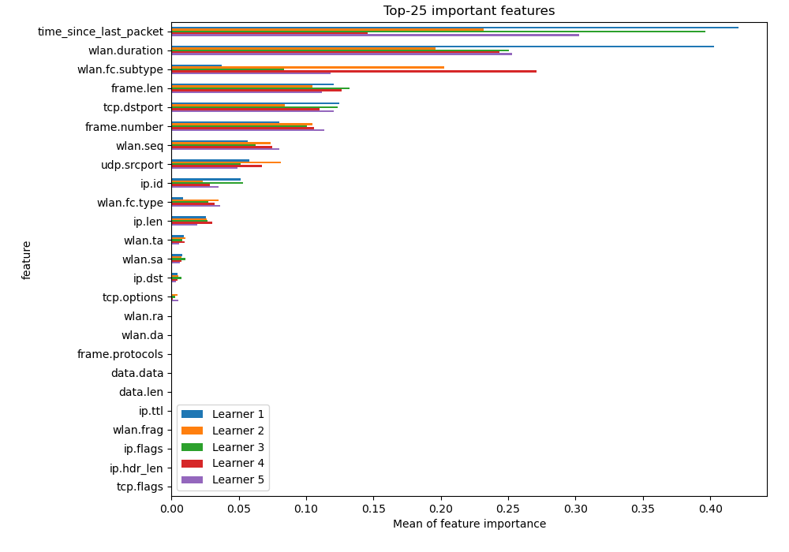
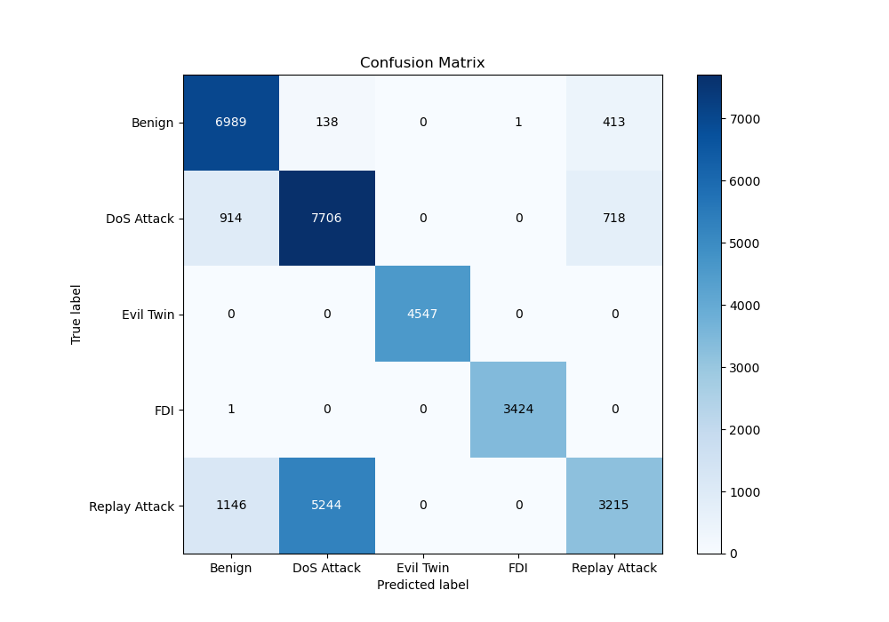
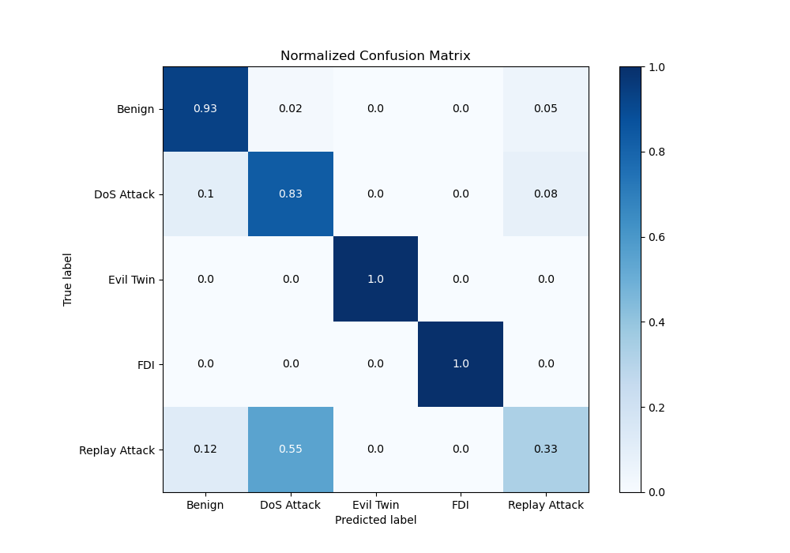
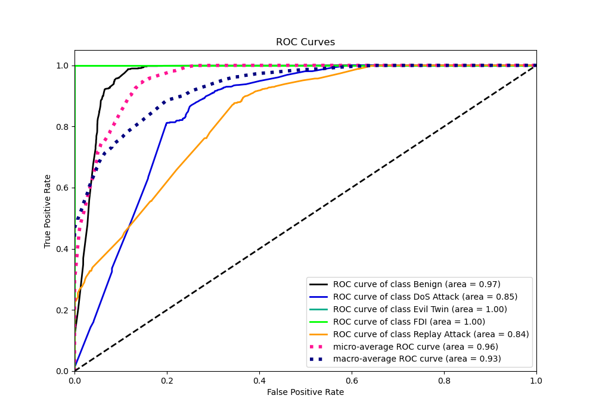
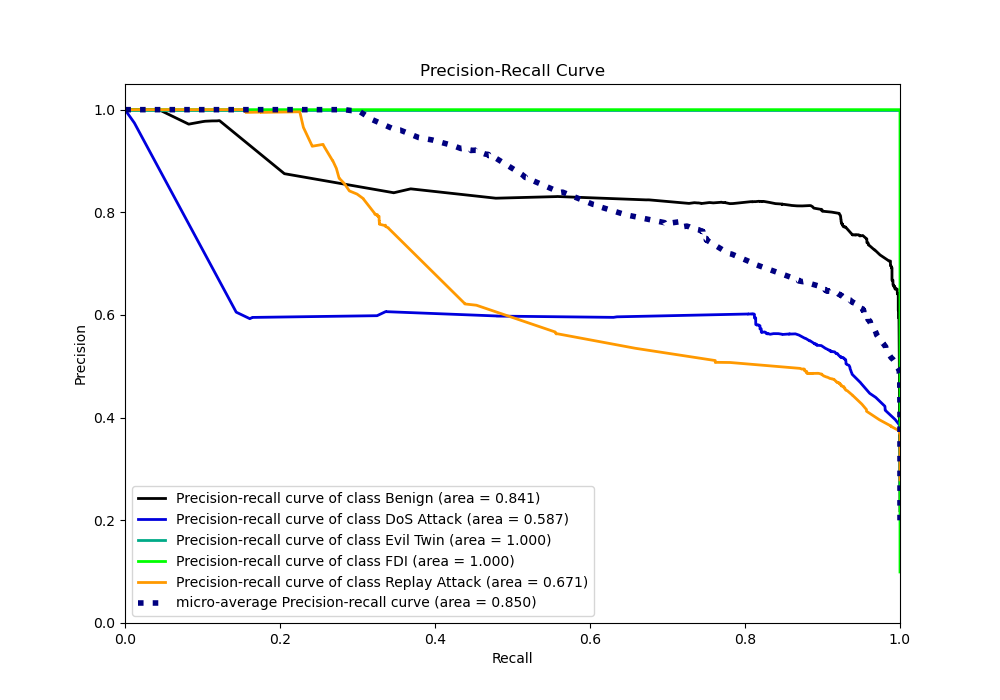

# Summary of 7_Default_RandomForest

[<< Go back](../README.md)

## Random Forest
- **n_jobs**: -1
- **criterion**: gini
- **max_features**: 0.9
- **min_samples_split**: 30
- **max_depth**: 4
- **eval_metric_name**: logloss
- **num_class**: 5
- **explain_level**: 2

## Validation
 - **validation_type**: kfold
 - **k_folds**: 5
 - **shuffle**: True
 - **random_seed**: 1082

## Optimized metric
logloss

## Training time

21.7 seconds

### Metric details
|           |      Benign |   DoS Attack |   Evil Twin |         FDI |   Replay Attack |   accuracy |    macro avg |   weighted avg |   logloss |
|:----------|------------:|-------------:|------------:|------------:|----------------:|-----------:|-------------:|---------------:|----------:|
| precision |    0.772265 |     0.588784 |           1 |    0.999708 |        0.739761 |   0.751132 |     0.820104 |       0.76614  |  0.515509 |
| recall    |    0.9268   |     0.82523  |           1 |    0.999708 |        0.334721 |   0.751132 |     0.817292 |       0.751132 |  0.515509 |
| f1-score  |    0.842505 |     0.687238 |           1 |    0.999708 |        0.460899 |   0.751132 |     0.79807  |       0.730459 |  0.515509 |
| support   | 7541        |  9338        |        4547 | 3425        |     9605        |   0.751132 | 34456        |   34456        |  0.515509 |

## Confusion matrix
|                          |   Predicted as Benign |   Predicted as DoS Attack |   Predicted as Evil Twin |   Predicted as FDI |   Predicted as Replay Attack |
|:-------------------------|----------------------:|--------------------------:|-------------------------:|-------------------:|-----------------------------:|
| Labeled as Benign        |                  6989 |                       138 |                        0 |                  1 |                          413 |
| Labeled as DoS Attack    |                   914 |                      7706 |                        0 |                  0 |                          718 |
| Labeled as Evil Twin     |                     0 |                         0 |                     4547 |                  0 |                            0 |
| Labeled as FDI           |                     1 |                         0 |                        0 |               3424 |                            0 |
| Labeled as Replay Attack |                  1146 |                      5244 |                        0 |                  0 |                         3215 |

## Learning curves

## Permutation-based Importance

## Confusion Matrix

## Normalized Confusion Matrix

## ROC Curve

## Precision Recall Curve

[<< Go back](../README.md)
