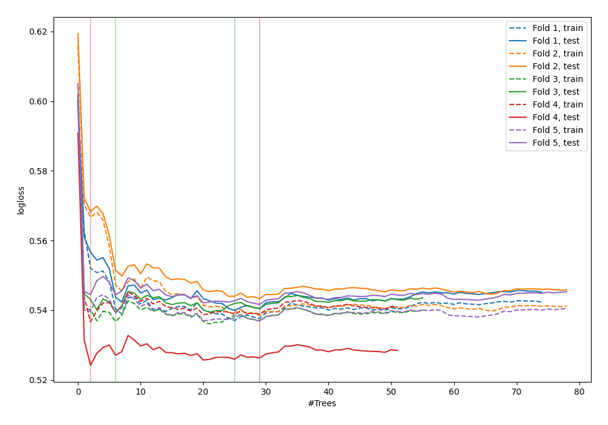
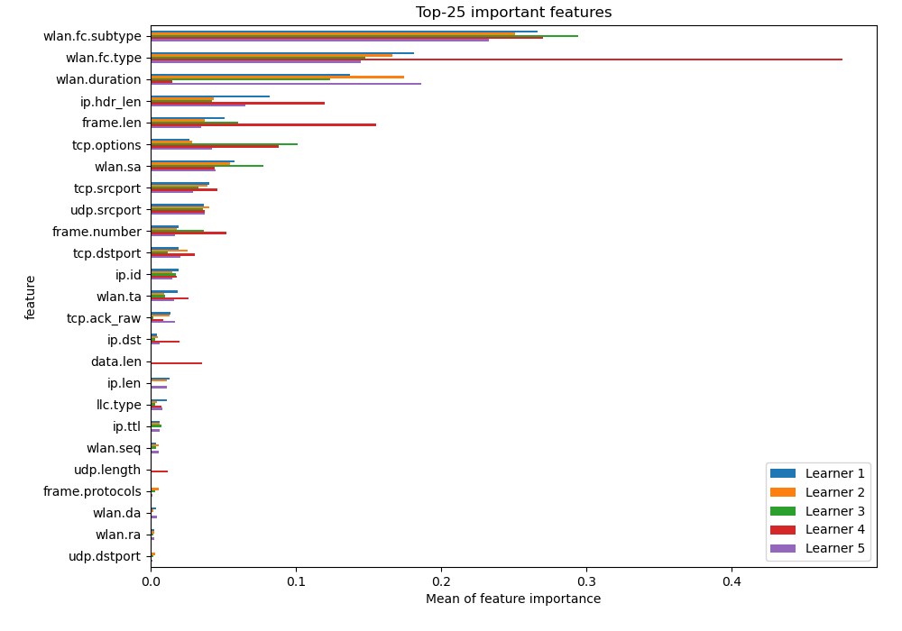
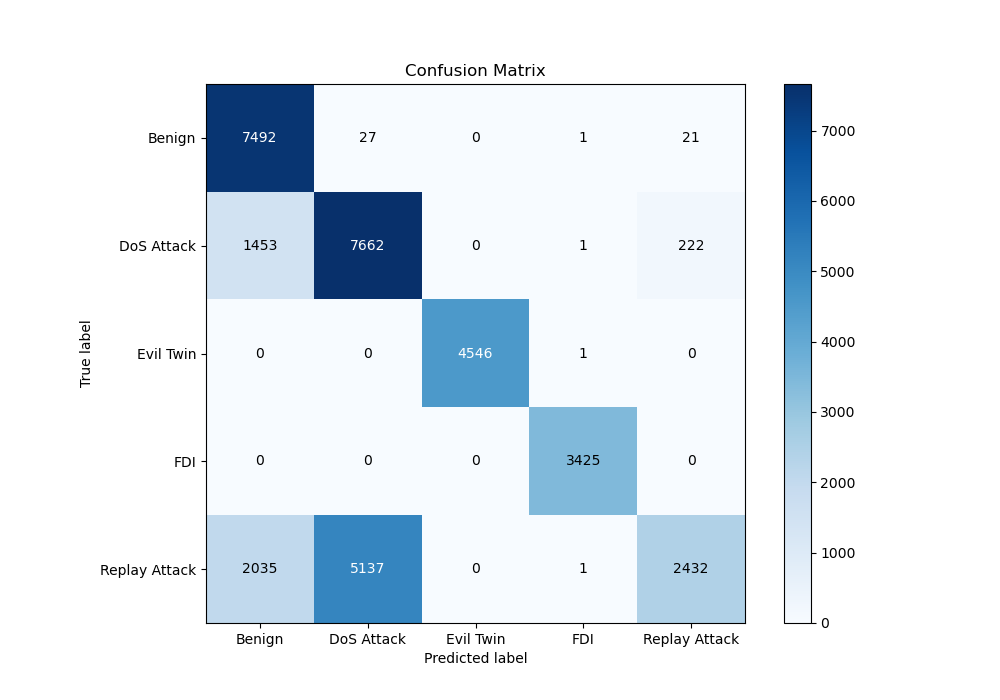
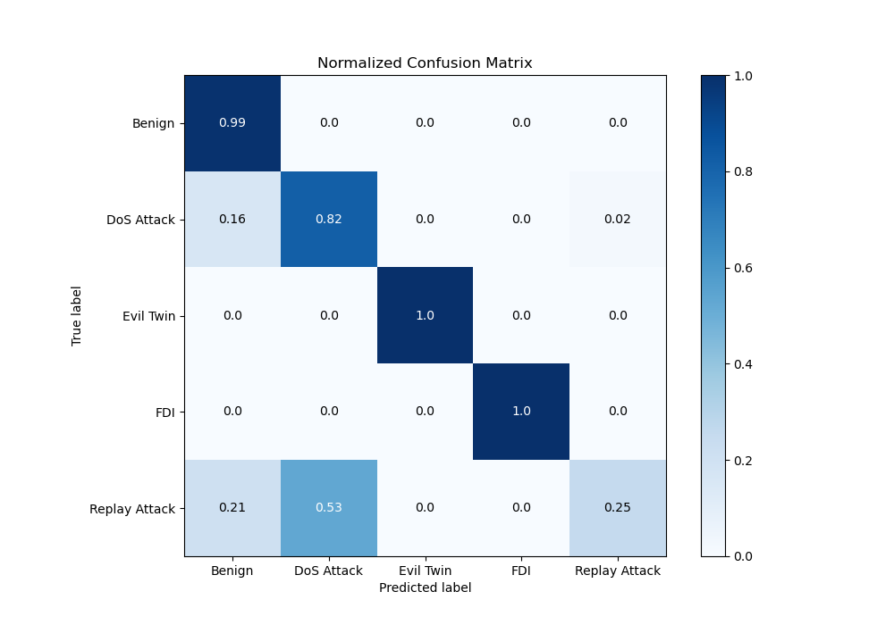
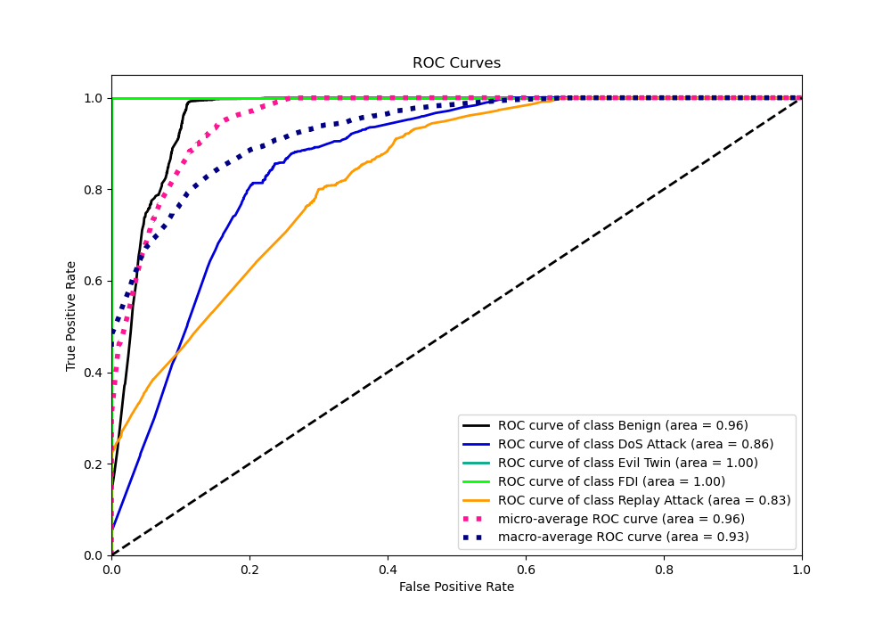
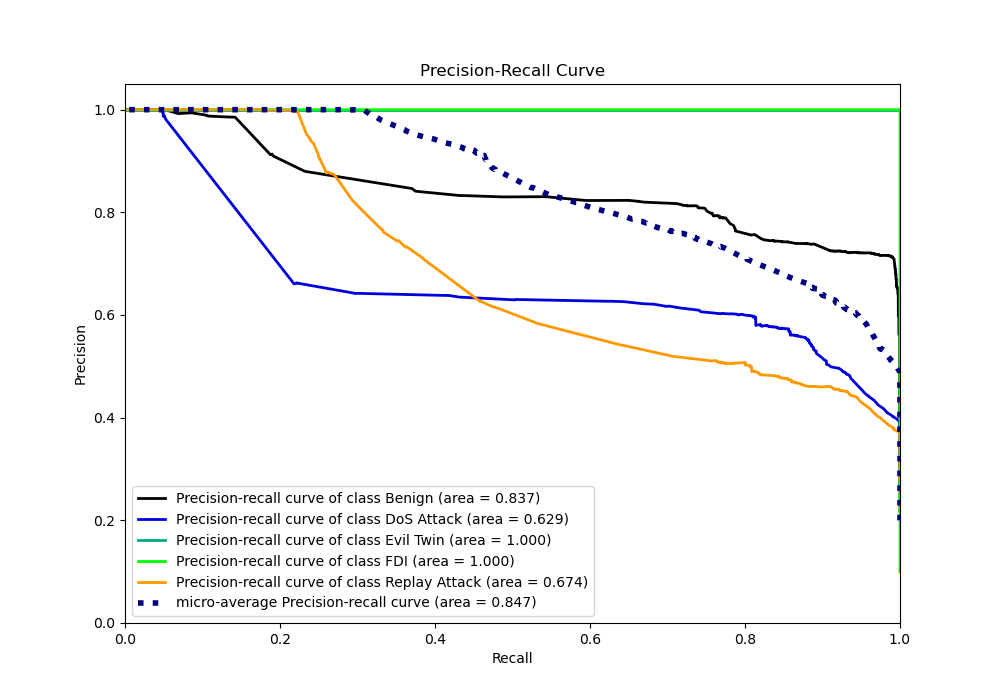

# Summary of 8_Default_ExtraTrees

[<< Go back](../README.md)

## Extra Trees Classifier (Extra Trees)
- **n_jobs**: -1
- **criterion**: gini
- **max_features**: 0.9
- **min_samples_split**: 30
- **max_depth**: 4
- **eval_metric_name**: logloss
- **num_class**: 5
- **explain_level**: 2

## Validation
 - **validation_type**: kfold
 - **k_folds**: 5
 - **shuffle**: True
 - **random_seed**: 1082

## Optimized metric
logloss

## Training time

15.4 seconds

### Metric details
|           |      Benign |   DoS Attack |   Evil Twin |         FDI |   Replay Attack |   accuracy |    macro avg |   weighted avg |   logloss |
|:----------|------------:|-------------:|------------:|------------:|----------------:|-----------:|-------------:|---------------:|----------:|
| precision |    0.682332 |     0.59738  |     1       |    0.998833 |        0.909159 |   0.741729 |     0.837541 |       0.795922 |  0.537698 |
| recall    |    0.993502 |     0.820518 |     0.99978 |    1        |        0.253201 |   0.741729 |     0.8134   |       0.741729 |  0.537698 |
| f1-score  |    0.809028 |     0.691391 |     0.99989 |    0.999416 |        0.396091 |   0.741729 |     0.779163 |       0.706148 |  0.537698 |
| support   | 7541        |  9338        |  4547       | 3425        |     9605        |   0.741729 | 34456        |   34456        |  0.537698 |

## Confusion matrix
|                          |   Predicted as Benign |   Predicted as DoS Attack |   Predicted as Evil Twin |   Predicted as FDI |   Predicted as Replay Attack |
|:-------------------------|----------------------:|--------------------------:|-------------------------:|-------------------:|-----------------------------:|
| Labeled as Benign        |                  7492 |                        27 |                        0 |                  1 |                           21 |
| Labeled as DoS Attack    |                  1453 |                      7662 |                        0 |                  1 |                          222 |
| Labeled as Evil Twin     |                     0 |                         0 |                     4546 |                  1 |                            0 |
| Labeled as FDI           |                     0 |                         0 |                        0 |               3425 |                            0 |
| Labeled as Replay Attack |                  2035 |                      5137 |                        0 |                  1 |                         2432 |

## Learning curves

## Permutation-based Importance

## Confusion Matrix

## Normalized Confusion Matrix

## ROC Curve

## Precision Recall Curve

[<< Go back](../README.md)
