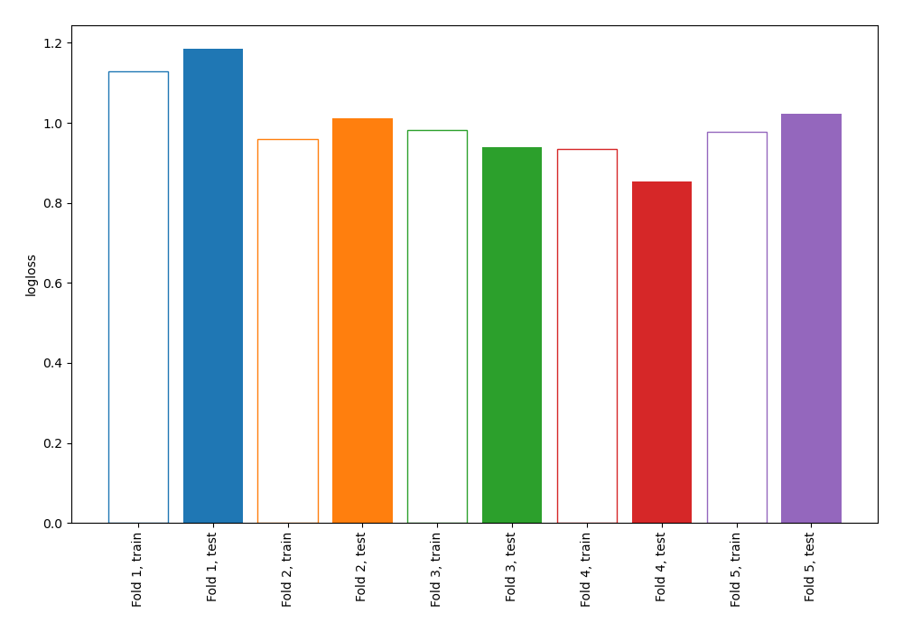
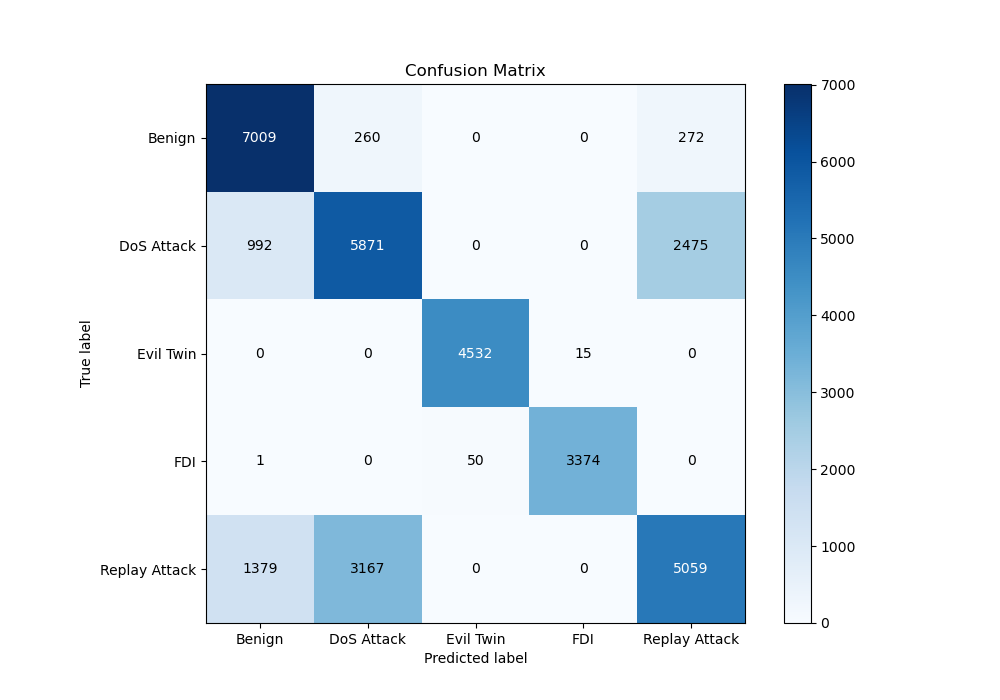
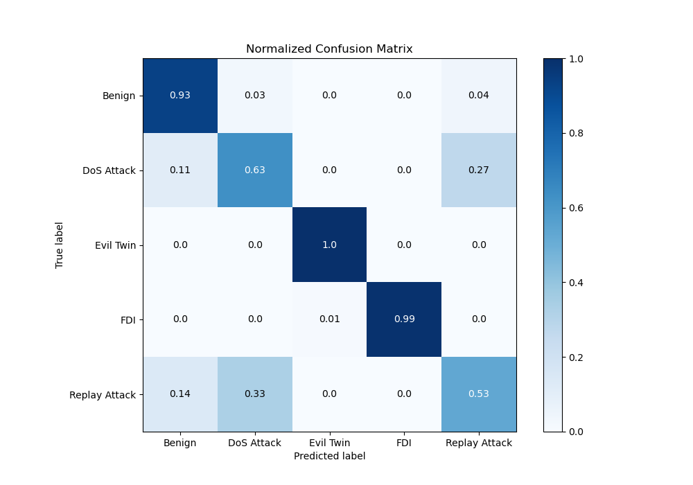
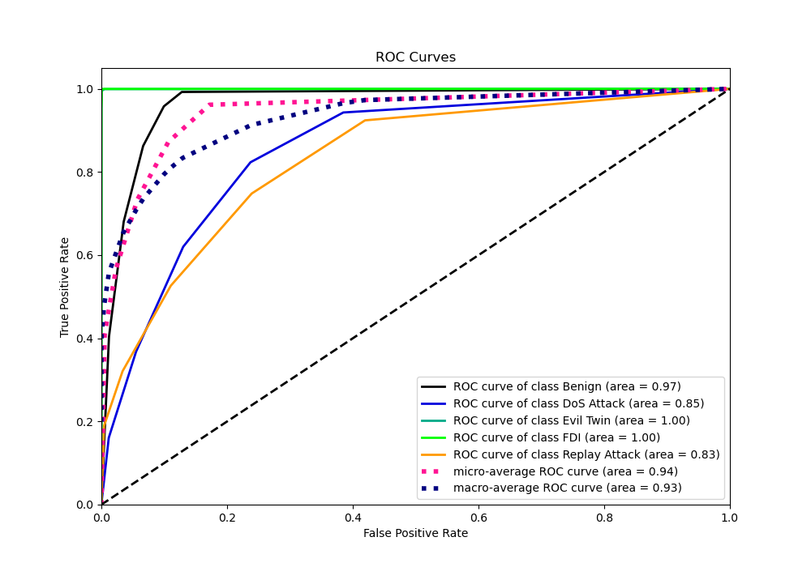
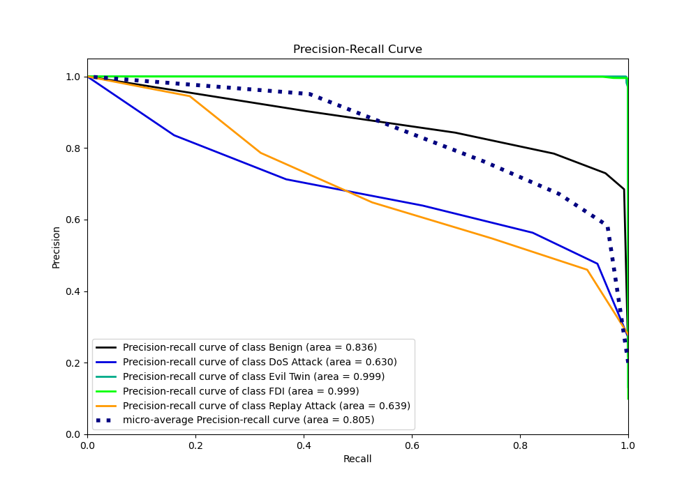

# Summary of 9_Default_NearestNeighbors

[<< Go back](../README.md)

## k-Nearest Neighbors (Nearest Neighbors)
- **n_jobs**: -1
- **n_neighbors**: 5
- **weights**: uniform
- **num_class**: 5
- **explain_level**: 2

## Validation
 - **validation_type**: kfold
 - **k_folds**: 5
 - **shuffle**: True
 - **random_seed**: 1082

## Optimized metric
logloss

## Training time

5.0 seconds

### Metric details
|           |      Benign |   DoS Attack |   Evil Twin |         FDI |   Replay Attack |   accuracy |    macro avg |   weighted avg |   logloss |
|:----------|------------:|-------------:|------------:|------------:|----------------:|-----------:|-------------:|---------------:|----------:|
| precision |    0.747148 |     0.631426 |    0.989088 |    0.995574 |        0.648091 |   0.750087 |     0.802265 |       0.744795 |   1.00225 |
| recall    |    0.929452 |     0.628721 |    0.996701 |    0.985109 |        0.526705 |   0.750087 |     0.813338 |       0.750087 |   1.00225 |
| f1-score  |    0.828389 |     0.630071 |    0.99288  |    0.990314 |        0.581127 |   0.750087 |     0.804556 |       0.743518 |   1.00225 |
| support   | 7541        |  9338        | 4547        | 3425        |     9605        |   0.750087 | 34456        |   34456        |   1.00225 |

## Confusion matrix
|                          |   Predicted as Benign |   Predicted as DoS Attack |   Predicted as Evil Twin |   Predicted as FDI |   Predicted as Replay Attack |
|:-------------------------|----------------------:|--------------------------:|-------------------------:|-------------------:|-----------------------------:|
| Labeled as Benign        |                  7009 |                       260 |                        0 |                  0 |                          272 |
| Labeled as DoS Attack    |                   992 |                      5871 |                        0 |                  0 |                         2475 |
| Labeled as Evil Twin     |                     0 |                         0 |                     4532 |                 15 |                            0 |
| Labeled as FDI           |                     1 |                         0 |                       50 |               3374 |                            0 |
| Labeled as Replay Attack |                  1379 |                      3167 |                        0 |                  0 |                         5059 |

## Learning curves

## Confusion Matrix

## Normalized Confusion Matrix

## ROC Curve

## Precision Recall Curve

[<< Go back](../README.md)
