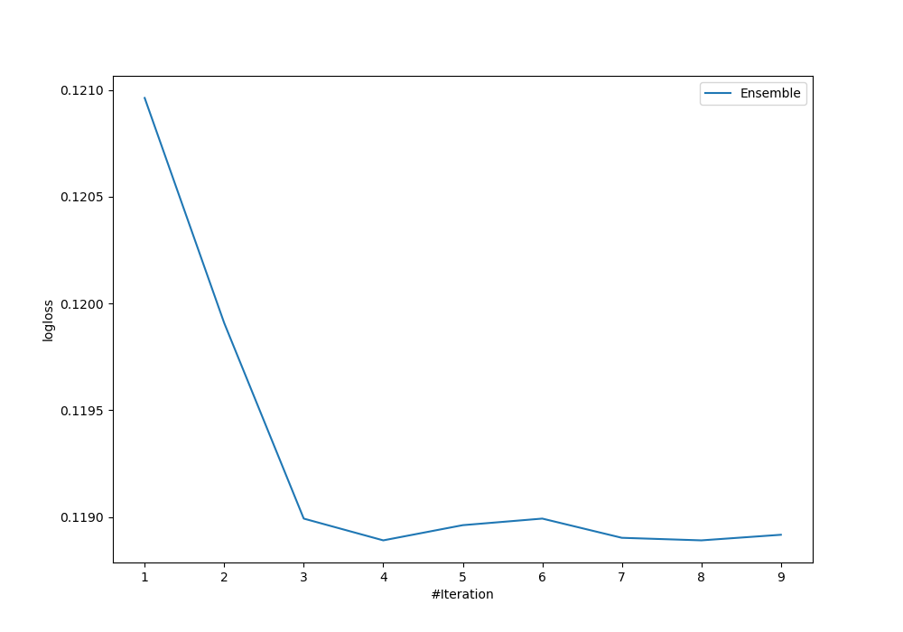
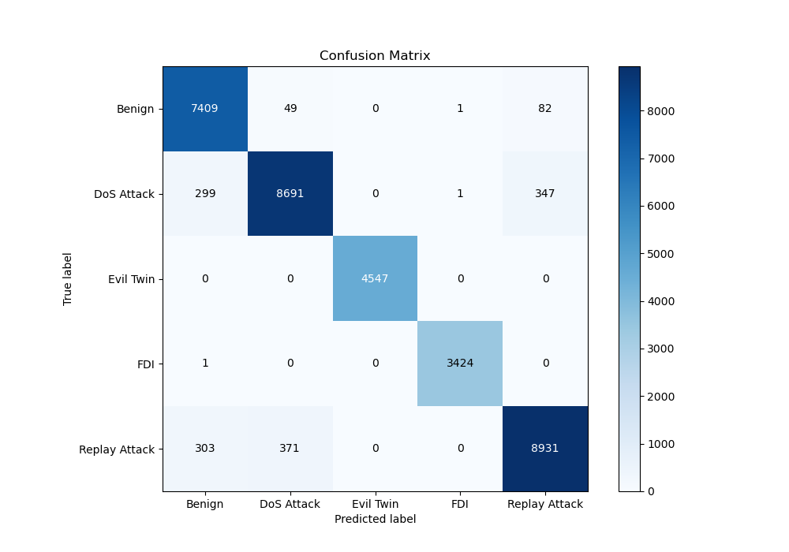
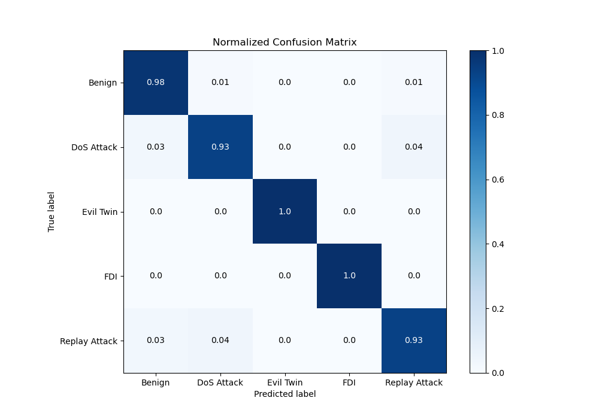
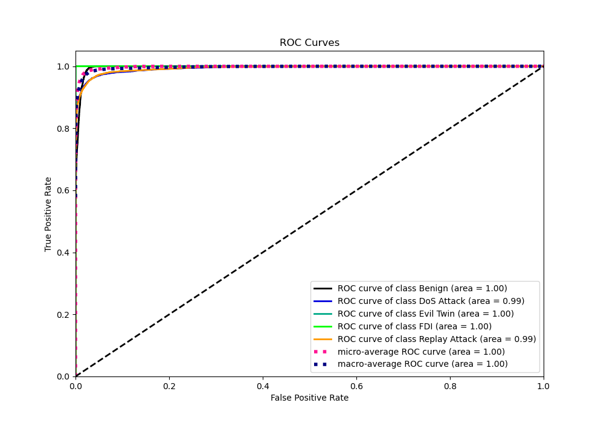
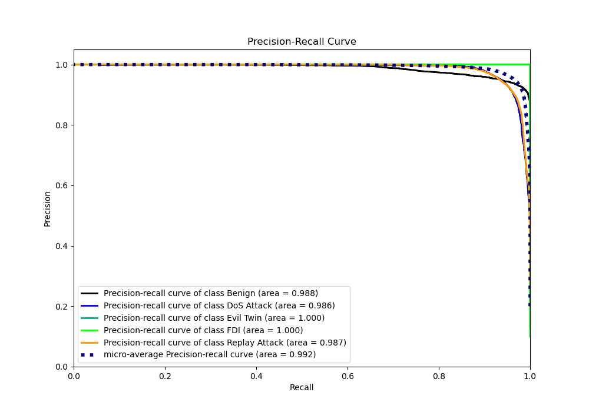

# Summary of Ensemble

[<< Go back](../README.md)

## Ensemble structure
| Model              |   Weight |
|:-------------------|---------:|
| 3_Default_LightGBM |        3 |
| 4_Default_Xgboost  |        1 |

### Metric details
|           |      Benign |   DoS Attack |   Evil Twin |         FDI |   Replay Attack |   accuracy |    macro avg |   weighted avg |   logloss |
|:----------|------------:|-------------:|------------:|------------:|----------------:|-----------:|-------------:|---------------:|----------:|
| precision |    0.924738 |     0.953902 |           1 |    0.999416 |        0.954167 |   0.957801 |     0.966445 |       0.9582   |   0.11889 |
| recall    |    0.982496 |     0.930713 |           1 |    0.999708 |        0.929828 |   0.957801 |     0.968549 |       0.957801 |   0.11889 |
| f1-score  |    0.952742 |     0.942165 |           1 |    0.999562 |        0.94184  |   0.957801 |     0.967262 |       0.957727 |   0.11889 |
| support   | 7541        |  9338        |        4547 | 3425        |     9605        |   0.957801 | 34456        |   34456        |   0.11889 |

## Confusion matrix
|                          |   Predicted as Benign |   Predicted as DoS Attack |   Predicted as Evil Twin |   Predicted as FDI |   Predicted as Replay Attack |
|:-------------------------|----------------------:|--------------------------:|-------------------------:|-------------------:|-----------------------------:|
| Labeled as Benign        |                  7409 |                        49 |                        0 |                  1 |                           82 |
| Labeled as DoS Attack    |                   299 |                      8691 |                        0 |                  1 |                          347 |
| Labeled as Evil Twin     |                     0 |                         0 |                     4547 |                  0 |                            0 |
| Labeled as FDI           |                     1 |                         0 |                        0 |               3424 |                            0 |
| Labeled as Replay Attack |                   303 |                       371 |                        0 |                  0 |                         8931 |

## Learning curves

## Confusion Matrix

## Normalized Confusion Matrix

## ROC Curve

## Precision Recall Curve

[<< Go back](../README.md)
