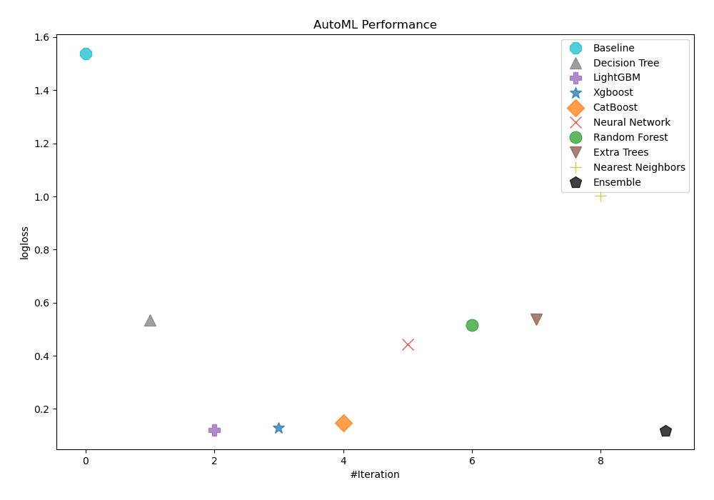
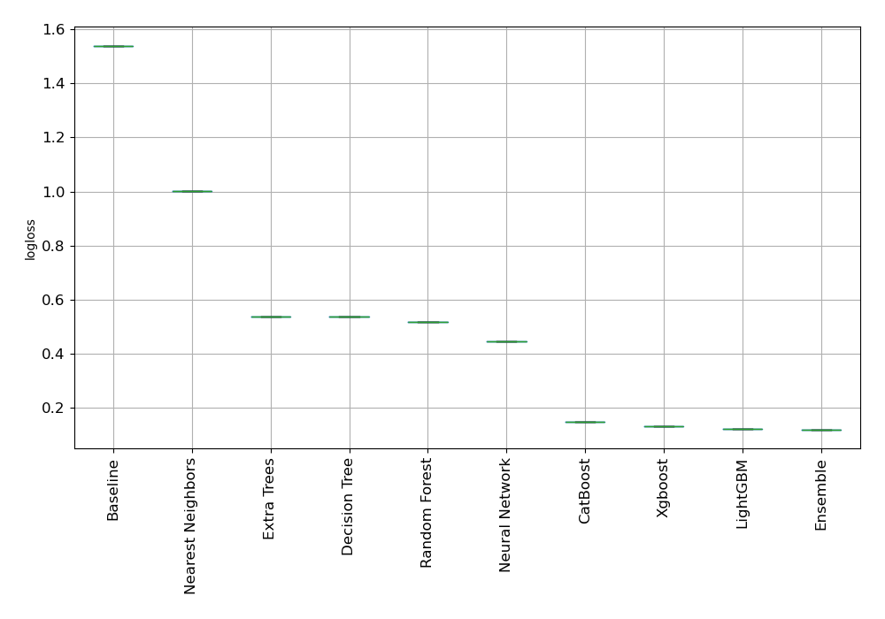
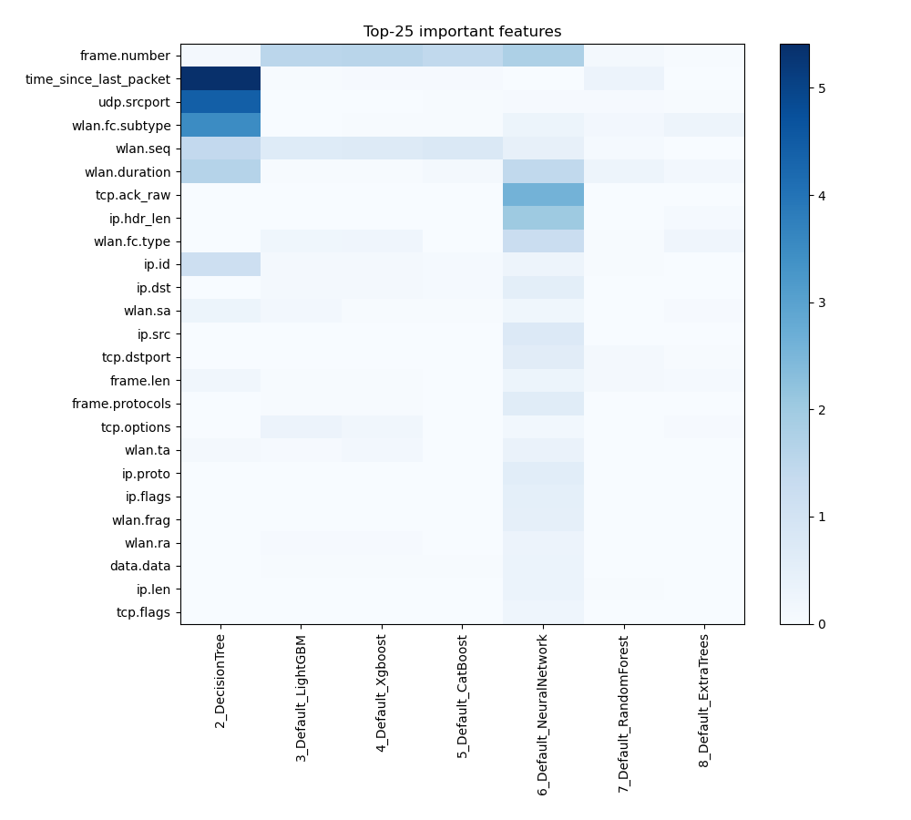
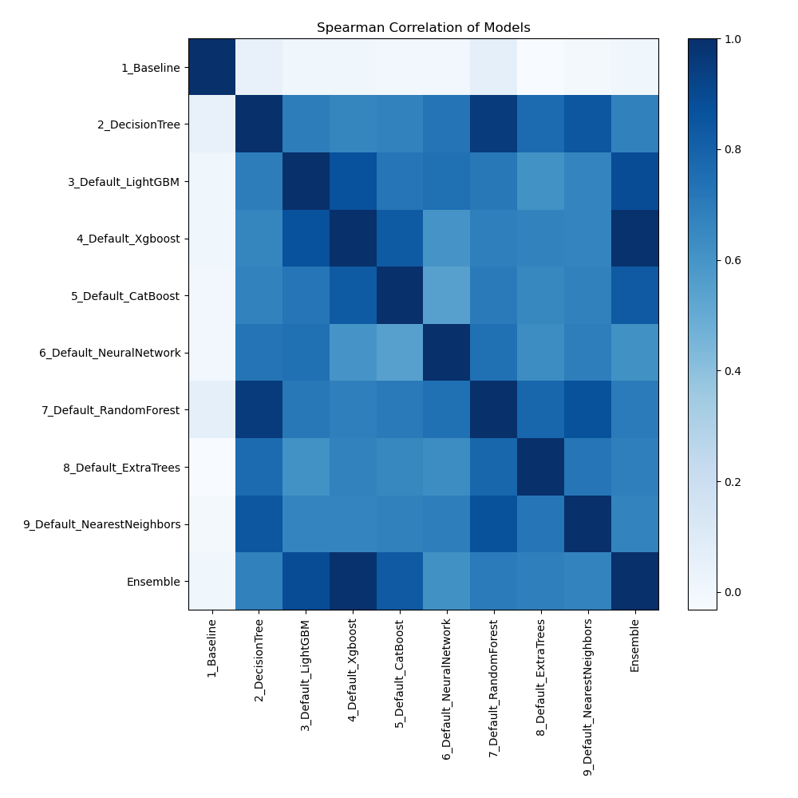

# AutoML Leaderboard

| Best model   | name                                                               | model_type        | metric_type   |   metric_value |   train_time |
|:-------------|:-------------------------------------------------------------------|:------------------|:--------------|---------------:|-------------:|
|              | [1_Baseline](1_Baseline/README.md)                                 | Baseline          | logloss       |       1.53937  |         2.56 |
|              | [2_DecisionTree](2_DecisionTree/README.md)                         | Decision Tree     | logloss       |       0.535386 |        34.4  |
|              | [3_Default_LightGBM](3_Default_LightGBM/README.md)                 | LightGBM          | logloss       |       0.120963 |       538.56 |
|              | [4_Default_Xgboost](4_Default_Xgboost/README.md)                   | Xgboost           | logloss       |       0.129057 |       146.46 |
|              | [5_Default_CatBoost](5_Default_CatBoost/README.md)                 | CatBoost          | logloss       |       0.148095 |       186.49 |
|              | [6_Default_NeuralNetwork](6_Default_NeuralNetwork/README.md)       | Neural Network    | logloss       |       0.44349  |        41.24 |
|              | [7_Default_RandomForest](7_Default_RandomForest/README.md)         | Random Forest     | logloss       |       0.515509 |        22.7  |
|              | [8_Default_ExtraTrees](8_Default_ExtraTrees/README.md)             | Extra Trees       | logloss       |       0.537698 |        16.38 |
|              | [9_Default_NearestNeighbors](9_Default_NearestNeighbors/README.md) | Nearest Neighbors | logloss       |       1.00225  |         5.56 |
| **the best** | [Ensemble](Ensemble/README.md)                                     | Ensemble          | logloss       |       0.11889  |         1.94 |

### AutoML Performance

### AutoML Performance Boxplot

### Features Importance

### Spearman Correlation of Models

