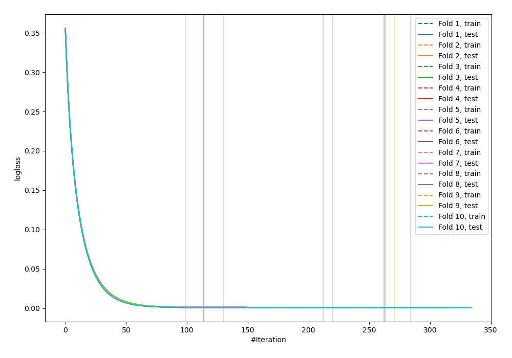
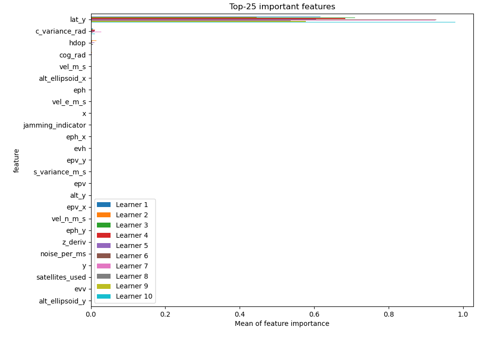
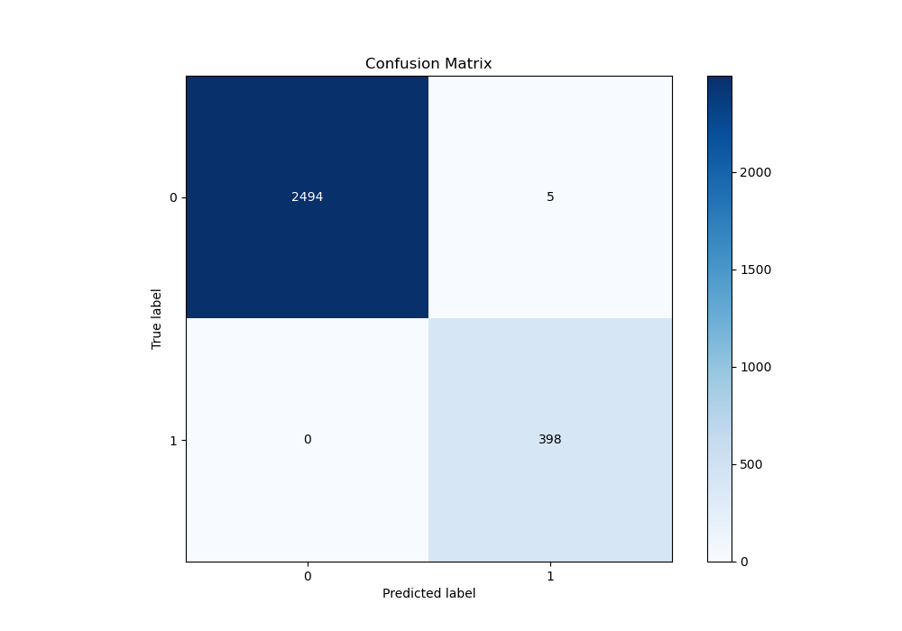
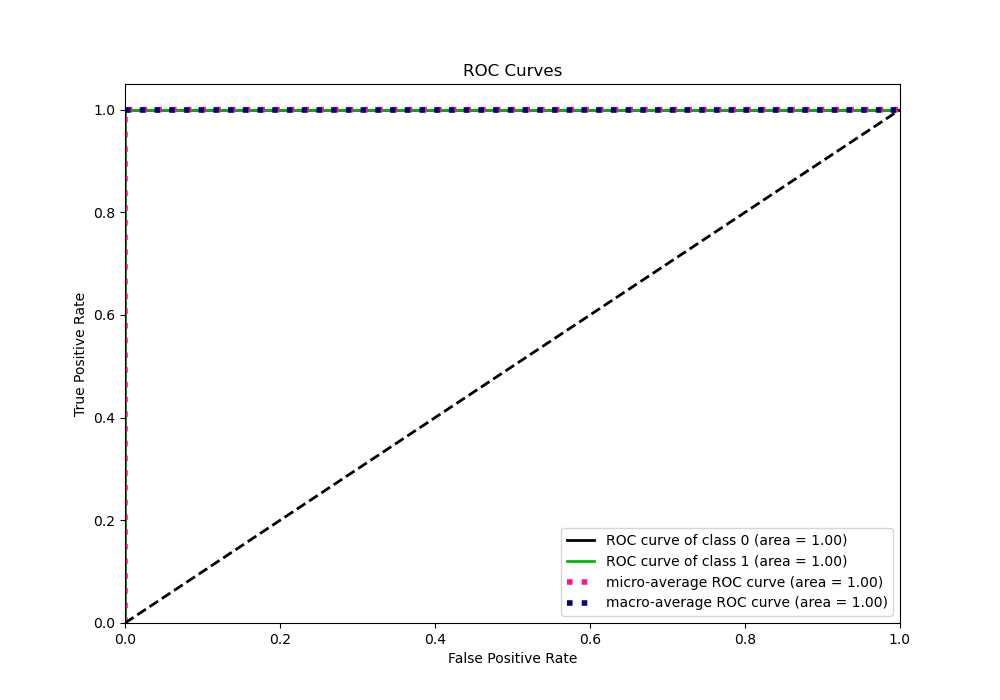
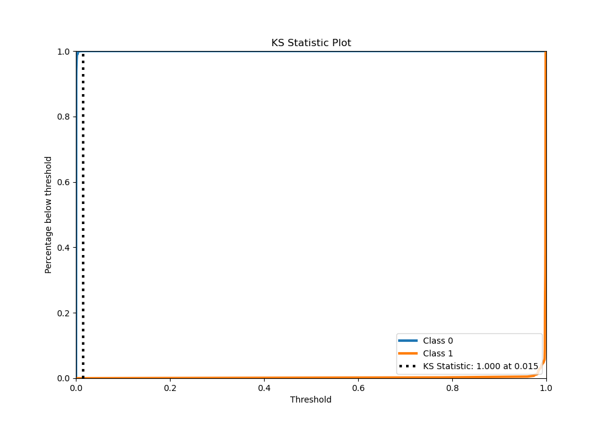
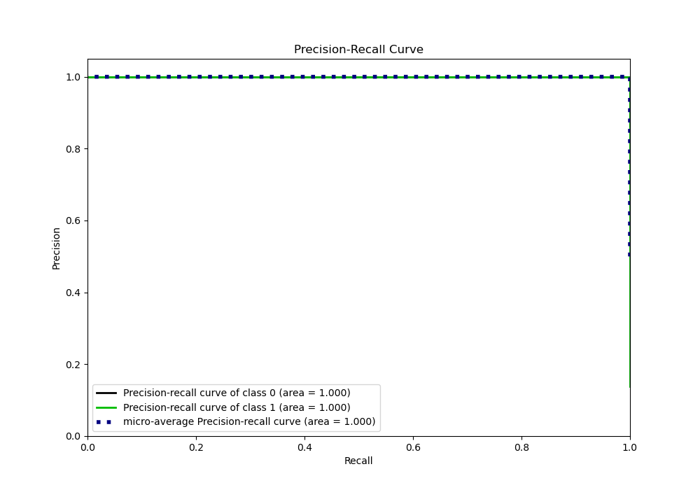
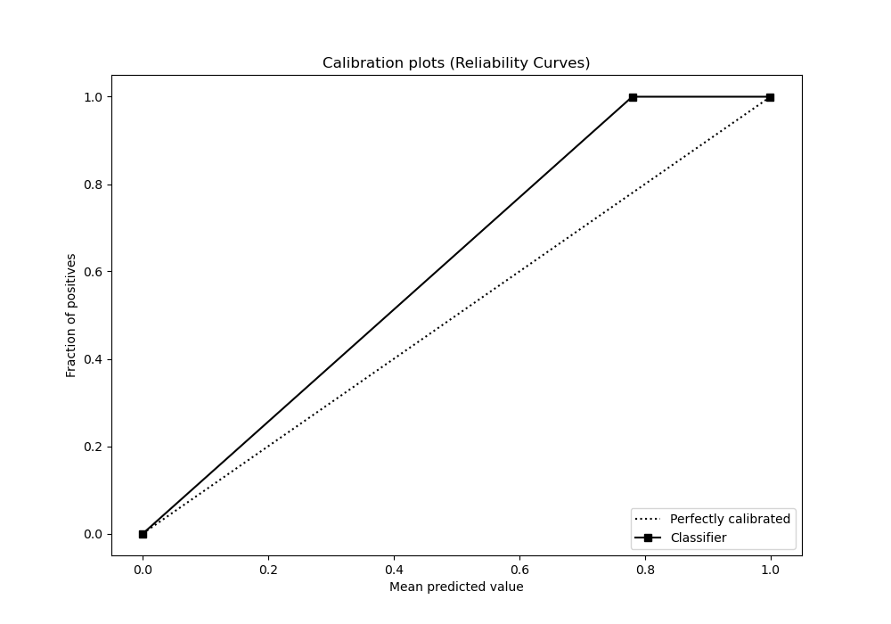
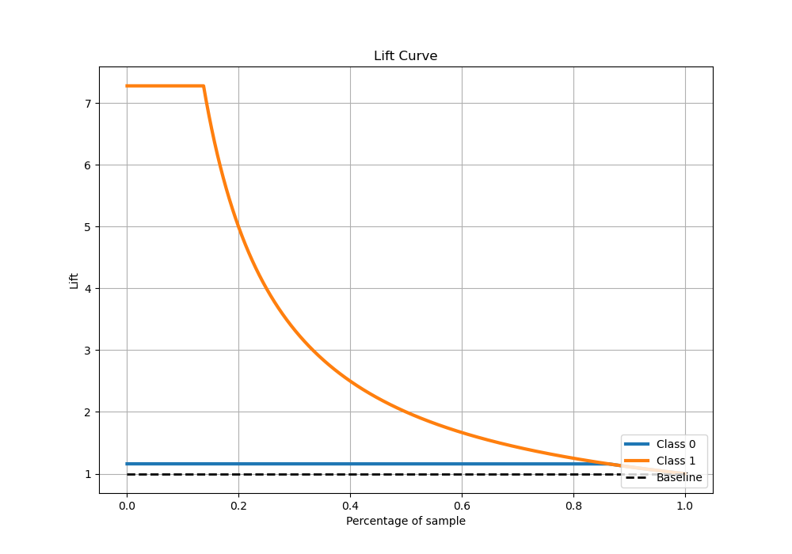

# Summary of 108_Xgboost_SelectedFeatures

[<< Go back](../README.md)

## Extreme Gradient Boosting (Xgboost)
- **n_jobs**: -1
- **objective**: binary:logistic
- **eta**: 0.075
- **max_depth**: 8
- **min_child_weight**: 1
- **subsample**: 1.0
- **colsample_bytree**: 1.0
- **eval_metric**: logloss
- **explain_level**: 1

## Validation
 - **validation_type**: kfold
 - **shuffle**: True
 - **stratify**: True
 - **k_folds**: 10

## Optimized metric
logloss

## Training time

15.1 seconds

## Metric details
|           |       score |    threshold |
|:----------|------------:|-------------:|
| logloss   | 0.000836727 | nan          |
| auc       | 1           | nan          |
| f1        | 0.993758    |   0.00452347 |
| accuracy  | 0.998274    |   0.00452347 |
| precision | 1           |   0.996372   |
| recall    | 1           |   0.00020696 |
| mcc       | 0.992782    |   0.00452347 |

## Metric details with threshold from accuracy metric
|           |       score |    threshold |
|:----------|------------:|-------------:|
| logloss   | 0.000836727 | nan          |
| auc       | 1           | nan          |
| f1        | 0.993758    |   0.00452347 |
| accuracy  | 0.998274    |   0.00452347 |
| precision | 0.987593    |   0.00452347 |
| recall    | 1           |   0.00452347 |
| mcc       | 0.992782    |   0.00452347 |

## Confusion matrix (at threshold=0.004523)
|              |   Predicted as 0 |   Predicted as 1 |
|:-------------|-----------------:|-----------------:|
| Labeled as 0 |             2494 |                5 |
| Labeled as 1 |                0 |              398 |

## Learning curves

## Permutation-based Importance

## Confusion Matrix

## Normalized Confusion Matrix

## ROC Curve

## Kolmogorov-Smirnov Statistic

## Precision-Recall Curve

## Calibration Curve

## Cumulative Gains Curve

## Lift Curve

[<< Go back](../README.md)
