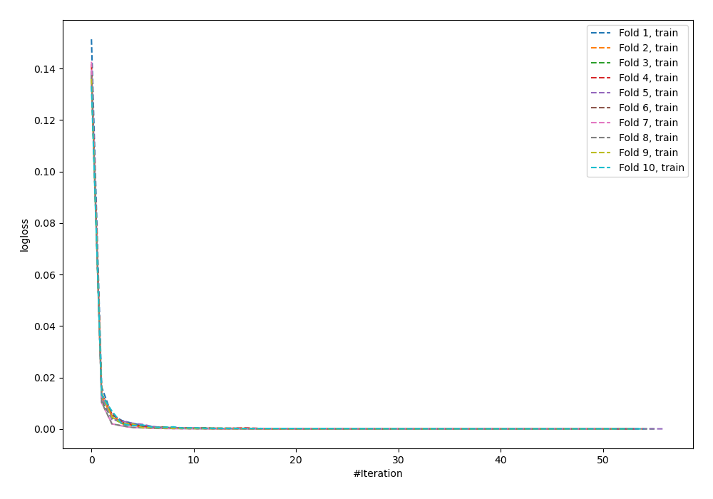
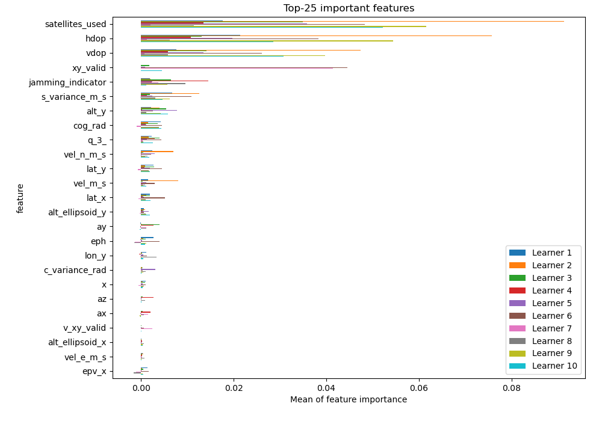
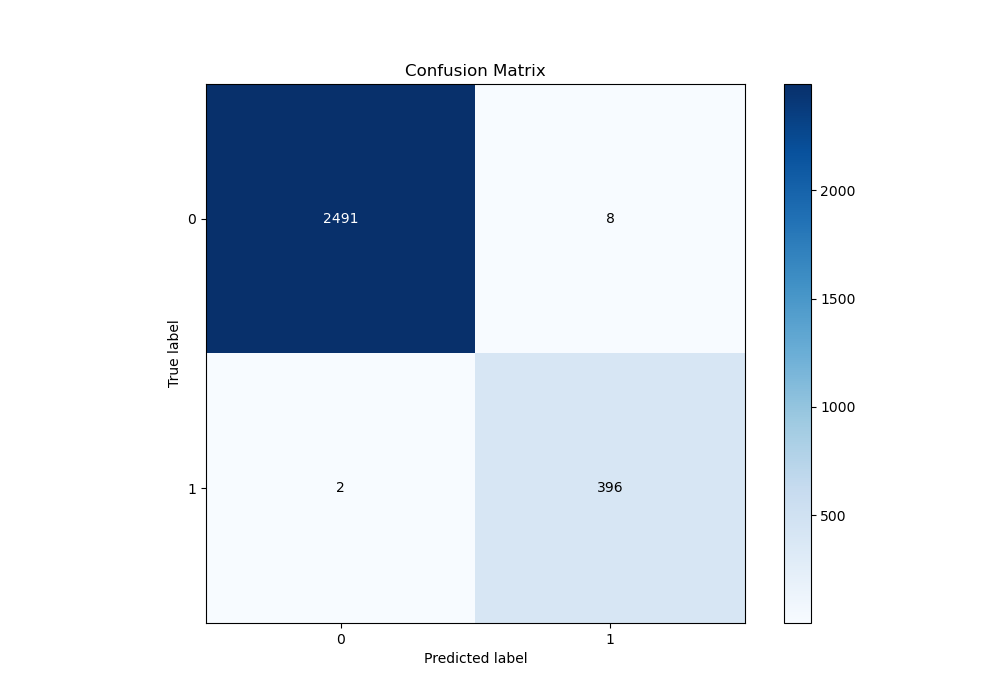
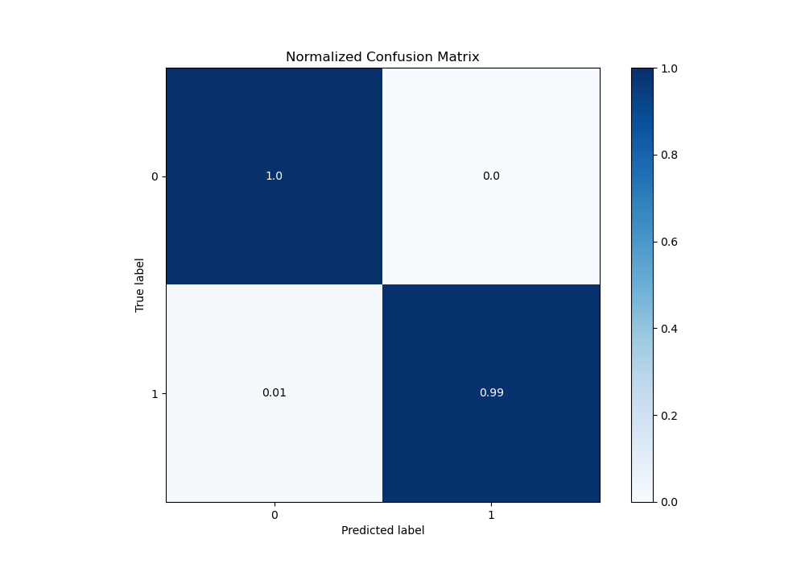
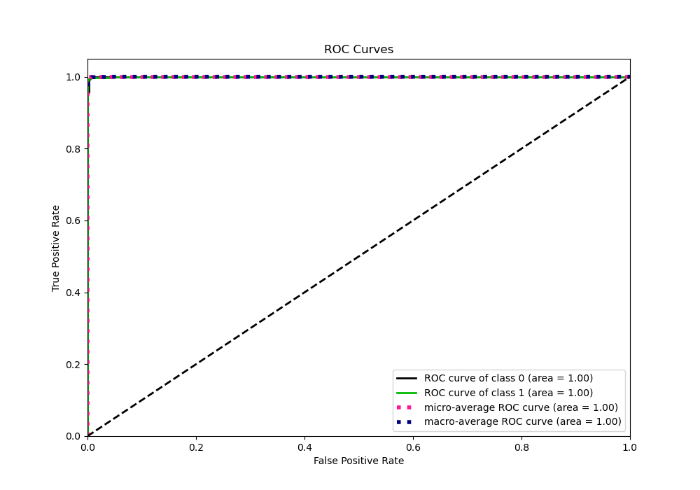
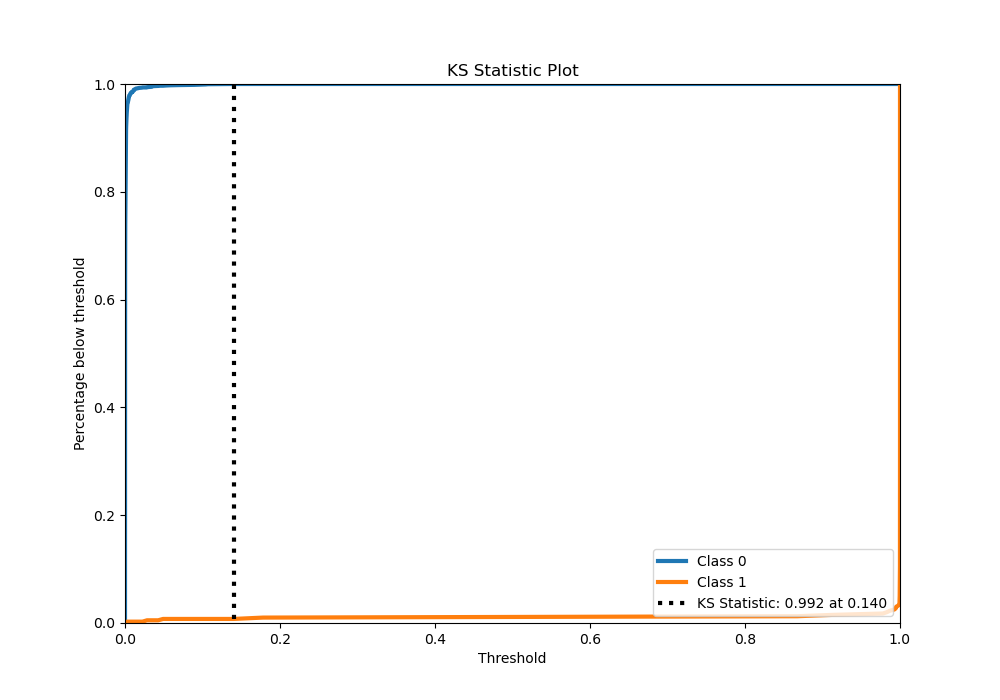
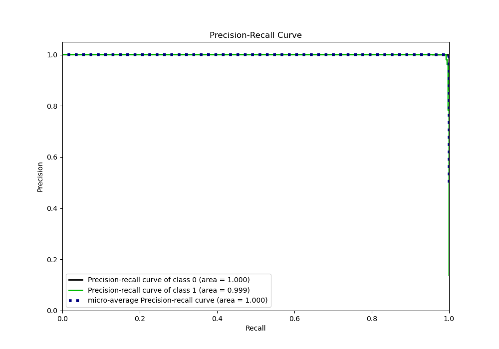
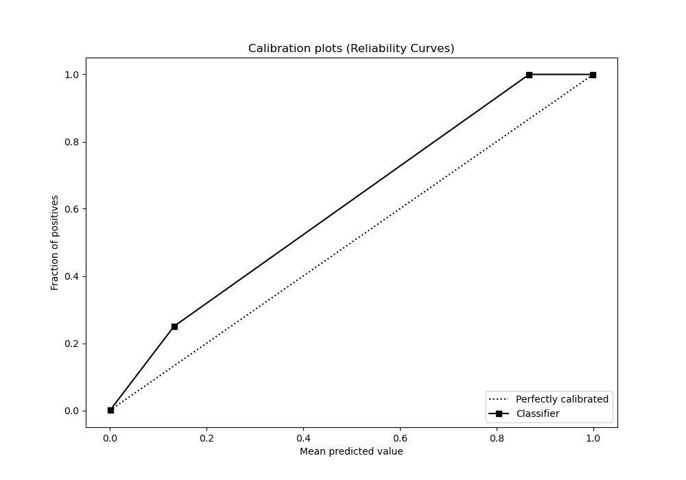
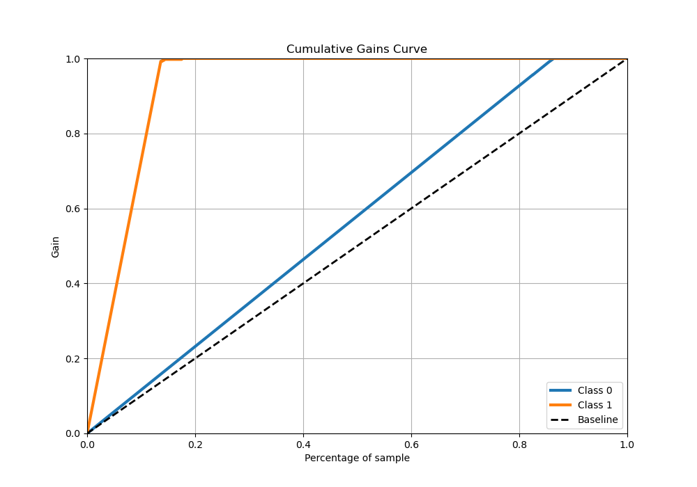
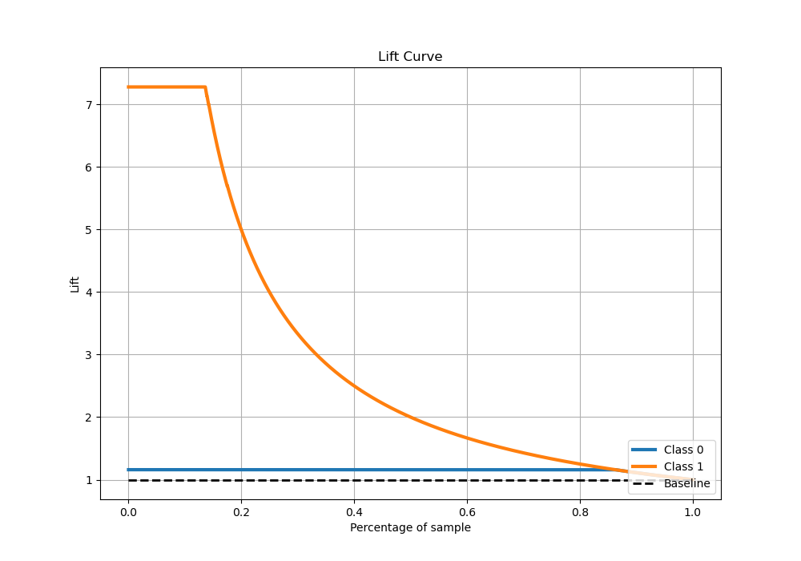

# Summary of 111_NeuralNetwork

[<< Go back](../README.md)

## Neural Network
- **n_jobs**: -1
- **dense_1_size**: 64
- **dense_2_size**: 16
- **learning_rate**: 0.01
- **explain_level**: 1

## Validation
 - **validation_type**: kfold
 - **shuffle**: True
 - **stratify**: True
 - **k_folds**: 10

## Optimized metric
logloss

## Training time

17.3 seconds

## Metric details
|           |      score |     threshold |
|:----------|-----------:|--------------:|
| logloss   | 0.00582897 | nan           |
| auc       | 0.999865   | nan           |
| f1        | 0.987531   |   0.0459464   |
| accuracy  | 0.996548   |   0.0459464   |
| precision | 1          |   0.999664    |
| recall    | 1          |   7.27404e-09 |
| mcc       | 0.985565   |   0.0459464   |

## Metric details with threshold from accuracy metric
|           |      score |   threshold |
|:----------|-----------:|------------:|
| logloss   | 0.00582897 | nan         |
| auc       | 0.999865   | nan         |
| f1        | 0.987531   |   0.0459464 |
| accuracy  | 0.996548   |   0.0459464 |
| precision | 0.980198   |   0.0459464 |
| recall    | 0.994975   |   0.0459464 |
| mcc       | 0.985565   |   0.0459464 |

## Confusion matrix (at threshold=0.045946)
|              |   Predicted as 0 |   Predicted as 1 |
|:-------------|-----------------:|-----------------:|
| Labeled as 0 |             2491 |                8 |
| Labeled as 1 |                2 |              396 |

## Learning curves

## Permutation-based Importance

## Confusion Matrix

## Normalized Confusion Matrix

## ROC Curve

## Kolmogorov-Smirnov Statistic

## Precision-Recall Curve

## Calibration Curve

## Cumulative Gains Curve

## Lift Curve

[<< Go back](../README.md)
