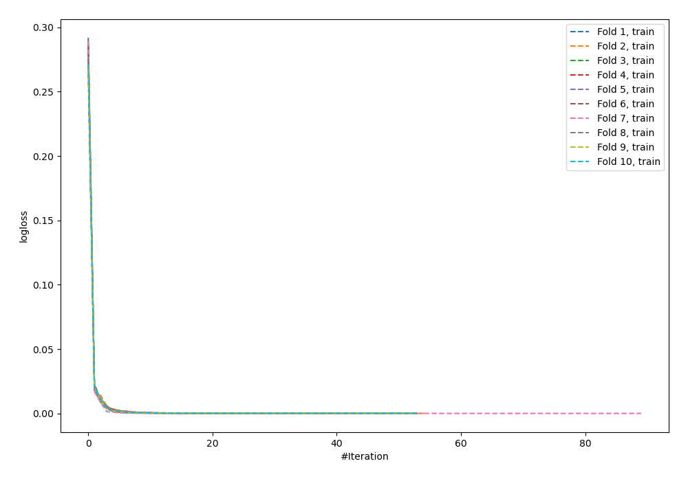
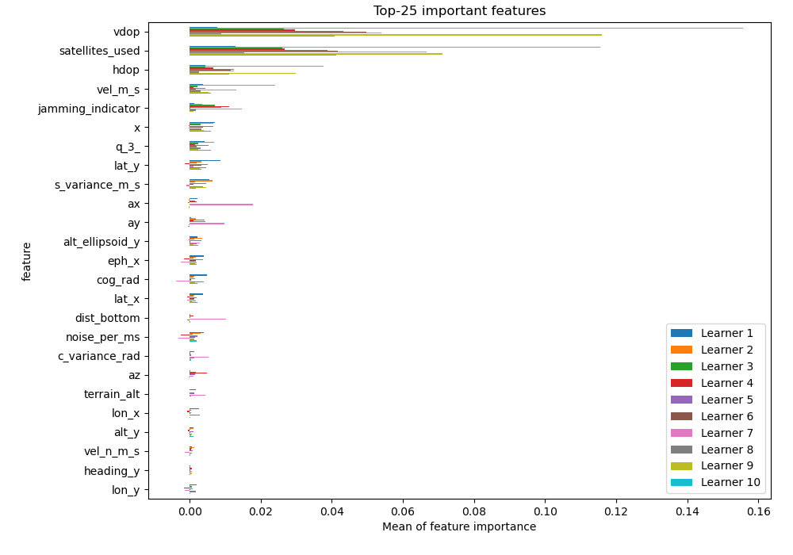
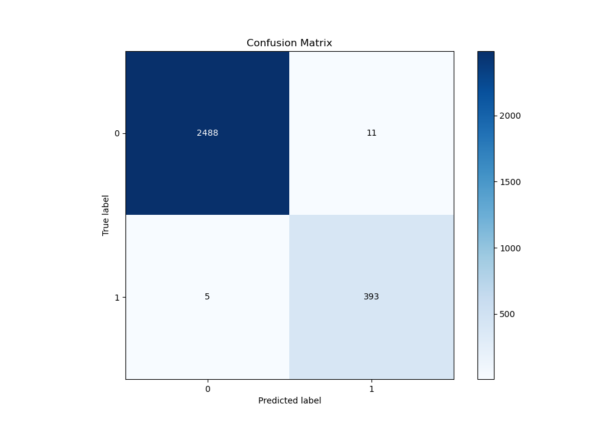
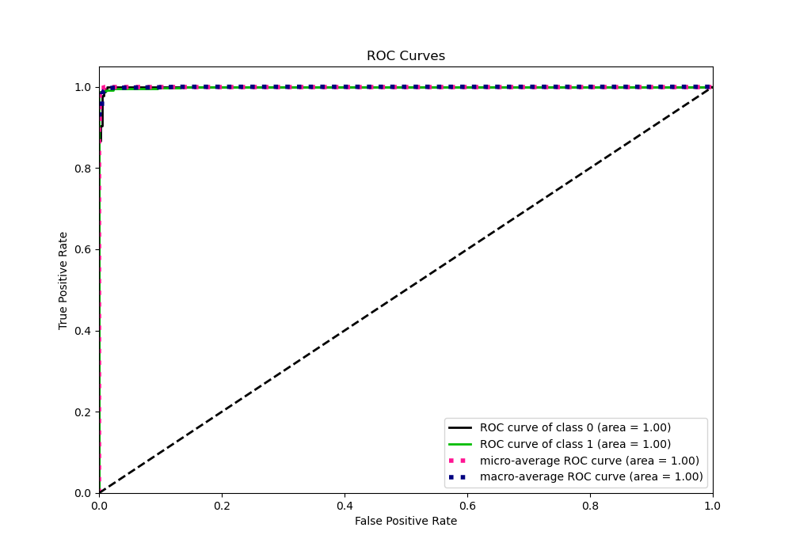
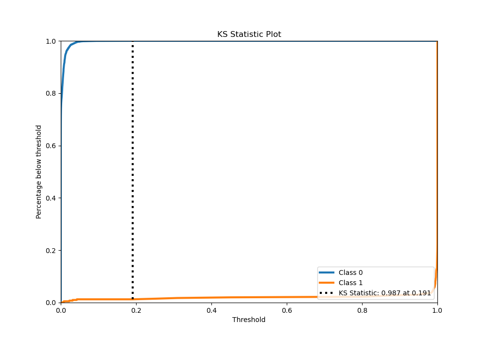
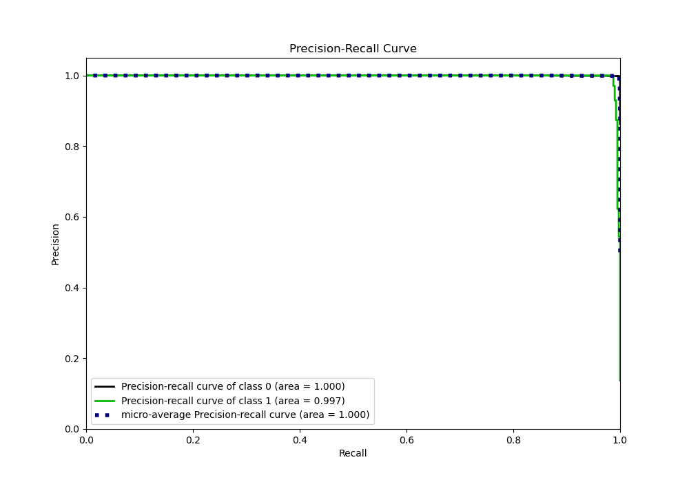
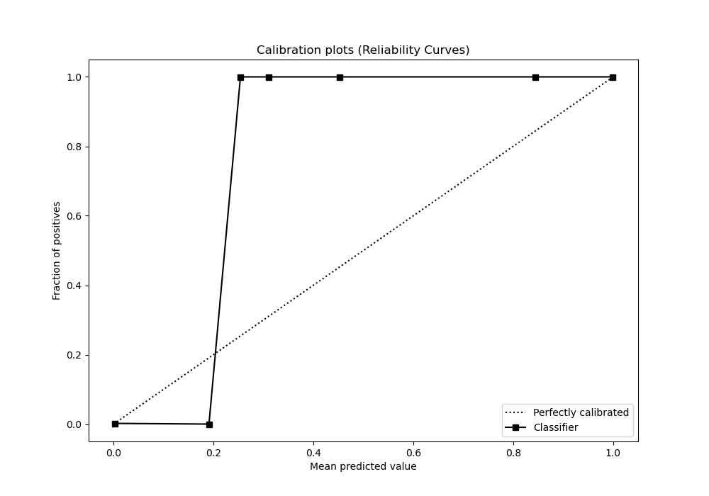
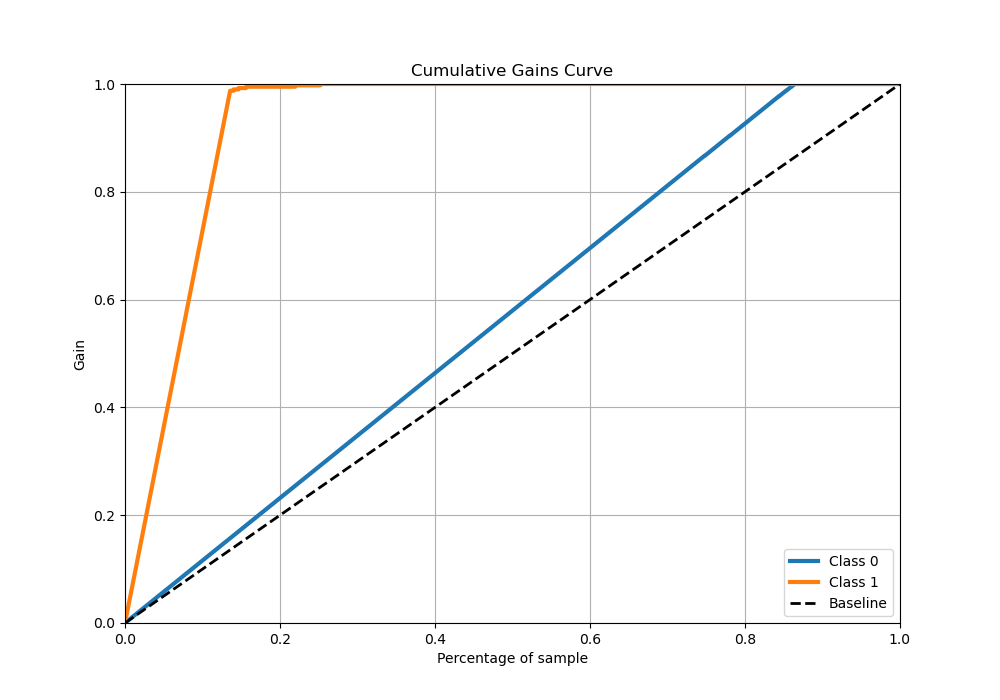
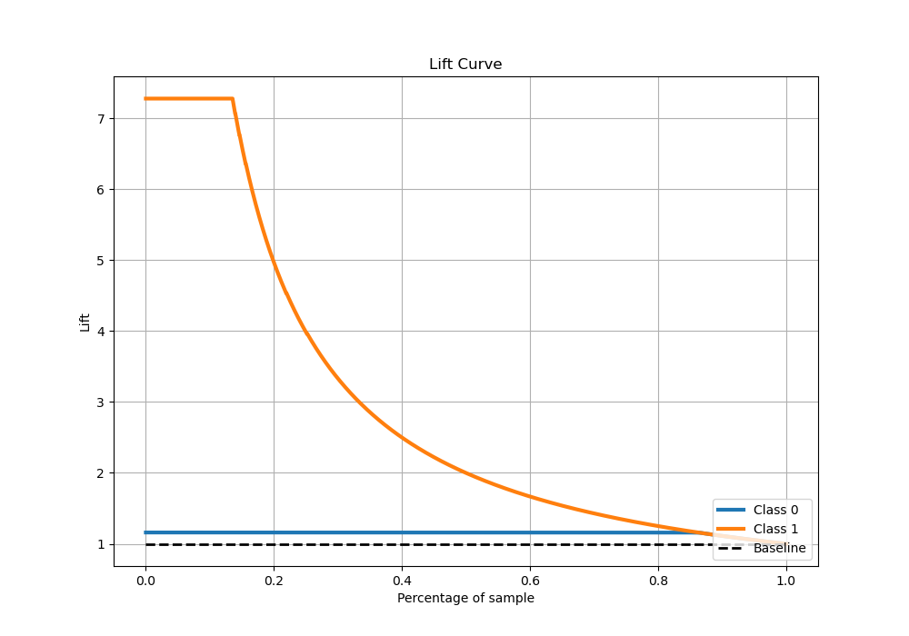

# Summary of 112_NeuralNetwork

[<< Go back](../README.md)

## Neural Network
- **n_jobs**: -1
- **dense_1_size**: 32
- **dense_2_size**: 16
- **learning_rate**: 0.01
- **explain_level**: 1

## Validation
 - **validation_type**: kfold
 - **shuffle**: True
 - **stratify**: True
 - **k_folds**: 10

## Optimized metric
logloss

## Training time

16.9 seconds

## Metric details
|           |     score |    threshold |
|:----------|----------:|-------------:|
| logloss   | 0.0106989 | nan          |
| auc       | 0.999324  | nan          |
| f1        | 0.98005   |   0.0431171  |
| accuracy  | 0.994477  |   0.0431171  |
| precision | 1         |   0.991297   |
| recall    | 1         |   8.8281e-09 |
| mcc       | 0.976882  |   0.0431171  |

## Metric details with threshold from accuracy metric
|           |     score |   threshold |
|:----------|----------:|------------:|
| logloss   | 0.0106989 | nan         |
| auc       | 0.999324  | nan         |
| f1        | 0.98005   |   0.0431171 |
| accuracy  | 0.994477  |   0.0431171 |
| precision | 0.972772  |   0.0431171 |
| recall    | 0.987437  |   0.0431171 |
| mcc       | 0.976882  |   0.0431171 |

## Confusion matrix (at threshold=0.043117)
|              |   Predicted as 0 |   Predicted as 1 |
|:-------------|-----------------:|-----------------:|
| Labeled as 0 |             2488 |               11 |
| Labeled as 1 |                5 |              393 |

## Learning curves

## Permutation-based Importance

## Confusion Matrix

## Normalized Confusion Matrix

## ROC Curve

## Kolmogorov-Smirnov Statistic

## Precision-Recall Curve

## Calibration Curve

## Cumulative Gains Curve

## Lift Curve

[<< Go back](../README.md)
