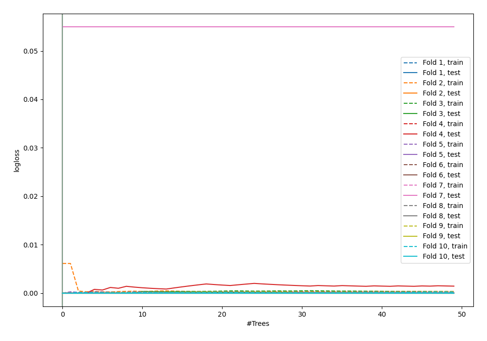
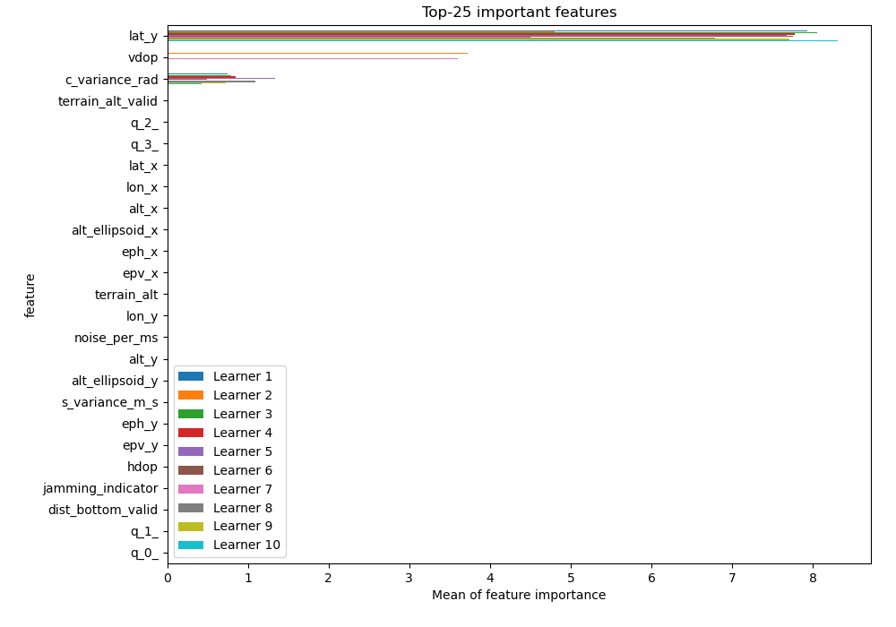
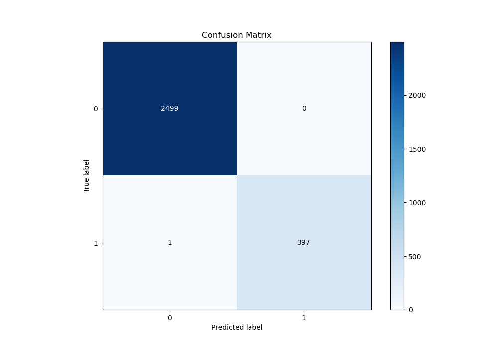
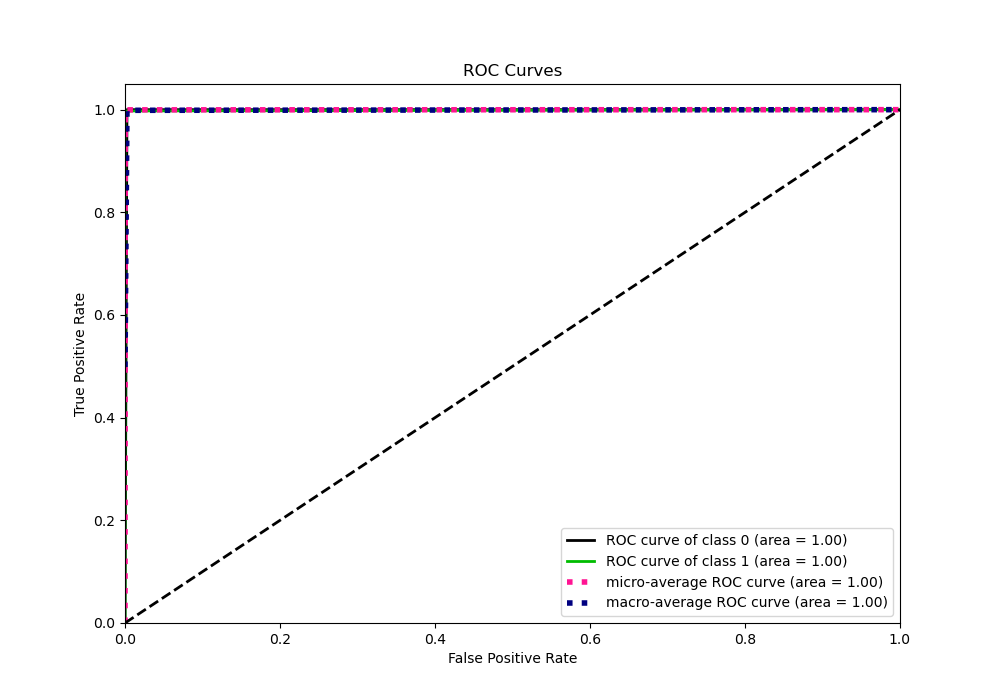
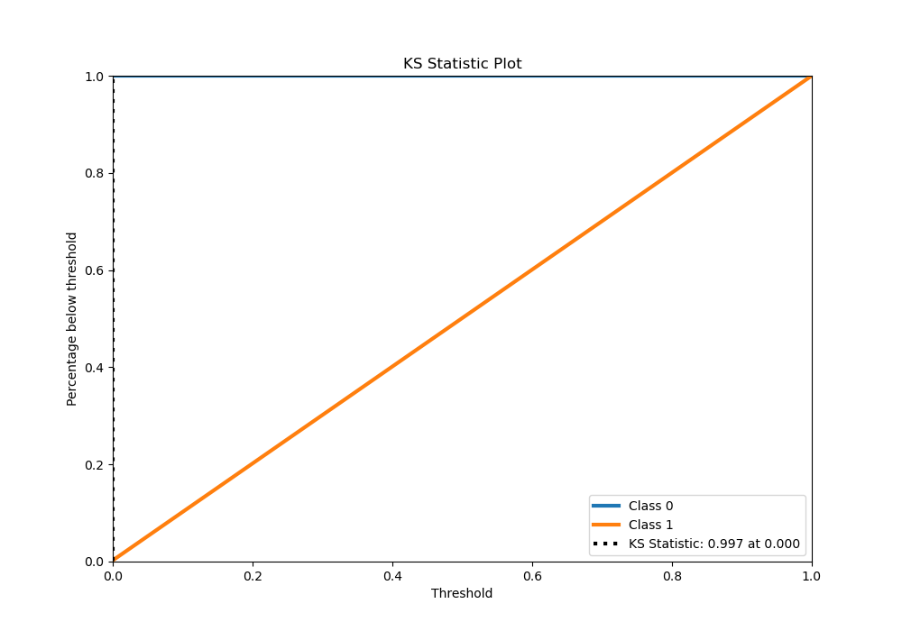
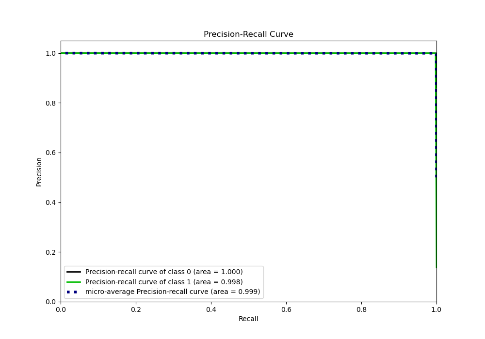
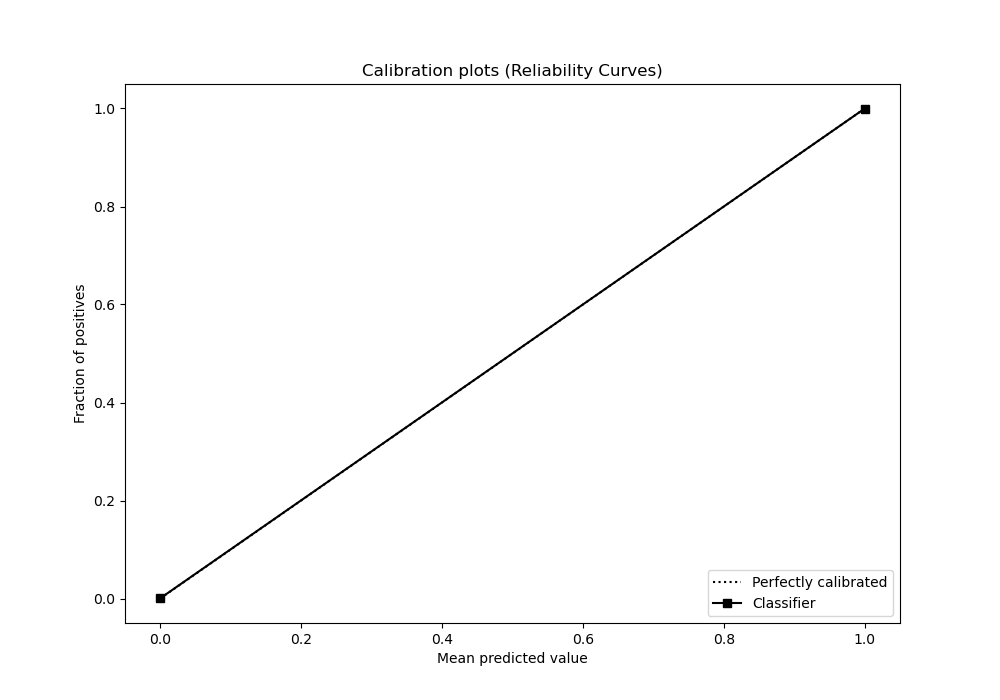
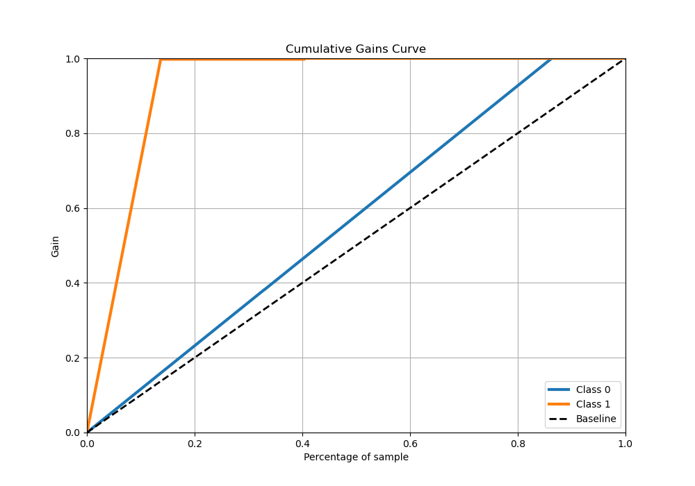
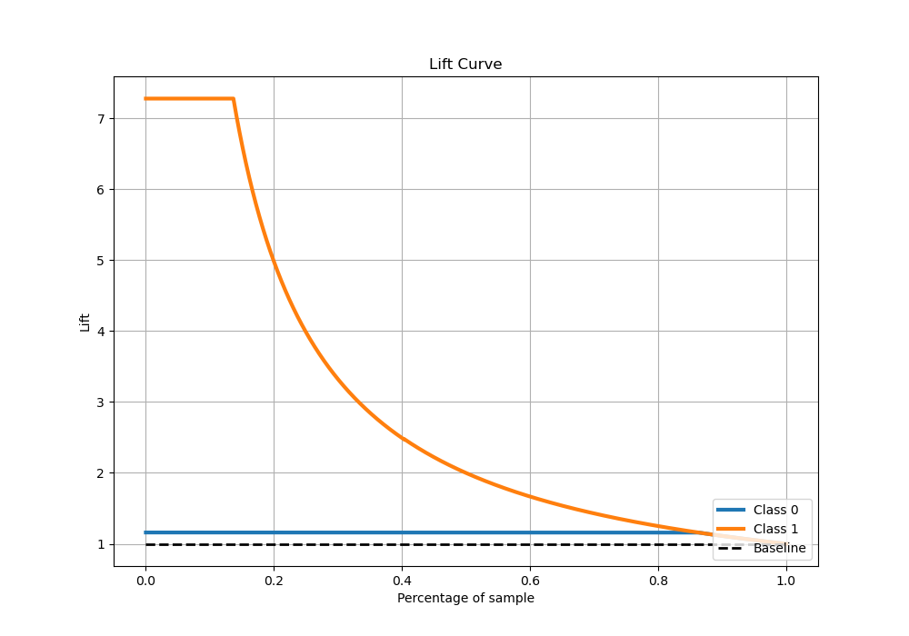

# Summary of 116_RandomForest

[<< Go back](../README.md)

## Random Forest
- **n_jobs**: -1
- **criterion**: gini
- **max_features**: 0.9
- **min_samples_split**: 20
- **max_depth**: 4
- **eval_metric_name**: logloss
- **explain_level**: 1

## Validation
 - **validation_type**: kfold
 - **shuffle**: True
 - **stratify**: True
 - **k_folds**: 10

## Optimized metric
logloss

## Training time

20.6 seconds

## Metric details
|           |      score |   threshold |
|:----------|-----------:|------------:|
| logloss   | 0.00550319 |         nan |
| auc       | 0.998744   |         nan |
| f1        | 0.998742   |           0 |
| accuracy  | 0.999655   |           0 |
| precision | 1          |           0 |
| recall    | 0.997487   |           0 |
| mcc       | 0.998543   |           0 |

## Metric details with threshold from accuracy metric
|           |      score |   threshold |
|:----------|-----------:|------------:|
| logloss   | 0.00550319 |         nan |
| auc       | 0.998744   |         nan |
| f1        | 0.998742   |           0 |
| accuracy  | 0.999655   |           0 |
| precision | 1          |           0 |
| recall    | 0.997487   |           0 |
| mcc       | 0.998543   |           0 |

## Confusion matrix (at threshold=0.0)
|              |   Predicted as 0 |   Predicted as 1 |
|:-------------|-----------------:|-----------------:|
| Labeled as 0 |             2499 |                0 |
| Labeled as 1 |                1 |              397 |

## Learning curves

## Permutation-based Importance

## Confusion Matrix

## Normalized Confusion Matrix

## ROC Curve

## Kolmogorov-Smirnov Statistic

## Precision-Recall Curve

## Calibration Curve

## Cumulative Gains Curve

## Lift Curve

[<< Go back](../README.md)
