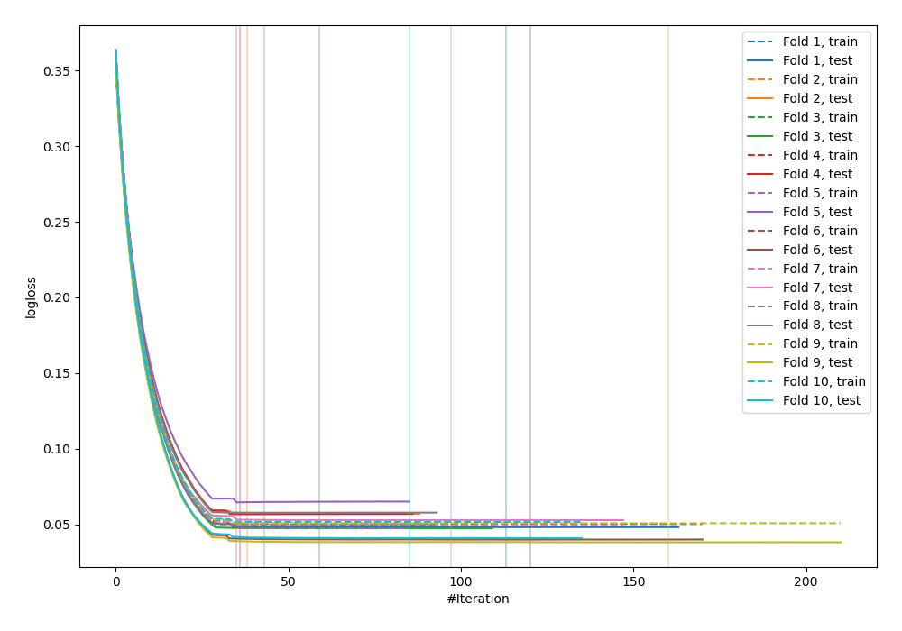
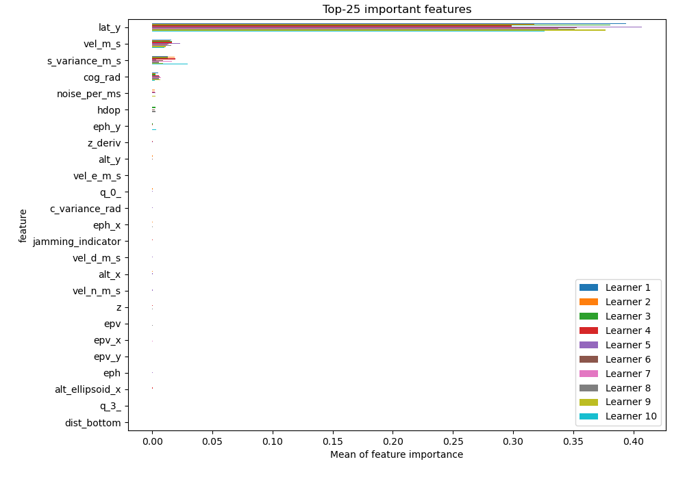
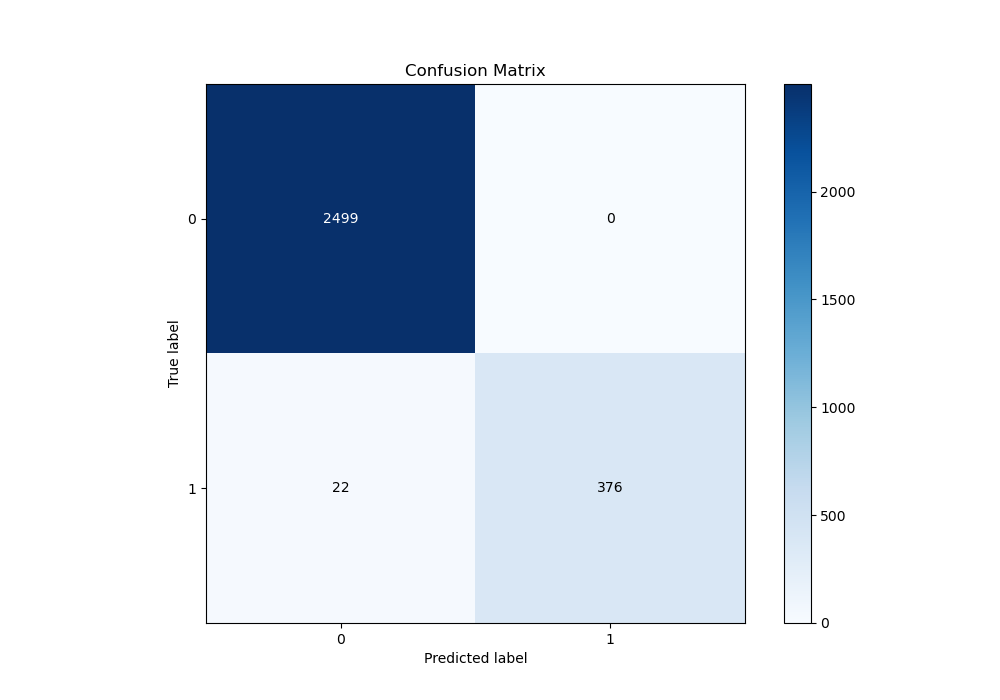
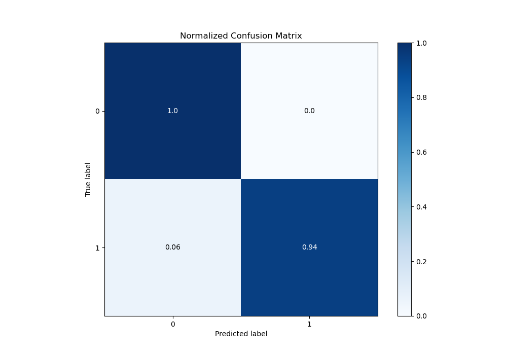
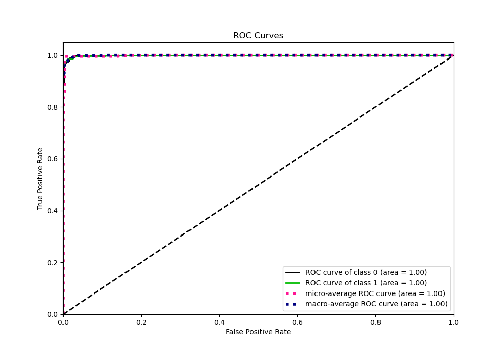
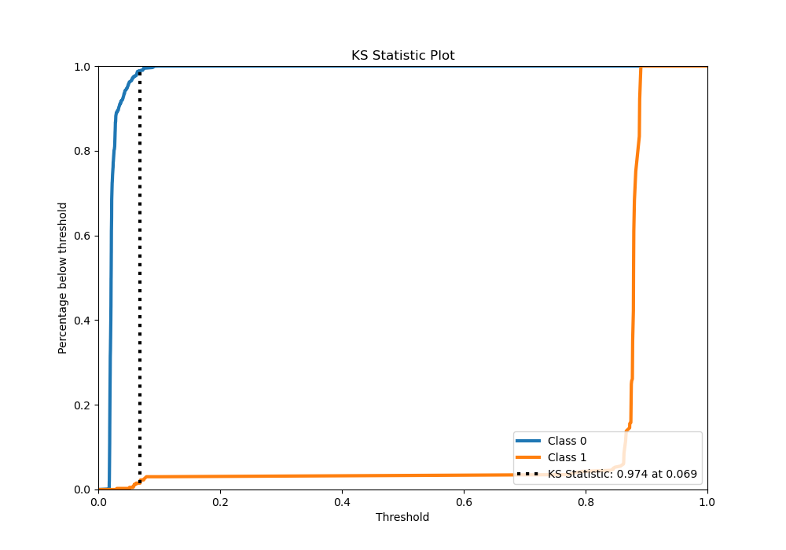
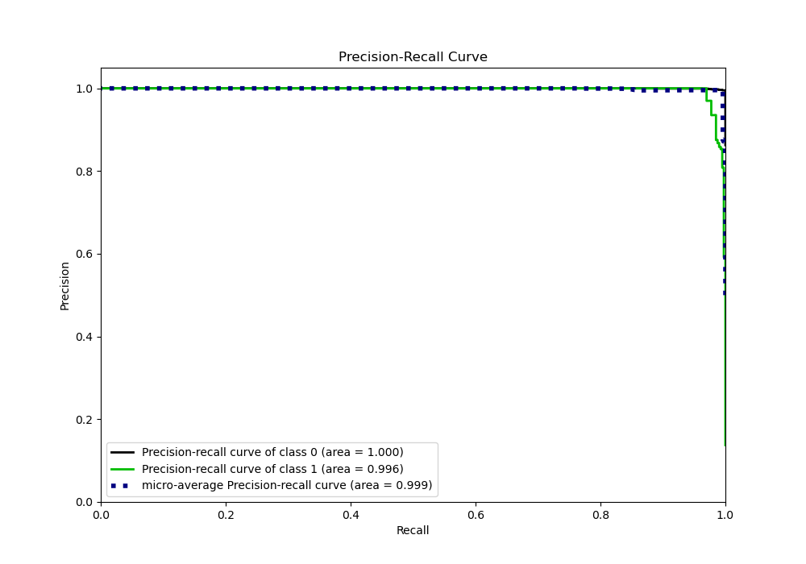
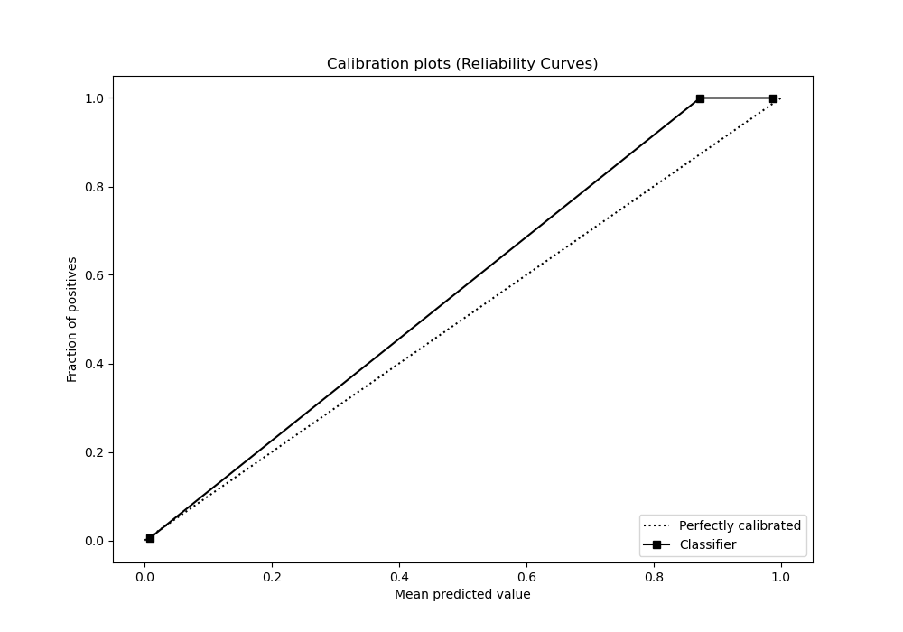
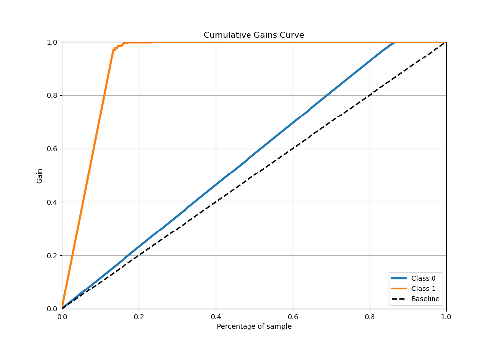
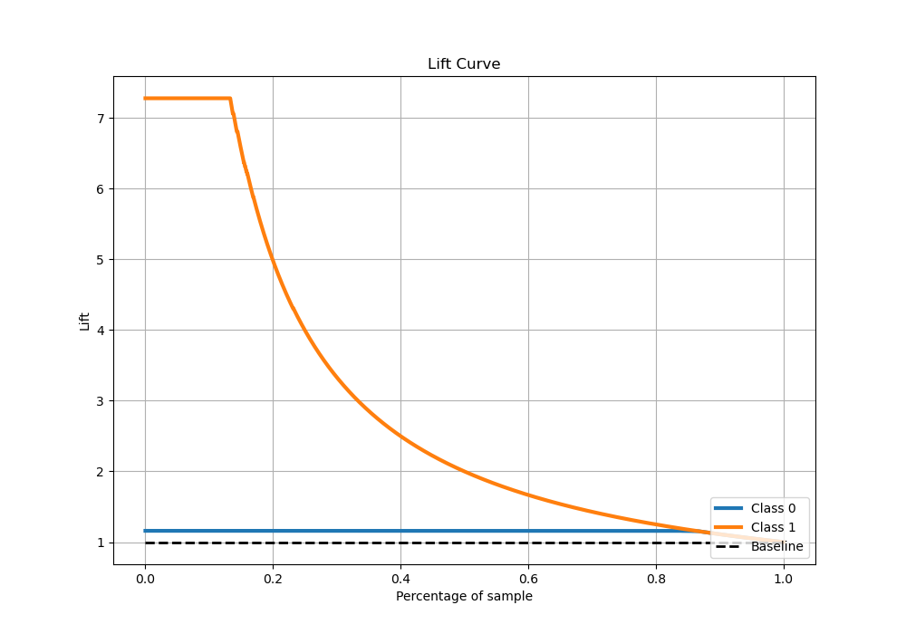

# Summary of 14_Xgboost

[<< Go back](../README.md)

## Extreme Gradient Boosting (Xgboost)
- **n_jobs**: -1
- **objective**: binary:logistic
- **eta**: 0.075
- **max_depth**: 6
- **min_child_weight**: 25
- **subsample**: 0.5
- **colsample_bytree**: 0.9
- **eval_metric**: logloss
- **explain_level**: 1

## Validation
 - **validation_type**: kfold
 - **shuffle**: True
 - **stratify**: True
 - **k_folds**: 10

## Optimized metric
logloss

## Training time

11.1 seconds

## Metric details
|           |     score |   threshold |
|:----------|----------:|------------:|
| logloss   | 0.0502277 | nan         |
| auc       | 0.999262  | nan         |
| f1        | 0.971576  |   0.859731  |
| accuracy  | 0.992406  |   0.859731  |
| precision | 1         |   0.859731  |
| recall    | 1         |   0.0159637 |
| mcc       | 0.967719  |   0.859731  |

## Metric details with threshold from accuracy metric
|           |     score |   threshold |
|:----------|----------:|------------:|
| logloss   | 0.0502277 |  nan        |
| auc       | 0.999262  |  nan        |
| f1        | 0.971576  |    0.859731 |
| accuracy  | 0.992406  |    0.859731 |
| precision | 1         |    0.859731 |
| recall    | 0.944724  |    0.859731 |
| mcc       | 0.967719  |    0.859731 |

## Confusion matrix (at threshold=0.859731)
|              |   Predicted as 0 |   Predicted as 1 |
|:-------------|-----------------:|-----------------:|
| Labeled as 0 |             2499 |                0 |
| Labeled as 1 |               22 |              376 |

## Learning curves

## Permutation-based Importance

## Confusion Matrix

## Normalized Confusion Matrix

## ROC Curve

## Kolmogorov-Smirnov Statistic

## Precision-Recall Curve

## Calibration Curve

## Cumulative Gains Curve

## Lift Curve

[<< Go back](../README.md)
