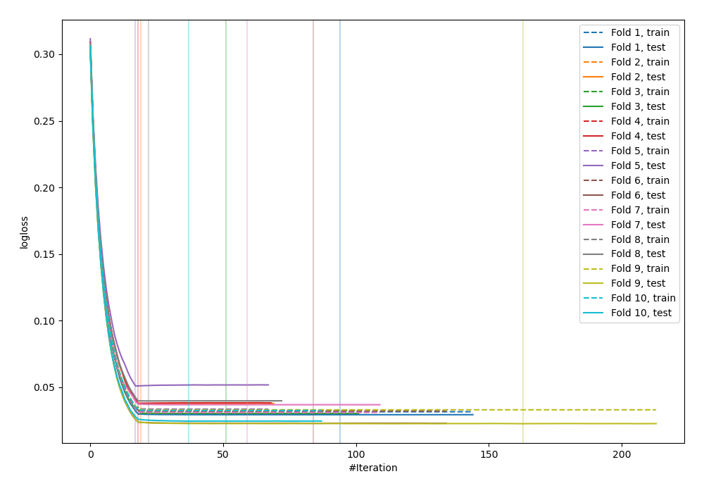
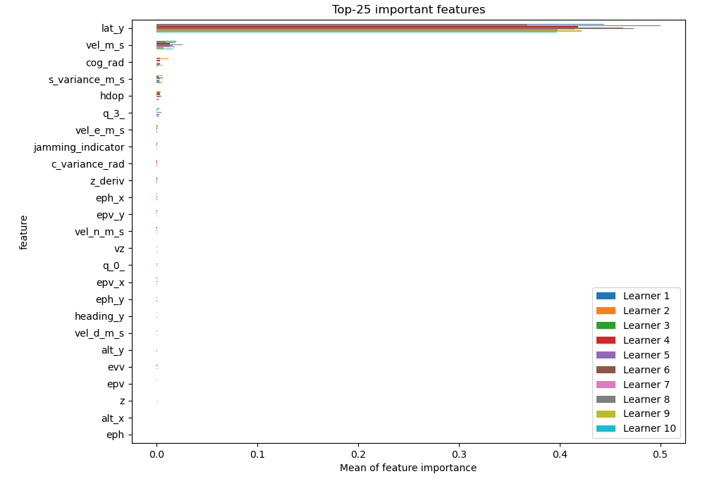
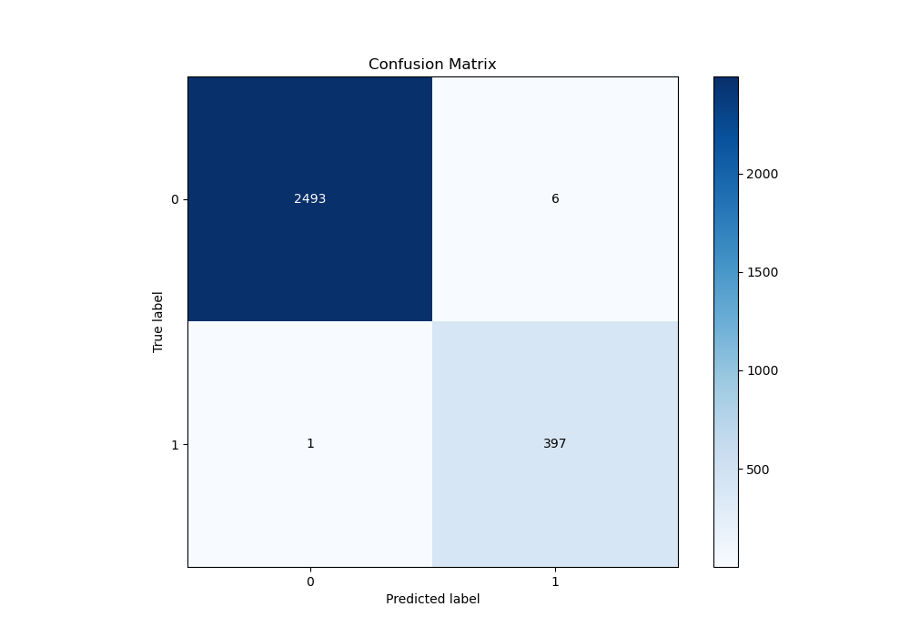
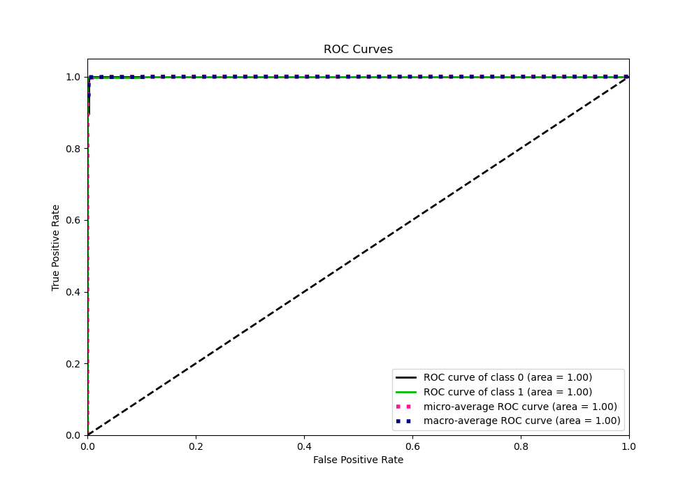
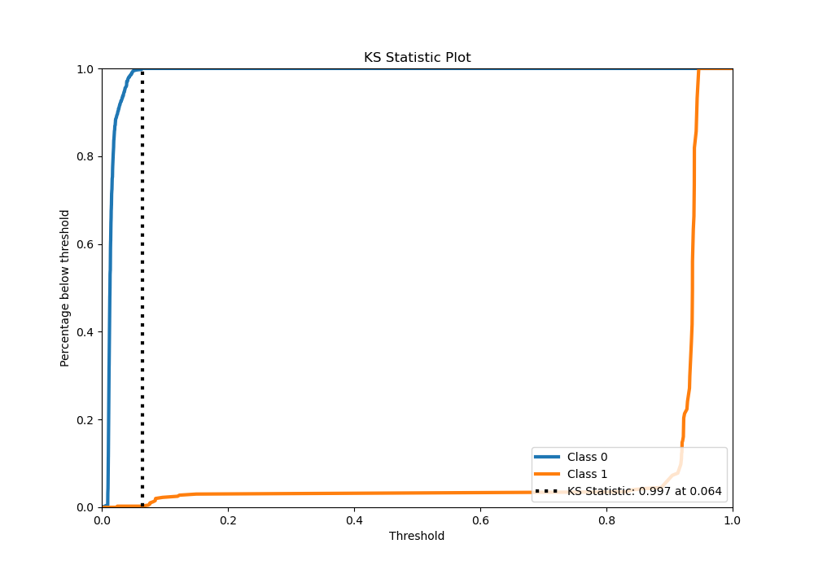
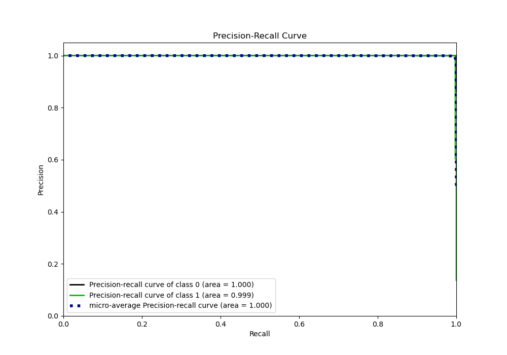
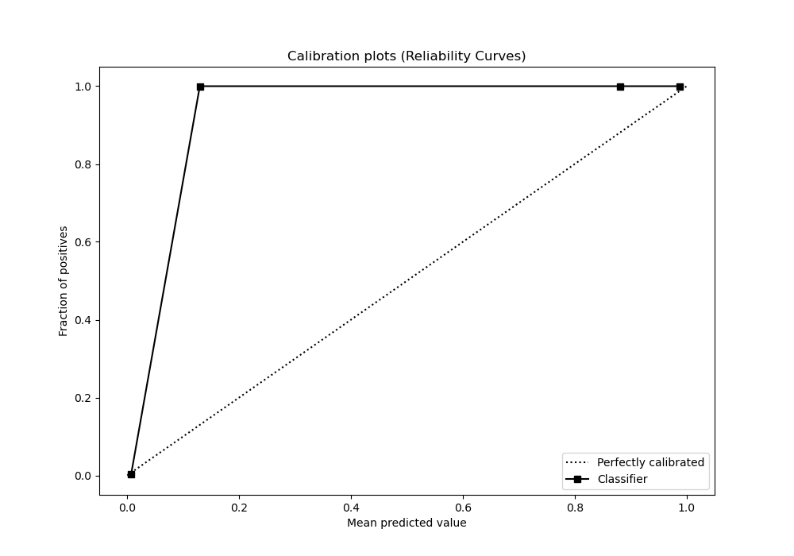
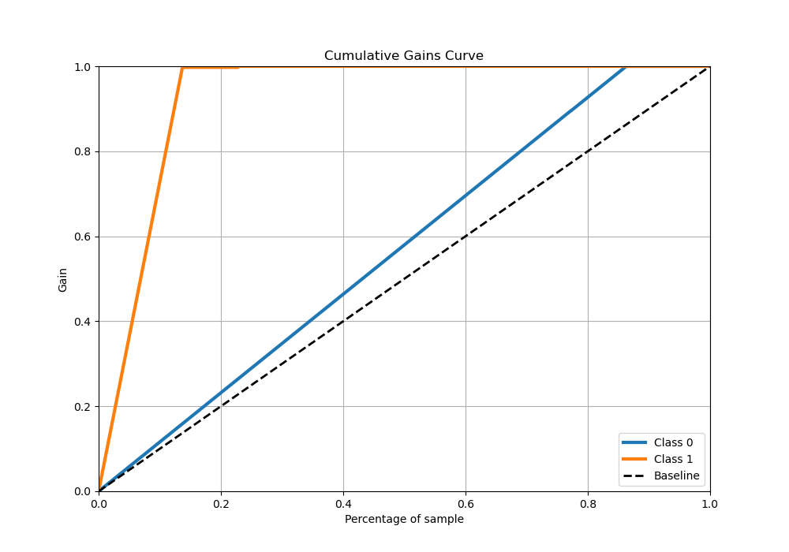
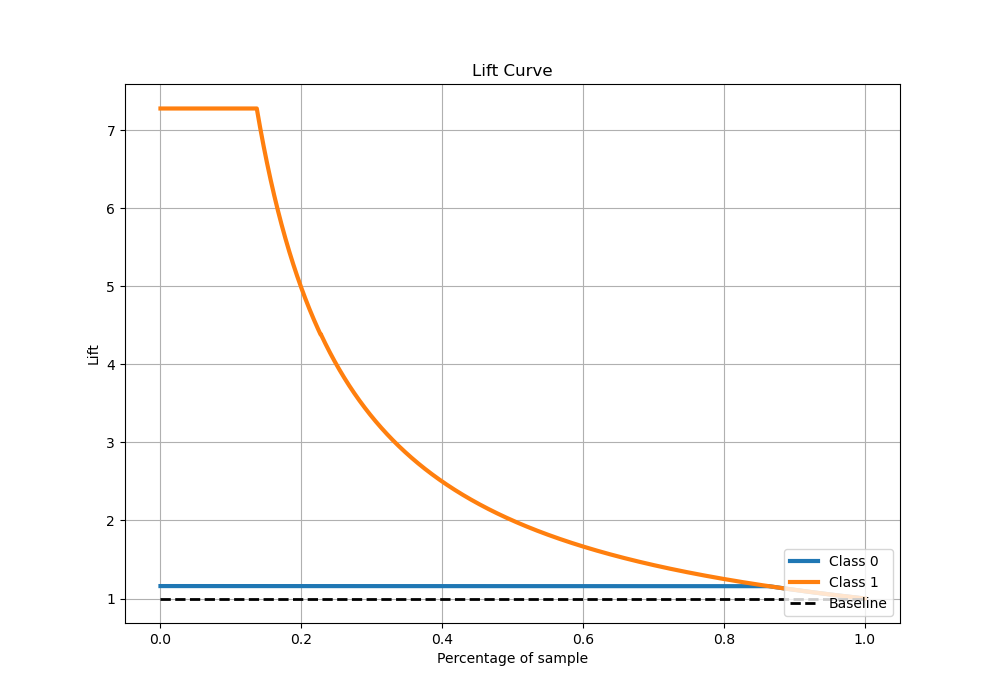

# Summary of 17_Xgboost

[<< Go back](../README.md)

## Extreme Gradient Boosting (Xgboost)
- **n_jobs**: -1
- **objective**: binary:logistic
- **eta**: 0.15
- **max_depth**: 7
- **min_child_weight**: 25
- **subsample**: 0.8
- **colsample_bytree**: 0.8
- **eval_metric**: logloss
- **explain_level**: 1

## Validation
 - **validation_type**: kfold
 - **shuffle**: True
 - **stratify**: True
 - **k_folds**: 10

## Optimized metric
logloss

## Training time

11.7 seconds

## Metric details
|           |     score |    threshold |
|:----------|----------:|-------------:|
| logloss   | 0.0333334 | nan          |
| auc       | 0.999737  | nan          |
| f1        | 0.991261  |   0.0627964  |
| accuracy  | 0.997584  |   0.0627964  |
| precision | 1         |   0.9045     |
| recall    | 1         |   0.00850878 |
| mcc       | 0.989885  |   0.0627964  |

## Metric details with threshold from accuracy metric
|           |     score |   threshold |
|:----------|----------:|------------:|
| logloss   | 0.0333334 | nan         |
| auc       | 0.999737  | nan         |
| f1        | 0.991261  |   0.0627964 |
| accuracy  | 0.997584  |   0.0627964 |
| precision | 0.985112  |   0.0627964 |
| recall    | 0.997487  |   0.0627964 |
| mcc       | 0.989885  |   0.0627964 |

## Confusion matrix (at threshold=0.062796)
|              |   Predicted as 0 |   Predicted as 1 |
|:-------------|-----------------:|-----------------:|
| Labeled as 0 |             2493 |                6 |
| Labeled as 1 |                1 |              397 |

## Learning curves

## Permutation-based Importance

## Confusion Matrix

## Normalized Confusion Matrix

## ROC Curve

## Kolmogorov-Smirnov Statistic

## Precision-Recall Curve

## Calibration Curve

## Cumulative Gains Curve

## Lift Curve

[<< Go back](../README.md)
