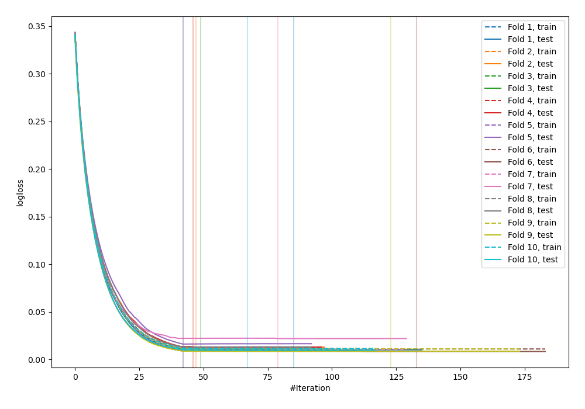
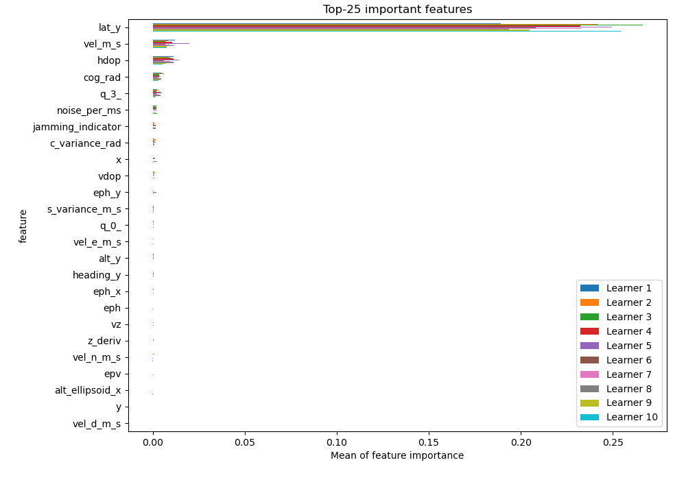
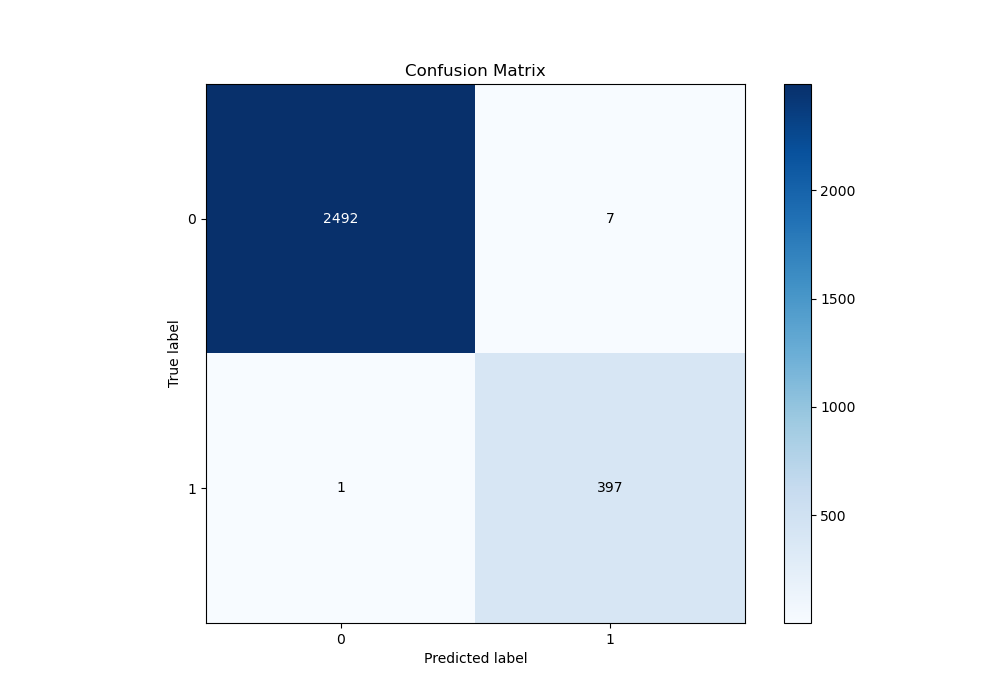
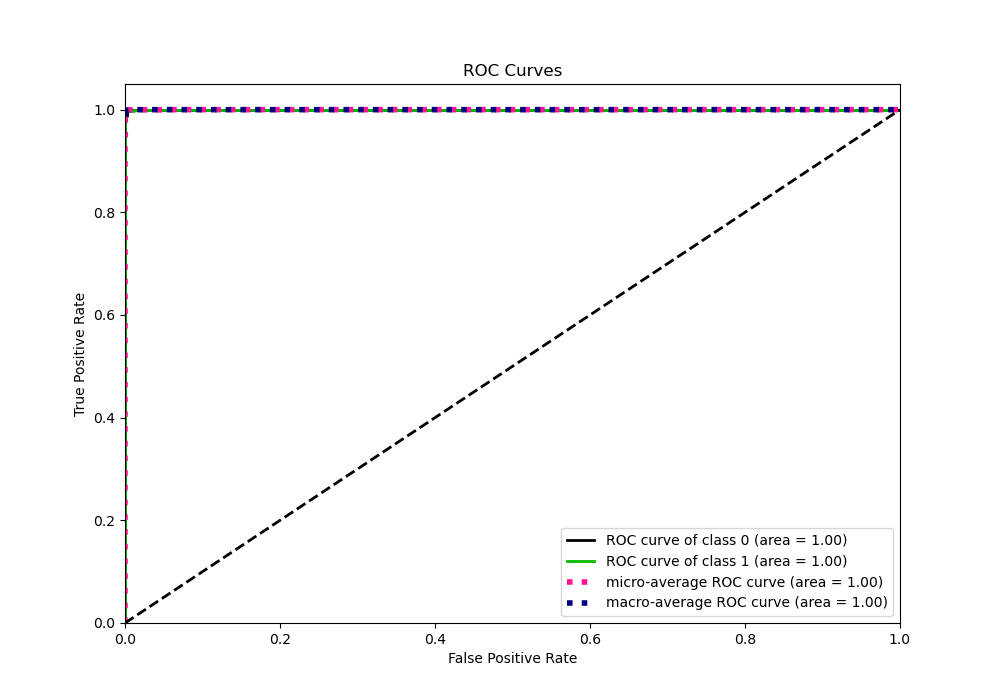
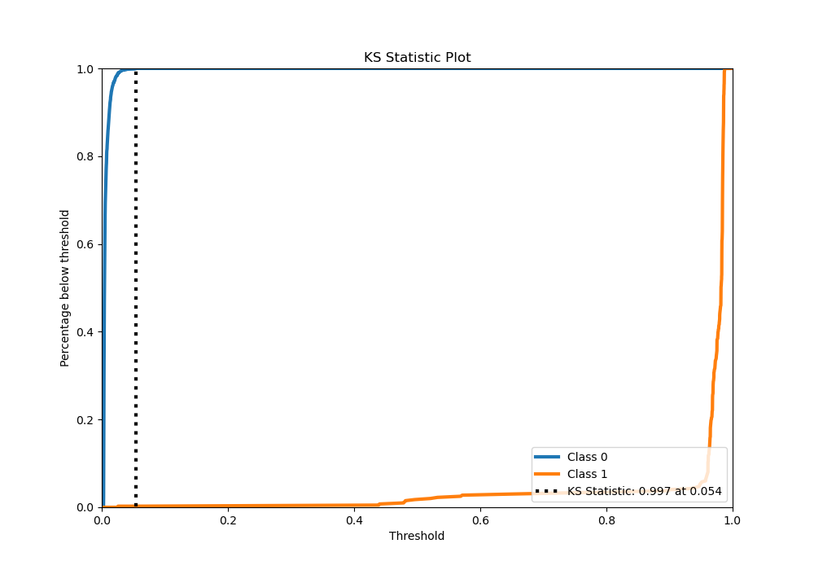
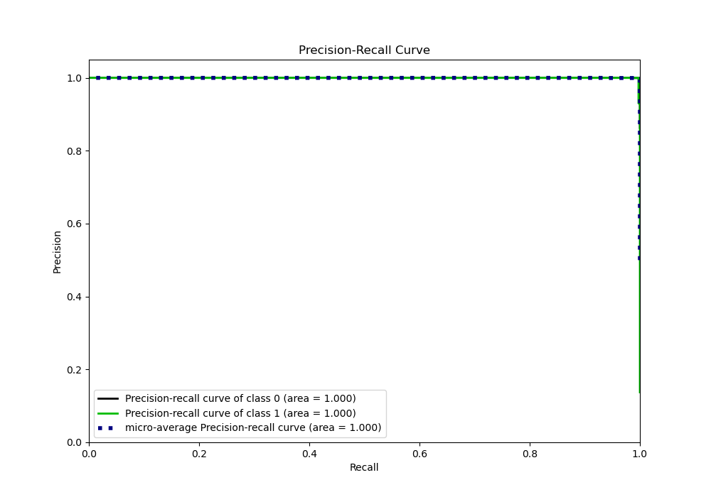
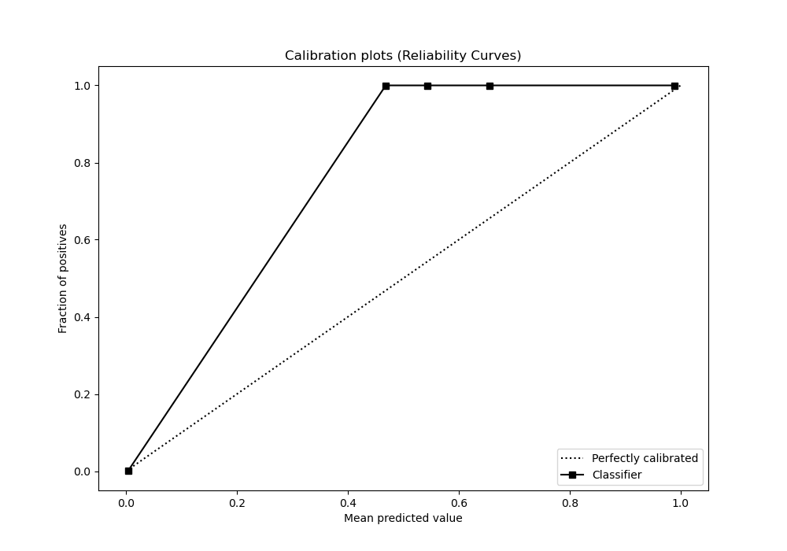
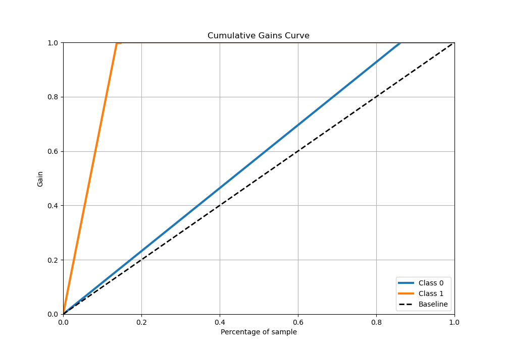
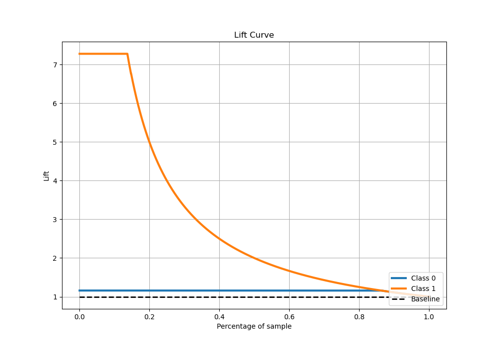

# Summary of 18_Xgboost

[<< Go back](../README.md)

## Extreme Gradient Boosting (Xgboost)
- **n_jobs**: -1
- **objective**: binary:logistic
- **eta**: 0.1
- **max_depth**: 7
- **min_child_weight**: 10
- **subsample**: 0.8
- **colsample_bytree**: 0.9
- **eval_metric**: logloss
- **explain_level**: 1

## Validation
 - **validation_type**: kfold
 - **shuffle**: True
 - **stratify**: True
 - **k_folds**: 10

## Optimized metric
logloss

## Training time

12.3 seconds

## Metric details
|           |     score |    threshold |
|:----------|----------:|-------------:|
| logloss   | 0.0123469 | nan          |
| auc       | 0.99997   | nan          |
| f1        | 0.990025  |   0.0379668  |
| accuracy  | 0.997239  |   0.0379668  |
| precision | 1         |   0.951283   |
| recall    | 1         |   0.00246929 |
| mcc       | 0.98846   |   0.0379668  |

## Metric details with threshold from accuracy metric
|           |     score |   threshold |
|:----------|----------:|------------:|
| logloss   | 0.0123469 | nan         |
| auc       | 0.99997   | nan         |
| f1        | 0.990025  |   0.0379668 |
| accuracy  | 0.997239  |   0.0379668 |
| precision | 0.982673  |   0.0379668 |
| recall    | 0.997487  |   0.0379668 |
| mcc       | 0.98846   |   0.0379668 |

## Confusion matrix (at threshold=0.037967)
|              |   Predicted as 0 |   Predicted as 1 |
|:-------------|-----------------:|-----------------:|
| Labeled as 0 |             2492 |                7 |
| Labeled as 1 |                1 |              397 |

## Learning curves

## Permutation-based Importance

## Confusion Matrix

## Normalized Confusion Matrix

## ROC Curve

## Kolmogorov-Smirnov Statistic

## Precision-Recall Curve

## Calibration Curve

## Cumulative Gains Curve

## Lift Curve

[<< Go back](../README.md)
