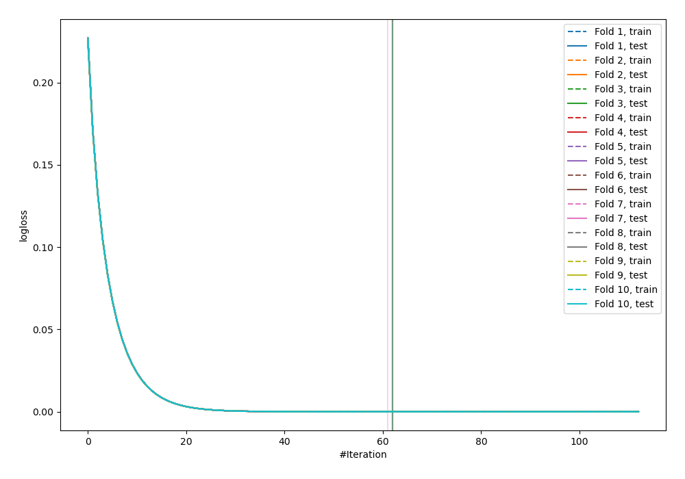
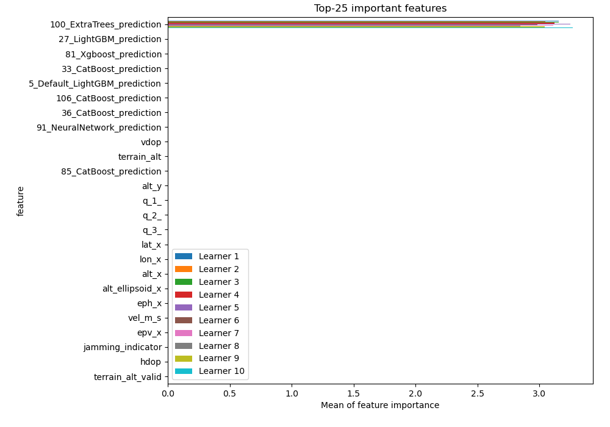
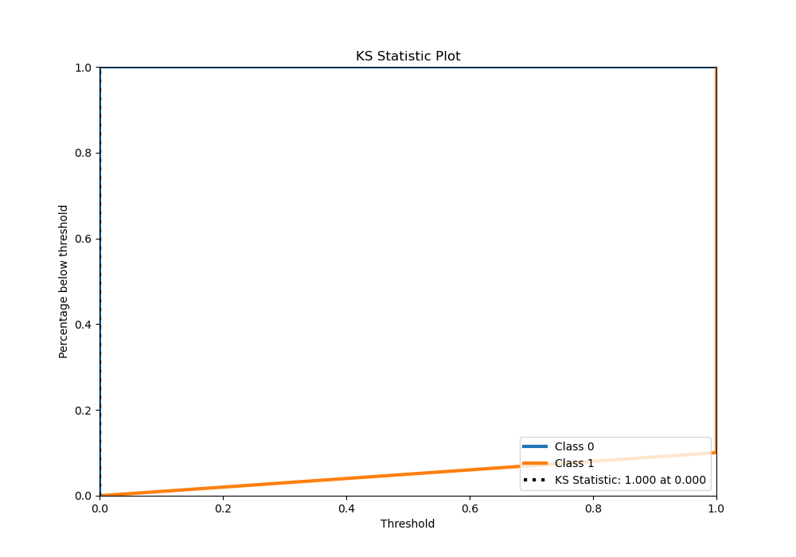
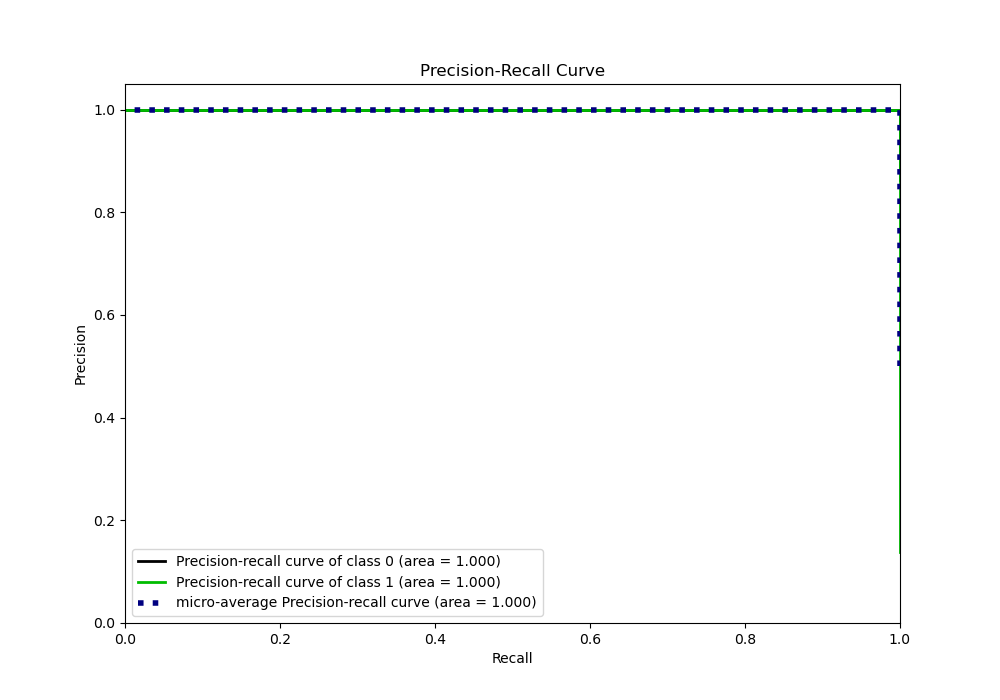
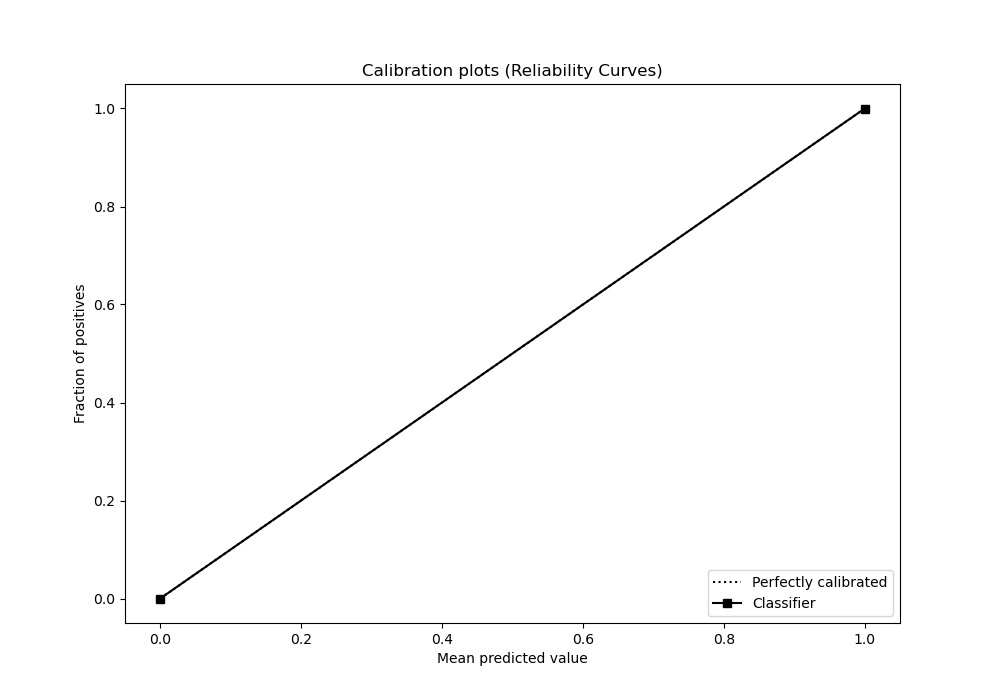

# Summary of 27_LightGBM_Stacked

[<< Go back](../README.md)

## LightGBM
- **n_jobs**: -1
- **objective**: binary
- **num_leaves**: 15
- **learning_rate**: 0.2
- **feature_fraction**: 1.0
- **bagging_fraction**: 0.8
- **min_data_in_leaf**: 15
- **metric**: binary_logloss
- **custom_eval_metric_name**: None
- **explain_level**: 1

## Validation
 - **validation_type**: kfold
 - **shuffle**: True
 - **stratify**: True
 - **k_folds**: 10

## Optimized metric
logloss

## Training time

25.9 seconds

## Metric details
|           |       score |     threshold |
|:----------|------------:|--------------:|
| logloss   | 7.34637e-07 | nan           |
| auc       | 1           | nan           |
| f1        | 0.992519    |   6.72141e-07 |
| accuracy  | 0.997929    |   6.72141e-07 |
| precision | 1           |   0.999997    |
| recall    | 1           |   4.10246e-07 |
| mcc       | 0.991354    |   6.72141e-07 |

## Metric details with threshold from accuracy metric
|           |       score |     threshold |
|:----------|------------:|--------------:|
| logloss   | 7.34637e-07 | nan           |
| auc       | 1           | nan           |
| f1        | 0.992519    |   6.72141e-07 |
| accuracy  | 0.997929    |   6.72141e-07 |
| precision | 0.985149    |   6.72141e-07 |
| recall    | 1           |   6.72141e-07 |
| mcc       | 0.991354    |   6.72141e-07 |

## Confusion matrix (at threshold=1e-06)
|              |   Predicted as 0 |   Predicted as 1 |
|:-------------|-----------------:|-----------------:|
| Labeled as 0 |             2493 |                6 |
| Labeled as 1 |                0 |              398 |

## Learning curves

## Permutation-based Importance

## Confusion Matrix

## Normalized Confusion Matrix

## ROC Curve

## Kolmogorov-Smirnov Statistic

## Precision-Recall Curve

## Calibration Curve

## Cumulative Gains Curve

## Lift Curve

[<< Go back](../README.md)
