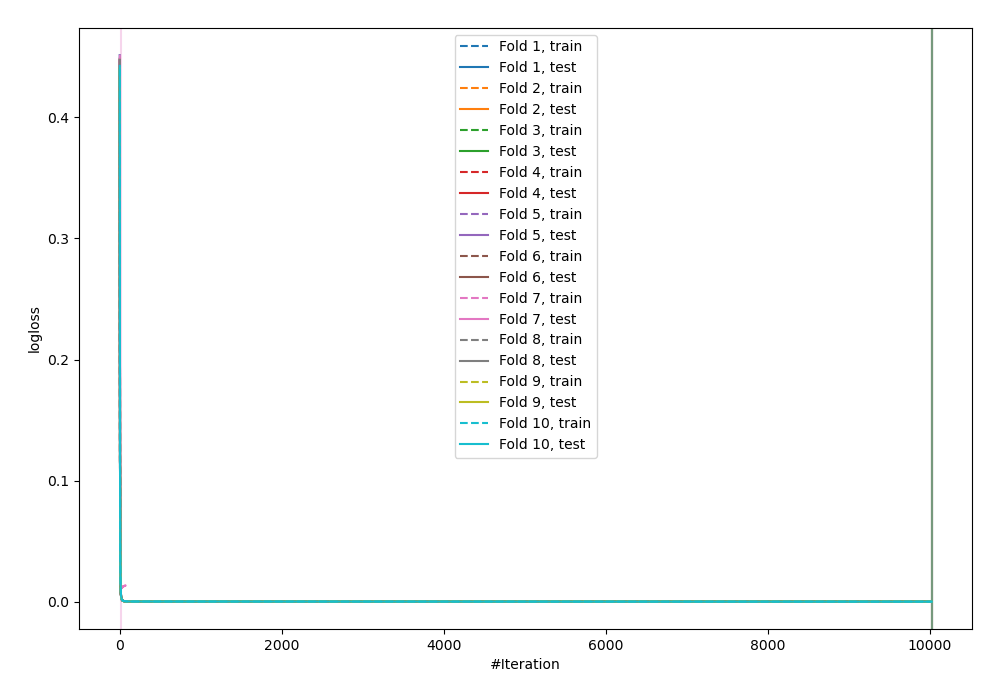
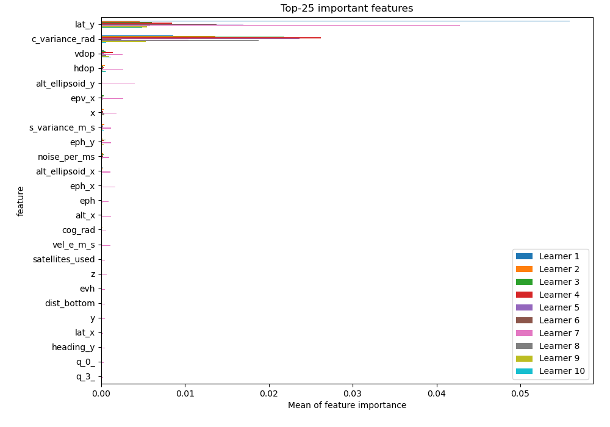
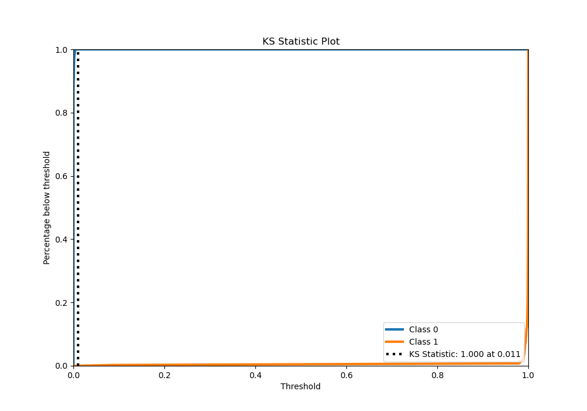
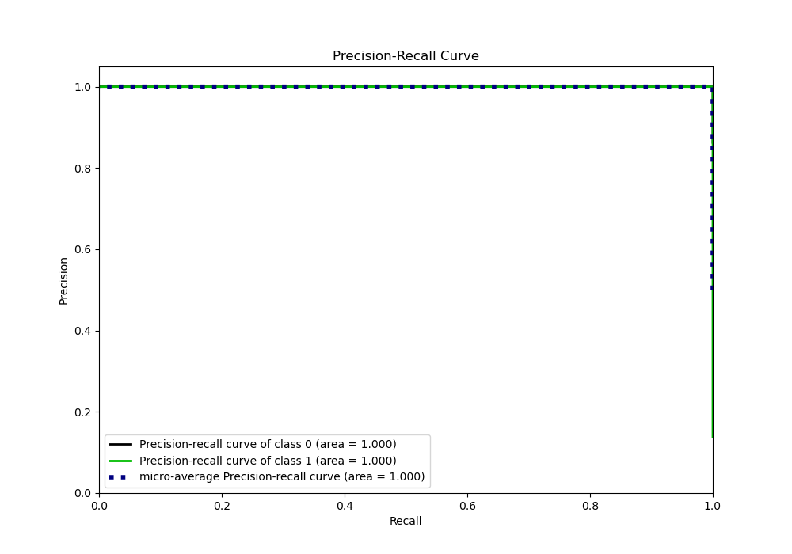
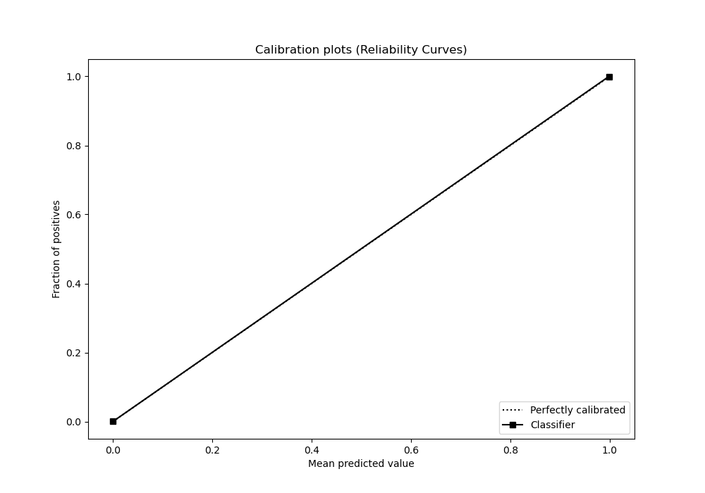

# Summary of 36_CatBoost

[<< Go back](../README.md)

## CatBoost
- **n_jobs**: -1
- **learning_rate**: 0.1
- **depth**: 7
- **rsm**: 0.8
- **loss_function**: Logloss
- **eval_metric**: Logloss
- **explain_level**: 1

## Validation
 - **validation_type**: kfold
 - **shuffle**: True
 - **stratify**: True
 - **k_folds**: 10

## Optimized metric
logloss

## Training time

595.8 seconds

## Metric details
|           |      score |    threshold |
|:----------|-----------:|-------------:|
| logloss   | 0.00123108 | nan          |
| auc       | 1          | nan          |
| f1        | 0.992519   |   0.00429175 |
| accuracy  | 0.997929   |   0.00429175 |
| precision | 1          |   0.992597   |
| recall    | 1          |   4.5238e-06 |
| mcc       | 0.991354   |   0.00429175 |

## Metric details with threshold from accuracy metric
|           |      score |    threshold |
|:----------|-----------:|-------------:|
| logloss   | 0.00123108 | nan          |
| auc       | 1          | nan          |
| f1        | 0.992519   |   0.00429175 |
| accuracy  | 0.997929   |   0.00429175 |
| precision | 0.985149   |   0.00429175 |
| recall    | 1          |   0.00429175 |
| mcc       | 0.991354   |   0.00429175 |

## Confusion matrix (at threshold=0.004292)
|              |   Predicted as 0 |   Predicted as 1 |
|:-------------|-----------------:|-----------------:|
| Labeled as 0 |             2493 |                6 |
| Labeled as 1 |                0 |              398 |

## Learning curves

## Permutation-based Importance

## Confusion Matrix

## Normalized Confusion Matrix

## ROC Curve

## Kolmogorov-Smirnov Statistic

## Precision-Recall Curve

## Calibration Curve

## Cumulative Gains Curve

## Lift Curve

[<< Go back](../README.md)
