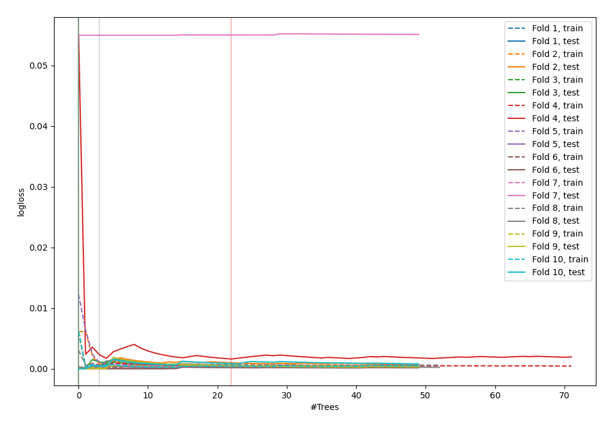
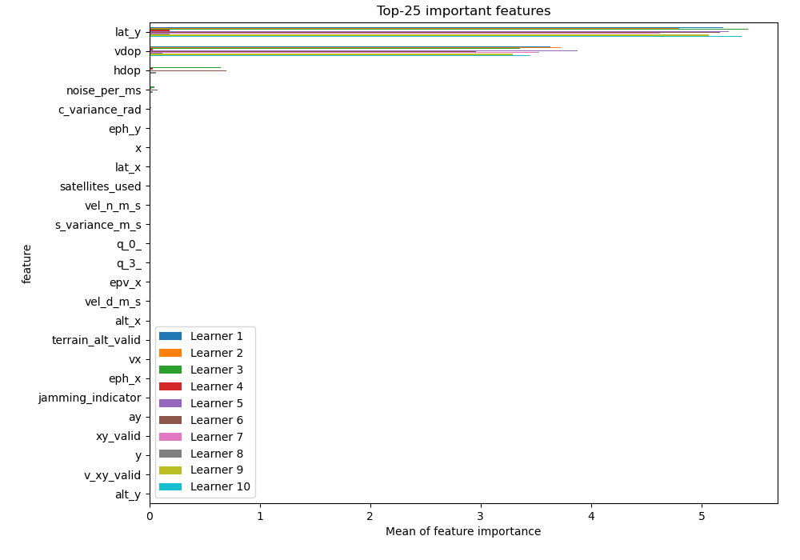
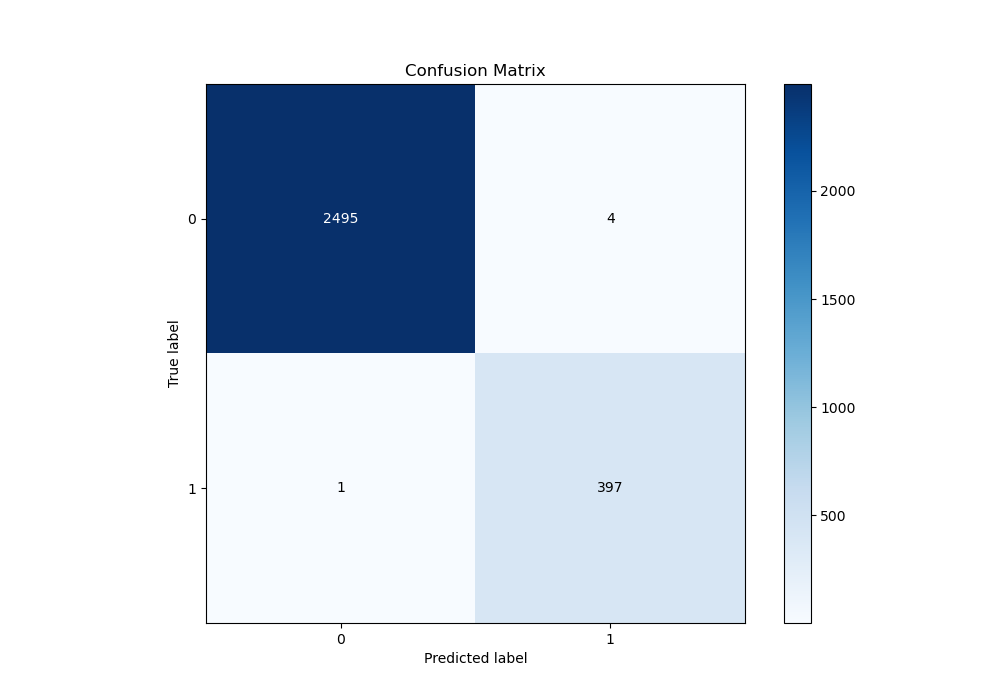
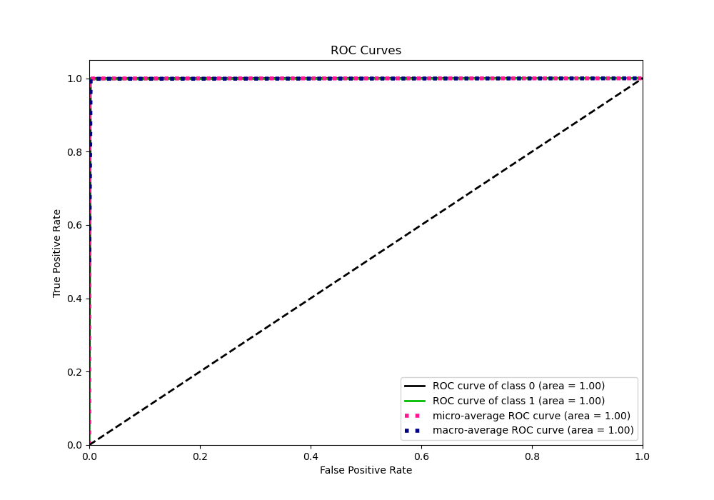
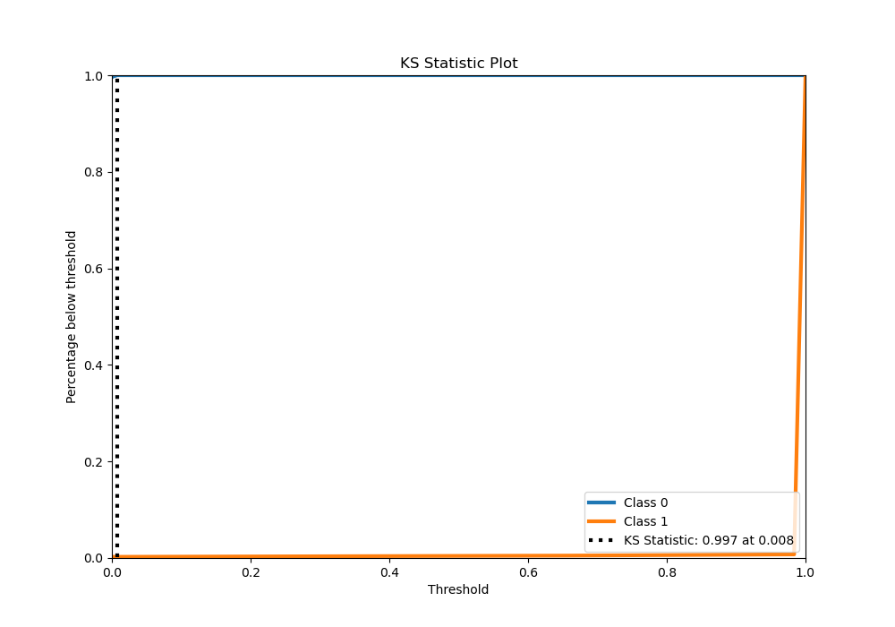
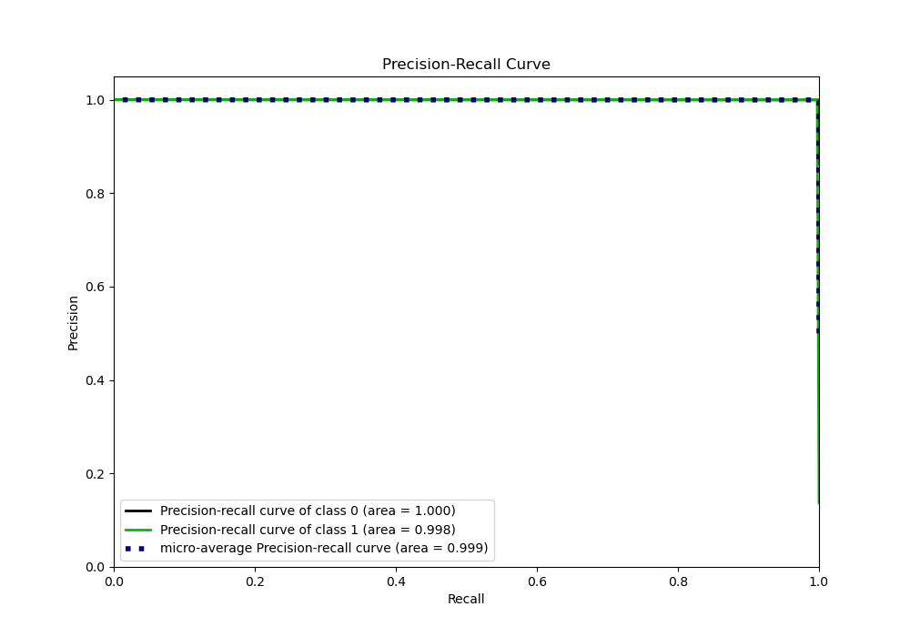
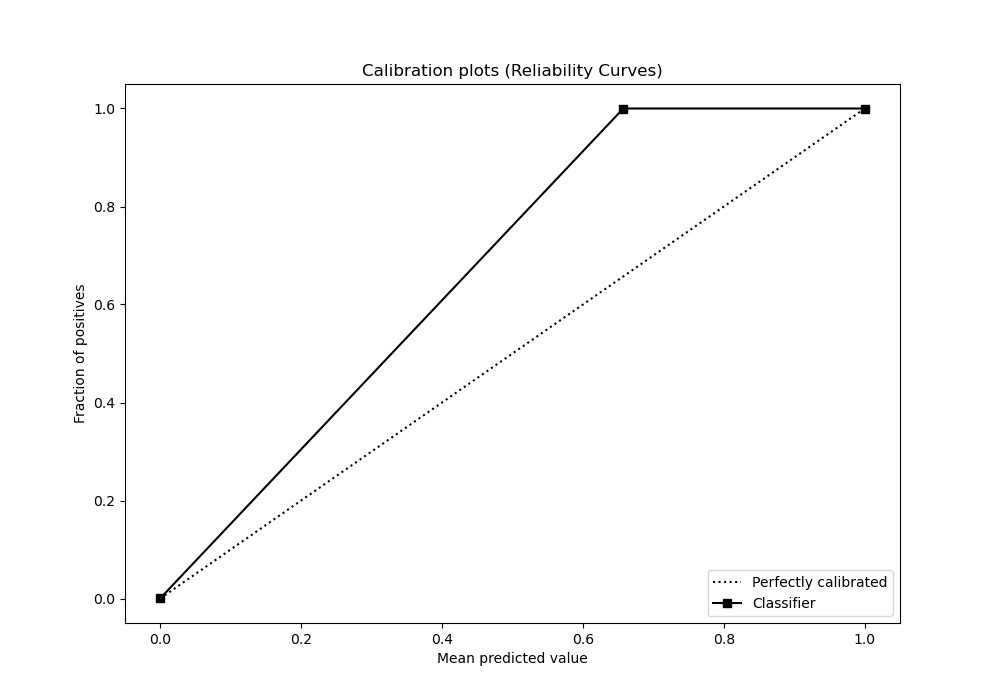
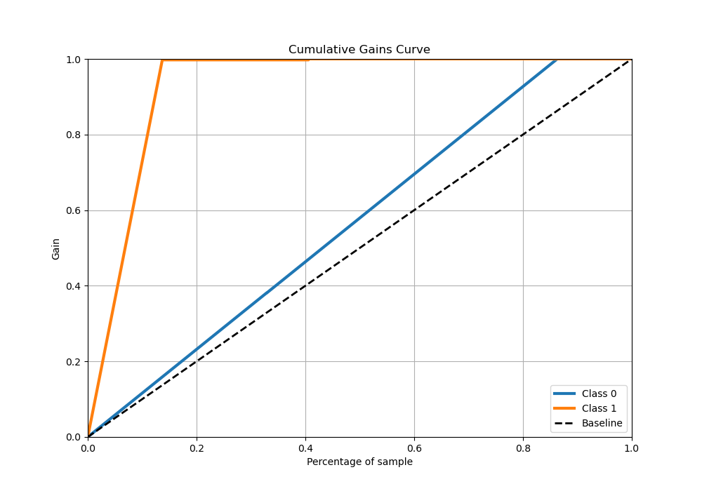
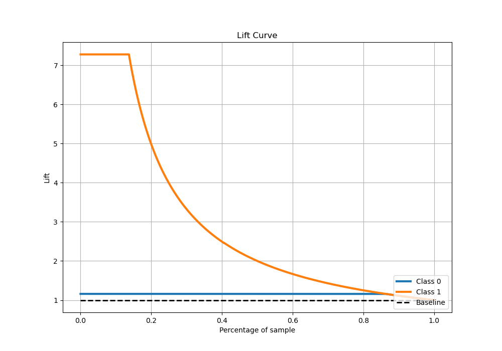

# Summary of 39_RandomForest

[<< Go back](../README.md)

## Random Forest
- **n_jobs**: -1
- **criterion**: gini
- **max_features**: 0.5
- **min_samples_split**: 20
- **max_depth**: 5
- **eval_metric_name**: logloss
- **explain_level**: 1

## Validation
 - **validation_type**: kfold
 - **shuffle**: True
 - **stratify**: True
 - **k_folds**: 10

## Optimized metric
logloss

## Training time

13.3 seconds

## Metric details
|           |     score |    threshold |
|:----------|----------:|-------------:|
| logloss   | 0.0056709 | nan          |
| auc       | 0.998739  | nan          |
| f1        | 0.993742  |   0.00362319 |
| accuracy  | 0.998274  |   0.00362319 |
| precision | 0.990025  |   0.00362319 |
| recall    | 0.997487  |   0          |
| mcc       | 0.992751  |   0.00362319 |

## Metric details with threshold from accuracy metric
|           |     score |    threshold |
|:----------|----------:|-------------:|
| logloss   | 0.0056709 | nan          |
| auc       | 0.998739  | nan          |
| f1        | 0.993742  |   0.00362319 |
| accuracy  | 0.998274  |   0.00362319 |
| precision | 0.990025  |   0.00362319 |
| recall    | 0.997487  |   0.00362319 |
| mcc       | 0.992751  |   0.00362319 |

## Confusion matrix (at threshold=0.003623)
|              |   Predicted as 0 |   Predicted as 1 |
|:-------------|-----------------:|-----------------:|
| Labeled as 0 |             2495 |                4 |
| Labeled as 1 |                1 |              397 |

## Learning curves

## Permutation-based Importance

## Confusion Matrix

## Normalized Confusion Matrix

## ROC Curve

## Kolmogorov-Smirnov Statistic

## Precision-Recall Curve

## Calibration Curve

## Cumulative Gains Curve

## Lift Curve

[<< Go back](../README.md)
