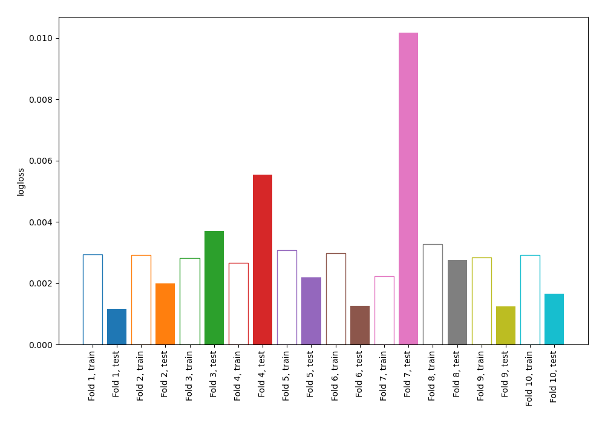
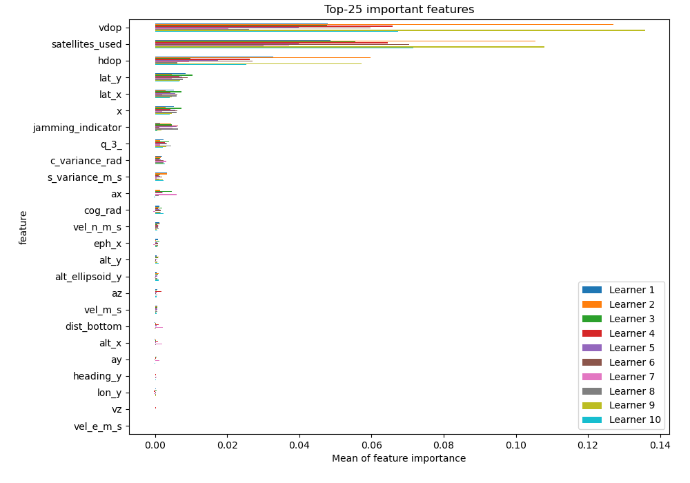
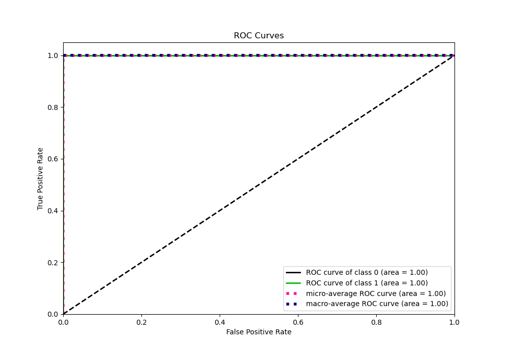
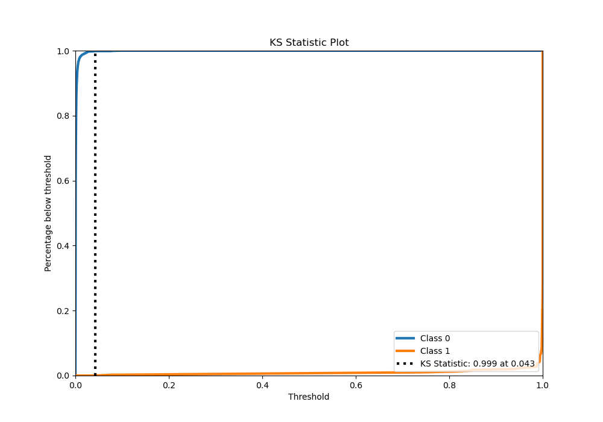
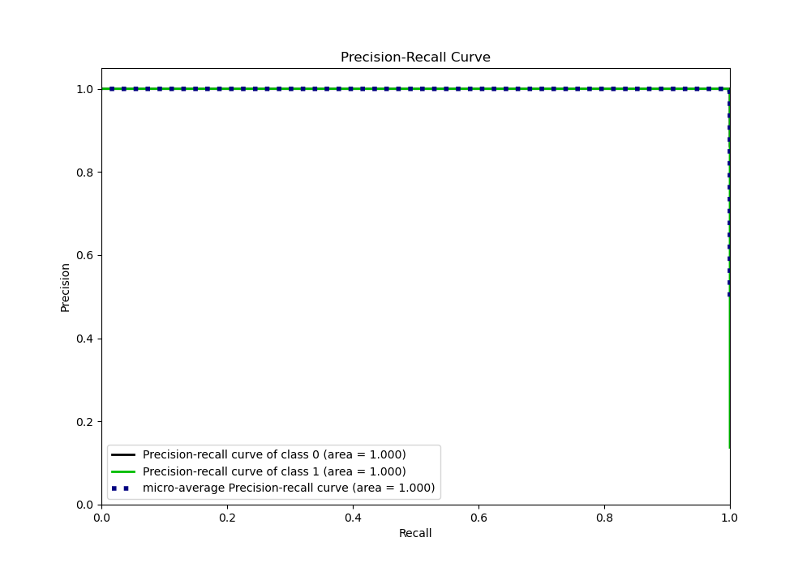
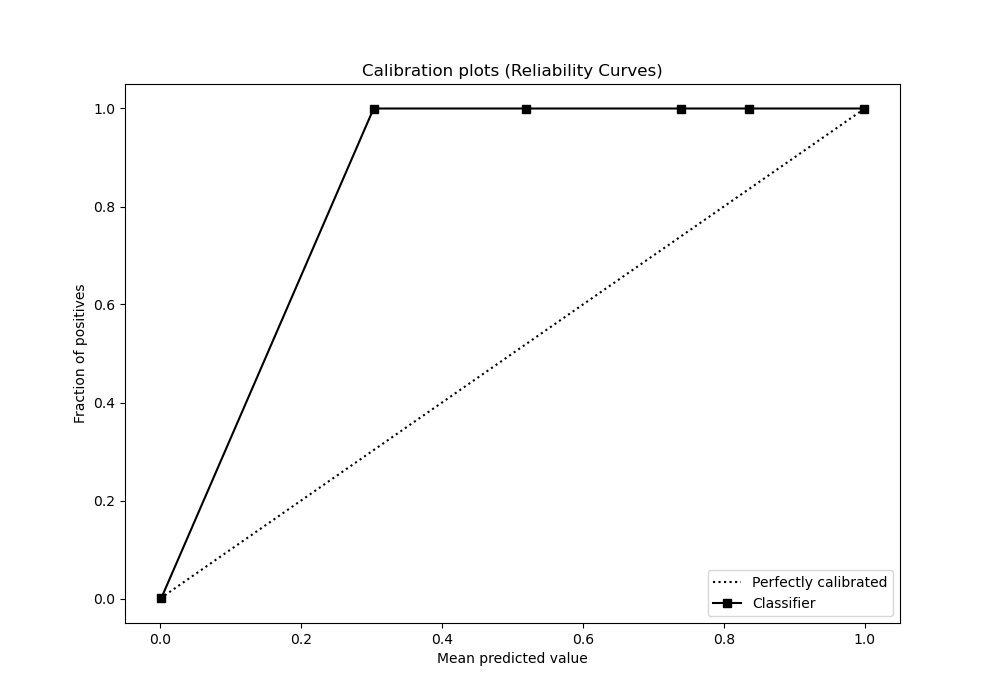
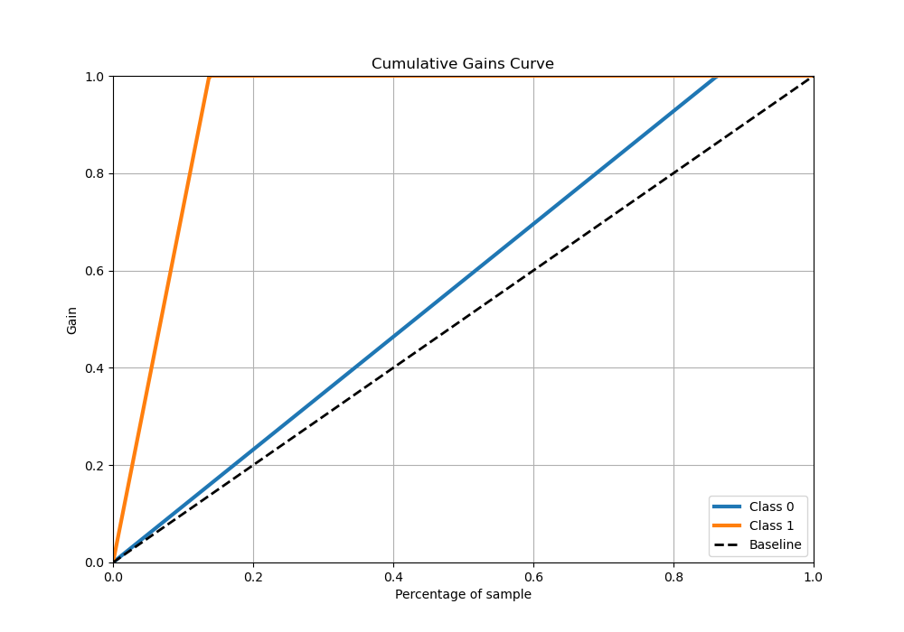
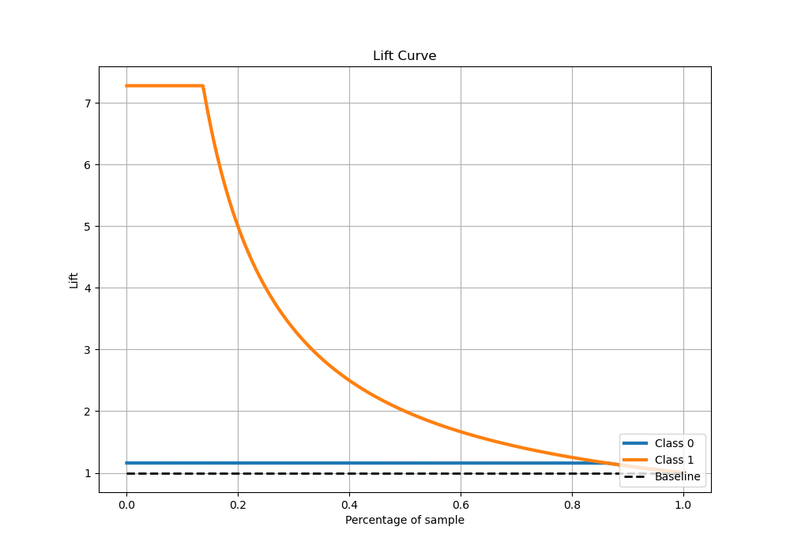

# Summary of 4_Linear

[<< Go back](../README.md)

## Logistic Regression (Linear)
- **n_jobs**: -1
- **explain_level**: 1

## Validation
 - **validation_type**: kfold
 - **shuffle**: True
 - **stratify**: True
 - **k_folds**: 10

## Optimized metric
logloss

## Training time

5.9 seconds

## Metric details
|           |      score |     threshold |
|:----------|-----------:|--------------:|
| logloss   | 0.00317344 | nan           |
| auc       | 0.999997   | nan           |
| f1        | 0.992519   |   0.036742    |
| accuracy  | 0.997929   |   0.036742    |
| precision | 1          |   0.994159    |
| recall    | 1          |   3.26932e-06 |
| mcc       | 0.991354   |   0.036742    |

## Metric details with threshold from accuracy metric
|           |      score |   threshold |
|:----------|-----------:|------------:|
| logloss   | 0.00317344 |  nan        |
| auc       | 0.999997   |  nan        |
| f1        | 0.992519   |    0.036742 |
| accuracy  | 0.997929   |    0.036742 |
| precision | 0.985149   |    0.036742 |
| recall    | 1          |    0.036742 |
| mcc       | 0.991354   |    0.036742 |

## Confusion matrix (at threshold=0.036742)
|              |   Predicted as 0 |   Predicted as 1 |
|:-------------|-----------------:|-----------------:|
| Labeled as 0 |             2493 |                6 |
| Labeled as 1 |                0 |              398 |

## Learning curves

## Coefficients
| feature           |   Learner_1 |   Learner_2 |   Learner_3 |   Learner_4 |   Learner_5 |   Learner_6 |   Learner_7 |   Learner_8 |   Learner_9 |   Learner_10 |
|:------------------|------------:|------------:|------------:|------------:|------------:|------------:|------------:|------------:|------------:|-------------:|
| vdop              |  1.77522    |  1.71883    |  1.72299    |  1.72209    |  1.63685    |  1.7511     |  1.78483    |  1.49227    |  1.82402    |   1.753      |
| hdop              |  1.28764    |  1.23926    |  1.22756    |  1.23012    |  1.17635    |  1.25608    |  1.2744     |  1.06022    |  1.30694    |   1.25427    |
| lat_y             |  1.23423    |  1.217      |  1.20344    |  1.16147    |  1.18478    |  1.22528    |  1.17895    |  1.13815    |  1.24519    |   1.22809    |
| jamming_indicator |  1.02748    |  1.04039    |  1.0411     |  1.03765    |  1.06692    |  1.0233     |  0.960238   |  1.11029    |  1.0501     |   1.09391    |
| lat_x             |  0.991557   |  0.99285    |  0.966577   |  0.932748   |  0.977731   |  0.987859   |  0.931707   |  0.962343   |  1.00943    |   0.990186   |
| x                 |  0.99132    |  0.992657   |  0.966291   |  0.932512   |  0.977546   |  0.987641   |  0.931513   |  0.962074   |  1.00918    |   0.989933   |
| vel_n_m_s         |  0.833703   |  0.760021   |  0.818503   |  0.818268   |  0.776024   |  0.82638    |  0.892947   |  0.714172   |  0.822785   |   0.820398   |
| s_variance_m_s    |  0.803055   |  0.736437   |  0.741435   |  0.719866   |  0.65596    |  0.764005   |  0.814448   |  0.597198   |  0.734289   |   0.780016   |
| q_0_              |  0.751399   |  0.729803   |  0.713299   |  0.693544   |  0.656483   |  0.73298    |  0.713186   |  0.578237   |  0.754381   |   0.741107   |
| alt_y             |  0.709364   |  0.650991   |  0.630209   |  0.636228   |  0.615528   |  0.67447    |  0.602815   |  0.497166   |  0.705222   |   0.672375   |
| alt_ellipsoid_y   |  0.708916   |  0.650539   |  0.629752   |  0.635782   |  0.615029   |  0.674015   |  0.602422   |  0.496658   |  0.704759   |   0.671933   |
| vel_m_s           |  0.650527   |  0.582343   |  0.638603   |  0.640298   |  0.601902   |  0.637257   |  0.716556   |  0.565146   |  0.630393   |   0.640573   |
| eph_x             |  0.462512   |  0.475473   |  0.454765   |  0.438311   |  0.431789   |  0.462516   |  0.447964   |  0.423412   |  0.47414    |   0.463281   |
| dist_bottom       |  0.358734   |  0.357788   |  0.366566   |  0.379031   |  0.338058   |  0.360145   |  0.335679   |  0.345592   |  0.361557   |   0.336496   |
| alt_x             |  0.336281   |  0.338883   |  0.342531   |  0.357411   |  0.349212   |  0.336741   |  0.299035   |  0.377219   |  0.320313   |   0.312815   |
| heading_y         |  0.291448   |  0.294273   |  0.279559   |  0.281597   |  0.256884   |  0.291152   |  0.257702   |  0.201998   |  0.292694   |   0.290803   |
| z                 |  0.165306   |  0.149732   |  0.146209   |  0.136878   |  0.12728    |  0.154828   |  0.159226   |  0.0993952  |  0.166984   |   0.163962   |
| ay                |  0.153839   |  0.114843   |  0.118049   |  0.196517   |  0.0706655  |  0.151628   |  0.275985   |  0.113463   |  0.101948   |   0.149968   |
| eph               |  0.0976827  |  0.119916   |  0.108428   |  0.101072   |  0.0629579  |  0.101784   |  0.112827   |  0.0613094  |  0.10513    |   0.0992631  |
| terrain_alt       |  0.0794038  |  0.0883591  |  0.0883761  |  0.0593695  |  0.141627   |  0.091897   |  0.0756857  |  0.152931   |  0.0846162  |   0.0633945  |
| epv_x             |  0.0811696  |  0.084928   |  0.0784641  |  0.0636032  |  0.0577584  |  0.0733831  |  0.0948534  |  0.0905455  |  0.0722391  |   0.0759278  |
| vy                |  0.0862664  |  0.0742378  |  0.0696927  |  0.082084   |  0.0795386  |  0.0885086  |  0.0667613  |  0.0832093  |  0.0615231  |   0.0614614  |
| alt_ellipsoid_x   |  0.089984   |  0.0608948  |  0.0429428  |  0.0151445  |  0.0373357  |  0.0439168  |  0.0328809  | -0.00221451 |  0.0566686  |   0.0754224  |
| lon_x             |  0.039089   |  0.0486997  |  0.0522556  | -0.0184167  |  0.0529237  |  0.0479455  |  0.00203033 |  0.0417109  |  0.0140972  |   0.0261784  |
| q_1_              |  0.00258976 |  0.00209595 |  0.00254212 |  0.00245033 |  0.00310972 |  0.00319881 |  0.00370205 |  0.00593013 |  0.00355036 |   0.00296478 |
| q_2_              | -0.0170594  | -0.0192309  | -0.0157637  | -0.0148962  | -0.0338772  | -0.0189539  | -0.0117155  | -0.0535078  | -0.0129778  |  -0.0172336  |
| vx                | -0.0329064  | -0.0309235  | -0.0278898  | -0.0206441  | -0.0368211  | -0.0364992  | -0.0199361  | -0.0501678  | -0.00427015 |  -0.0122599  |
| terrain_alt_valid | -0.091709   | -0.0923546  | -0.0846833  | -0.0912909  | -0.0649531  | -0.086235   | -0.0882534  | -0.0480166  | -0.0902629  |  -0.0895644  |
| dist_bottom_valid | -0.0936366  | -0.0944258  | -0.0860222  | -0.0932832  | -0.0649096  | -0.0886945  | -0.0902768  | -0.0484827  | -0.0926317  |  -0.091375   |
| vel_d_m_s         | -0.115756   | -0.0940428  | -0.107402   | -0.0982146  | -0.0811398  | -0.0982989  | -0.121787   | -0.0603011  | -0.0877971  |  -0.0896818  |
| v_xy_valid        | -0.11452    | -0.1132     | -0.101811   | -0.107208   | -0.0976771  | -0.102854   | -0.0875395  | -0.0980283  | -0.11683    |  -0.103469   |
| xy_valid          | -0.11452    | -0.1132     | -0.101811   | -0.107208   | -0.0976771  | -0.102854   | -0.0875395  | -0.0980283  | -0.11683    |  -0.103469   |
| eph_y             | -0.113559   | -0.0925285  | -0.0960037  | -0.0928003  | -0.164747   | -0.105914   | -0.0598732  | -0.160133   | -0.113624   |  -0.106685   |
| noise_per_ms      | -0.148485   | -0.164807   | -0.170683   | -0.0871168  | -0.15877    | -0.133409   | -0.102122   | -0.16817    | -0.102073   |  -0.103854   |
| evv               | -0.179057   | -0.173993   | -0.16987    | -0.165506   | -0.156154   | -0.174557   | -0.169718   | -0.135907   | -0.180157   |  -0.176662   |
| z_deriv           | -0.197707   | -0.187925   | -0.186624   | -0.181392   | -0.19646    | -0.19208    | -0.18398    | -0.189739   | -0.194077   |  -0.187829   |
| epv_y             | -0.242977   | -0.219594   | -0.230993   | -0.225141   | -0.268641   | -0.239151   | -0.193641   | -0.240216   | -0.241863   |  -0.232275   |
| lon_y             | -0.2784     | -0.28922    | -0.286949   | -0.309693   | -0.26496    | -0.295617   | -0.284219   | -0.297422   | -0.282841   |  -0.283786   |
| evh               | -0.377832   | -0.367687   | -0.359285   | -0.351397   | -0.334782   | -0.369501   | -0.358256   | -0.293741   | -0.381981   |  -0.374311   |
| vel_e_m_s         | -0.368397   | -0.345626   | -0.351333   | -0.355535   | -0.367307   | -0.371939   | -0.36436    | -0.353358   | -0.370095   |  -0.372316   |
| vz                | -0.447775   | -0.433454   | -0.425182   | -0.417826   | -0.42567    | -0.440525   | -0.424899   | -0.398296   | -0.45402    |  -0.444033   |
| az                | -0.459228   | -0.481026   | -0.509525   | -0.444167   | -0.512038   | -0.482791   | -0.336543   | -0.468329   | -0.48335    |  -0.460499   |
| y                 | -0.696767   | -0.669164   | -0.657343   | -0.655406   | -0.598072   | -0.672699   | -0.663858   | -0.5263     | -0.701309   |  -0.685147   |
| cog_rad           | -0.764487   | -0.695072   | -0.718157   | -0.688653   | -0.643507   | -0.727177   | -0.773553   | -0.556857   | -0.738621   |  -0.748907   |
| q_3_              | -0.732455   | -0.726662   | -0.70083    | -0.669721   | -0.734876   | -0.723175   | -0.673871   | -0.75388    | -0.729672   |  -0.729328   |
| epv               | -0.82281    | -0.800276   | -0.781434   | -0.760501   | -0.720049   | -0.802614   | -0.779623   | -0.630751   | -0.827607   |  -0.812229   |
| ax                | -0.862934   | -0.862146   | -0.793659   | -0.808409   | -0.87342    | -0.861655   | -0.677199   | -0.888227   | -0.850431   |  -0.85504    |
| c_variance_rad    | -1.02413    | -1.00569    | -1.01688    | -1.02073    | -1.03749    | -1.03471    | -0.995621   | -1.0642     | -1.05559    |  -1.03073    |
| satellites_used   | -1.88881    | -1.78013    | -1.81103    | -1.81048    | -1.70654    | -1.86146    | -1.90864    | -1.55377    | -1.88525    |  -1.86156    |
| intercept         | -3.53116    | -3.71938    | -3.78337    | -3.77723    | -4.04497    | -3.60246    | -3.67688    | -4.28397    | -3.63415    |  -3.57696    |

## Permutation-based Importance

## Confusion Matrix

## Normalized Confusion Matrix

## ROC Curve

## Kolmogorov-Smirnov Statistic

## Precision-Recall Curve

## Calibration Curve

## Cumulative Gains Curve

## Lift Curve

[<< Go back](../README.md)
