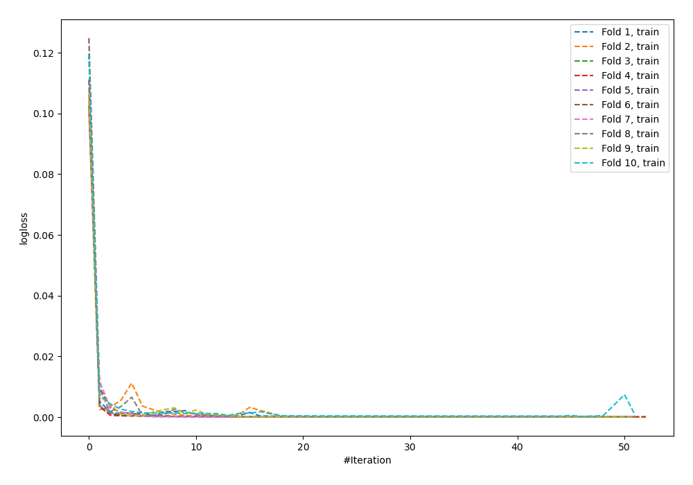
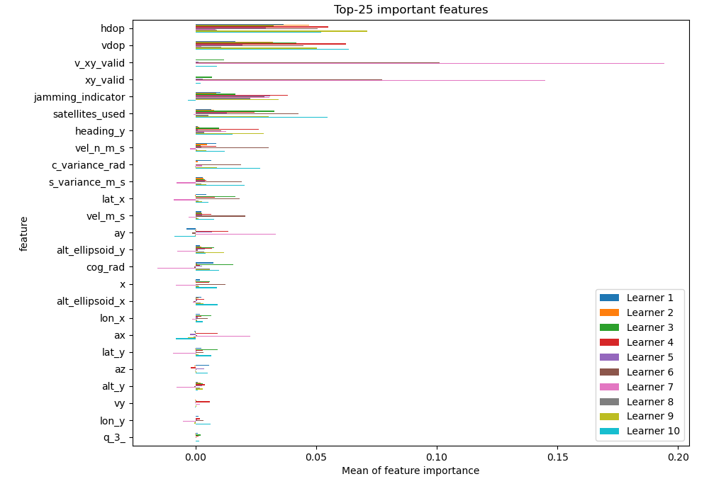
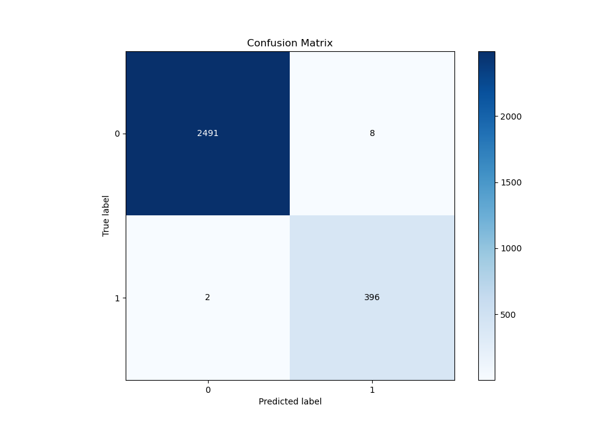
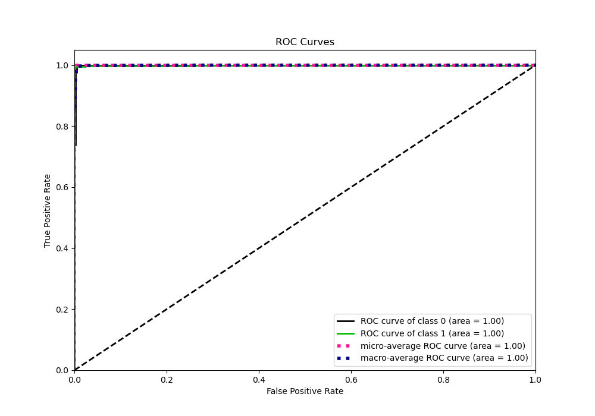
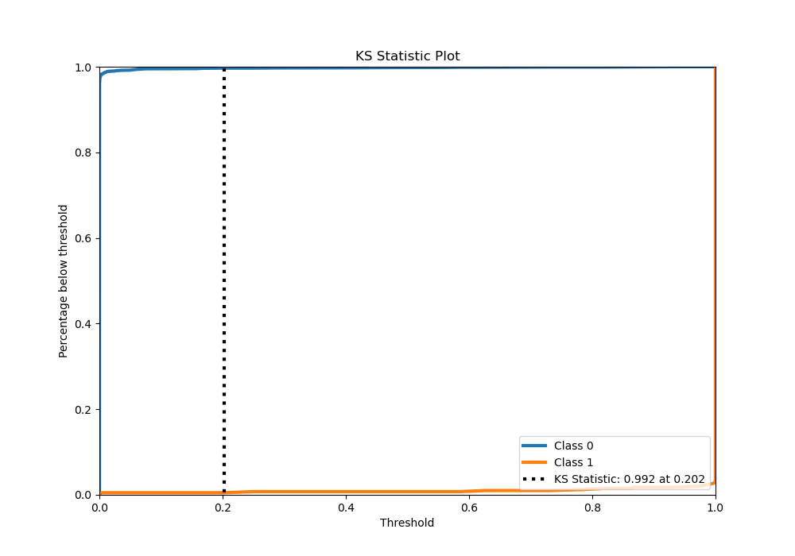
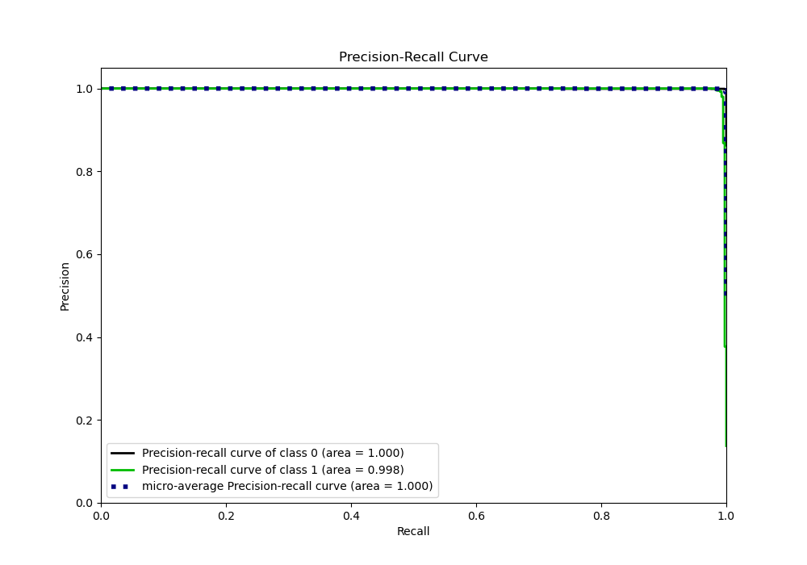
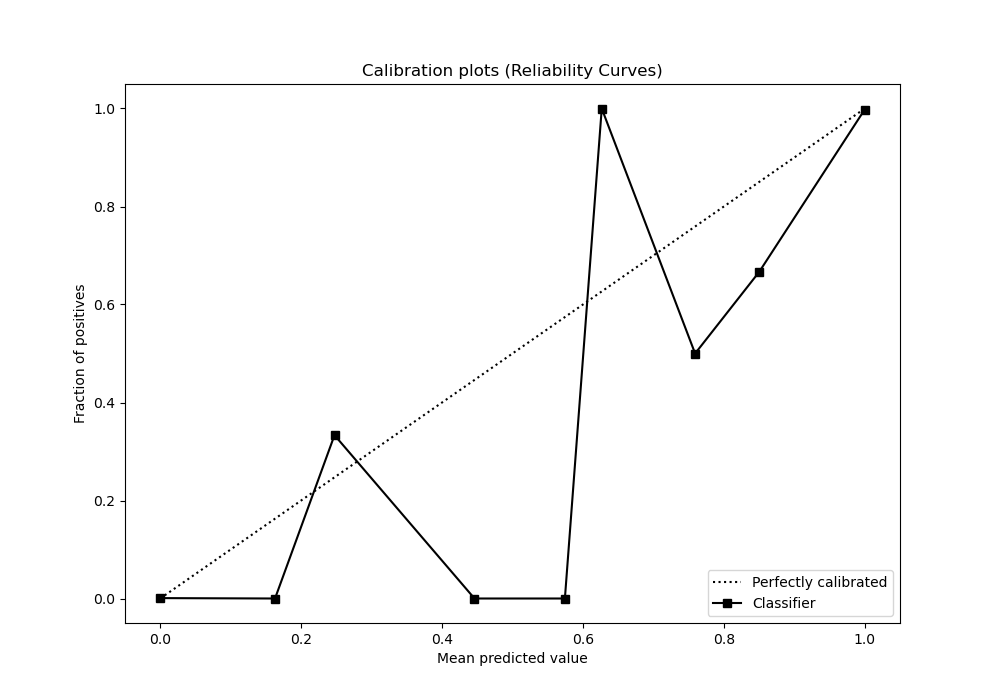
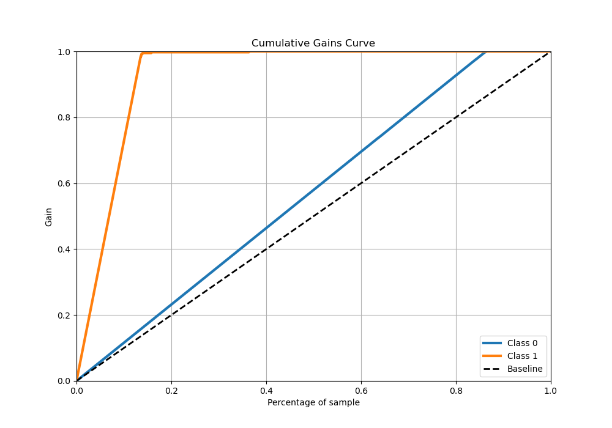
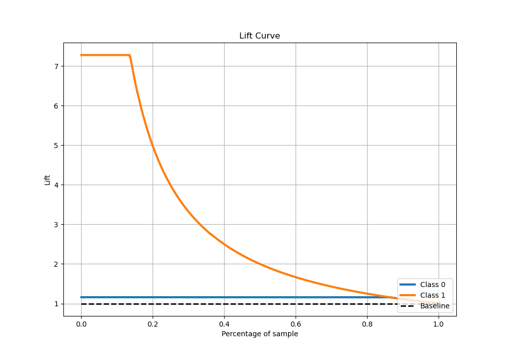

# Summary of 59_NeuralNetwork

[<< Go back](../README.md)

## Neural Network
- **n_jobs**: -1
- **dense_1_size**: 32
- **dense_2_size**: 8
- **learning_rate**: 0.08
- **explain_level**: 1

## Validation
 - **validation_type**: kfold
 - **shuffle**: True
 - **stratify**: True
 - **k_folds**: 10

## Optimized metric
logloss

## Training time

10.7 seconds

## Metric details
|           |     score |     threshold |
|:----------|----------:|--------------:|
| logloss   | 0.0124148 | nan           |
| auc       | 0.999264  | nan           |
| f1        | 0.987531  |   0.227167    |
| accuracy  | 0.996548  |   0.227167    |
| precision | 1         |   1           |
| recall    | 1         |   1.46958e-34 |
| mcc       | 0.985565  |   0.227167    |

## Metric details with threshold from accuracy metric
|           |     score |   threshold |
|:----------|----------:|------------:|
| logloss   | 0.0124148 |  nan        |
| auc       | 0.999264  |  nan        |
| f1        | 0.987531  |    0.227167 |
| accuracy  | 0.996548  |    0.227167 |
| precision | 0.980198  |    0.227167 |
| recall    | 0.994975  |    0.227167 |
| mcc       | 0.985565  |    0.227167 |

## Confusion matrix (at threshold=0.227167)
|              |   Predicted as 0 |   Predicted as 1 |
|:-------------|-----------------:|-----------------:|
| Labeled as 0 |             2491 |                8 |
| Labeled as 1 |                2 |              396 |

## Learning curves

## Permutation-based Importance

## Confusion Matrix

## Normalized Confusion Matrix

## ROC Curve

## Kolmogorov-Smirnov Statistic

## Precision-Recall Curve

## Calibration Curve

## Cumulative Gains Curve

## Lift Curve

[<< Go back](../README.md)
