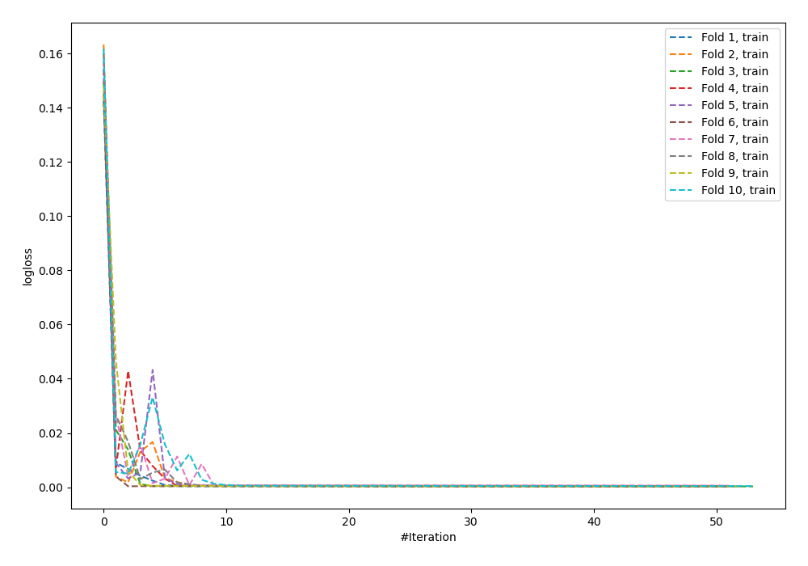
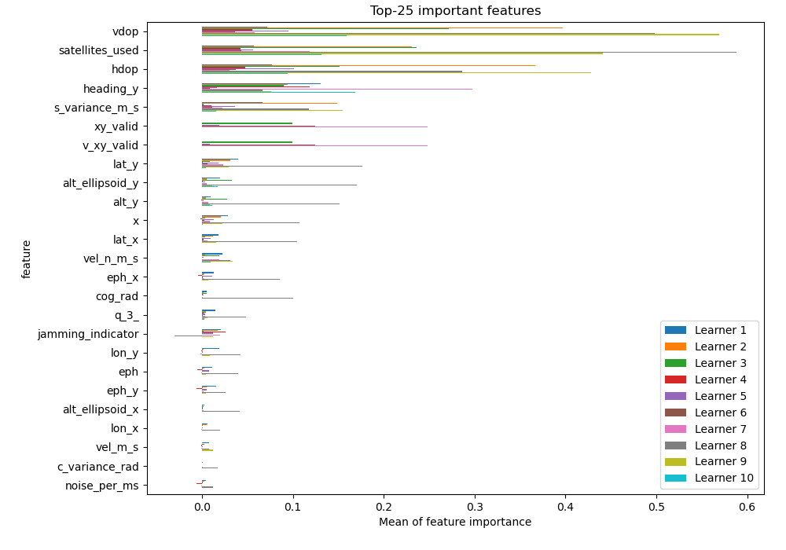
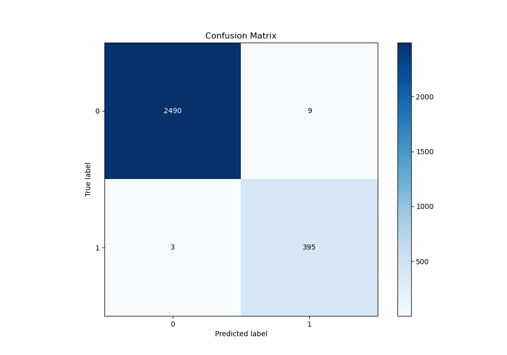
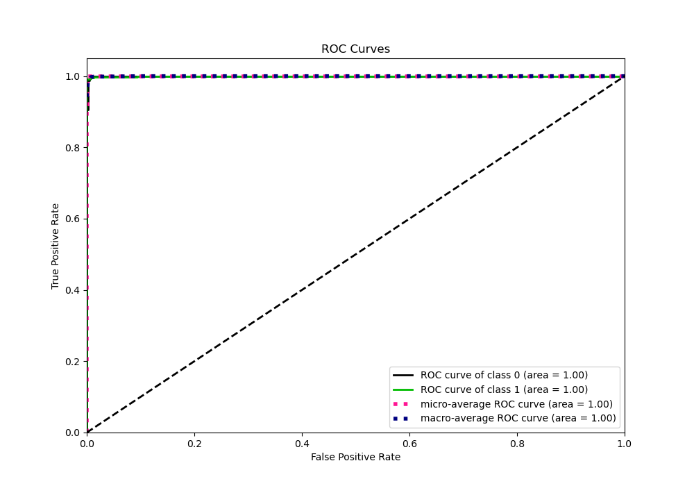
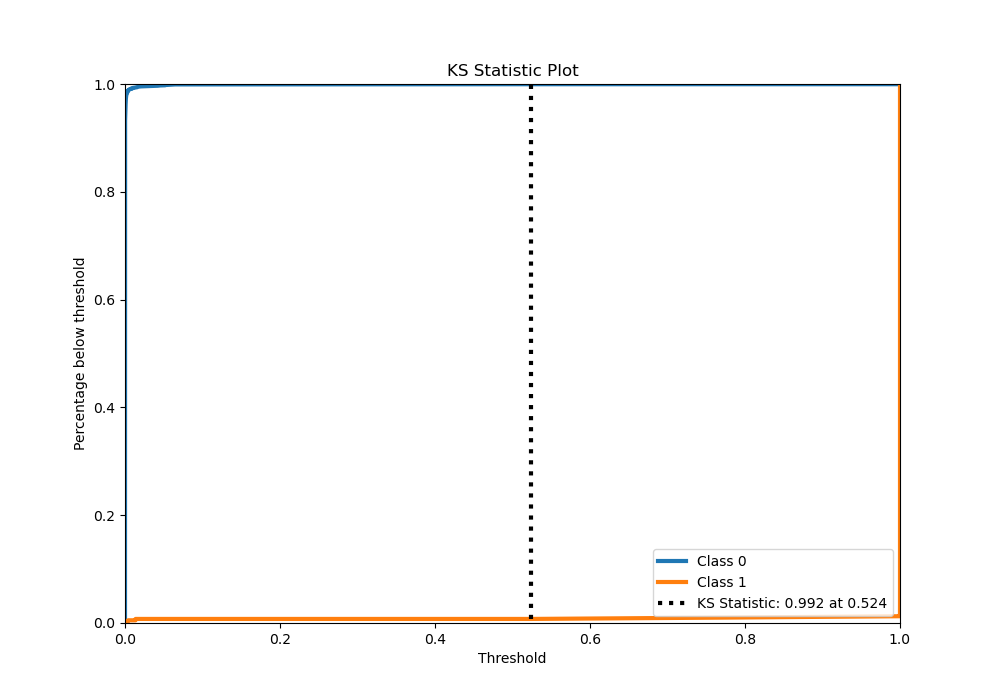
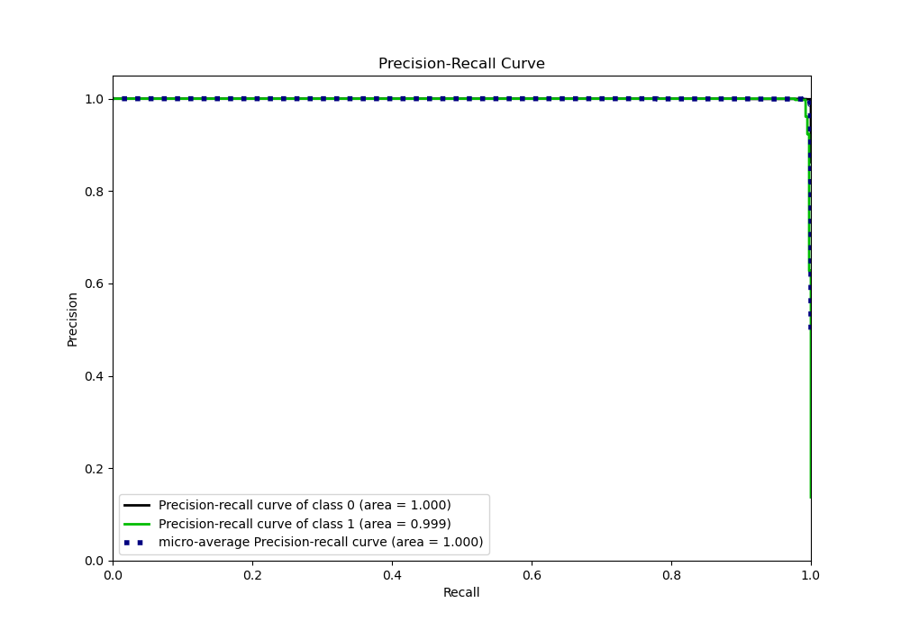
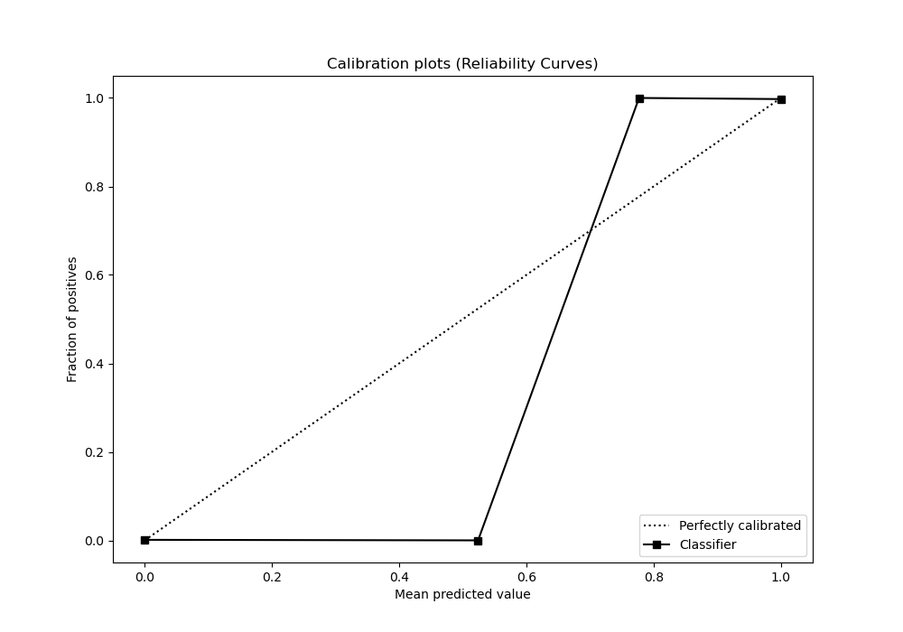
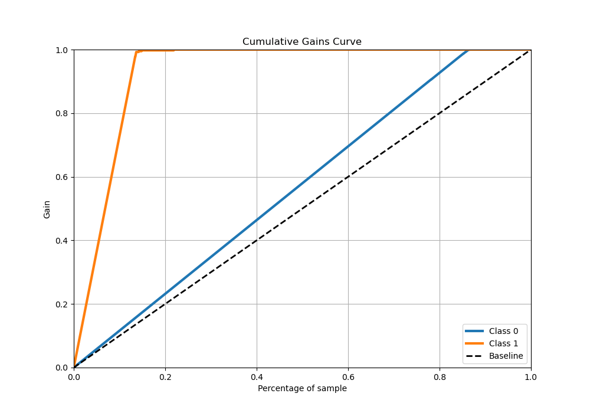
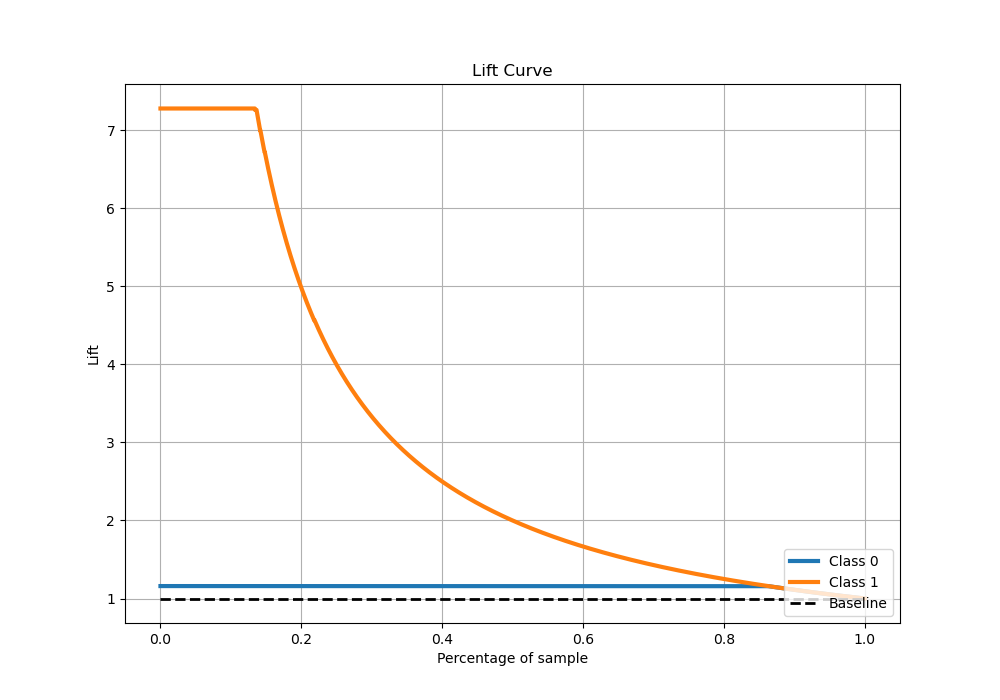

# Summary of 63_NeuralNetwork

[<< Go back](../README.md)

## Neural Network
- **n_jobs**: -1
- **dense_1_size**: 64
- **dense_2_size**: 16
- **learning_rate**: 0.1
- **explain_level**: 1

## Validation
 - **validation_type**: kfold
 - **shuffle**: True
 - **stratify**: True
 - **k_folds**: 10

## Optimized metric
logloss

## Training time

13.3 seconds

## Metric details
|           |     score |     threshold |
|:----------|----------:|--------------:|
| logloss   | 0.0125732 | nan           |
| auc       | 0.999707  | nan           |
| f1        | 0.985037  |   0.0381082   |
| accuracy  | 0.995858  |   0.0381082   |
| precision | 0.977723  |   0.0381082   |
| recall    | 1         |   1.18067e-93 |
| mcc       | 0.982671  |   0.0381082   |

## Metric details with threshold from accuracy metric
|           |     score |   threshold |
|:----------|----------:|------------:|
| logloss   | 0.0125732 | nan         |
| auc       | 0.999707  | nan         |
| f1        | 0.985037  |   0.0381082 |
| accuracy  | 0.995858  |   0.0381082 |
| precision | 0.977723  |   0.0381082 |
| recall    | 0.992462  |   0.0381082 |
| mcc       | 0.982671  |   0.0381082 |

## Confusion matrix (at threshold=0.038108)
|              |   Predicted as 0 |   Predicted as 1 |
|:-------------|-----------------:|-----------------:|
| Labeled as 0 |             2490 |                9 |
| Labeled as 1 |                3 |              395 |

## Learning curves

## Permutation-based Importance

## Confusion Matrix

## Normalized Confusion Matrix

## ROC Curve

## Kolmogorov-Smirnov Statistic

## Precision-Recall Curve

## Calibration Curve

## Cumulative Gains Curve

## Lift Curve

[<< Go back](../README.md)
