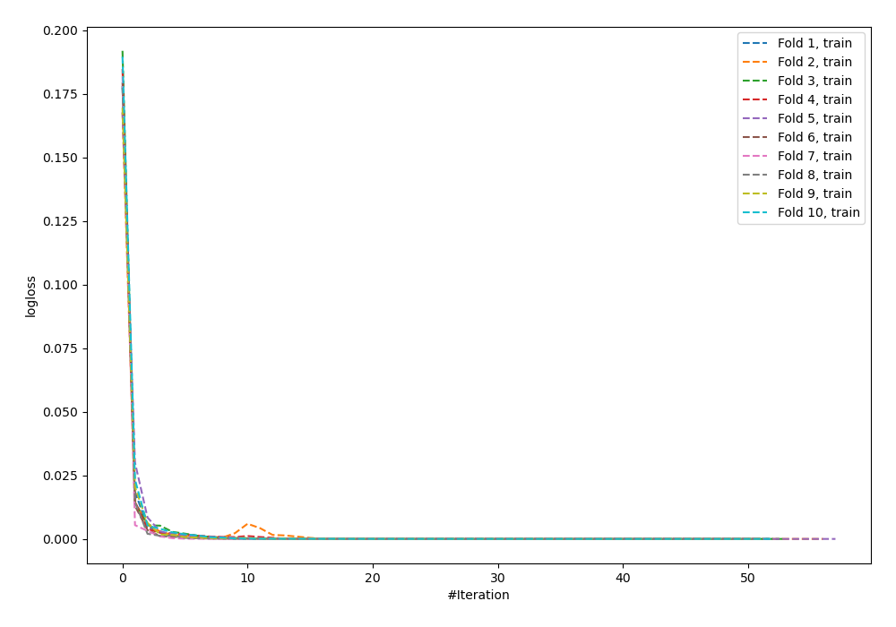
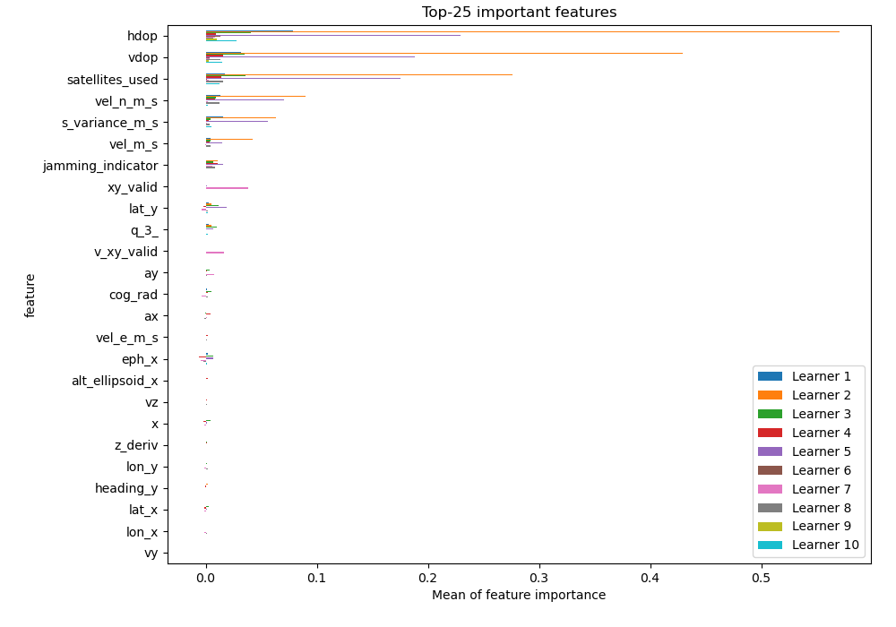
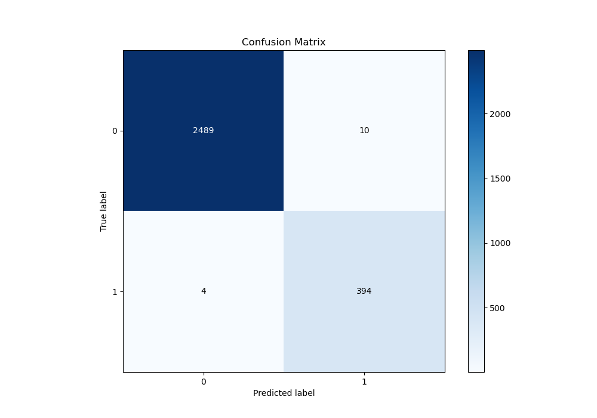
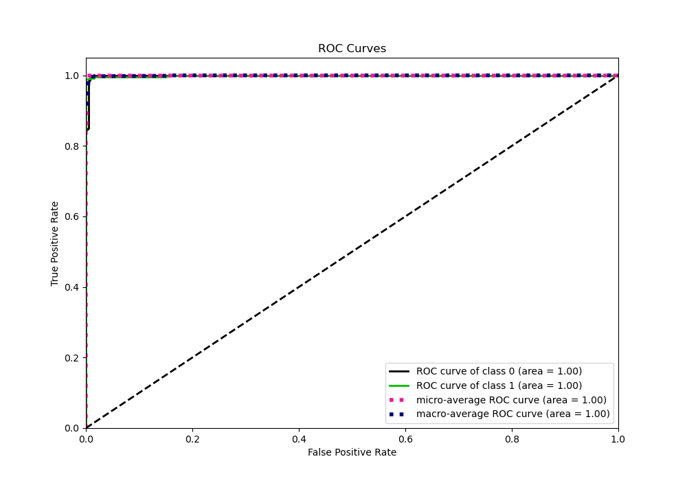
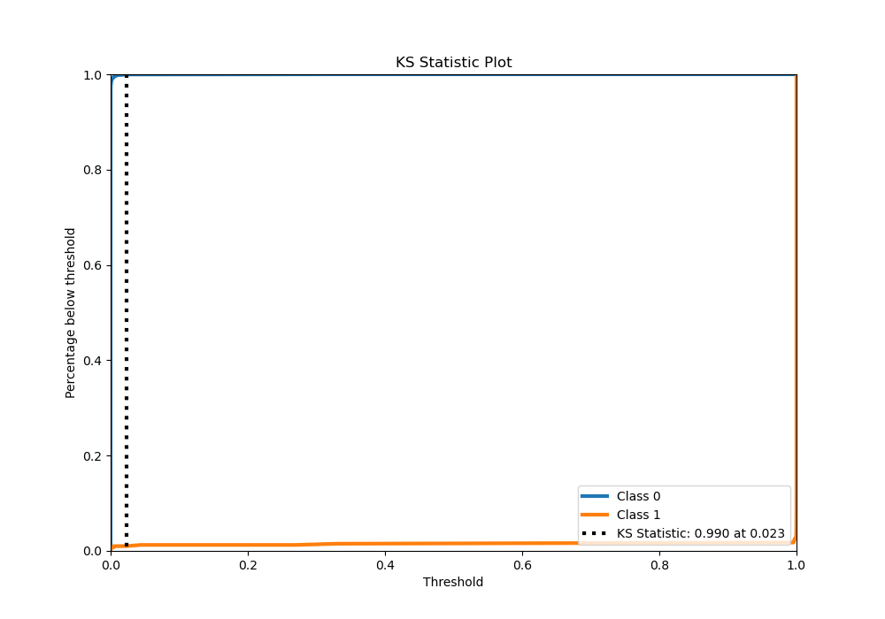
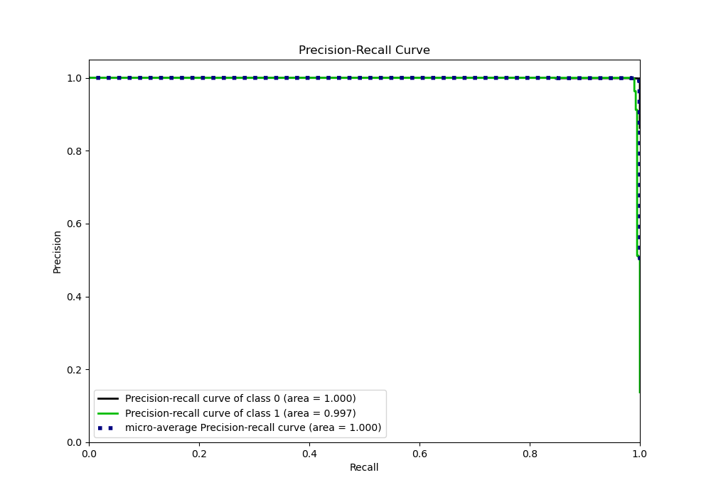
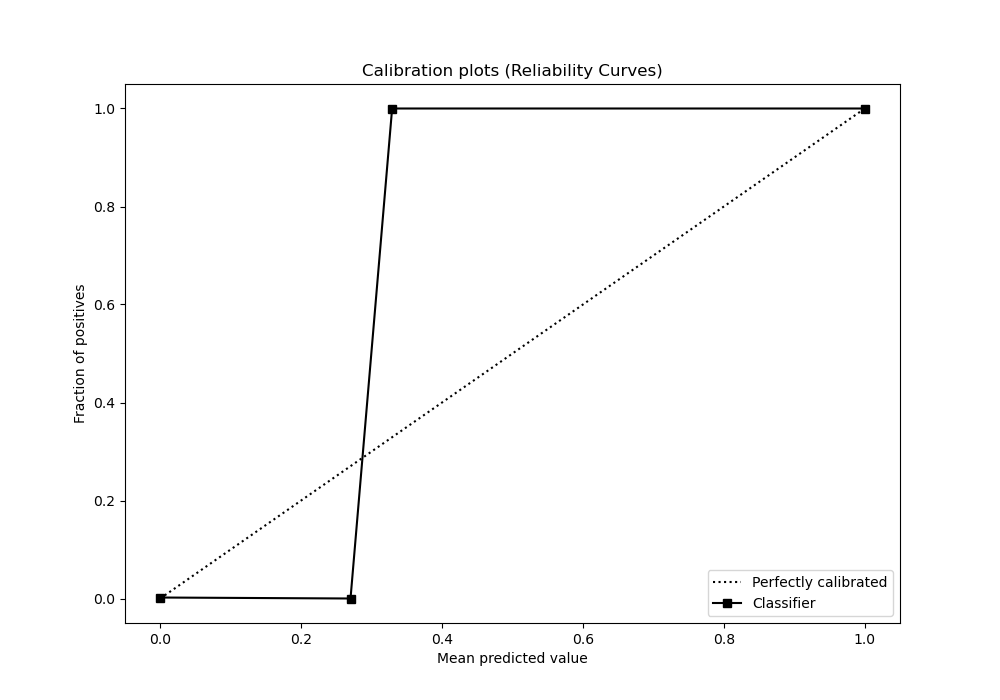
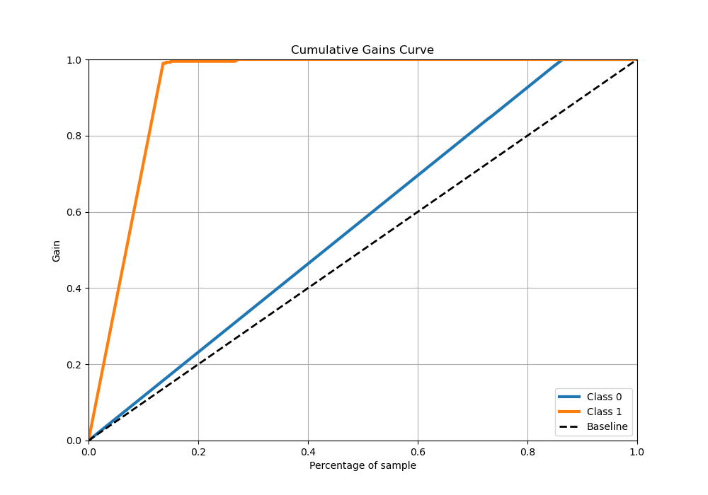
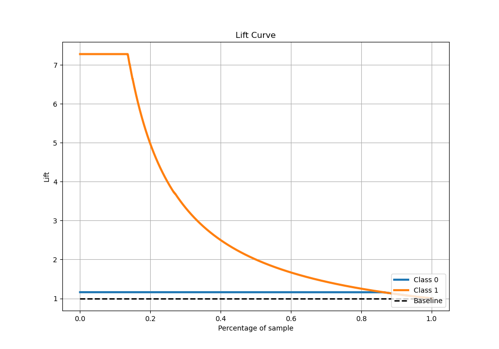

# Summary of 64_NeuralNetwork

[<< Go back](../README.md)

## Neural Network
- **n_jobs**: -1
- **dense_1_size**: 16
- **dense_2_size**: 8
- **learning_rate**: 0.05
- **explain_level**: 1

## Validation
 - **validation_type**: kfold
 - **shuffle**: True
 - **stratify**: True
 - **k_folds**: 10

## Optimized metric
logloss

## Training time

12.8 seconds

## Metric details
|           |     score |     threshold |
|:----------|----------:|--------------:|
| logloss   | 0.0148832 | nan           |
| auc       | 0.999177  | nan           |
| f1        | 0.982544  |   0.00578882  |
| accuracy  | 0.995167  |   0.00578882  |
| precision | 1         |   0.999824    |
| recall    | 1         |   1.10045e-20 |
| mcc       | 0.979776  |   0.00578882  |

## Metric details with threshold from accuracy metric
|           |     score |    threshold |
|:----------|----------:|-------------:|
| logloss   | 0.0148832 | nan          |
| auc       | 0.999177  | nan          |
| f1        | 0.982544  |   0.00578882 |
| accuracy  | 0.995167  |   0.00578882 |
| precision | 0.975248  |   0.00578882 |
| recall    | 0.98995   |   0.00578882 |
| mcc       | 0.979776  |   0.00578882 |

## Confusion matrix (at threshold=0.005789)
|              |   Predicted as 0 |   Predicted as 1 |
|:-------------|-----------------:|-----------------:|
| Labeled as 0 |             2489 |               10 |
| Labeled as 1 |                4 |              394 |

## Learning curves

## Permutation-based Importance

## Confusion Matrix

## Normalized Confusion Matrix

## ROC Curve

## Kolmogorov-Smirnov Statistic

## Precision-Recall Curve

## Calibration Curve

## Cumulative Gains Curve

## Lift Curve

[<< Go back](../README.md)
