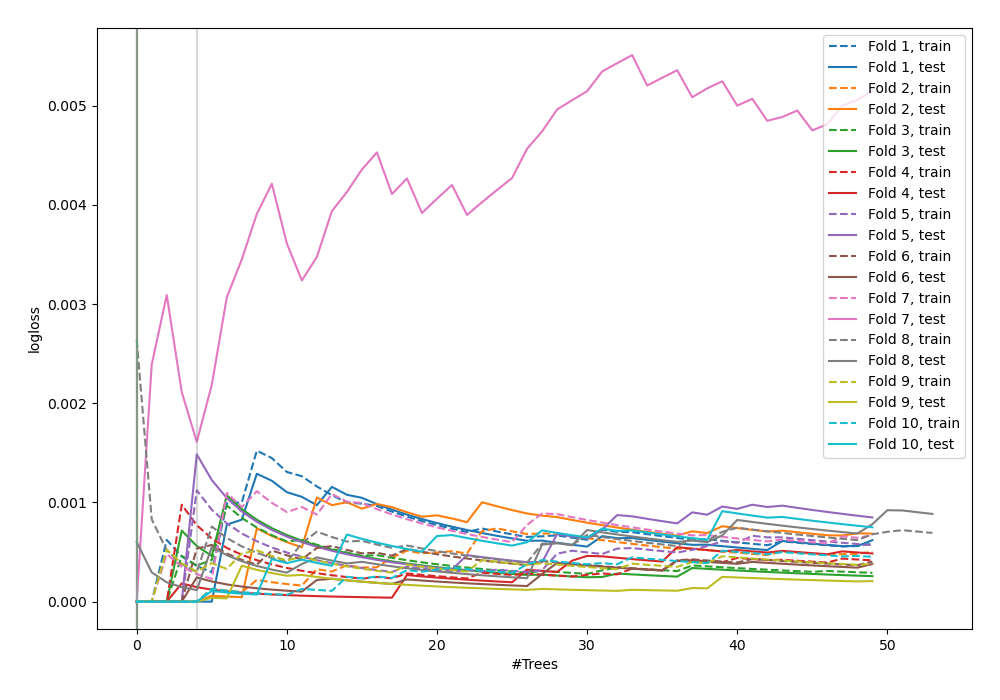
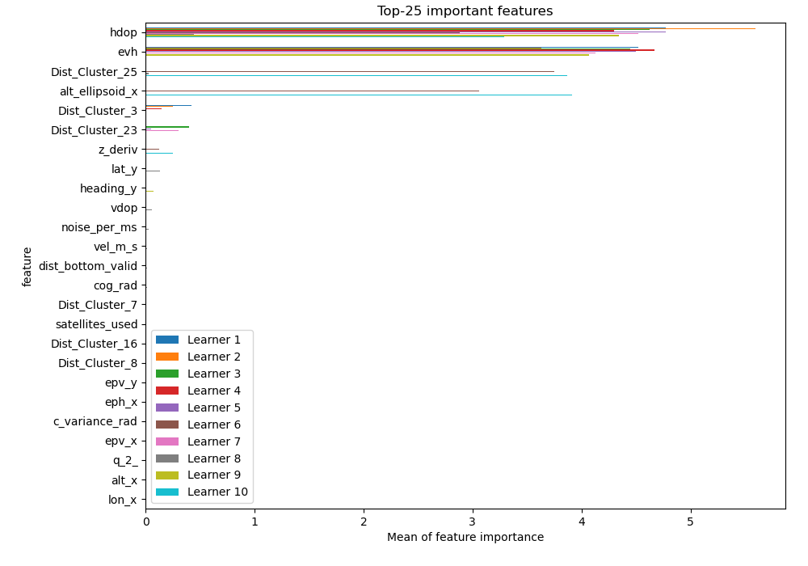
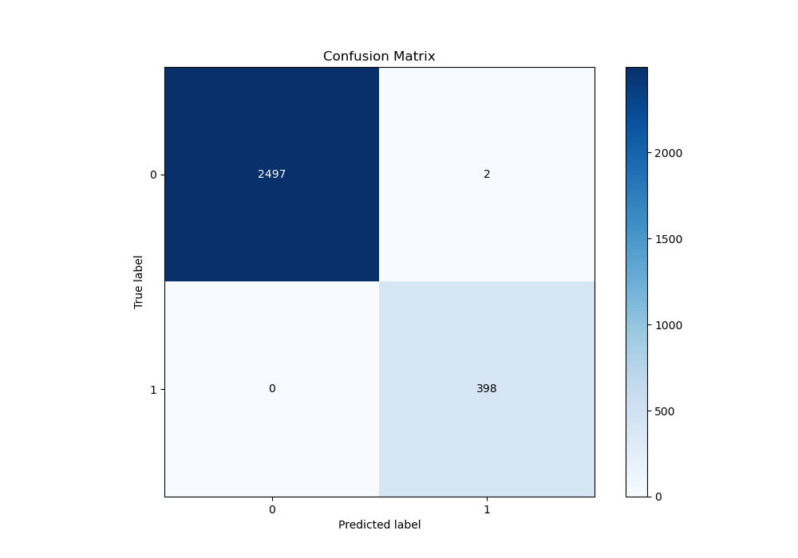
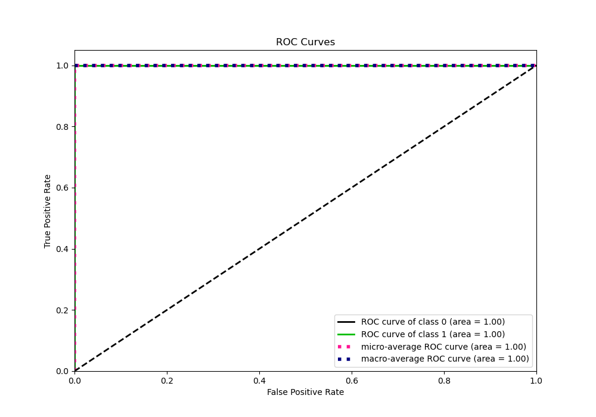
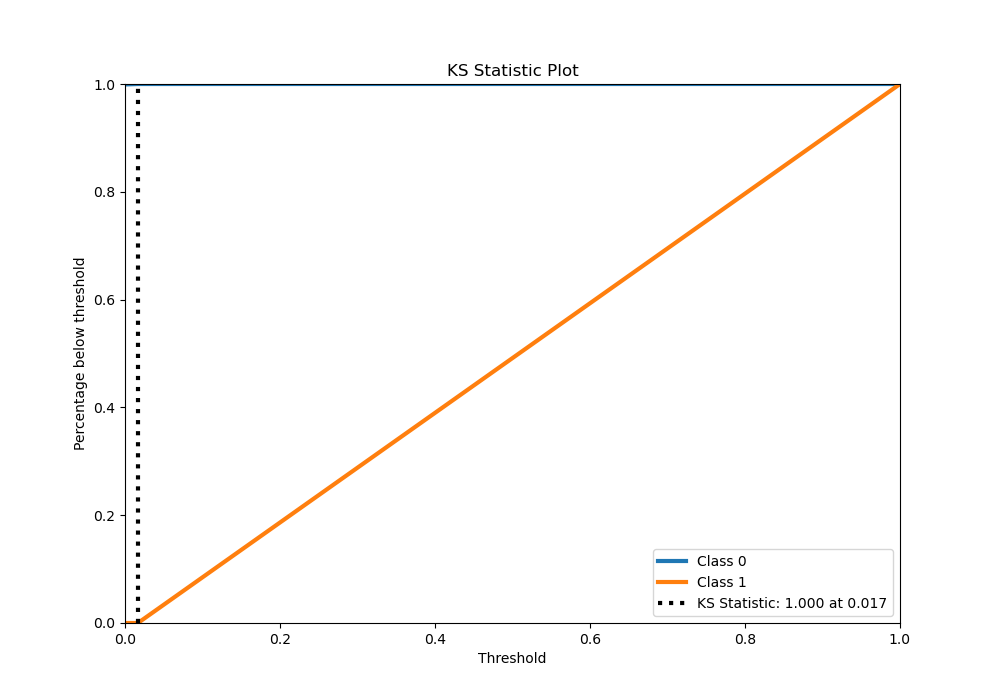
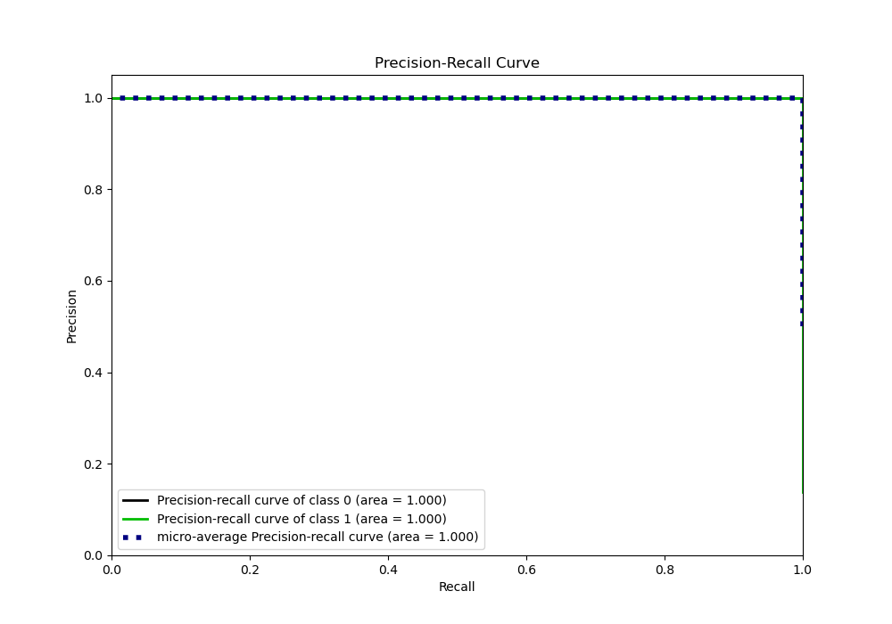
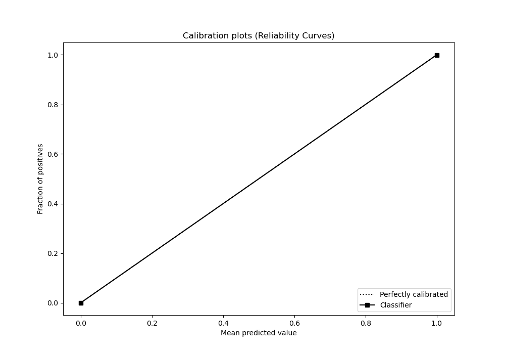

# Summary of 76_ExtraTrees

[<< Go back](../README.md)

## Extra Trees Classifier (Extra Trees)
- **n_jobs**: -1
- **criterion**: entropy
- **max_features**: 0.6
- **min_samples_split**: 30
- **max_depth**: 6
- **eval_metric_name**: logloss
- **explain_level**: 1

## Validation
 - **validation_type**: kfold
 - **shuffle**: True
 - **stratify**: True
 - **k_folds**: 10

## Optimized metric
logloss

## Training time

22.1 seconds

## Metric details
|           |       score |   threshold |
|:----------|------------:|------------:|
| logloss   | 1.17222e-05 |         nan |
| auc       | 1           |         nan |
| f1        | 0.997494    |           0 |
| accuracy  | 0.99931     |           0 |
| precision | 0.995       |           0 |
| recall    | 1           |           0 |
| mcc       | 0.997098    |           0 |

## Metric details with threshold from accuracy metric
|           |       score |   threshold |
|:----------|------------:|------------:|
| logloss   | 1.17222e-05 |         nan |
| auc       | 1           |         nan |
| f1        | 0.997494    |           0 |
| accuracy  | 0.99931     |           0 |
| precision | 0.995       |           0 |
| recall    | 1           |           0 |
| mcc       | 0.997098    |           0 |

## Confusion matrix (at threshold=0.0)
|              |   Predicted as 0 |   Predicted as 1 |
|:-------------|-----------------:|-----------------:|
| Labeled as 0 |             2497 |                2 |
| Labeled as 1 |                0 |              398 |

## Learning curves

## Permutation-based Importance

## Confusion Matrix

## Normalized Confusion Matrix

## ROC Curve

## Kolmogorov-Smirnov Statistic

## Precision-Recall Curve

## Calibration Curve

## Cumulative Gains Curve

## Lift Curve

[<< Go back](../README.md)
