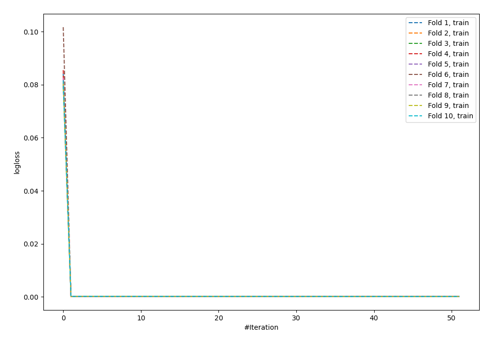
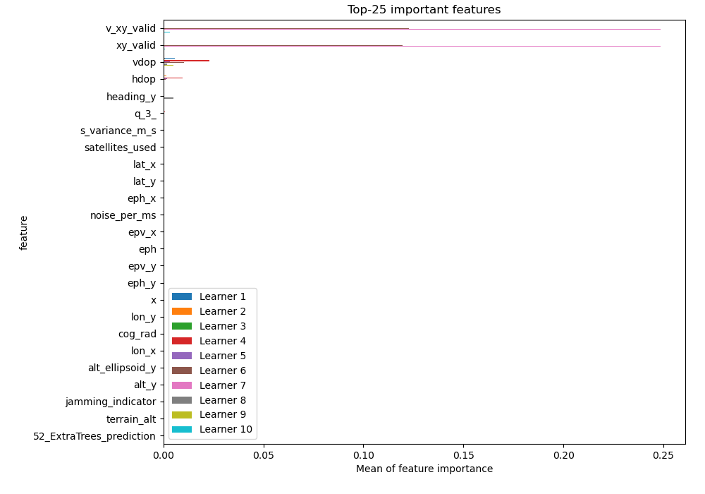
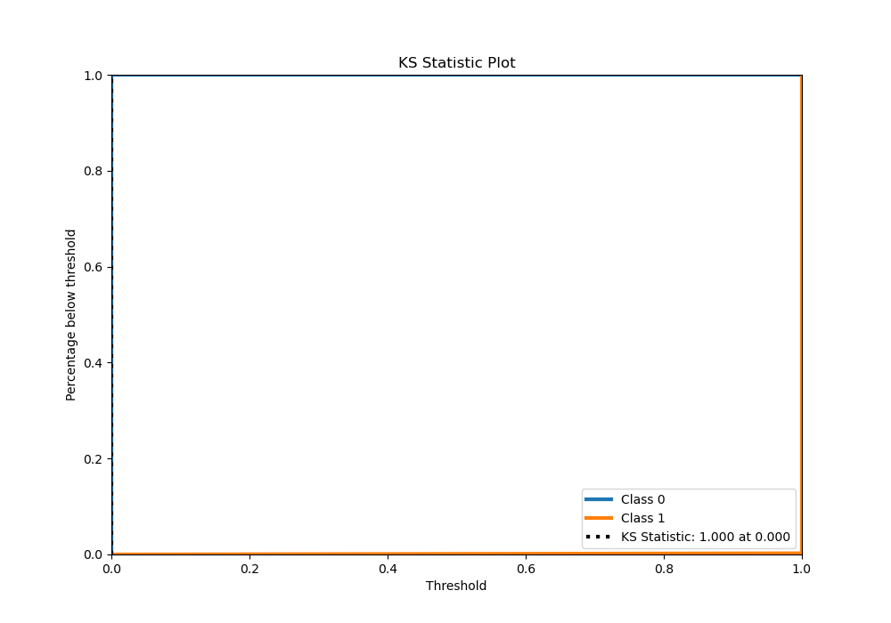
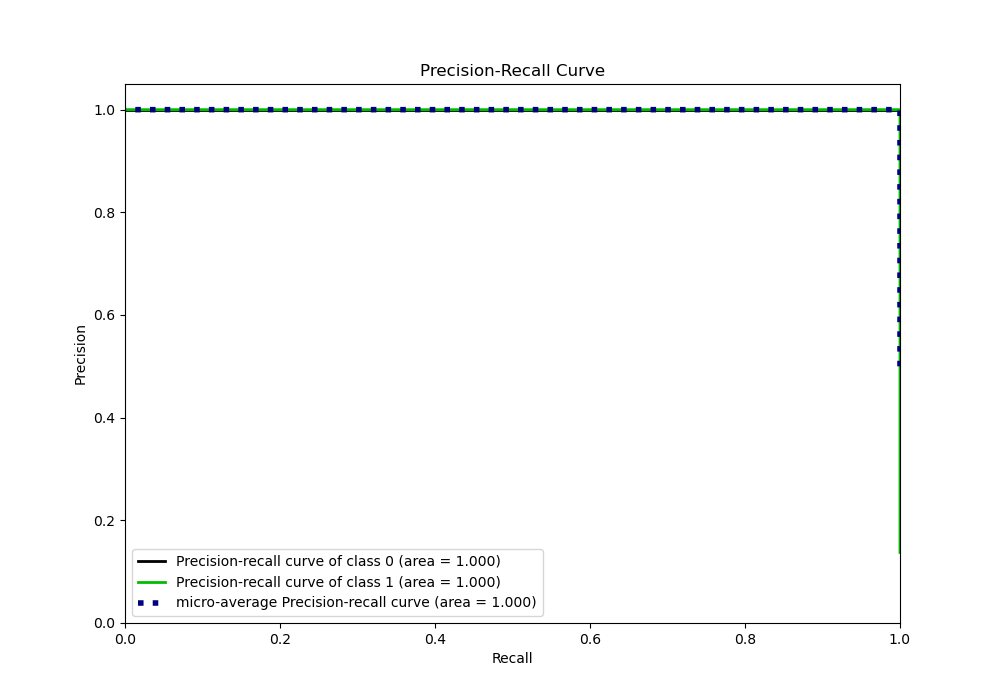
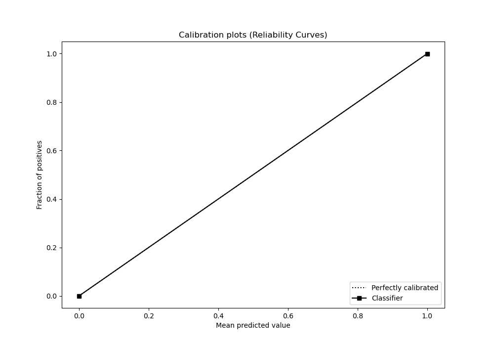

# Summary of 91_NeuralNetwork_Stacked

[<< Go back](../README.md)

## Neural Network
- **n_jobs**: -1
- **dense_1_size**: 64
- **dense_2_size**: 16
- **learning_rate**: 0.05
- **explain_level**: 1

## Validation
 - **validation_type**: kfold
 - **shuffle**: True
 - **stratify**: True
 - **k_folds**: 10

## Optimized metric
logloss

## Training time

22.7 seconds

## Metric details
|           |       score |     threshold |
|:----------|------------:|--------------:|
| logloss   | 1.19209e-07 | nan           |
| auc       | 1           | nan           |
| f1        | 0.992519    |   5.56026e-13 |
| accuracy  | 0.997929    |   5.56026e-13 |
| precision | 0.985149    |   5.56026e-13 |
| recall    | 1           |   1.74178e-44 |
| mcc       | 0.991354    |   5.56026e-13 |

## Metric details with threshold from accuracy metric
|           |       score |     threshold |
|:----------|------------:|--------------:|
| logloss   | 1.19209e-07 | nan           |
| auc       | 1           | nan           |
| f1        | 0.992519    |   5.56026e-13 |
| accuracy  | 0.997929    |   5.56026e-13 |
| precision | 0.985149    |   5.56026e-13 |
| recall    | 1           |   5.56026e-13 |
| mcc       | 0.991354    |   5.56026e-13 |

## Confusion matrix (at threshold=0.0)
|              |   Predicted as 0 |   Predicted as 1 |
|:-------------|-----------------:|-----------------:|
| Labeled as 0 |             2493 |                6 |
| Labeled as 1 |                0 |              398 |

## Learning curves

## Permutation-based Importance

## Confusion Matrix

## Normalized Confusion Matrix

## ROC Curve

## Kolmogorov-Smirnov Statistic

## Precision-Recall Curve

## Calibration Curve

## Cumulative Gains Curve

## Lift Curve

[<< Go back](../README.md)
