# Summary of 97_DecisionTree

[<< Go back](../README.md)

## Decision Tree
- **n_jobs**: -1
- **criterion**: gini
- **max_depth**: 3
- **explain_level**: 1

## Validation
 - **validation_type**: kfold
 - **shuffle**: True
 - **stratify**: True
 - **k_folds**: 10

## Optimized metric
logloss

## Training time

20.0 seconds

## Metric details
|           |      score |   threshold |
|:----------|-----------:|------------:|
| logloss   | 0.00550319 |         nan |
| auc       | 0.998744   |         nan |
| f1        | 0.998742   |           0 |
| accuracy  | 0.999655   |           0 |
| precision | 1          |           0 |
| recall    | 0.997487   |           0 |
| mcc       | 0.998543   |           0 |

## Metric details with threshold from accuracy metric
|           |      score |   threshold |
|:----------|-----------:|------------:|
| logloss   | 0.00550319 |         nan |
| auc       | 0.998744   |         nan |
| f1        | 0.998742   |           0 |
| accuracy  | 0.999655   |           0 |
| precision | 1          |           0 |
| recall    | 0.997487   |           0 |
| mcc       | 0.998543   |           0 |

## Confusion matrix (at threshold=0.0)
|              |   Predicted as 0 |   Predicted as 1 |
|:-------------|-----------------:|-----------------:|
| Labeled as 0 |             2499 |                0 |
| Labeled as 1 |                1 |              397 |

## Learning curves
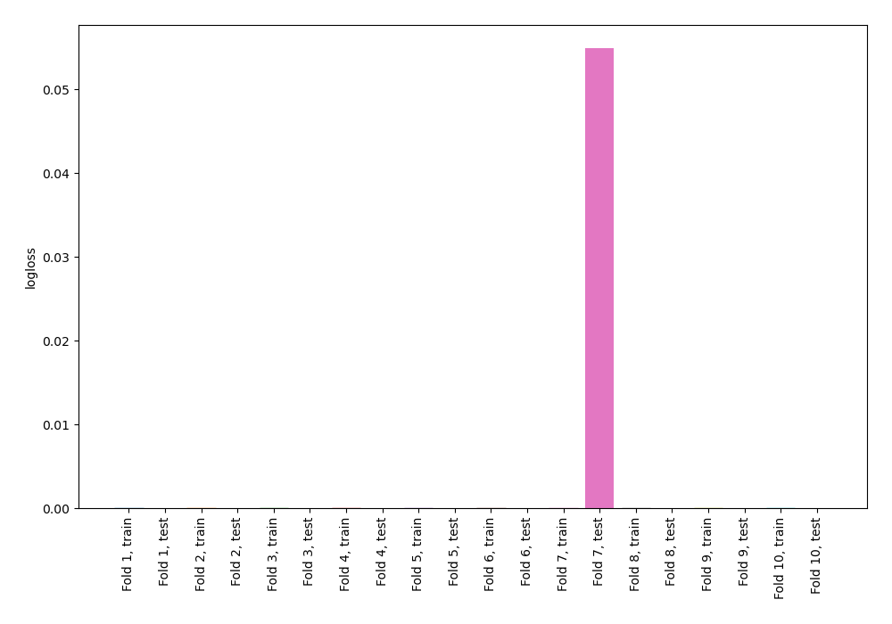

## Decision Tree 

### Tree #1

### Rules

if (lat_y <= 362048272.0) and (c_variance_rad > 0.636) then class: 0 (proba: 100.0%) | based on 2,249 samples

if (lat_y > 362048272.0) then class: 1 (proba: 100.0%) | based on 347 samples

if (lat_y <= 362048272.0) and (c_variance_rad <= 0.636) then class: 1 (proba: 100.0%) | based on 11 samples

### Tree #2

### Rules

if (lat_y <= 362048272.0) and (c_variance_rad > 0.636) then class: 0 (proba: 100.0%) | based on 2,249 samples

if (lat_y > 362048272.0) then class: 1 (proba: 100.0%) | based on 348 samples

if (lat_y <= 362048272.0) and (c_variance_rad <= 0.636) then class: 1 (proba: 100.0%) | based on 10 samples

### Tree #3

### Rules

if (lat_y <= 362048272.0) and (c_variance_rad > 0.636) then class: 0 (proba: 100.0%) | based on 2,249 samples

if (lat_y > 362048272.0) then class: 1 (proba: 100.0%) | based on 347 samples

if (lat_y <= 362048272.0) and (c_variance_rad <= 0.636) then class: 1 (proba: 100.0%) | based on 11 samples

### Tree #4
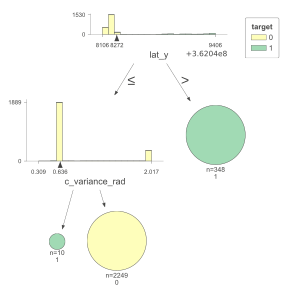

### Rules

if (lat_y <= 362048272.0) and (c_variance_rad > 0.636) then class: 0 (proba: 100.0%) | based on 2,249 samples

if (lat_y > 362048272.0) then class: 1 (proba: 100.0%) | based on 348 samples

if (lat_y <= 362048272.0) and (c_variance_rad <= 0.636) then class: 1 (proba: 100.0%) | based on 10 samples

### Tree #5

### Rules

if (lat_y <= 362048272.0) and (c_variance_rad > 0.636) then class: 0 (proba: 100.0%) | based on 2,249 samples

if (lat_y > 362048272.0) then class: 1 (proba: 100.0%) | based on 349 samples

if (lat_y <= 362048272.0) and (c_variance_rad <= 0.636) then class: 1 (proba: 100.0%) | based on 9 samples

### Tree #6

### Rules

if (lat_y <= 362048272.0) and (c_variance_rad > 0.636) then class: 0 (proba: 100.0%) | based on 2,249 samples

if (lat_y > 362048272.0) then class: 1 (proba: 100.0%) | based on 346 samples

if (lat_y <= 362048272.0) and (c_variance_rad <= 0.636) then class: 1 (proba: 100.0%) | based on 12 samples

### Tree #7
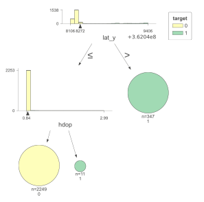

### Rules

if (lat_y <= 362048272.0) and (hdop <= 0.876) then class: 0 (proba: 100.0%) | based on 2,249 samples

if (lat_y > 362048272.0) then class: 1 (proba: 100.0%) | based on 347 samples

if (lat_y <= 362048272.0) and (hdop > 0.876) then class: 1 (proba: 100.0%) | based on 11 samples

### Tree #8

### Rules

if (lat_y <= 362048272.0) and (c_variance_rad > 0.636) then class: 0 (proba: 100.0%) | based on 2,249 samples

if (lat_y > 362048272.0) then class: 1 (proba: 100.0%) | based on 349 samples

if (lat_y <= 362048272.0) and (c_variance_rad <= 0.636) then class: 1 (proba: 100.0%) | based on 10 samples

### Tree #9

### Rules

if (lat_y <= 362048272.0) and (c_variance_rad > 0.636) then class: 0 (proba: 100.0%) | based on 2,249 samples

if (lat_y > 362048272.0) then class: 1 (proba: 100.0%) | based on 347 samples

if (lat_y <= 362048272.0) and (c_variance_rad <= 0.636) then class: 1 (proba: 100.0%) | based on 12 samples

### Tree #10
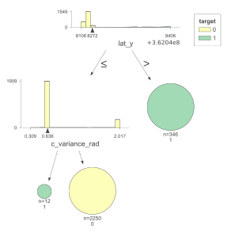

### Rules

if (lat_y <= 362048272.0) and (c_variance_rad > 0.636) then class: 0 (proba: 100.0%) | based on 2,250 samples

if (lat_y > 362048272.0) then class: 1 (proba: 100.0%) | based on 346 samples

if (lat_y <= 362048272.0) and (c_variance_rad <= 0.636) then class: 1 (proba: 100.0%) | based on 12 samples

## Permutation-based Importance
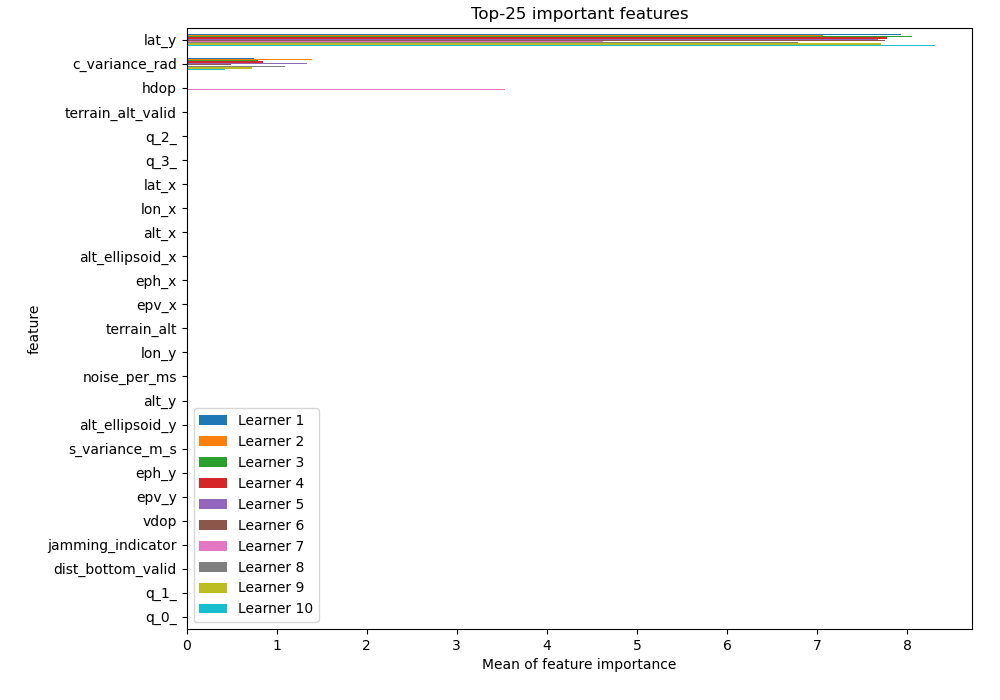
## Confusion Matrix

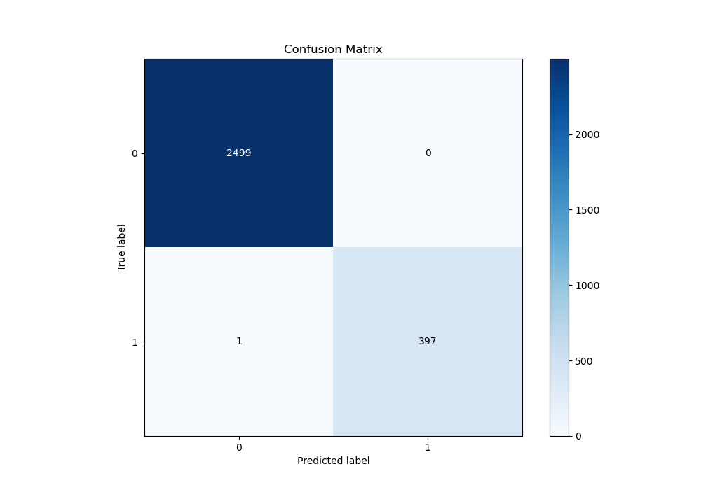

## Normalized Confusion Matrix

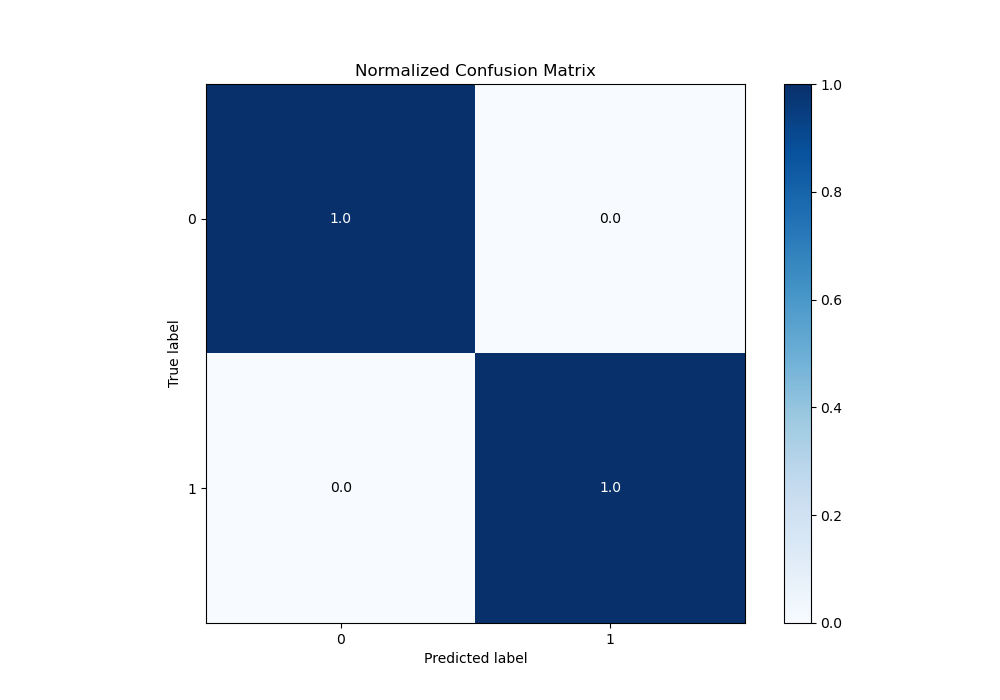

## ROC Curve

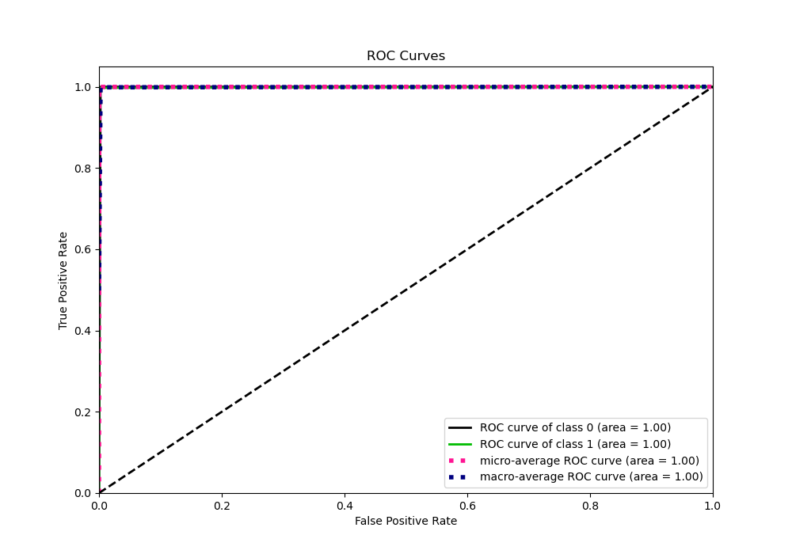

## Kolmogorov-Smirnov Statistic

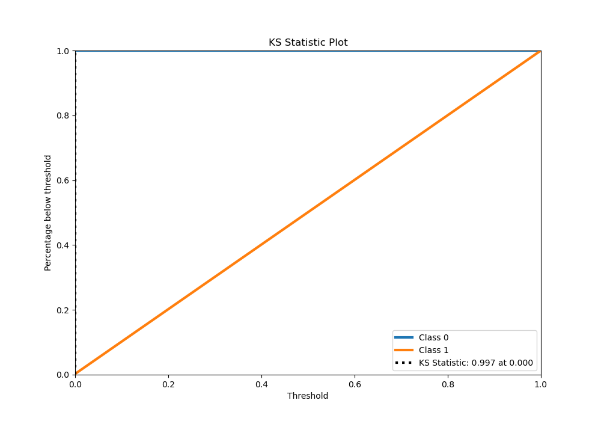

## Precision-Recall Curve

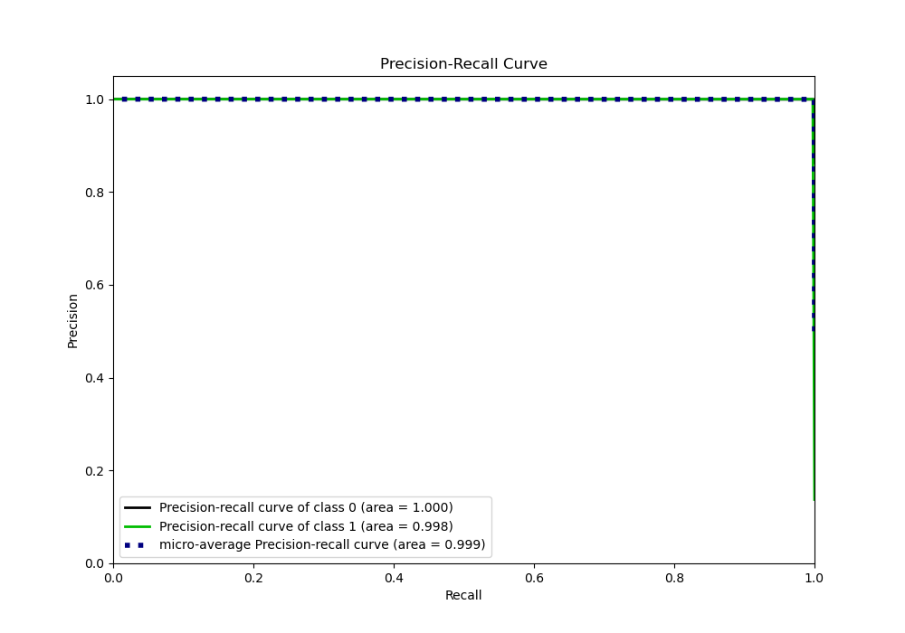

## Calibration Curve

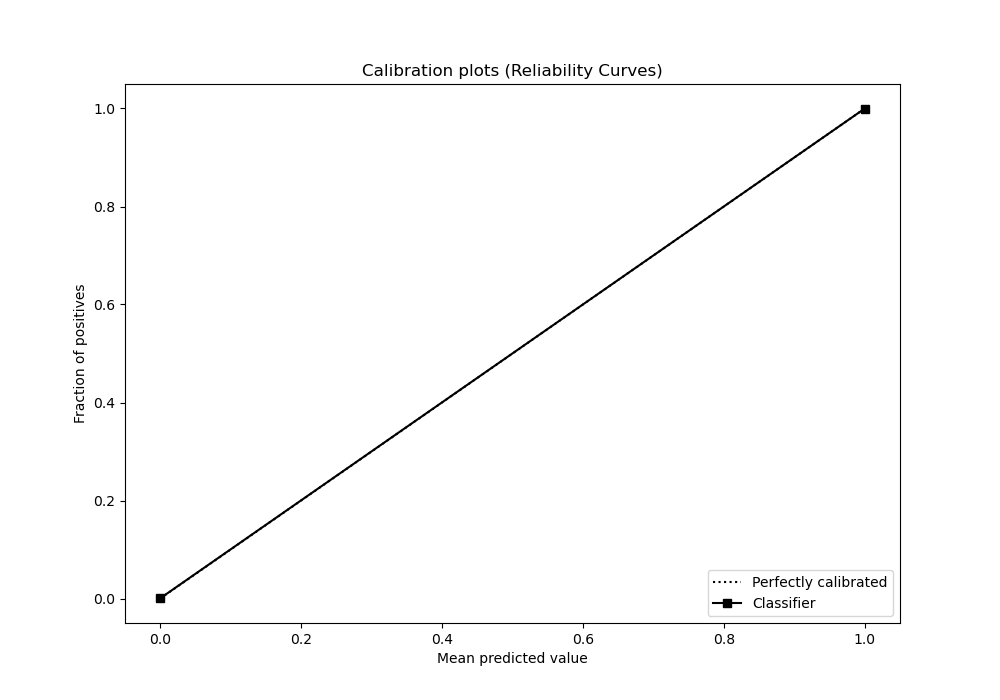

## Cumulative Gains Curve

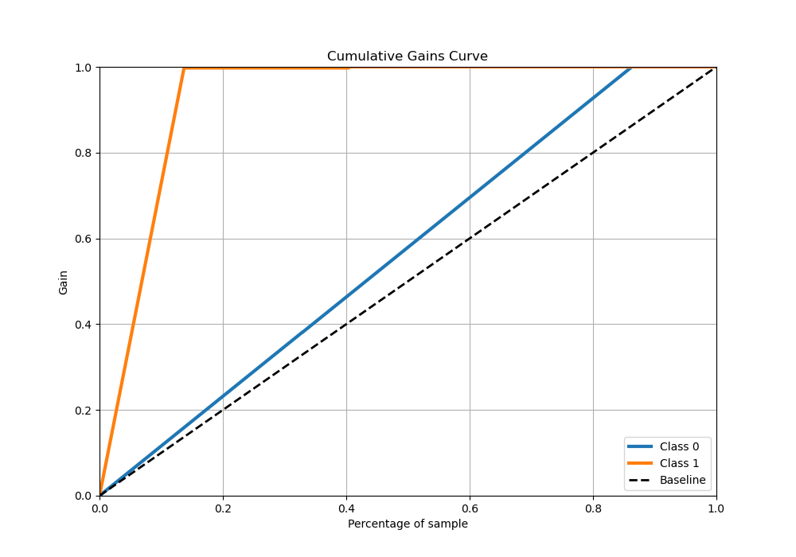

## Lift Curve

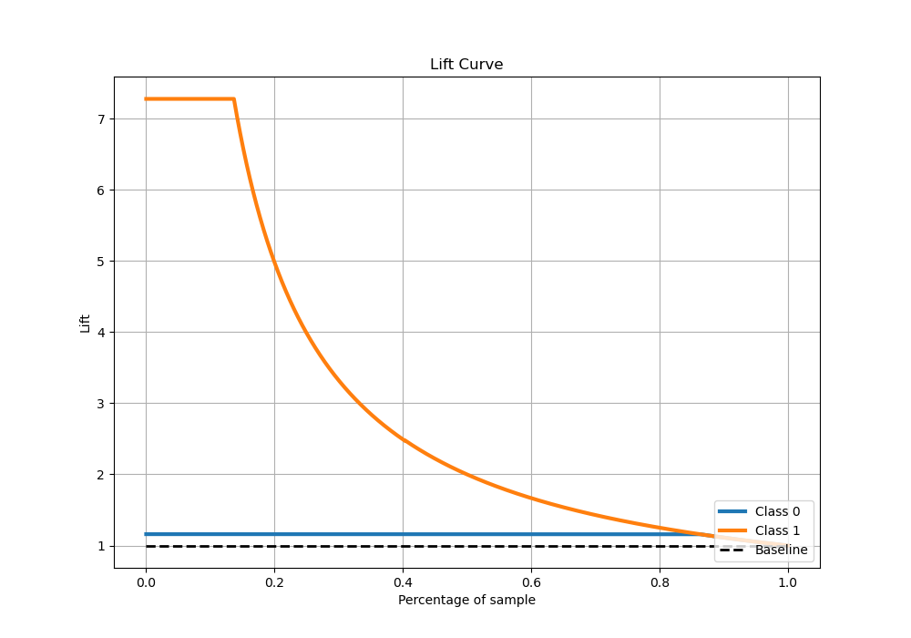

[<< Go back](../README.md)
