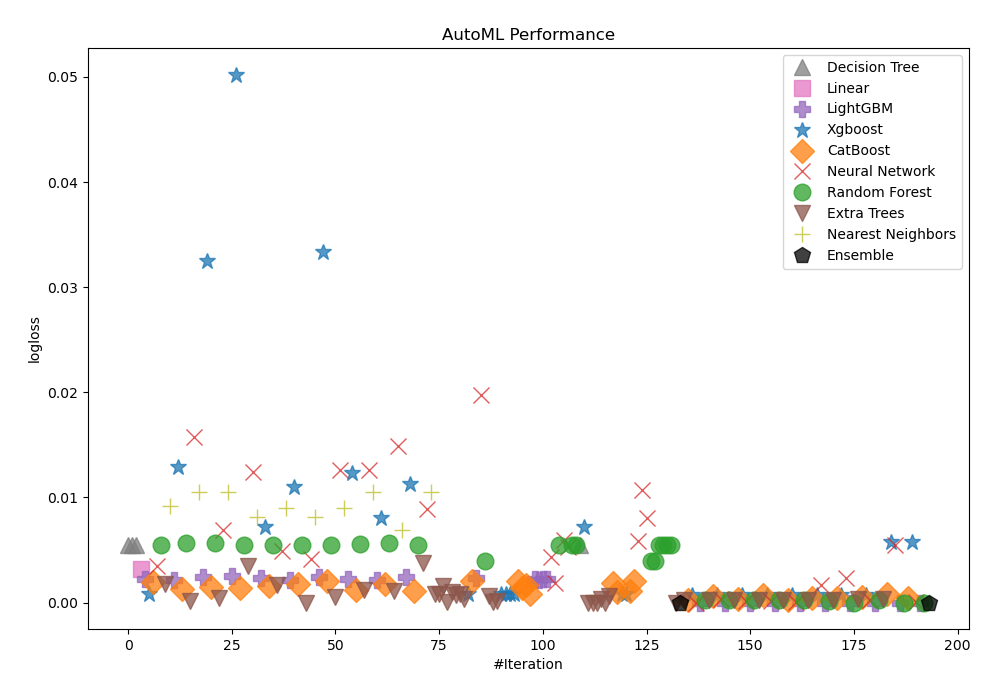
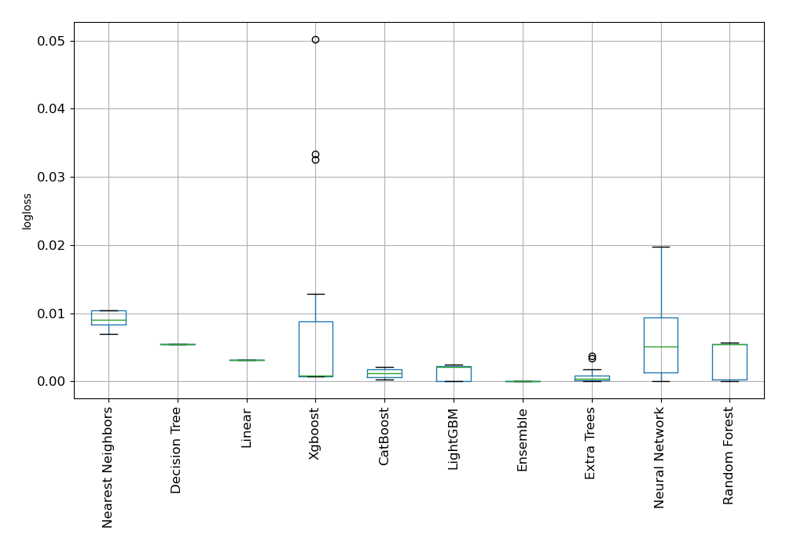
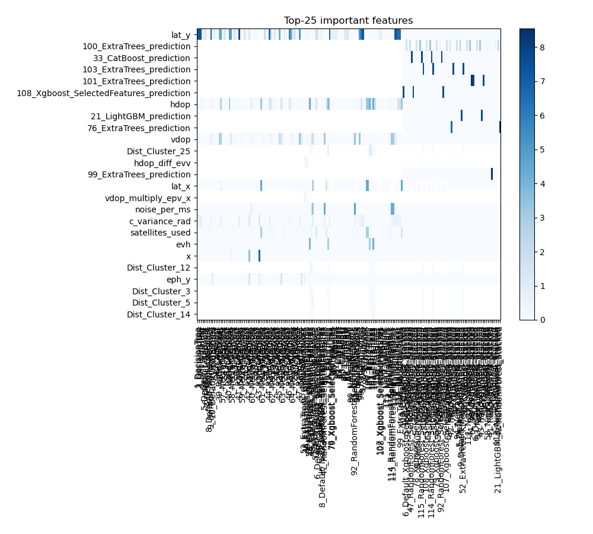
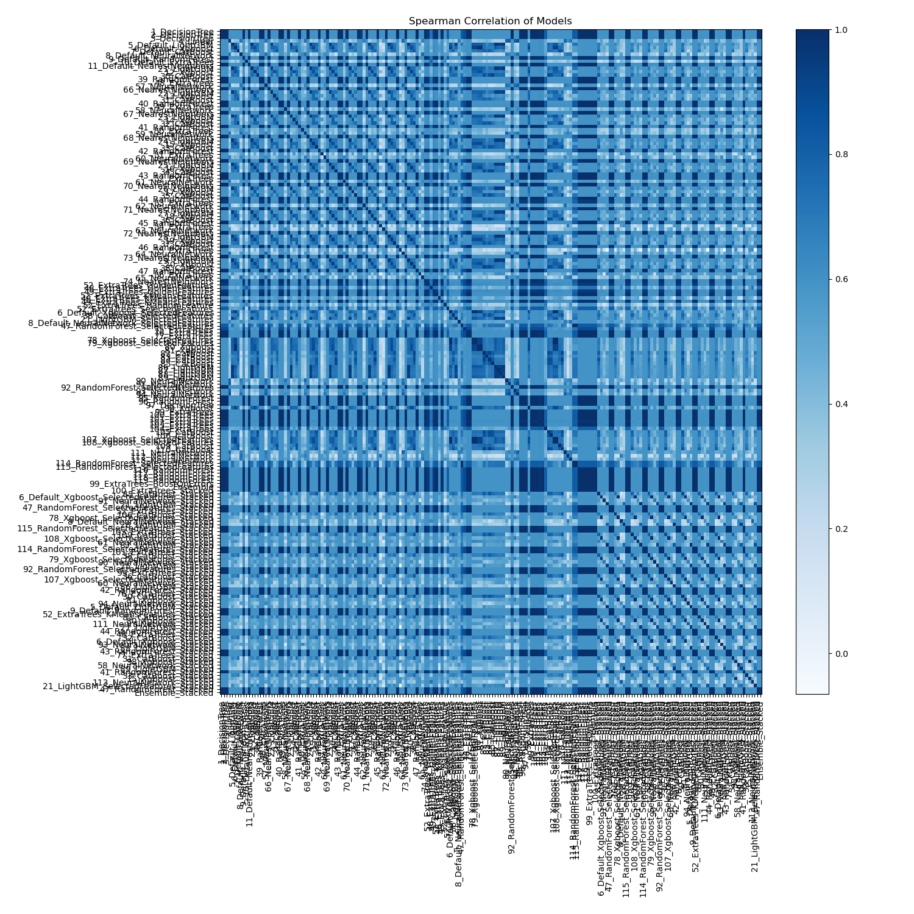

# AutoML Leaderboard

| Best model   | name                                                                                               | model_type        | metric_type   |   metric_value |   train_time |
|:-------------|:---------------------------------------------------------------------------------------------------|:------------------|:--------------|---------------:|-------------:|
|              | [1_DecisionTree](1_DecisionTree/README.md)                                                         | Decision Tree     | logloss       |    0.00550319  |        13.87 |
|              | [2_DecisionTree](2_DecisionTree/README.md)                                                         | Decision Tree     | logloss       |    0.00550319  |        14.98 |
|              | [3_DecisionTree](3_DecisionTree/README.md)                                                         | Decision Tree     | logloss       |    0.00550319  |        14.14 |
|              | [4_Linear](4_Linear/README.md)                                                                     | Linear            | logloss       |    0.00317344  |         7.09 |
|              | [5_Default_LightGBM](5_Default_LightGBM/README.md)                                                 | LightGBM          | logloss       |    0.00225463  |        21.81 |
|              | [6_Default_Xgboost](6_Default_Xgboost/README.md)                                                   | Xgboost           | logloss       |    0.000843677 |        12.9  |
|              | [7_Default_CatBoost](7_Default_CatBoost/README.md)                                                 | CatBoost          | logloss       |    0.00195113  |        19.03 |
|              | [8_Default_NeuralNetwork](8_Default_NeuralNetwork/README.md)                                       | Neural Network    | logloss       |    0.00346197  |        11.17 |
|              | [9_Default_RandomForest](9_Default_RandomForest/README.md)                                         | Random Forest     | logloss       |    0.00550319  |        15    |
|              | [10_Default_ExtraTrees](10_Default_ExtraTrees/README.md)                                           | Extra Trees       | logloss       |    0.00172596  |        21.15 |
|              | [11_Default_NearestNeighbors](11_Default_NearestNeighbors/README.md)                               | Nearest Neighbors | logloss       |    0.00919507  |         5.55 |
|              | [21_LightGBM](21_LightGBM/README.md)                                                               | LightGBM          | logloss       |    0.00211618  |        15.39 |
|              | [12_Xgboost](12_Xgboost/README.md)                                                                 | Xgboost           | logloss       |    0.0128648   |        12.24 |
|              | [30_CatBoost](30_CatBoost/README.md)                                                               | CatBoost          | logloss       |    0.00130881  |      1974.89 |
|              | [39_RandomForest](39_RandomForest/README.md)                                                       | Random Forest     | logloss       |    0.0056709   |        14.49 |
|              | [48_ExtraTrees](48_ExtraTrees/README.md)                                                           | Extra Trees       | logloss       |    0.000140079 |        13.49 |
|              | [57_NeuralNetwork](57_NeuralNetwork/README.md)                                                     | Neural Network    | logloss       |    0.0157318   |        11.65 |
|              | [66_NearestNeighbors](66_NearestNeighbors/README.md)                                               | Nearest Neighbors | logloss       |    0.0104782   |         6.05 |
|              | [22_LightGBM](22_LightGBM/README.md)                                                               | LightGBM          | logloss       |    0.00244946  |        10.36 |
|              | [13_Xgboost](13_Xgboost/README.md)                                                                 | Xgboost           | logloss       |    0.0325219   |        11.4  |
|              | [31_CatBoost](31_CatBoost/README.md)                                                               | CatBoost          | logloss       |    0.0014374   |        46.48 |
|              | [40_RandomForest](40_RandomForest/README.md)                                                       | Random Forest     | logloss       |    0.00564315  |        15.25 |
|              | [49_ExtraTrees](49_ExtraTrees/README.md)                                                           | Extra Trees       | logloss       |    0.000412345 |        14.08 |
|              | [58_NeuralNetwork](58_NeuralNetwork/README.md)                                                     | Neural Network    | logloss       |    0.0069338   |        11.97 |
|              | [67_NearestNeighbors](67_NearestNeighbors/README.md)                                               | Nearest Neighbors | logloss       |    0.0104782   |         6.52 |
|              | [23_LightGBM](23_LightGBM/README.md)                                                               | LightGBM          | logloss       |    0.0024807   |        16.81 |
|              | [14_Xgboost](14_Xgboost/README.md)                                                                 | Xgboost           | logloss       |    0.0502277   |        12.33 |
|              | [32_CatBoost](32_CatBoost/README.md)                                                               | CatBoost          | logloss       |    0.00141292  |        37.11 |
|              | [41_RandomForest](41_RandomForest/README.md)                                                       | Random Forest     | logloss       |    0.00550319  |        15.64 |
|              | [50_ExtraTrees](50_ExtraTrees/README.md)                                                           | Extra Trees       | logloss       |    0.00343024  |        16.97 |
|              | [59_NeuralNetwork](59_NeuralNetwork/README.md)                                                     | Neural Network    | logloss       |    0.0124148   |        11.88 |
|              | [68_NearestNeighbors](68_NearestNeighbors/README.md)                                               | Nearest Neighbors | logloss       |    0.00811375  |         7.1  |
|              | [24_LightGBM](24_LightGBM/README.md)                                                               | LightGBM          | logloss       |    0.00237386  |        13.19 |
|              | [15_Xgboost](15_Xgboost/README.md)                                                                 | Xgboost           | logloss       |    0.00722992  |        12.25 |
|              | [33_CatBoost](33_CatBoost/README.md)                                                               | CatBoost          | logloss       |    0.00154436  |        53.52 |
|              | [42_RandomForest](42_RandomForest/README.md)                                                       | Random Forest     | logloss       |    0.00550319  |        15.82 |
|              | [51_ExtraTrees](51_ExtraTrees/README.md)                                                           | Extra Trees       | logloss       |    0.00162591  |        15.67 |
|              | [60_NeuralNetwork](60_NeuralNetwork/README.md)                                                     | Neural Network    | logloss       |    0.00493066  |        12.78 |
|              | [69_NearestNeighbors](69_NearestNeighbors/README.md)                                               | Nearest Neighbors | logloss       |    0.0089831   |         7.58 |
|              | [25_LightGBM](25_LightGBM/README.md)                                                               | LightGBM          | logloss       |    0.00216036  |        12.43 |
|              | [16_Xgboost](16_Xgboost/README.md)                                                                 | Xgboost           | logloss       |    0.0109734   |        13.05 |
|              | [34_CatBoost](34_CatBoost/README.md)                                                               | CatBoost          | logloss       |    0.0017727   |      1520.5  |
|              | [43_RandomForest](43_RandomForest/README.md)                                                       | Random Forest     | logloss       |    0.00550319  |        16.23 |
| **the best** | [52_ExtraTrees](52_ExtraTrees/README.md)                                                           | Extra Trees       | logloss       |    1.19209e-07 |        15.54 |
|              | [61_NeuralNetwork](61_NeuralNetwork/README.md)                                                     | Neural Network    | logloss       |    0.00410694  |        12.78 |
|              | [70_NearestNeighbors](70_NearestNeighbors/README.md)                                               | Nearest Neighbors | logloss       |    0.00811375  |         8.23 |
|              | [26_LightGBM](26_LightGBM/README.md)                                                               | LightGBM          | logloss       |    0.00243634  |        15.67 |
|              | [17_Xgboost](17_Xgboost/README.md)                                                                 | Xgboost           | logloss       |    0.0333334   |        12.9  |
|              | [35_CatBoost](35_CatBoost/README.md)                                                               | CatBoost          | logloss       |    0.00206973  |       595.53 |
|              | [44_RandomForest](44_RandomForest/README.md)                                                       | Random Forest     | logloss       |    0.00550319  |        16.8  |
|              | [53_ExtraTrees](53_ExtraTrees/README.md)                                                           | Extra Trees       | logloss       |    0.000573055 |        16.52 |
|              | [62_NeuralNetwork](62_NeuralNetwork/README.md)                                                     | Neural Network    | logloss       |    0.0126502   |        13.76 |
|              | [71_NearestNeighbors](71_NearestNeighbors/README.md)                                               | Nearest Neighbors | logloss       |    0.0089831   |         8.54 |
|              | [27_LightGBM](27_LightGBM/README.md)                                                               | LightGBM          | logloss       |    0.00226676  |        12.27 |
|              | [18_Xgboost](18_Xgboost/README.md)                                                                 | Xgboost           | logloss       |    0.0123469   |        13.54 |
|              | [36_CatBoost](36_CatBoost/README.md)                                                               | CatBoost          | logloss       |    0.00123108  |       597.51 |
|              | [45_RandomForest](45_RandomForest/README.md)                                                       | Random Forest     | logloss       |    0.00558303  |        18.48 |
|              | [54_ExtraTrees](54_ExtraTrees/README.md)                                                           | Extra Trees       | logloss       |    0.00117651  |        16.86 |
|              | [63_NeuralNetwork](63_NeuralNetwork/README.md)                                                     | Neural Network    | logloss       |    0.0125732   |        14.44 |
|              | [72_NearestNeighbors](72_NearestNeighbors/README.md)                                               | Nearest Neighbors | logloss       |    0.0104782   |         9.17 |
|              | [28_LightGBM](28_LightGBM/README.md)                                                               | LightGBM          | logloss       |    0.00214501  |        16.04 |
|              | [19_Xgboost](19_Xgboost/README.md)                                                                 | Xgboost           | logloss       |    0.00808756  |        14.64 |
|              | [37_CatBoost](37_CatBoost/README.md)                                                               | CatBoost          | logloss       |    0.0017871   |       204.4  |
|              | [46_RandomForest](46_RandomForest/README.md)                                                       | Random Forest     | logloss       |    0.00567454  |        18.25 |
|              | [55_ExtraTrees](55_ExtraTrees/README.md)                                                           | Extra Trees       | logloss       |    0.00107189  |        17.29 |
|              | [64_NeuralNetwork](64_NeuralNetwork/README.md)                                                     | Neural Network    | logloss       |    0.0148832   |        14    |
|              | [73_NearestNeighbors](73_NearestNeighbors/README.md)                                               | Nearest Neighbors | logloss       |    0.0069429   |         9.6  |
|              | [29_LightGBM](29_LightGBM/README.md)                                                               | LightGBM          | logloss       |    0.0024688   |        21.02 |
|              | [20_Xgboost](20_Xgboost/README.md)                                                                 | Xgboost           | logloss       |    0.011275    |        14.53 |
|              | [38_CatBoost](38_CatBoost/README.md)                                                               | CatBoost          | logloss       |    0.00111778  |       581.52 |
|              | [47_RandomForest](47_RandomForest/README.md)                                                       | Random Forest     | logloss       |    0.00550319  |        17.93 |
|              | [56_ExtraTrees](56_ExtraTrees/README.md)                                                           | Extra Trees       | logloss       |    0.00372386  |        17.92 |
|              | [65_NeuralNetwork](65_NeuralNetwork/README.md)                                                     | Neural Network    | logloss       |    0.00888151  |        15.71 |
|              | [74_NearestNeighbors](74_NearestNeighbors/README.md)                                               | Nearest Neighbors | logloss       |    0.0104782   |        10.41 |
|              | [52_ExtraTrees_GoldenFeatures](52_ExtraTrees_GoldenFeatures/README.md)                             | Extra Trees       | logloss       |    0.000793224 |        24.15 |
|              | [48_ExtraTrees_GoldenFeatures](48_ExtraTrees_GoldenFeatures/README.md)                             | Extra Trees       | logloss       |    0.000806246 |        20.52 |
|              | [49_ExtraTrees_GoldenFeatures](49_ExtraTrees_GoldenFeatures/README.md)                             | Extra Trees       | logloss       |    0.00153978  |        21.94 |
|              | [52_ExtraTrees_KMeansFeatures](52_ExtraTrees_KMeansFeatures/README.md)                             | Extra Trees       | logloss       |    2.5928e-05  |        24.32 |
|              | [48_ExtraTrees_KMeansFeatures](48_ExtraTrees_KMeansFeatures/README.md)                             | Extra Trees       | logloss       |    0.00101783  |        28.11 |
|              | [49_ExtraTrees_KMeansFeatures](49_ExtraTrees_KMeansFeatures/README.md)                             | Extra Trees       | logloss       |    0.000680048 |        23.57 |
|              | [52_ExtraTrees_RandomFeature](52_ExtraTrees_RandomFeature/README.md)                               | Extra Trees       | logloss       |    0.000817513 |        23.56 |
|              | [52_ExtraTrees_SelectedFeatures](52_ExtraTrees_SelectedFeatures/README.md)                         | Extra Trees       | logloss       |    0.000299823 |        16.71 |
|              | [6_Default_Xgboost_SelectedFeatures](6_Default_Xgboost_SelectedFeatures/README.md)                 | Xgboost           | logloss       |    0.000836727 |        14.14 |
|              | [38_CatBoost_SelectedFeatures](38_CatBoost_SelectedFeatures/README.md)                             | CatBoost          | logloss       |    0.00204524  |       447.26 |
|              | [21_LightGBM_SelectedFeatures](21_LightGBM_SelectedFeatures/README.md)                             | LightGBM          | logloss       |    0.00232451  |        16.23 |
|              | [8_Default_NeuralNetwork_SelectedFeatures](8_Default_NeuralNetwork_SelectedFeatures/README.md)     | Neural Network    | logloss       |    0.0197555   |        14.62 |
|              | [47_RandomForest_SelectedFeatures](47_RandomForest_SelectedFeatures/README.md)                     | Random Forest     | logloss       |    0.00396728  |        17.62 |
|              | [75_ExtraTrees](75_ExtraTrees/README.md)                                                           | Extra Trees       | logloss       |    0.000588036 |        22.79 |
|              | [76_ExtraTrees](76_ExtraTrees/README.md)                                                           | Extra Trees       | logloss       |    1.17222e-05 |        23.37 |
|              | [77_ExtraTrees](77_ExtraTrees/README.md)                                                           | Extra Trees       | logloss       |    0.000140079 |        18.69 |
|              | [78_Xgboost_SelectedFeatures](78_Xgboost_SelectedFeatures/README.md)                               | Xgboost           | logloss       |    0.000836727 |        14.74 |
|              | [79_Xgboost_SelectedFeatures](79_Xgboost_SelectedFeatures/README.md)                               | Xgboost           | logloss       |    0.000836727 |        14.87 |
|              | [80_Xgboost](80_Xgboost/README.md)                                                                 | Xgboost           | logloss       |    0.000843677 |        17.55 |
|              | [81_Xgboost](81_Xgboost/README.md)                                                                 | Xgboost           | logloss       |    0.000843677 |        17.62 |
|              | [82_CatBoost](82_CatBoost/README.md)                                                               | CatBoost          | logloss       |    0.0020781   |       491.01 |
|              | [83_CatBoost](83_CatBoost/README.md)                                                               | CatBoost          | logloss       |    0.00137797  |       610.78 |
|              | [84_CatBoost](84_CatBoost/README.md)                                                               | CatBoost          | logloss       |    0.00164648  |       606.29 |
|              | [85_CatBoost](85_CatBoost/README.md)                                                               | CatBoost          | logloss       |    0.000779301 |      1779.01 |
|              | [86_LightGBM](86_LightGBM/README.md)                                                               | LightGBM          | logloss       |    0.00219768  |        16.72 |
|              | [87_LightGBM](87_LightGBM/README.md)                                                               | LightGBM          | logloss       |    0.00214897  |        22.56 |
|              | [88_LightGBM](88_LightGBM/README.md)                                                               | LightGBM          | logloss       |    0.00226917  |        15.99 |
|              | [89_LightGBM](89_LightGBM/README.md)                                                               | LightGBM          | logloss       |    0.00227431  |        18.42 |
|              | [90_NeuralNetwork](90_NeuralNetwork/README.md)                                                     | Neural Network    | logloss       |    0.00434059  |        15.71 |
|              | [91_NeuralNetwork](91_NeuralNetwork/README.md)                                                     | Neural Network    | logloss       |    0.00183687  |        16.61 |
|              | [92_RandomForest_SelectedFeatures](92_RandomForest_SelectedFeatures/README.md)                     | Random Forest     | logloss       |    0.00550319  |        18.15 |
|              | [93_NeuralNetwork](93_NeuralNetwork/README.md)                                                     | Neural Network    | logloss       |    0.00593752  |        15.69 |
|              | [94_NeuralNetwork](94_NeuralNetwork/README.md)                                                     | Neural Network    | logloss       |    0.00524062  |        16.25 |
|              | [95_RandomForest](95_RandomForest/README.md)                                                       | Random Forest     | logloss       |    0.00550319  |        20.33 |
|              | [96_RandomForest](96_RandomForest/README.md)                                                       | Random Forest     | logloss       |    0.00550319  |        20.45 |
|              | [97_DecisionTree](97_DecisionTree/README.md)                                                       | Decision Tree     | logloss       |    0.00550319  |        21.11 |
|              | [98_Xgboost](98_Xgboost/README.md)                                                                 | Xgboost           | logloss       |    0.00722992  |        16.22 |
|              | [99_ExtraTrees](99_ExtraTrees/README.md)                                                           | Extra Trees       | logloss       |    1.19209e-07 |        19.81 |
|              | [100_ExtraTrees](100_ExtraTrees/README.md)                                                         | Extra Trees       | logloss       |    1.19209e-07 |        19.93 |
|              | [101_ExtraTrees](101_ExtraTrees/README.md)                                                         | Extra Trees       | logloss       |    1.19209e-07 |        24.4  |
|              | [102_ExtraTrees](102_ExtraTrees/README.md)                                                         | Extra Trees       | logloss       |    0.000382411 |        24.89 |
|              | [103_ExtraTrees](103_ExtraTrees/README.md)                                                         | Extra Trees       | logloss       |    1.19209e-07 |        24.68 |
|              | [104_ExtraTrees](104_ExtraTrees/README.md)                                                         | Extra Trees       | logloss       |    0.000575971 |        25.21 |
|              | [105_CatBoost](105_CatBoost/README.md)                                                             | CatBoost          | logloss       |    0.00189029  |      1872.73 |
|              | [106_CatBoost](106_CatBoost/README.md)                                                             | CatBoost          | logloss       |    0.000992698 |        63.54 |
|              | [107_Xgboost_SelectedFeatures](107_Xgboost_SelectedFeatures/README.md)                             | Xgboost           | logloss       |    0.000836727 |        16.3  |
|              | [108_Xgboost_SelectedFeatures](108_Xgboost_SelectedFeatures/README.md)                             | Xgboost           | logloss       |    0.000836727 |        16.32 |
|              | [109_CatBoost](109_CatBoost/README.md)                                                             | CatBoost          | logloss       |    0.00111336  |        38.24 |
|              | [110_CatBoost](110_CatBoost/README.md)                                                             | CatBoost          | logloss       |    0.00202576  |       591.85 |
|              | [111_NeuralNetwork](111_NeuralNetwork/README.md)                                                   | Neural Network    | logloss       |    0.00582897  |        18.37 |
|              | [112_NeuralNetwork](112_NeuralNetwork/README.md)                                                   | Neural Network    | logloss       |    0.0106989   |        17.98 |
|              | [113_NeuralNetwork](113_NeuralNetwork/README.md)                                                   | Neural Network    | logloss       |    0.00808464  |        17.58 |
|              | [114_RandomForest_SelectedFeatures](114_RandomForest_SelectedFeatures/README.md)                   | Random Forest     | logloss       |    0.00396728  |        20.1  |
|              | [115_RandomForest_SelectedFeatures](115_RandomForest_SelectedFeatures/README.md)                   | Random Forest     | logloss       |    0.00396728  |        20.18 |
|              | [116_RandomForest](116_RandomForest/README.md)                                                     | Random Forest     | logloss       |    0.00550319  |        21.83 |
|              | [117_RandomForest](117_RandomForest/README.md)                                                     | Random Forest     | logloss       |    0.00550319  |        21.9  |
|              | [118_RandomForest](118_RandomForest/README.md)                                                     | Random Forest     | logloss       |    0.00550319  |        22.06 |
|              | [119_RandomForest](119_RandomForest/README.md)                                                     | Random Forest     | logloss       |    0.00550319  |        22.18 |
|              | [99_ExtraTrees_BoostOnErrors](99_ExtraTrees_BoostOnErrors/README.md)                               | Extra Trees       | logloss       |    1.19209e-07 |        21.64 |
|              | [Ensemble](Ensemble/README.md)                                                                     | Ensemble          | logloss       |    1.19209e-07 |        83.44 |
|              | [100_ExtraTrees_Stacked](100_ExtraTrees_Stacked/README.md)                                         | Extra Trees       | logloss       |    0.000239383 |        29.03 |
|              | [85_CatBoost_Stacked](85_CatBoost_Stacked/README.md)                                               | CatBoost          | logloss       |    0.00028581  |      4221.37 |
|              | [6_Default_Xgboost_SelectedFeatures_Stacked](6_Default_Xgboost_SelectedFeatures_Stacked/README.md) | Xgboost           | logloss       |    0.000749058 |        27.36 |
|              | [91_NeuralNetwork_Stacked](91_NeuralNetwork_Stacked/README.md)                                     | Neural Network    | logloss       |    1.19209e-07 |        23.8  |
|              | [21_LightGBM_Stacked](21_LightGBM_Stacked/README.md)                                               | LightGBM          | logloss       |    7.27046e-07 |        29.65 |
|              | [47_RandomForest_SelectedFeatures_Stacked](47_RandomForest_SelectedFeatures_Stacked/README.md)     | Random Forest     | logloss       |    0.000239383 |        28.53 |
|              | [52_ExtraTrees_Stacked](52_ExtraTrees_Stacked/README.md)                                           | Extra Trees       | logloss       |    0.000239383 |        30.53 |
|              | [106_CatBoost_Stacked](106_CatBoost_Stacked/README.md)                                             | CatBoost          | logloss       |    0.000669506 |       765.46 |
|              | [78_Xgboost_SelectedFeatures_Stacked](78_Xgboost_SelectedFeatures_Stacked/README.md)               | Xgboost           | logloss       |    0.000749058 |        27.47 |
|              | [8_Default_NeuralNetwork_Stacked](8_Default_NeuralNetwork_Stacked/README.md)                       | Neural Network    | logloss       |    0.000362789 |        22.74 |
|              | [28_LightGBM_Stacked](28_LightGBM_Stacked/README.md)                                               | LightGBM          | logloss       |    7.71631e-07 |        26.36 |
|              | [115_RandomForest_SelectedFeatures_Stacked](115_RandomForest_SelectedFeatures_Stacked/README.md)   | Random Forest     | logloss       |    0.000239383 |        28.69 |
|              | [103_ExtraTrees_Stacked](103_ExtraTrees_Stacked/README.md)                                         | Extra Trees       | logloss       |    0.000283509 |        36.53 |
|              | [109_CatBoost_Stacked](109_CatBoost_Stacked/README.md)                                             | CatBoost          | logloss       |    0.000338657 |        75.89 |
|              | [108_Xgboost_SelectedFeatures_Stacked](108_Xgboost_SelectedFeatures_Stacked/README.md)             | Xgboost           | logloss       |    0.000749058 |        27.76 |
|              | [61_NeuralNetwork_Stacked](61_NeuralNetwork_Stacked/README.md)                                     | Neural Network    | logloss       |    0.000146023 |        23.01 |
|              | [87_LightGBM_Stacked](87_LightGBM_Stacked/README.md)                                               | LightGBM          | logloss       |    7.27046e-07 |        30.04 |
|              | [114_RandomForest_SelectedFeatures_Stacked](114_RandomForest_SelectedFeatures_Stacked/README.md)   | Random Forest     | logloss       |    0.000239383 |        29.08 |
|              | [101_ExtraTrees_Stacked](101_ExtraTrees_Stacked/README.md)                                         | Extra Trees       | logloss       |    0.000283509 |        37.11 |
|              | [38_CatBoost_Stacked](38_CatBoost_Stacked/README.md)                                               | CatBoost          | logloss       |    0.000724811 |      1045.74 |
|              | [79_Xgboost_SelectedFeatures_Stacked](79_Xgboost_SelectedFeatures_Stacked/README.md)               | Xgboost           | logloss       |    0.000749058 |        27.94 |
|              | [90_NeuralNetwork_Stacked](90_NeuralNetwork_Stacked/README.md)                                     | Neural Network    | logloss       |    0.000163573 |        22.96 |
|              | [25_LightGBM_Stacked](25_LightGBM_Stacked/README.md)                                               | LightGBM          | logloss       |    7.36798e-07 |        25.8  |
|              | [92_RandomForest_SelectedFeatures_Stacked](92_RandomForest_SelectedFeatures_Stacked/README.md)     | Random Forest     | logloss       |    0.000239383 |        29.78 |
|              | [99_ExtraTrees_Stacked](99_ExtraTrees_Stacked/README.md)                                           | Extra Trees       | logloss       |    0.000239383 |        31.35 |
|              | [36_CatBoost_Stacked](36_CatBoost_Stacked/README.md)                                               | CatBoost          | logloss       |    0.000261648 |      1138.55 |
|              | [107_Xgboost_SelectedFeatures_Stacked](107_Xgboost_SelectedFeatures_Stacked/README.md)             | Xgboost           | logloss       |    0.000749058 |        30.02 |
|              | [60_NeuralNetwork_Stacked](60_NeuralNetwork_Stacked/README.md)                                     | Neural Network    | logloss       |    7.62266e-06 |        32.45 |
|              | [86_LightGBM_Stacked](86_LightGBM_Stacked/README.md)                                               | LightGBM          | logloss       |    7.71631e-07 |        30.52 |
|              | [42_RandomForest_Stacked](42_RandomForest_Stacked/README.md)                                       | Random Forest     | logloss       |    0.00028004  |        35.39 |
|              | [76_ExtraTrees_Stacked](76_ExtraTrees_Stacked/README.md)                                           | Extra Trees       | logloss       |    0.000283509 |        41.89 |
|              | [30_CatBoost_Stacked](30_CatBoost_Stacked/README.md)                                               | CatBoost          | logloss       |    0.000414899 |      3873.55 |
|              | [81_Xgboost_Stacked](81_Xgboost_Stacked/README.md)                                                 | Xgboost           | logloss       |    0.000749058 |        32.4  |
|              | [94_NeuralNetwork_Stacked](94_NeuralNetwork_Stacked/README.md)                                     | Neural Network    | logloss       |    0.00168029  |        25.99 |
|              | [5_Default_LightGBM_Stacked](5_Default_LightGBM_Stacked/README.md)                                 | LightGBM          | logloss       |    7.27046e-07 |        31.92 |
|              | [9_Default_RandomForest_Stacked](9_Default_RandomForest_Stacked/README.md)                         | Random Forest     | logloss       |    0.000180736 |        34.65 |
|              | [52_ExtraTrees_KMeansFeatures_Stacked](52_ExtraTrees_KMeansFeatures_Stacked/README.md)             | Extra Trees       | logloss       |    0.000283509 |        40.09 |
|              | [83_CatBoost_Stacked](83_CatBoost_Stacked/README.md)                                               | CatBoost          | logloss       |    0.000413612 |      1022.73 |
|              | [80_Xgboost_Stacked](80_Xgboost_Stacked/README.md)                                                 | Xgboost           | logloss       |    0.000749058 |        33.05 |
|              | [111_NeuralNetwork_Stacked](111_NeuralNetwork_Stacked/README.md)                                   | Neural Network    | logloss       |    0.0023566   |        27.32 |
|              | [27_LightGBM_Stacked](27_LightGBM_Stacked/README.md)                                               | LightGBM          | logloss       |    7.34637e-07 |        27.07 |
|              | [44_RandomForest_Stacked](44_RandomForest_Stacked/README.md)                                       | Random Forest     | logloss       |    1.19209e-07 |        34.44 |
|              | [48_ExtraTrees_Stacked](48_ExtraTrees_Stacked/README.md)                                           | Extra Trees       | logloss       |    0.000379343 |        33.85 |
|              | [32_CatBoost_Stacked](32_CatBoost_Stacked/README.md)                                               | CatBoost          | logloss       |    0.000556991 |        63.4  |
|              | [6_Default_Xgboost_Stacked](6_Default_Xgboost_Stacked/README.md)                                   | Xgboost           | logloss       |    0.000749058 |        32.32 |
|              | [93_NeuralNetwork_Stacked](93_NeuralNetwork_Stacked/README.md)                                     | Neural Network    | logloss       |    0.00024024  |        26.33 |
|              | [88_LightGBM_Stacked](88_LightGBM_Stacked/README.md)                                               | LightGBM          | logloss       |    7.34637e-07 |        27.7  |
|              | [43_RandomForest_Stacked](43_RandomForest_Stacked/README.md)                                       | Random Forest     | logloss       |    0.000239383 |        34.69 |
|              | [77_ExtraTrees_Stacked](77_ExtraTrees_Stacked/README.md)                                           | Extra Trees       | logloss       |    0.000379343 |        34.02 |
|              | [31_CatBoost_Stacked](31_CatBoost_Stacked/README.md)                                               | CatBoost          | logloss       |    0.00080324  |       147.3  |
|              | [98_Xgboost_Stacked](98_Xgboost_Stacked/README.md)                                                 | Xgboost           | logloss       |    0.00574993  |        31.22 |
|              | [58_NeuralNetwork_Stacked](58_NeuralNetwork_Stacked/README.md)                                     | Neural Network    | logloss       |    0.00550319  |        27.73 |
|              | [89_LightGBM_Stacked](89_LightGBM_Stacked/README.md)                                               | LightGBM          | logloss       |    7.71631e-07 |        29.37 |
|              | [41_RandomForest_Stacked](41_RandomForest_Stacked/README.md)                                       | Random Forest     | logloss       |    1.19209e-07 |        35.28 |
|              | [33_CatBoost_Stacked](33_CatBoost_Stacked/README.md)                                               | CatBoost          | logloss       |    0.000405999 |       256.81 |
|              | [15_Xgboost_Stacked](15_Xgboost_Stacked/README.md)                                                 | Xgboost           | logloss       |    0.00574993  |        31.32 |
|              | [113_NeuralNetwork_Stacked](113_NeuralNetwork_Stacked/README.md)                                   | Neural Network    | logloss       |    7.48647e-06 |        27.19 |
|              | [21_LightGBM_SelectedFeatures_Stacked](21_LightGBM_SelectedFeatures_Stacked/README.md)             | LightGBM          | logloss       |    7.27046e-07 |        31.42 |
|              | [47_RandomForest_Stacked](47_RandomForest_Stacked/README.md)                                       | Random Forest     | logloss       |    1.19209e-07 |        35.2  |
|              | [Ensemble_Stacked](Ensemble_Stacked/README.md)                                                     | Ensemble          | logloss       |    1.19209e-07 |       179.21 |

### AutoML Performance

### AutoML Performance Boxplot

### Features Importance

### Spearman Correlation of Models

