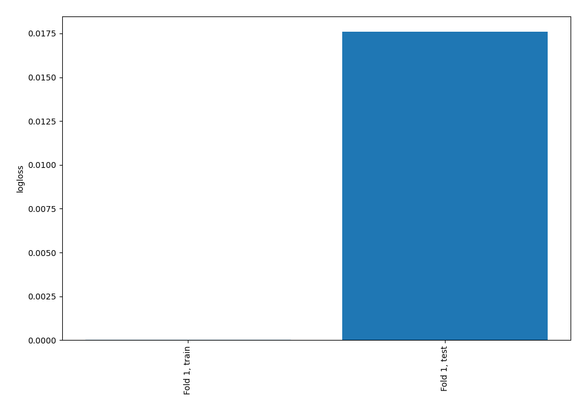
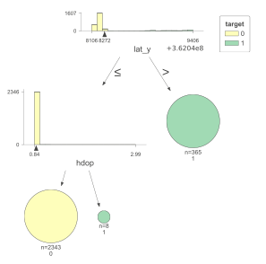
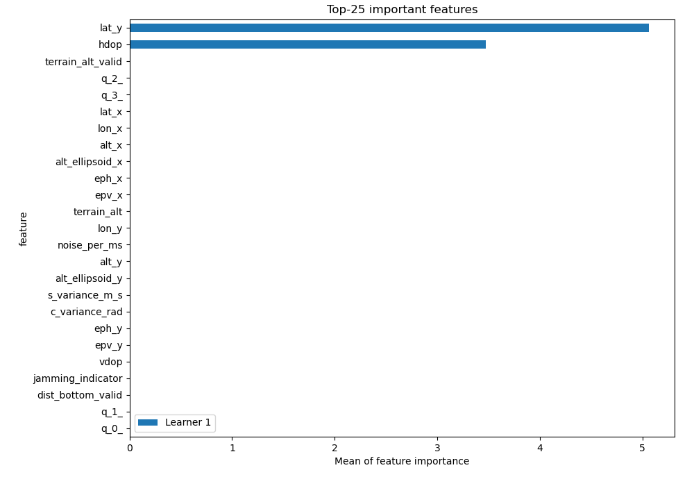
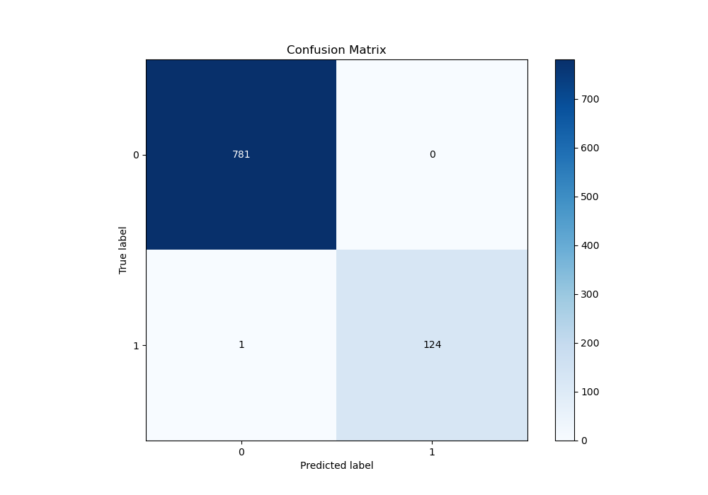
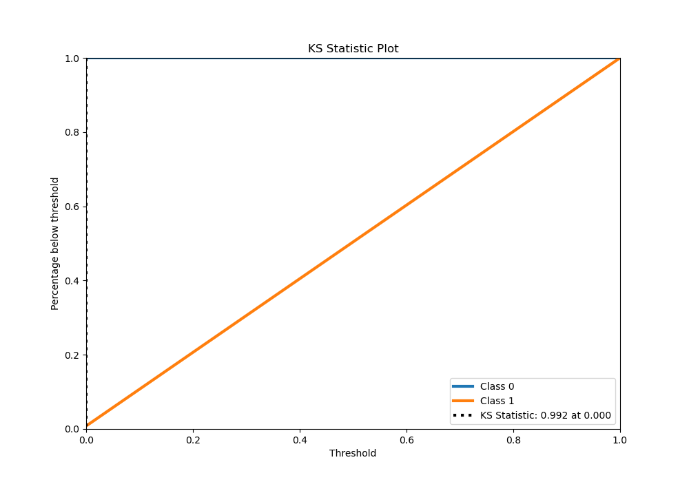
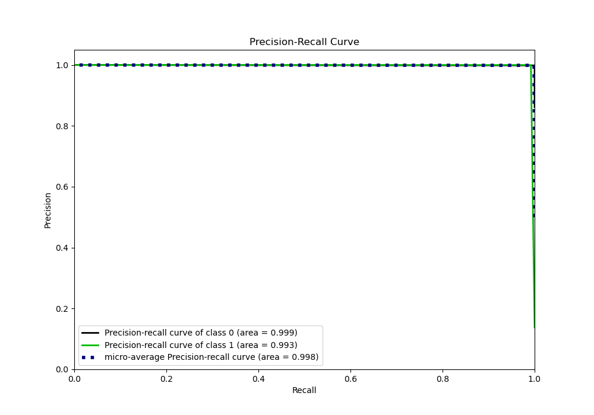
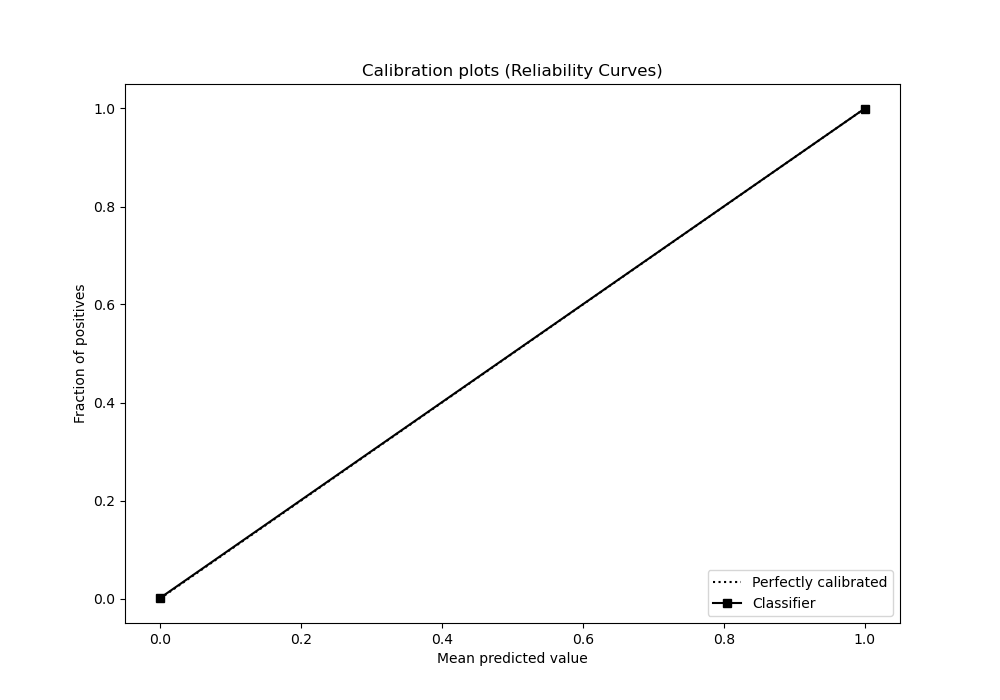
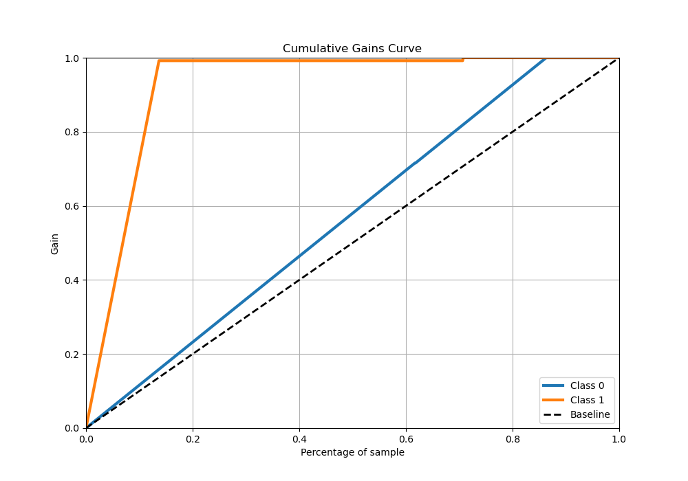
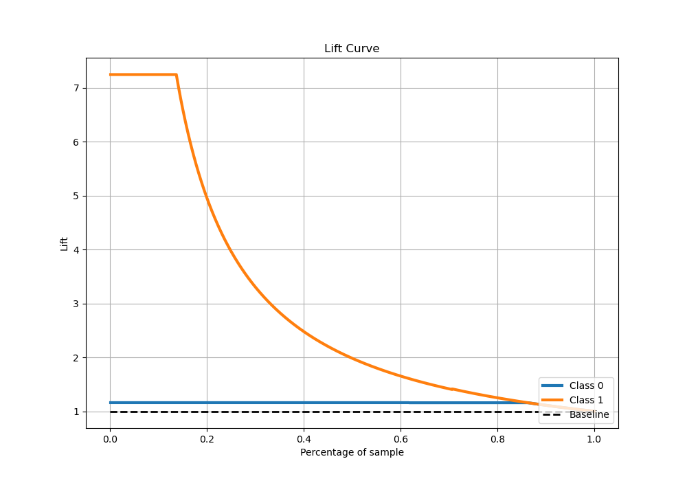

# Summary of 2_DecisionTree

[<< Go back](../README.md)

## Decision Tree
- **n_jobs**: -1
- **criterion**: gini
- **max_depth**: 4
- **explain_level**: 2

## Validation
 - **validation_type**: split
 - **train_ratio**: 0.75
 - **shuffle**: True
 - **stratify**: True

## Optimized metric
logloss

## Training time

9.9 seconds

## Metric details
|           |     score |   threshold |
|:----------|----------:|------------:|
| logloss   | 0.0175966 |         nan |
| auc       | 0.996     |         nan |
| f1        | 0.995984  |           0 |
| accuracy  | 0.998896  |           0 |
| precision | 1         |           0 |
| recall    | 0.992     |           0 |
| mcc       | 0.995355  |           0 |

## Metric details with threshold from accuracy metric
|           |     score |   threshold |
|:----------|----------:|------------:|
| logloss   | 0.0175966 |         nan |
| auc       | 0.996     |         nan |
| f1        | 0.995984  |           0 |
| accuracy  | 0.998896  |           0 |
| precision | 1         |           0 |
| recall    | 0.992     |           0 |
| mcc       | 0.995355  |           0 |

## Confusion matrix (at threshold=0.0)
|              |   Predicted as 0 |   Predicted as 1 |
|:-------------|-----------------:|-----------------:|
| Labeled as 0 |              781 |                0 |
| Labeled as 1 |                1 |              124 |

## Learning curves

## Decision Tree 

### Tree #1

### Rules

if (lat_y <= 362048272.0) and (hdop <= 0.876) then class: 0 (proba: 100.0%) | based on 2,343 samples

if (lat_y > 362048272.0) then class: 1 (proba: 100.0%) | based on 365 samples

if (lat_y <= 362048272.0) and (hdop > 0.876) then class: 1 (proba: 100.0%) | based on 8 samples

## Permutation-based Importance

## Confusion Matrix

## Normalized Confusion Matrix

## ROC Curve

## Kolmogorov-Smirnov Statistic

## Precision-Recall Curve

## Calibration Curve

## Cumulative Gains Curve

## Lift Curve

[<< Go back](../README.md)
