# Summary of 3_Linear

[<< Go back](../README.md)

## Logistic Regression (Linear)
- **n_jobs**: -1
- **explain_level**: 2

## Validation
 - **validation_type**: split
 - **train_ratio**: 0.75
 - **shuffle**: True
 - **stratify**: True

## Optimized metric
logloss

## Training time

5.4 seconds

## Metric details
|           |      score |     threshold |
|:----------|-----------:|--------------:|
| logloss   | 0.00168599 | nan           |
| auc       | 1          | nan           |
| f1        | 0.995025   |   0.066965    |
| accuracy  | 0.998621   |   0.066965    |
| precision | 1          |   0.999006    |
| recall    | 1          |   3.29163e-06 |
| mcc       | 0.994241   |   0.066965    |

## Metric details with threshold from accuracy metric
|           |      score |   threshold |
|:----------|-----------:|------------:|
| logloss   | 0.00168599 |  nan        |
| auc       | 1          |  nan        |
| f1        | 0.995025   |    0.066965 |
| accuracy  | 0.998621   |    0.066965 |
| precision | 0.990099   |    0.066965 |
| recall    | 1          |    0.066965 |
| mcc       | 0.994241   |    0.066965 |

## Confusion matrix (at threshold=0.066965)
|              |   Predicted as 0 |   Predicted as 1 |
|:-------------|-----------------:|-----------------:|
| Labeled as 0 |              624 |                1 |
| Labeled as 1 |                0 |              100 |

## Learning curves
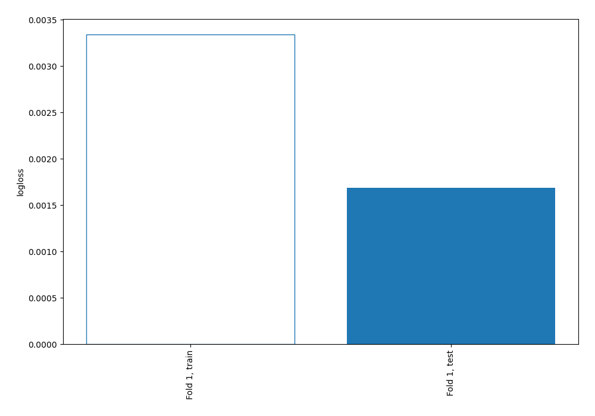

## Coefficients
| feature           |    Learner_1 |
|:------------------|-------------:|
| vdop              |  1.73178     |
| hdop              |  1.23874     |
| lat_y             |  1.19694     |
| jamming_indicator |  0.975933    |
| lat_x             |  0.970651    |
| x                 |  0.970433    |
| s_variance_m_s    |  0.79396     |
| vel_n_m_s         |  0.772186    |
| q_0_              |  0.749893    |
| alt_y             |  0.699389    |
| alt_ellipsoid_y   |  0.698987    |
| vel_m_s           |  0.598714    |
| eph_x             |  0.473716    |
| dist_bottom       |  0.327795    |
| alt_x             |  0.299105    |
| heading_y         |  0.280782    |
| ay                |  0.199396    |
| z                 |  0.170482    |
| alt_ellipsoid_x   |  0.138343    |
| eph               |  0.123343    |
| epv_x             |  0.109713    |
| vy                |  0.099368    |
| terrain_alt       |  0.0620976   |
| lon_x             |  0.0290657   |
| q_1_              |  0.000141255 |
| q_2_              | -0.013814    |
| vx                | -0.025285    |
| noise_per_ms      | -0.0653756   |
| eph_y             | -0.0868026   |
| vel_d_m_s         | -0.0937576   |
| terrain_alt_valid | -0.0945305   |
| dist_bottom_valid | -0.0945585   |
| xy_valid          | -0.112731    |
| v_xy_valid        | -0.112731    |
| evv               | -0.178746    |
| z_deriv           | -0.181956    |
| epv_y             | -0.194905    |
| lon_y             | -0.263134    |
| vel_e_m_s         | -0.355033    |
| evh               | -0.377289    |
| vz                | -0.433021    |
| az                | -0.531932    |
| y                 | -0.689958    |
| cog_rad           | -0.702935    |
| q_3_              | -0.721261    |
| epv               | -0.820811    |
| ax                | -0.892128    |
| c_variance_rad    | -1.00334     |
| satellites_used   | -1.86428     |
| intercept         | -3.447       |

## Permutation-based Importance
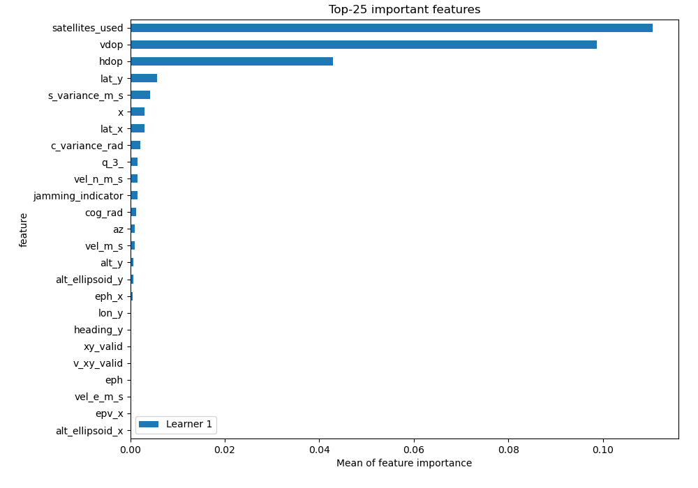
## Confusion Matrix

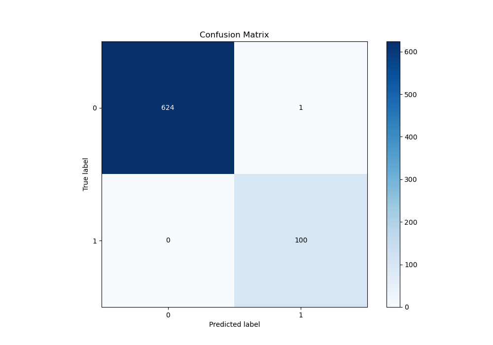

## Normalized Confusion Matrix

## ROC Curve

## Kolmogorov-Smirnov Statistic

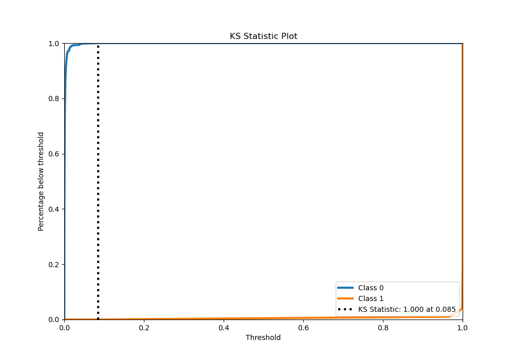

## Precision-Recall Curve

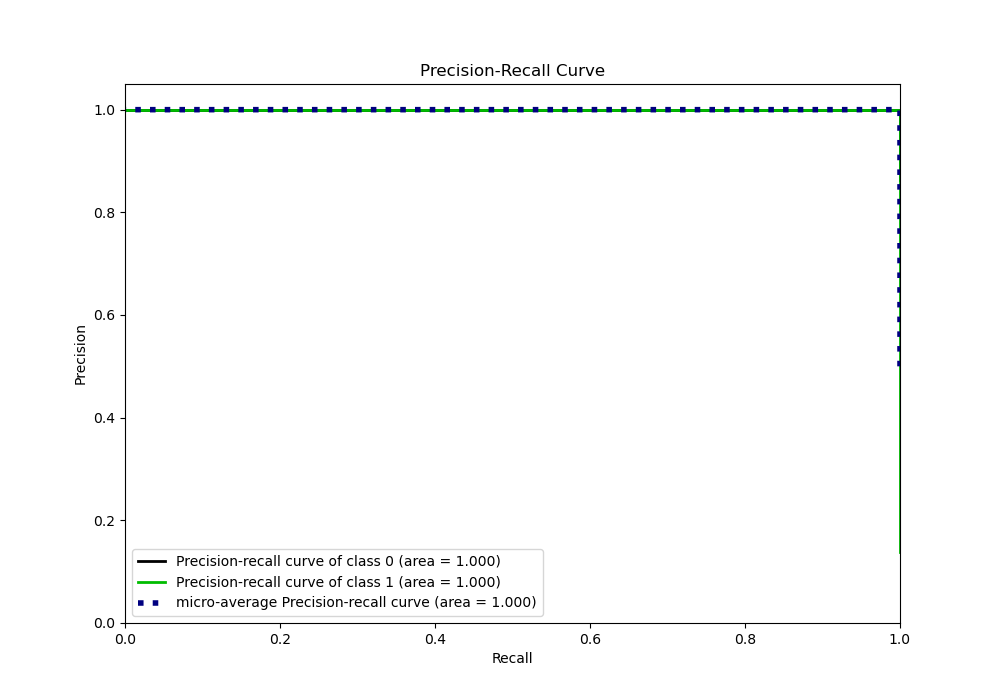

## Calibration Curve

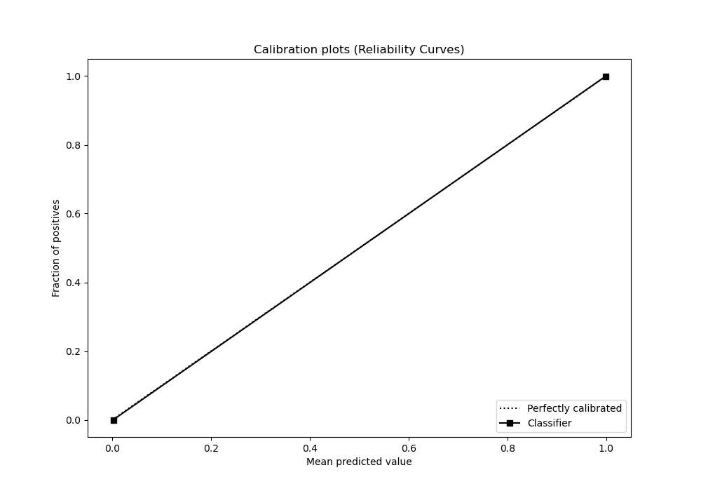

## Cumulative Gains Curve

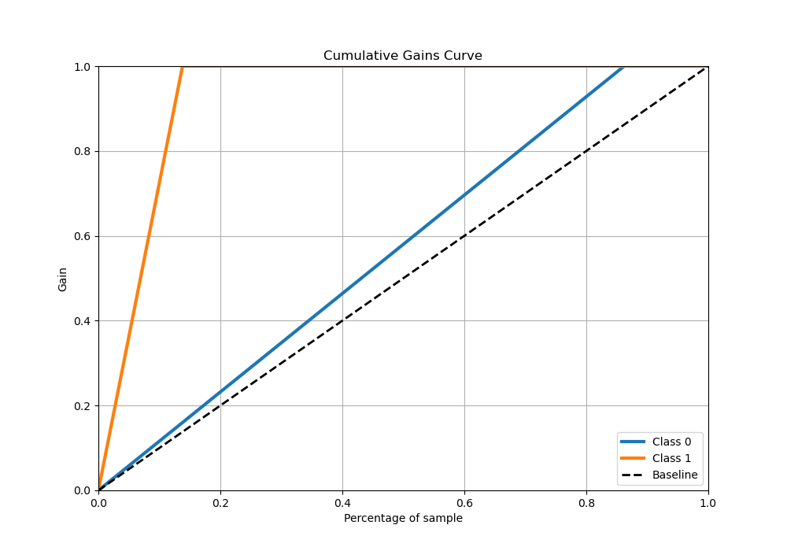

## Lift Curve

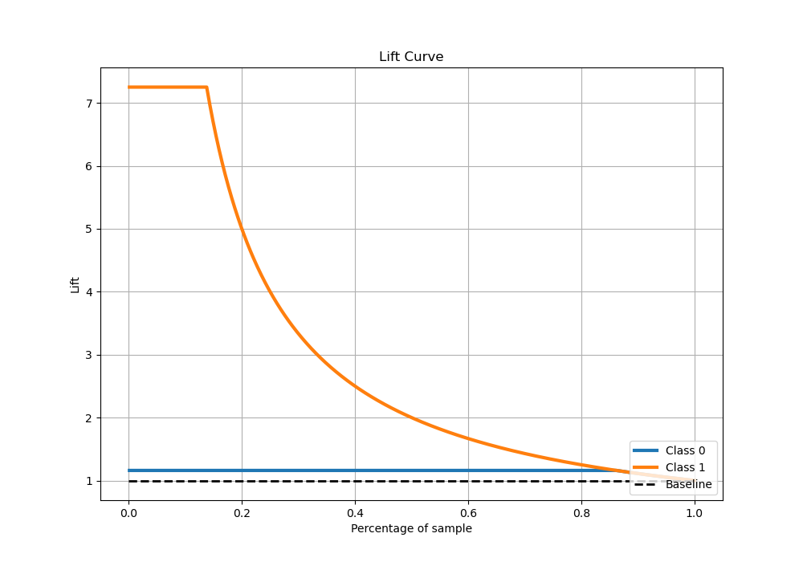

## SHAP Importance
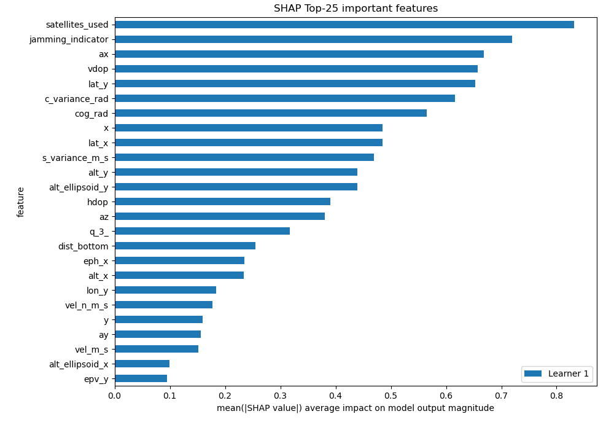

## SHAP Dependence plots

### Dependence (Fold 1)
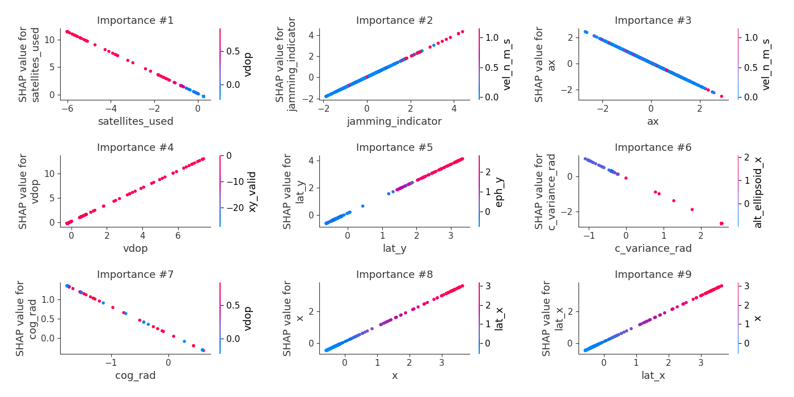

## SHAP Decision plots

### Top-10 Worst decisions for class 0 (Fold 1)
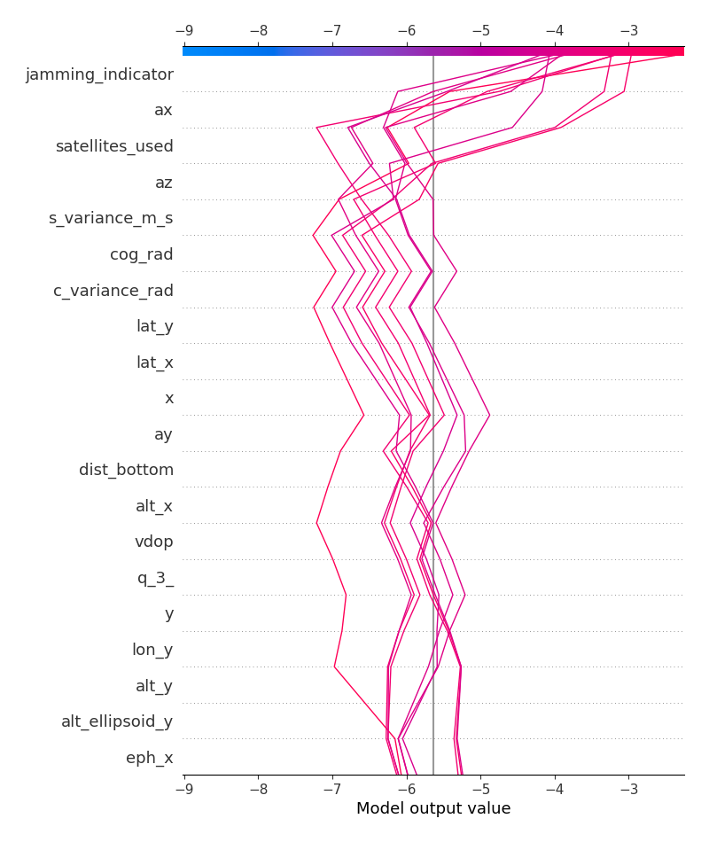
### Top-10 Best decisions for class 0 (Fold 1)
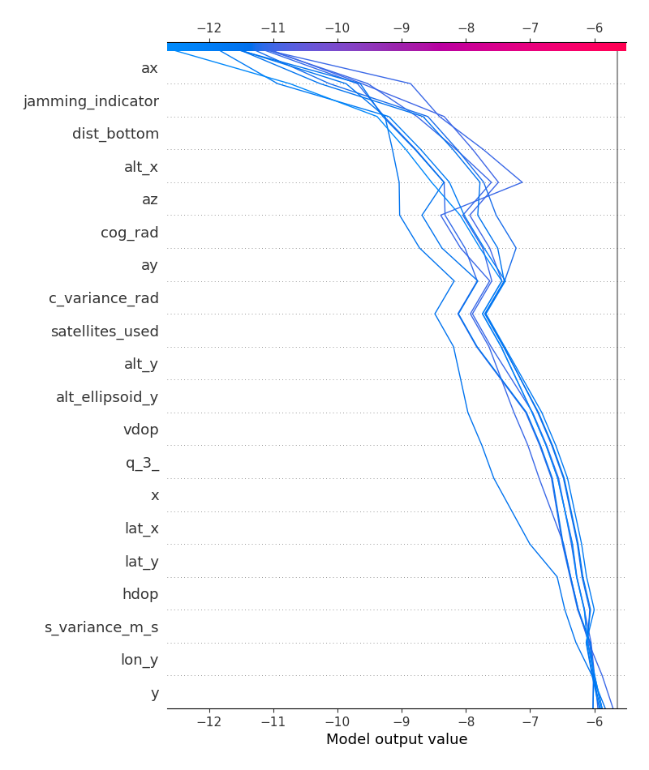
### Top-10 Worst decisions for class 1 (Fold 1)
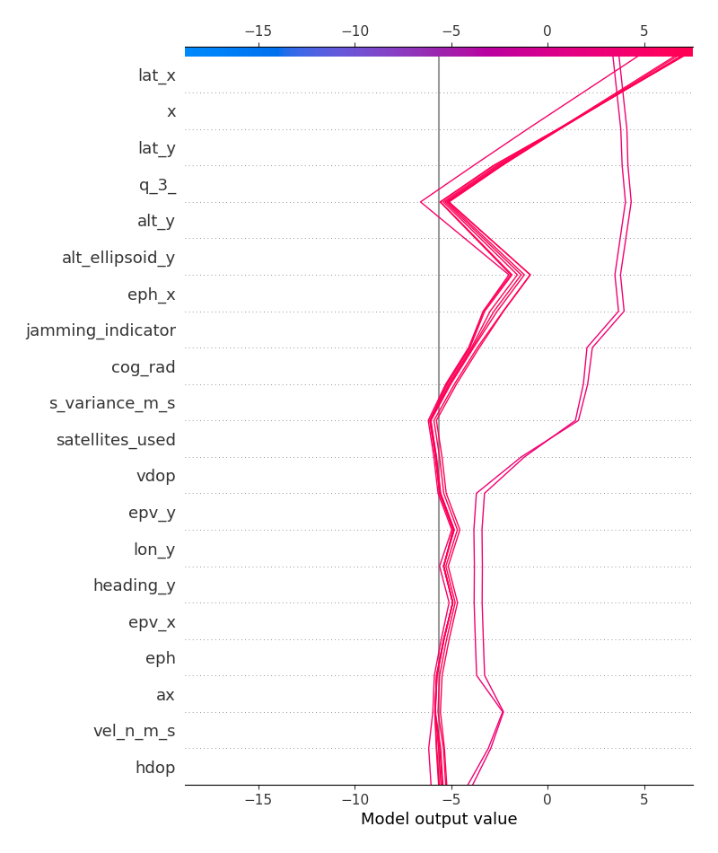
### Top-10 Best decisions for class 1 (Fold 1)
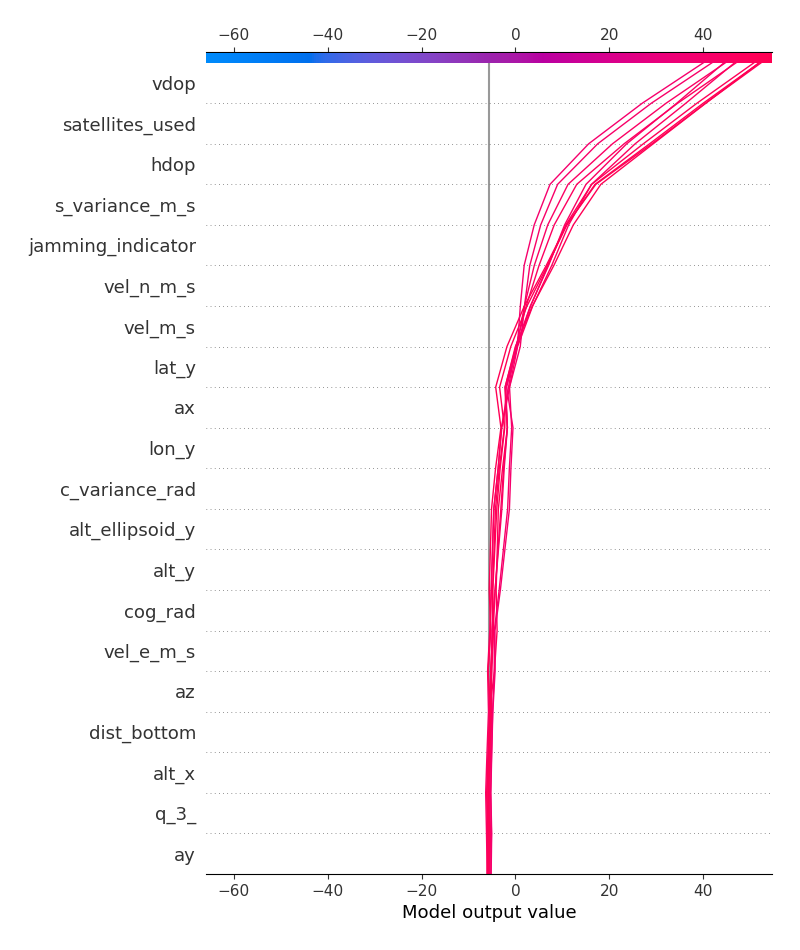

[<< Go back](../README.md)
