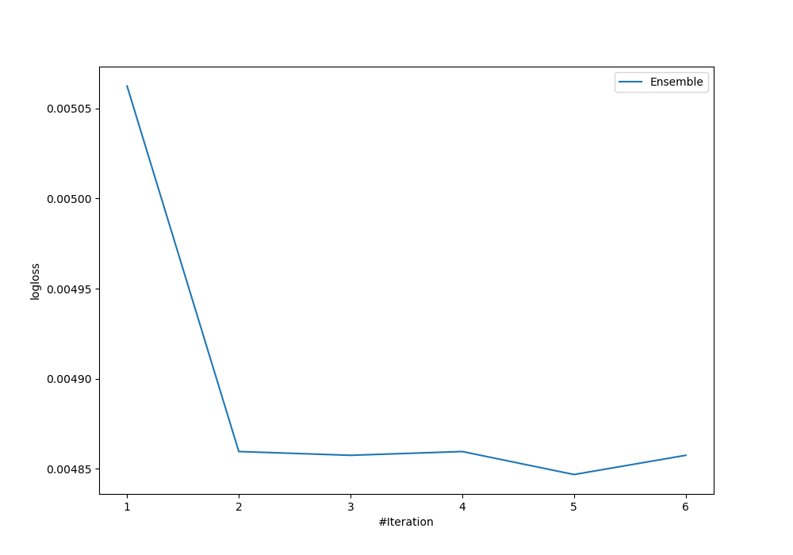
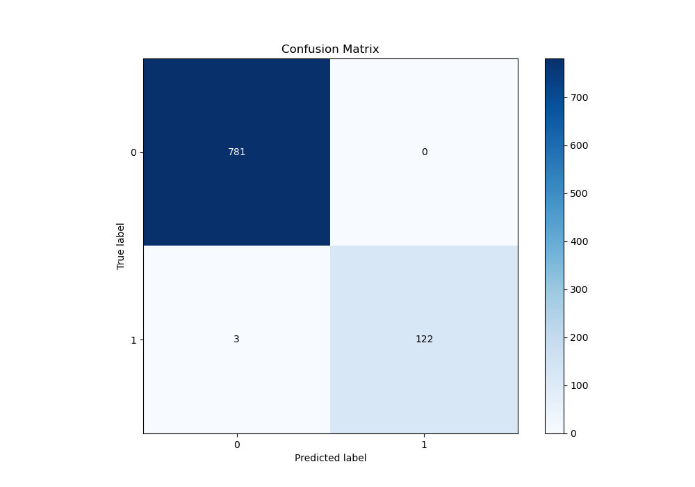
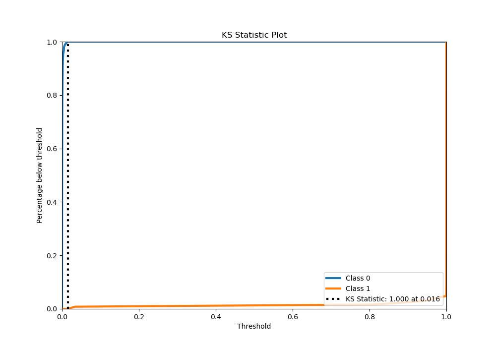
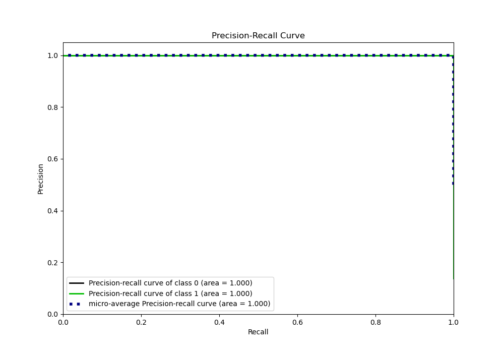
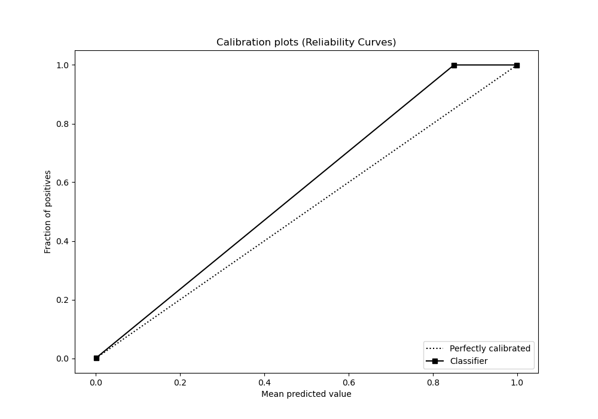
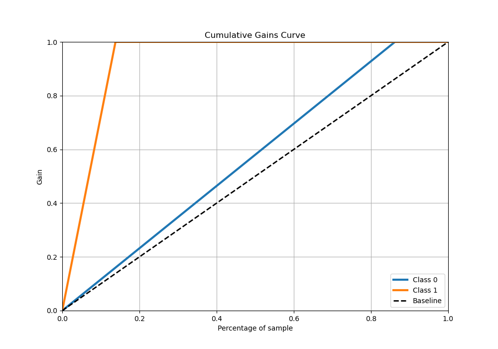
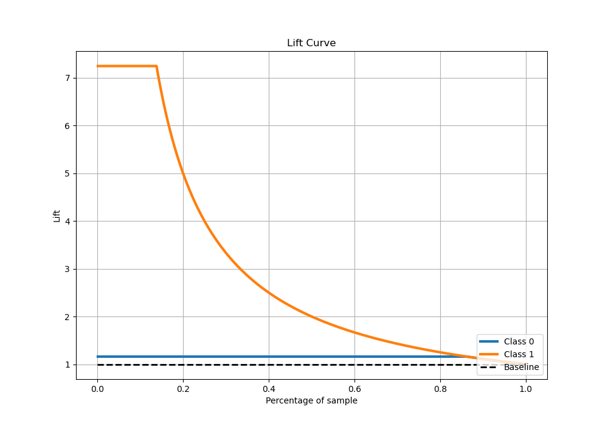

# Summary of Ensemble

[<< Go back](../README.md)

## Ensemble structure
| Model          |   Weight |
|:---------------|---------:|
| 2_DecisionTree |        2 |
| 3_Linear       |        3 |

## Metric details
|           |      score |     threshold |
|:----------|-----------:|--------------:|
| logloss   | 0.00484688 | nan           |
| auc       | 1          | nan           |
| f1        | 0.987854   |   0.923621    |
| accuracy  | 0.996689   |   0.923621    |
| precision | 1          |   0.923621    |
| recall    | 1          |   3.64796e-06 |
| mcc       | 0.986035   |   0.923621    |

## Metric details with threshold from accuracy metric
|           |      score |   threshold |
|:----------|-----------:|------------:|
| logloss   | 0.00484688 |  nan        |
| auc       | 1          |  nan        |
| f1        | 0.987854   |    0.923621 |
| accuracy  | 0.996689   |    0.923621 |
| precision | 1          |    0.923621 |
| recall    | 0.976      |    0.923621 |
| mcc       | 0.986035   |    0.923621 |

## Confusion matrix (at threshold=0.923621)
|              |   Predicted as 0 |   Predicted as 1 |
|:-------------|-----------------:|-----------------:|
| Labeled as 0 |              781 |                0 |
| Labeled as 1 |                3 |              122 |

## Learning curves

## Confusion Matrix

## Normalized Confusion Matrix

## ROC Curve

## Kolmogorov-Smirnov Statistic

## Precision-Recall Curve

## Calibration Curve

## Cumulative Gains Curve

## Lift Curve

[<< Go back](../README.md)
