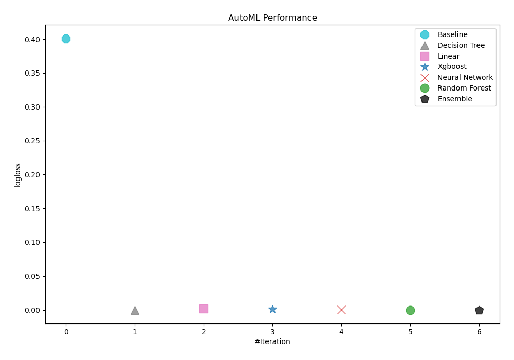
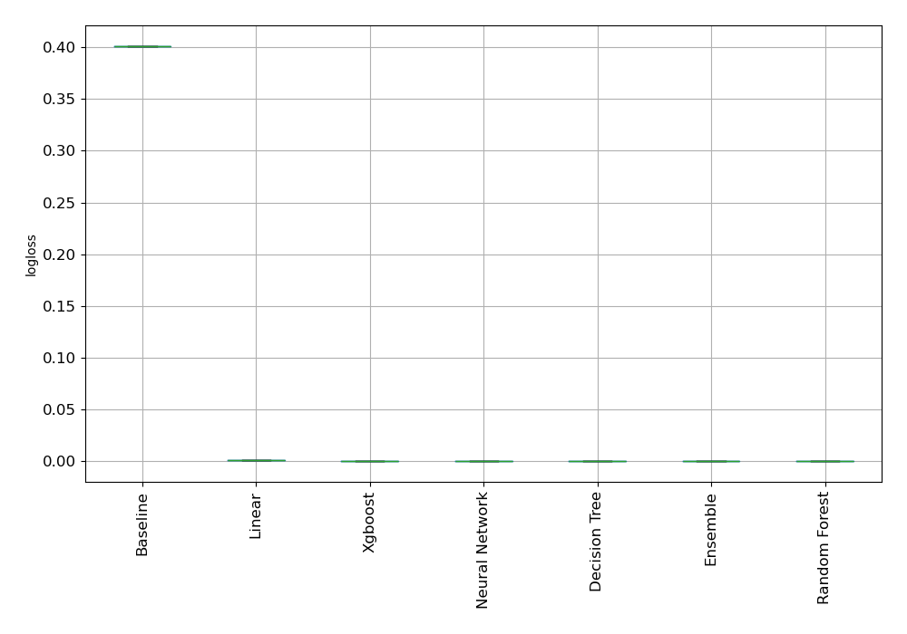
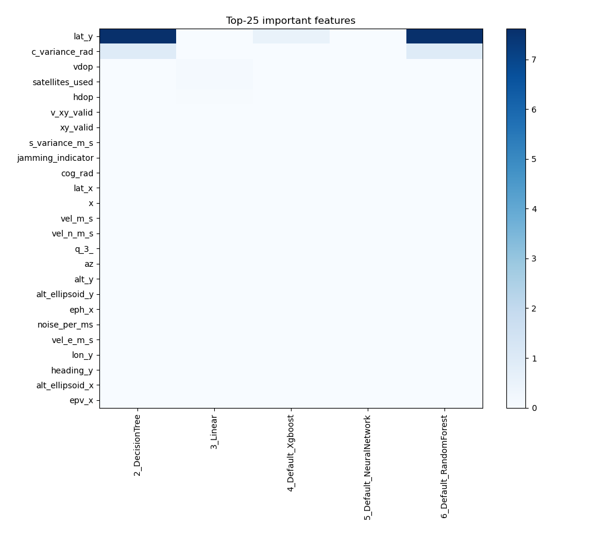
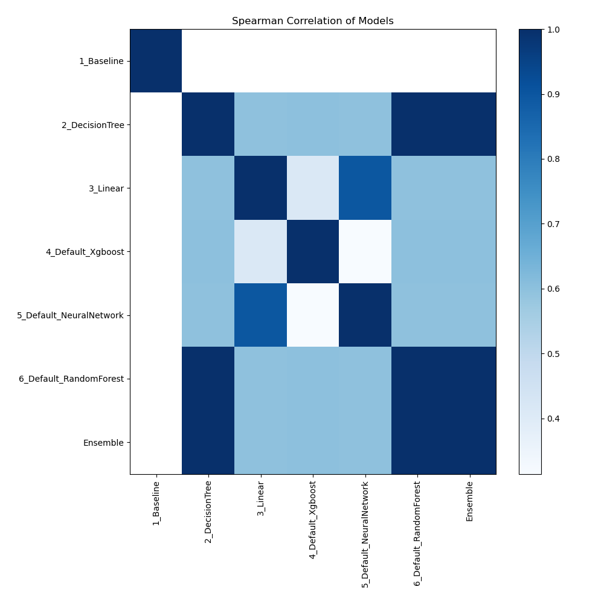

# AutoML Leaderboard

| Best model   | name                                                         | model_type     | metric_type   |   metric_value |   train_time |
|:-------------|:-------------------------------------------------------------|:---------------|:--------------|---------------:|-------------:|
|              | [1_Baseline](1_Baseline/README.md)                           | Baseline       | logloss       |    0.401192    |         0.99 |
| **the best** | [2_DecisionTree](2_DecisionTree/README.md)                   | Decision Tree  | logloss       |    1.19209e-07 |        13.98 |
|              | [3_Linear](3_Linear/README.md)                               | Linear         | logloss       |    0.00168599  |         6.45 |
|              | [4_Default_Xgboost](4_Default_Xgboost/README.md)             | Xgboost        | logloss       |    0.000817675 |         6.97 |
|              | [5_Default_NeuralNetwork](5_Default_NeuralNetwork/README.md) | Neural Network | logloss       |    7.1652e-05  |         3.27 |
|              | [6_Default_RandomForest](6_Default_RandomForest/README.md)   | Random Forest  | logloss       |    1.19209e-07 |         3.7  |
|              | [Ensemble](Ensemble/README.md)                               | Ensemble       | logloss       |    1.19209e-07 |         1.84 |

### AutoML Performance

### AutoML Performance Boxplot

### Features Importance

### Spearman Correlation of Models

